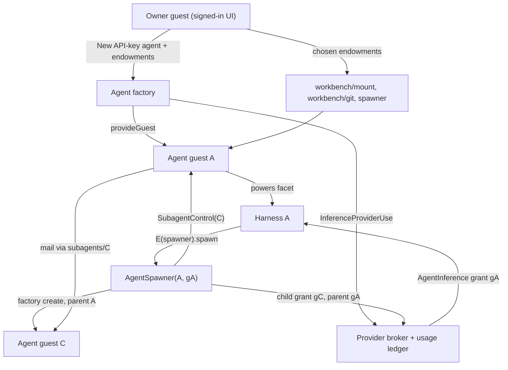

# The API-key agent workbench: endowments, budgeted subagents, and git-VFS tools

| | |
|---|---|
| **Created** | 2026-10-27 |
| **Updated** | 2026-10-30 |
| **Author** | kriscendobot (prompted) |
| **Status** | Proposed. Leaving Proposed requires answers to open question 3 (what backs the workbench mount on minion.town) and open question 6 (whether one agent may spend another's grant by forwarding it) |
| **Provider design** | [API-key inference providers and pinned guest agents](api-key-inference-providers-and-pinned-agents.md) (PR [#1543](https://github.com/endojs/endo-but-for-bots/pull/1543)) |
| **Companion** | minion.town `designs/agent-chat-clip.md` (the chat Clip), under review in [kriscendobot/minion.town#228](https://github.com/kriscendobot/minion.town/pull/228) |
| **Grounded against** | `endojs/endo-but-for-bots` `llm` at `844ce3df7b`, and the #1543 head `069b429c16` (which folds in the maintainer's answers to #1543's open questions), this PR's frozen base. The in-repo claims below were rechecked at that base by reading the code and design text; none was verified by execution. Four code claims drive design choices and are unverified until the gating tests run, before any phase starts (§ Phased implementation, *Gating checks*): the `glorp` signature and its `grep(glob)` equality; that no guard exposes `EndoMount.edit`; that `provideSubMount(mount, path, name, { readOnly: true })` yields a searchable read-only `EndoMount`; and that the daemon holds an exclusive lock on its state directory (the broker lease relies on it). None of the chat-Clip behavior is verified; W6 is its only real-execution evidence |

## What is the Problem Being Solved?

The provider design lets a minion.town owner import an API key, create a Lal or Fae agent (the daemon's two agent harnesses, `packages/lal` and `packages/fae`) pinned to a dedicated guest, and message it.
The maintainer's scenario (kriskowal, 2026-10-27, arc tracker [minion.town#227](https://github.com/kriscendobot/minion.town/issues/227)) extends that into a working environment:

1. When the owner creates an agent, they give it **endowments** chosen from their inventory.
2. One endowment can be a **token-budgeted subagent spawner**.
   With it, an agent creates subagents, splits its token budget and endowments among them, converses with them, and holds a **control facet** for each delegation (pause, resize the budget, revoke).
3. Agents work in a **git virtual file system** through tools that mostly exist already: grep, glob, glorp, exact-string edit, and the git reader and writer.
   Hashline reads and edits, which anchor each line by a short hash of its content (`packages/daemon/src/hashline.js`), are new wiring over existing code.
   Bounded line reads are a small new method.
4. All of this runs behind a chat conversation surface integrated as a **Clip**, a sandboxed web page that minion.town hosts.
   The chat Clip is the minion.town companion design's, not this design's.

This design builds on the **provider design**, [api-key-inference-providers-and-pinned-agents](api-key-inference-providers-and-pinned-agents.md) (PR #1543, not merged), and assumes all of its phases are unbuilt.
It proposes one edit to the provider design, naming the broker's admission serialization, and W3 is gated on that edit landing (§ Budget, *Serialization and the broker lease*).
The spawner fills the subagent-creation slot the provider design leaves to this design ([§ Explicit endowment](api-key-inference-providers-and-pinned-agents.md#explicit-endowment)).

**Terms.**
An **owner** is a signed-in minion.town user who has imported an API key; the key is held by a **broker** (one per provider, all of one owner's brokers in one vat), which makes every upstream call and records each call's cost as a row in one **usage ledger**.
An **agent** is a Lal or Fae harness running as its own daemon **guest** (a confined identity with its own pet store), and it is **pinned**: a responder answers its mail.
A **grant** is an agent's right to spend through the broker, up to limits (models, rates, a budget per period); the agent reaches it through an `AgentInference` capability that names no key.
An **endowment** is a capability the owner hands the agent at creation, under a fixed name in the agent's pet store; the agent's tools are derived from what it holds.
A **spawner** is the capability with which an agent creates child agents whose grants are carved from its own, and a **workbench** is a bundle of file and git tools.

## Capability graph

Read the graph top to bottom: each arrow is a capability handed from its source to its target, labeled by what is handed.
The owner creates agent A with endowments; A's harness calls the spawner, which asks the factory and the broker to create child C with a child grant, and hands A the control for C.



## Reuse inventory

Each capability below comes from a design that already exists, and this design adds no parallel mechanism.
The Roadmap column is the milestone on [`README.md`](README.md) § Roadmap; M3 is the client-side-bridge milestone, where the provider design sits.

| Capability | Supplied by | Roadmap | Delta this design needs |
|---|---|---|---|
| Key custody, per-agent grant, reservation and settlement, the usage ledger | [api-key-inference-providers-and-pinned-agents](api-key-inference-providers-and-pinned-agents.md) | M3 | Child grants and ancestor-chain admission ([§ Budget](#budget-a-child-grant-is-an-attenuation-of-its-parents-grant)) |
| Attenuating a grant into a limited share with an admin facet | [hosted-agent-subscriptions](hosted-agent-subscriptions.md) § Delegation (`attenuate(limits) -> { share, admin }`, `provideSubscriptionShare`) | M3 | Apply the same limits/admin split to durable `InferenceGrantRecord`s |
| Agent guest, `@pins` responder, wake, reconciler | Provider design [§ Agent creation, wake, and deletion operations](api-key-inference-providers-and-pinned-agents.md#agent-creation-wake-and-deletion-operations); [daemon-guest-bot-incarnation](daemon-guest-bot-incarnation.md) (Implemented) | M3 | A `parentAgentId` on `AgentRecord`; new operation kinds `endow`, `grant-workbench`, and `grant-spawner` |
| Spawn, ask, and stop a subagent | Fae `SubagentSpawnerInterface` and `makeSubagentTools` / `makeSubagentDelegations` (`packages/fae/src/subagent.js`, `packages/fae/SUBAGENTS.md`); the subagents of [floot-daemon-owned-turns](floot-daemon-owned-turns.md) | not on roadmap (Complete) | Make the factory the spawner, so a child is a parent-design agent with its own grant |
| Splitting the control facet from the child facet | [endo-reminder](endo-reminder.md) § Delegation and attenuation: agent to subagent, the Mode B paragraph (`ReminderScheduler` / `ReminderControl`) | M3 | Same split, applied to agents |
| Turn interrupt compared with emergency stop | [hosted-agent-sandbox-unification](hosted-agent-sandbox-unification.md) § One binding vocabulary (its `lifecycle` states table) | M10 | Pause = no new turns; revoke = stop now |
| Endowment picker | [chat-inventory-create-menu](chat-inventory-create-menu.md) § Pane 3: Endowment selection | M9 | Proposed for reuse as an optional third step of **New API-key agent** (companion design; this design's open question 5) |
| Reply-chain transcript per conversation | [lal-reply-chain-transcripts](lal-reply-chain-transcripts.md) (Complete) | M1 | None |
| Streaming a reply | [daemon-message-streaming](daemon-message-streaming.md) (Complete: `editMessage`, `done`) | n/a | The responder streams harness text deltas through `editMessage` |
| Mount, search, writes | `EndoMount` (`packages/daemon/src/interfaces.js`): `glob`, `grep`, `glorp`, `readText`, `writeText`, `list`, `stat`, `subView`; the host's `provideSubMount`; [mount-stream-glob-grep](mount-stream-glob-grep.md) | M3 | None. A read tier binds a read-only sub-mount derived with the host's existing `provideSubMount(mount, path, name, { readOnly: true })`, which is a full searchable `EndoMount`; the `readOnly()` view is not used, because it narrows to `has`, `list`, `listTree`, and `lookup` ([§ The workbench](#the-workbench-vfs-tool-bundle)) |
| Exact-string edit | [endopi-edit-tool](endopi-edit-tool.md) (lal `editText`, fae `edit`) | M3 | None |
| Hashline edit | `packages/daemon/src/hashline.js` (parser, validator, renderer, splice); [cli-edit-verb](cli-edit-verb.md) | M3 | Wire `EndoMount.edit`, which the `hashline.js` header promises and no guard exposes yet, and add `readHashlines` (new) |
| Git | `@endo/exo-git` reader, then writer, then rewriter facets (each wider than the last); [daemon-git-capability](daemon-git-capability.md), [daemon-git-next-steps](daemon-git-next-steps.md), [agentry-git-verb-gaps](agentry-git-verb-gaps.md) | M3 | None. The bundle picks a tier |
| Bounded reads | Asked for by [agentry-git-eval-scenarios](agentry-git-eval-scenarios.md) | M3 | `readLines(path, { offset, limit })` |
| Tool catalog from held facets | [endo-agent-tools](endo-agent-tools.md), [daemon-agent-tools](daemon-agent-tools.md) | M3 | Register the bundle's tools in Lal (`packages/lal/tools/fs.js`) and Fae (`packages/fae/setup-fs-tools.js`) |

**"Glorp".**
`glorp` is the fused glob-plus-grep method on `EndoMount`.
Its signature is `glorp(globPattern, grepPattern, { maxResults?, followSymlinks? })`, and it returns `Array<{ file, line, text }>`.
Its result equals `grep(grepPattern, glob(globPattern))`, and no design document owns it.
The workbench depends only on the shipped signature and the `grep(glob)` equality, and the model-facing tool description calls it "glob plus grep".

## Endowments at creation

The provider design fixes an agent's guest powers by the harness's powers profile, and allows exactly one endowment beyond it: the subagent-creation capability, which the creation request names (the pre-checked **Can create subagents** box) and which the factory adds only when named (provider design [§ Explicit endowment](api-key-inference-providers-and-pinned-agents.md#explicit-endowment)).
The provider design leaves both that capability and endowing anything else from the owner's inventory to this design.
This design adds an **endowment set**, which is a list of capabilities the owner introduces into the agent guest under fixed names, and makes the spawner the provider design's subagent-creation capability.
The harness's tool catalog is derived from what the guest holds, as the provider design's confinement table already requires.

- **Operation: `endow` copies values the owner holds.**
  The factory gains an `AgentOperation` kind, `endow`.
  Its request is one list of endowments to set and one list of names to remove:
  `{ set: [{ as, from }], remove: [as] }`.
  A name that appears in both lists is refused with `endowment-conflict`, so the order of the two lists never matters.
  `remove` is also how a minted bundle is withdrawn: `remove: ['workbench']` deletes `endowments/workbench`.
  Each entry resolves the owner pet name `from` **through the owner guest's own powers** (`E(ownerGuest).lookup`), so the owner can endow only what the owner holds, and writes the value into the agent guest under `endowments/<as>`.
  A refusal names the offending entry's `as` and its owner pet name `from`.
  The operation is idempotent under the provider design's rules.
  Creation with endowments is a `create` followed by an `endow`, both under one client idempotency key.
  This is the `introducedNames` mechanism ([lal-fae-form-provisioning](lal-fae-form-provisioning.md)), driven by the factory instead of by a manager guest that holds the host (that is, one with the host's full authority).
- **Operations: `grant-workbench` and `grant-spawner` mint new authority.**
  Minting is a different act from copying, so it gets its own operations rather than a variant of `endow`.
  `grant-workbench` mints a workbench (§ The workbench) from the owner's chosen mount, git tier, and subtree root, which are themselves resolved through the owner's powers.
  `grant-spawner` mints a spawner bound to this agent and its grant (§ The budgeted spawner), as `spawn` already binds a child.
  Each writes its value under a fixed name, `endowments/workbench` or `endowments/spawner`, and is idempotent under the provider design's rules.
  So an agent holds at most one workbench and one spawner.
  A second `grant-workbench` with different options replaces the first (the old formula is dropped and its tools vanish at the next turn); a second `grant-spawner` with different options is refused with `spawner-exists`, because the spawner's children are bound to it, and the owner changes the limits behind a spawner with the provider design's `set-limits` on the agent's own grant instead.
  Withdrawal is not a third verb: copied and minted endowments are both withdrawn by `endow` with `remove`, because withdrawal only deletes a name, whatever put it there.
  The add side has two verbs and the remove side one, so the agent detail view hides the asymmetry: every endowment, copied or minted, is listed with one **Remove** action, and the view issues `endow { remove }` for each.
  Because a spawner is created only by `grant-spawner` or by `spawn` with `allowSpawn`, "a spawner bound to this agent's grant" holds by construction, not by inspecting what the owner passes.
  A creation request that names the provider design's subagent-creation endowment runs `grant-spawner` under the creation's idempotency key, after `create` and before any `endow`; a request that omits it (the box unchecked) mints no spawner, and the server adds none by default, as the provider design requires.
  The owner can add one later from the agent detail view with `grant-spawner`.
- **No type-based endowment filter.**
  See [§ Forwarded authority](#forwarded-authority-no-type-based-endowment-filter).
- **Durability.**
  An endowment must be a formula the daemon can name.
  Ephemeral remotables are refused with `endowment-not-durable`.
  Fae's spawner applies the same rule.
- **Source of truth.**
  The factory's `AgentRecord` endowment list is the intent and is authoritative.
  The `endowments/<as>` names in the agent guest's pet store are a projection of it.
  After a crash between the two writes, the factory's reconciler rewrites the projection to match the record.
- **Bundles.**
  The two minted bundles are the **workbench** ([§ The workbench](#the-workbench-vfs-tool-bundle)) and the **spawner** ([§ The budgeted spawner](#the-budgeted-spawner-and-the-subagent-control-facet)).
  The owner chooses them as options in the endowments step, which issues the matching `grant-*` operation.
  Each is a factory formula whose only state is the ids it binds, the same pattern as `AgentInference` (provider design [§ Durable grant identity](api-key-inference-providers-and-pinned-agents.md#durable-grant-identity)).

## Budget: A child grant is an attenuation of its parent's grant

A child's spend is recorded in the provider design's one usage ledger, by its one writer, the broker; there is no second ledger.

**A worked example.**
The numbers are illustrative.
The owner creates agent P with grant `gP`: a budget of 100,000 tokens a day and a parent reserve of 10,000.
P spawns children A and B, each with a cap of 60,000; together they exceed P's cap, which is allowed (oversubscription, below).
Every turn's worst-case reservation is 5,000.

1. A asks for a turn.
   The broker checks A's own cap (0 of 60,000 used) and P's subtree (0 of 100,000 used, and 95,000 left after the reservation, which is above P's reserve of 10,000).
   It admits the turn and writes one ledger row with `grantPath` `gP/gA/` and 5,000 reserved.
2. The turn settles at 3,000; the same row now records 3,000.
3. Later, A has used 55,000 and B 30,000, so P's subtree has used 85,000.
   B asks again: 85,000 plus 5,000 leaves exactly the 10,000 reserve, so the turn is admitted.
   B's next ask would leave 5,000, below the reserve, so it is deferred for budget.
   P's own turn may spend into the reserve, so P can still run the turn that decides what to do.
4. P calls `pause()` on A's control.
   A's grant becomes `paused`; A's next admission is deferred with `paused`, and A's turn already in flight settles normally.
5. P calls `revoke()` on B's control.
   B's grant becomes `revoked`, B's in-flight turn is cancelled in the same broker queue entry and charged its 5,000 reservation, marked `estimated`, and B is then deleted.

The rules below are what make each step hold.

- **Record.**
  `InferenceGrantRecord` gains `parentGrantId?`, `grantPath`, and `parentReserve?` (§ The parent reserve), and its `state` gains one value, `'paused'`, so it becomes `'active' | 'paused' | 'revoked'`.
  `grantPath` encodes the grant ids from the root grant down to this one as a string with a trailing separator, `gRoot/gB/gC/`.
  Every row a grant writes, including the rows for its own turns, carries that grant's own `grantPath`, so a prefix match on `a`'s path covers `a`'s own turns and all of its descendants' turns.
  With that encoding, "the path contains ancestor `a`" is exactly "the path starts with `a`'s own `grantPath`", so the subtree test is a true prefix match.
  `parentGrantId` is the canonical ancestry.
  `grantPath` is a denormalized index of it, computed once at creation from the parent's `grantPath` and never rewritten, so the two cannot disagree.
  Limits and `state` are the only mutable fields.
  Because ancestry is immutable, the first release does not move a child to another parent (see `agent-has-delegates` below).
  A child record is created only by the factory, through the broker's `InferenceProviderUse`.
  It is never created through the parent's `AgentInference`, which stays a pure request endpoint.
- **Limits.**
  A child's limits must be at most the parent's limits, field by field: the model allowlist (a subset), the per-turn output cap, the concurrent-turn limit, the request rate, the maximum turn count, the per-turn wall clock, and the token or dollar budget amount.
  The budget's period is not a limit; it is always exactly the parent's period.
  This is the `ShareLimits` shape of [hosted-agent-subscriptions](hosted-agent-subscriptions.md) § Delegation, applied to durable records.
  A `spawn` or `resize` request for limits above the parent's fails with `limits-exceed-parent`.
  The request fails rather than being clamped, so the parent is never handed a smaller grant than it asked for without knowing.
- **Admission is a chain check.**
  For each request on grant `g`, the broker computes the worst-case reservation (provider design [§ Cost and abuse controls](api-key-inference-providers-and-pinned-agents.md#cost-and-abuse-controls)).
  It admits the request only if every grant on `g`'s path is `active`, the reservation fits each one's remaining budget, concurrency, and rate, and, for each strict ancestor `a` of `g`, the reservation leaves at least `a`'s **parent reserve** unspent (§ The parent reserve).
  The reservation row carries `grantPath`.
  "Remaining for ancestor `a`" is `a`'s cap minus the sum of the current period's rows whose `grantPath` starts with `a`'s.
  A wall clock is captured on the reservation row at admission, so a later `resize` of `wallClockSeconds` never extends a turn already admitted.
  Settlement replaces the reservation on the same row.
  A row's `grantPath` is never rewritten: after a `resize` or a revoke, the spend a descendant already made still counts against every ancestor for that period.
- **Rows across a period reset.**
  A row belongs to the budget period in which its reservation was admitted.
  A turn admitted before a reset and settled after it updates its row in the closed period only.
  Its late usage, and any overrun beyond the reservation, are recorded against the closed period and never reduce the new period's budget; the Providers page shows it as a closed-period overrun.
  The 72-hour deferral bound (§ Deferred work under a pause) is measured in wall-clock time and is unaffected by resets.
- **Oversubscription is allowed.**
  The sum of the children's caps may exceed the parent's cap.
  The chain check still stops the subtree at the parent's cap.
  Children compete for the parent's remaining budget first come, first served, in the order the owner's admission queue admits them.
- **The parent reserve.**
  The parent's own turns draw from the same remaining budget as its subtree, and the parent's coordination turn is the one that would `pause` or `revoke` a runaway child.
  So every grant that has a spawner carries a `parentReserve`, an amount of its budget its descendants cannot spend.
  The chain check enforces it: a descendant's admission must leave each strict ancestor's remaining budget at or above that ancestor's reserve, while an ancestor's own turns may spend into its reserve.
  The default reserve is two worst-case reservations at the grant's own limits, so the parent can normally run the turn that issues a control call and one more; if that default is more than half the grant's budget amount, it is clamped to half, so children can still be admitted.
  The clamp means a small budget cannot hold both: a spawner-bearing grant needs a budget of at least four worst-case reservations (two for the reserve, two for children), and `grant-spawner` or `allowSpawn` below that is refused with `budget-below-minimum`.
  `grant-spawner` and `allowSpawn` accept a different `parentReserve`, which counts as a limit; one at or above the grant's budget amount is refused with `reserve-exceeds-budget`, because no child could ever be admitted.
  Admission alone makes the reserve best-effort: it is enforced against reservations, so a descendant's settlement that overruns its reservation can still spend into it.
  So the broker also enforces it at settlement, which makes the stop automatic.
  When a settlement of a descendant's row leaves a strict ancestor `a` below its reserve, the same entry commits `paused` on the child of `a` that lies on the overrunning row's path.
  So a runaway subtree stops without waiting for anyone's model turn, and `getStatus()` on that child reports `state: 'paused'` with `pausedBy: 'reserve'`.
  The pause covers that child's whole subtree, including siblings of the overrunning grant under the same child: `a` controls its children, not its grandchildren, and the child is the delegate answerable for its subtree's spend.
  A reserve pause is undone the same way as a control pause, by `resume()` on that child's control (held by `a`) or by the owner, and the 72-hour bound and attempt exemption of § Deferred work under a pause apply to it unchanged.
  `resume()` always commits `active`; it neither re-checks the reserve nor is refused.
  While `a` is still inside its reserve, the resumed subtree's next admission is deferred for budget by the ordinary chain check (`blockedBy: 'budget'`, transient), not re-paused, until the period resets or `a`'s budget is raised; only another overrunning settlement pauses it again.
  The control calls themselves need no budget: `pause`, `resume`, `resize`, and `revoke` are calls on the `SubagentControl`, not inference.
  What can need budget is the parent's own model turn that decides to make one of those calls; the reserve is there for that turn, and the owner's agent-management capability is the path that needs no budget at all (below).
  `getHeadroom()` reports the reserve and the budget available to children after it.
  Holding a reserve per child is still open (open question 2).
  The owner's agent-management capability remains the budget-independent escape hatch, but only for an owner who is present; an unattended tree relies on the automatic reserve pause above.
- **Attribution.**
  Each row still names its own agent and provider, so the Providers page shows per-agent usage.
  A subtree total is the same prefix sum.

### Serialization and the broker lease

**Mechanism.**
The provider design states that admission is atomic at the broker (provider design [§ Cost and abuse controls](api-key-inference-providers-and-pinned-agents.md#cost-and-abuse-controls)) but does not name the mechanism, so this design names it, and the provider design's phase 2 adopts it.
The broker keeps one in-vat promise queue per owner, and every admission, settlement, cancellation, and grant `state` write for any of that owner's providers runs as one entry on it.
The queue is per owner, not per provider, because the provider design's admission reserves against the agent, its provider, and the owner-wide cap atomically, and the owner-wide cap spans all of one owner's providers (provider design [§ Cost and abuse controls](api-key-inference-providers-and-pinned-agents.md#cost-and-abuse-controls), *Aggregation scope*); two per-provider queues could each admit a turn that together overruns it.
An entry reads and writes only the broker's own durable store, in the broker's vat; it makes no `E()` call and awaits nothing remote, so a slow CapTP peer cannot hold the queue.
Each entry commits all of its writes as **one durable store transaction**, so a crash leaves either all of an entry's writes or none of them.
Upstream calls happen after the admission entry has committed its reservation row and returned.
The same holds for cancellation: an entry that cancels turns (`revoke`, or `pause({ cancelInFlight: true })`) commits the charge and marks each row `estimated`, and the broker aborts the upstream requests only after the entry commits.
If an abort fails or the upstream ignores it, the charge stays at the reservation, and any usage the upstream later reports is recorded as an overrun, as for any turn.
The broker retries a failed abort until the turn's wall clock on the row expires, after which it drops the connection.
Every grant in a tree shares one provider, because a child inherits its parent's provider and cannot name another, and every provider in a tree belongs to one owner, so the chain check runs as part of the admission entry: it reads the ancestor sums and the owner-wide sum, checks them, and writes the reservation row in one step.
Two concurrent sibling admissions are two entries, and a settlement is a separate entry, so none of them interleaves with another's read-check-write.
This rests on one assumption, stated here so the implementation cannot drop it: **the brokers for all of one owner's providers run in a single vat**, and the queue is that vat's.
A deployment that split one owner's brokers across vats would need a different serialization mechanism and is out of scope.

**The W3 gate.**
The provider design is unmerged, and its phase 2 could land with a different broker.
So W3 does not start until the provider design's text on `llm` names this per-owner single-vat admission queue.
The W3 builder checks that before writing code and records the commit it read in the W3 pull request; if the text says otherwise, the builder stops and this design is revised first.

**The broker lease.**
The single-vat assumption is checked, not just stated.
On start, the broker vat writes a lease into the owner's `OwnerInferenceLimits` record in the provider registry (the provider design's per-owner place for the owner-wide cap) naming its incarnation: the daemon's process incarnation (a fresh id each time the daemon starts) and the broker vat's incarnation within it.
Every queue entry re-reads that lease inside its own durable transaction and commits only if the lease still names this incarnation; that is one keyed read of one record per entry, inside a transaction the entry opens anyway.
A broker that finds a lease naming the **current** daemon incarnation and a different vat refuses to serve that owner's providers with `broker-not-exclusive`, because a live peer holds it.
A lease naming an **earlier** daemon incarnation is stale by construction, because the daemon holds an exclusive lock on its state directory and so no earlier process can still be running; the new broker takes it over at once, with no timeout.
That lock is an unverified premise (§ Phased implementation, *Gating checks*); if the daemon does not hold one, W3 adds it before the lease.
A broker vat that crashes and is restarted inside the same daemon gets a new vat incarnation, and the daemon's vat supervisor, which saw the old vat terminate, clears the old lease before starting the new one.
So a crash never leaves an owner's providers unservable, and a live broker's lease is never taken.

**Computing the aggregate.**
The ledger rows are the only store the chain check reads; there is no cached per-grant total.
The admission entry walks `parentGrantId` from `g` to the root, which is at most four grants because depth is capped at 3 (§ Abuse controls), and for each one sums the current period's rows whose `grantPath` starts with that grant's.
The same entry also sums the owner-wide total, every current-period row of the owner's providers, which the provider design defines as the sum of the owner's rows in the usage ledger.
The store keys rows by `(ownerId, period, provider, grantPath)`, so the owner-wide sum, the provider sum, and each ancestor sum are each one ordered prefix scan, and a tree holds at most 32 agents (§ Abuse controls).
Expected load is one owner's tree: at most 32 agents, each with a small `maxConcurrentTurns`, so at most a few hundred entries a minute per owner, each scanning at most six prefixes of one period's rows: four ancestor grant paths, the provider, and the owner.
Different owners do not share a queue.
The provider design's owner-wide caps also bound a whole tree: by default every agent of one owner, at every depth, shares 2 concurrent turns, 20 requests per minute, and $5.00 a day, so a child's own limits are an upper bound, not a promise of capacity.
A running total per grant is a later optimization that needs a benchmark showing the prefix scan is too slow (the trigger: an admission entry's p99 above 10 ms with a full 32-agent tree on the W3 fake upstream); if it is added, it must be written in the same transaction as its source rows and rebuilt before the first admission after any restart.

### Forwarded authority: no type-based endowment filter

The factory does not inspect endowment values by formula type.
Such a filter could catch only the factory's own facets passed directly: a caplet that forwards to one has a different formula type and would pass, so the filter would be a guard that its designers already know is bypassable.
The consequences are stated plainly instead.

- **Spend.**
  Any inference that an endowed `AgentInference`, or a forwarder to one, reaches is charged to that grant and checked against its path.
  The chain check bounds spend by the grant reached, not by who reached it: it does not stop a holder from spending a subtree it was never delegated (next bullet).
- **Someone else's grant.**
  A parent that holds a sibling subtree's `AgentInference` (or another agent's) and forwards it to a child lets that child spend the sibling's budget.
  The cost is charged to the sibling's grant and every ancestor of that grant, and it is bounded by that grant's chain check; the forwarding parent bears no charge.
  The factory never hands out an `AgentInference` other than an agent's own, so this happens only when a holder chooses to pass one.
  Whether one agent's mistake or malice may drain another's budget this way is a security decision, not a settled tradeoff; it is open question 6, which gates acceptance.
- **Control.**
  Authority over a subagent is **not** confined by the factory: an owner or parent that passes a `SubagentControl`, directly or through a forwarder, gives that authority away, as it would any capability it holds.
  The factory itself never hands a child its own control or its parent's (§ Spawn).

## The budgeted spawner and the subagent control facet

The spawner is a factory facet bound to one parent agent and that agent's grant.
One noun runs through the surface: a child is a **subagent**, held at `subagents/<name>`, controlled through a `SubagentControl` held at `subagent-controls/<name>`, and described by a `SubagentSummary`.
The model-facing tools that reach the spawner carry the plain name "subagents".
It keeps the `spawn` shape of Fae's `SubagentSpawnerInterface`, but not `list` or `stop`.
`list` (names only) is replaced by `listSubagents`, which carries the names and more.
`stop` is dropped because a method name that reads as a reversible halt must not perform an irreversible delete on a new interface that also has `pause`.
Fae's `spawnSubagent` / `askSubagent` / `stopSubagent` tools and its `makeSubagentDelegations` (one outstanding ask per child, matching replies by `replyTo`, consuming late replies) reach it through a small adapter in Fae's tool layer.
The adapter implements the legacy `list()` from `listSubagents()` and the legacy `stop(name)` as `E(control).revoke()` on the stored control.
Lal gets the same three tools in `packages/lal/tools/`, through the same adapter.

```ts
interface AgentSpawner {
  // Fae-compatible. Each `capabilities` value must be one the caller holds.
  spawn(name: string, options: {
    systemPrompt: string;
    capabilities?: Array<{ name: string; value: unknown }>;
    harness?: 'lal' | 'fae';          // default: the parent's harness
    model?: string;                    // must be in the parent's allowlist
    // Tool description: "omitted fields inherit the parent's".
    limits?: Partial<ChildLimits>;
    allowSpawn?: { maxDepth: number; maxChildren: number; parentReserve?: number };
  }): Promise<{ name: string; locator: string; control: SubagentControl }>;
  listSubagents(): Promise<Array<SubagentSummary>>;
  // The same control `spawn` returned, for a parent that dropped its reference.
  getControl(name: string): Promise<SubagentControl>;
  getHeadroom(): Promise<{ depthRemaining: number; childrenRemaining: number;
                           budgetRemaining: BudgetReading;
                           parentReserve: number;       // held back for this agent's own turns
                           availableToChildren: number }>; // budgetRemaining.remaining minus the reserve
  help(): string;
}

interface SubagentControl {
  getStatus(): Promise<SubagentSummary>;
  // Halts admission of new turns in the subtree; turns already running finish.
  // With cancelInFlight, also cancels every in-flight subtree turn in the same
  // broker queue entry. help() and the tool description state the bound in one
  // sentence: "in-flight turns may still spend up to their reservations, for up
  // to one turn's wall clock; pass cancelInFlight to stop now."
  pause(options?: { cancelInFlight?: boolean }): Promise<void>;
  resume(): Promise<void>;
  // Merges. Tool description: "omitted fields keep their current values".
  // A `budget` given here is taken whole: both `unit` and `amount`, and the
  // unit must equal the recorded one. Returns the resulting status, so a
  // resize below current usage reports `blockedBy: 'budget'`.
  resize(limits: Partial<ChildLimits>): Promise<SubagentSummary>;
  revoke(): Promise<void>;
  help(): string;
}

interface ChildLimits {
  models: Array<string>;          // subset of the parent's allowlist
  maxOutputTokensPerTurn: number;
  maxConcurrentTurns: number;
  requestsPerMinute: number;
  maxTurns: number;
  wallClockSeconds: number;       // per turn
  budget: { unit: 'tokens' | 'usd'; amount: number }; // period is always the parent's
}

interface BudgetReading {
  unit: 'tokens' | 'usd';
  remaining: number;              // after the chain check: the smallest along the path
  periodResetsAt: string;         // ISO 8601
  estimated: boolean;             // true if any settled row is `estimated`
}

// One discriminated union, so impossible combinations cannot be written.
type SubagentState =
  | { state: 'active' }
  // Why the next admission would wait. Precedence when several apply:
  // ancestor-paused, budget, rate, concurrency. `transient` is true when the
  // block clears by itself (rate, concurrency, and budget at the period
  // reset) and false when someone must act (ancestor-paused).
  | { state: 'active'; blockedBy: 'ancestor-paused' | 'budget' | 'rate' | 'concurrency';
      transient: boolean }
  | { state: 'paused'; pausedBy: 'control' | 'reserve' }
  | { state: 'revoked' };

type SubagentSummary = SubagentState & {
  name: string;
  limits: ChildLimits;            // recorded on this grant: what `resize` merges into
  effectiveLimits: ChildLimits;   // field-wise minimum of `limits` along the grant path
  usage: BudgetReading;
  deferredCount: number;
  children: number;
};
```

**Refusals.**
One rule decides the failure form: **a method throws when the request itself cannot be honored (invalid arguments, limits above the parent's, a ceiling, a target that no longer exists); it returns normally, reporting the state, when the request is valid and the delegation's current state is what blocks progress.**
A thrown refusal is an `Error` whose `code` property carries the fixed code (`limits-exceed-parent`, `spawn-depth-exceeded`, `endowment-not-durable`, and the rest), the same convention as the provider design's refusal codes.
The harness tool wrappers turn a thrown refusal into a tool result that names the code, so the model sees it.
Under the rule:

- `askSubagent` to a paused or revoked child returns the tagged `{ status: 'not-sent' }` result (§ What the parent sees); it is the only tool that returns a tag.
- `resize` below usage succeeds and returns the summary with `blockedBy: 'budget'`, because the new limits are valid.
- On a revoked subagent, `getStatus()` returns `state: 'revoked'`, and `pause`, `resume`, and `revoke` are no-ops, because a revoked subagent already admits nothing.
  Only `resize` throws `agent-deleted`, because it asks to change limits that no longer exist.
- `spawn` with a name already in use returns the existing child if its options are the same (§ Idempotency), and throws `spawn-name-in-use` if they differ; a revoked child's name stays in use until its deletion completes.

**Idempotency.**
A `spawn` is keyed by `(parent agent, name)`, which is already unique among a parent's live children, so a retried `spawn` over a flaky CapTP link returns the existing child instead of creating a second one.
The caller supplies no key.
`pause`, `resume`, `resize`, and `revoke` are idempotent by their target state: repeating one is a no-op once the state holds.
`resize` merges: each field it names replaces the recorded value, and each field it omits keeps the recorded value; it never resets a field to the parent's.

**Spawn** is the provider design's `create` operation, run by the factory with `parentAgentId` set.
`AgentRecord` gains `parentAgentId?`, `rootAgentId`, and `depth`, all fixed at creation.
Its `ownerId` is copied from the parent and stays immutable, so a child belongs to the same owner, counts against that owner's agent quota, and appears in the owner's agent view as a tree (the companion design).
The steps are the provider design's: guest, grant (here a child grant), responder, name, commit, activate.
The "name" step binds the child at `subagents/<name>` in the **parent agent's** guest, as Fae does.
It also binds the control at `subagent-controls/<name>`; that is the same object `spawn` returns and `getControl(name)` returns, so a parent that drops its reference recovers it from the spawner, and the owner can find it by pet name.
The factory never gives the child its own control or the parent's.
The parent can still pass one in `capabilities` (§ Forwarded authority).

**Confinement.**

- **Endowments.**
  A child holds only what `spawn` passes in `capabilities`, plus a `spawner` the factory mints when `allowSpawn` is given.
  The passed values come from the parent's own hand.
  The parent may attenuate them first, for example with `E(mount).subView(path)` or `E(workbench).narrow(...)` (§ The workbench), or it may pass them unattenuated.
  So, apart from the minted spawner, a child can hold at most what its parent holds: equal authority is allowed, wider is not (§ Forwarded authority).
  The minted spawner is itself bounded by the parent's remaining depth, fan-out, and budget (below).
- **Budget.**
  The child grant's limits are at most the parent's, and admission is a chain check (§ Budget).
- **Key material.**
  The spawner holds no `InferenceProviderUse` and no `SecretBlob`.
  It asks the factory, which asks the broker, so a child receives only its own `AgentInference`.
  The parent's model and provider are inherited, and a child cannot name another provider.
- **Spawning depth.**
  A child spawner's `maxDepth` is at most its parent's remaining depth minus one, and its `maxChildren` is at most the parent's.

**Control semantics.**
Authority comes from holding the control facet.
The owner's agent-management capability reaches every descendant through the factory, so the owner can always pause or revoke a subagent the agent forgot about; the owner finds it in the agent view's subagent tree (companion design).

| Method | Effect | Cascade | In-flight turn |
|---|---|---|---|
| `pause()` | Commits the child grant's `state` as `paused`. That one record field is the only fact `pause` writes; wake is not touched | Admissions on the child and every descendant see a non-`active` grant on the path and are **deferred** with code `paused` or `ancestor-paused` | By default, each turn already admitted runs to completion and no further admission is granted, so a tool-using loop stops at its next admission. The worst case is stated as a per-period bound below. With `pause({ cancelInFlight: true })`, every in-flight turn whose `grantPath` starts with the child's is cancelled in the same broker queue entry as the `paused` commit, exactly as `revoke` cancels, and settles under the provider design's cancellation rule |
| `resume()` | Commits the grant's `state` back to `active` | Each deferred ask in the subtree is retried at once, oldest first | n/a |
| `resize(limits)` | The provider design's `set-limits` on the child grant, refused with `limits-exceed-parent` if above the limits recorded on the grant's immediate parent. That bound is the same whoever calls `resize`: an owner resizing a grandchild directly is bounded by the child's recorded limits, not the owner-created agent's. Lowering the budget below current usage is allowed, because it is how a parent stops a child for the rest of the period, but it is never silent: `resize` returns the resulting `SubagentSummary`, whose `blockedBy` is `budget` | Descendants' records are not rewritten. Their effective limits are the field-wise minimum along the path, which the chain check enforces and `getStatus()` reports as `effectiveLimits` | Unaffected; the next admission sees it |
| `revoke()` | The provider design's `delete` for the child | The child's grant is committed `revoked` first (the provider design's fencing also increments its `generation`, the grant record's counter that every request rechecks before admission, so a cached endpoint from before the fence cannot spend; provider design [§ Durable grant identity](api-key-inference-providers-and-pinned-agents.md#durable-grant-identity)), so every descendant fails admission at once with `agent-deleted`. The reconciler then deletes descendants depth-first, leaf first, each as an ordinary `delete` | In the same broker queue entry as the `revoked` commit, every in-flight turn whose `grantPath` starts with the child's is cancelled. Each settles under the provider design's cancellation rule (below) |

**The worst-case bound after a default `pause`.**
Let `R` be the subtree's turns in flight at the `paused` commit.
After the commit no reservation is written in the subtree, so the spend after it is at most the sum of the reservations of `R`, plus any upstream overrun beyond those reservations.
That sum is bounded per budget period `p`, using three quantities fixed at `a_p`, the last admission in the subtree in period `p` before the commit:

- `R_p`: the turns of `R` admitted in period `p`.
- `C_p`: the paused grant's effective budget cap in force at `a_p` (the field-wise minimum along its path, after every `resize` that committed before `a_p`).
- `S_p`: the subtree's settled spend in period `p` at `a_p`.

Admissions are serialized, and every turn of `R_p` was admitted no later than `a_p` and was still reserved at `a_p`, so the chain check at `a_p` saw all of them: the sum of the reservations of `R_p` is at most `C_p - S_p`.
**The bound: the spend after a default `pause` is at most the sum over `p` of `C_p - S_p`, plus any upstream overrun**, where `p` ranges over the periods in which a turn of `R` was admitted: one period, or two if a period reset fell within one wall clock of the commit.
A `resize` moves the bound only through `C_p`.
An upward `resize` that committed before `a_p` raises `C_p`; one that commits after `a_p`, including after the `paused` commit, changes nothing, because no turn is admitted after it.
A downward `resize` never shrinks a reservation already written.
The number of turns in `R` is at most the subtree's agent count (32 per tree) times each agent's `maxConcurrentTurns`, but the money bound does not grow with it, because every one of them fits under `C_p` when admitted.
In time: the last of them ends within the largest per-turn wall clock on the subtree's rows, which is at most the paused grant's `wallClockSeconds` at admission, because a child's limits are at most its parent's and the wall clock is fixed on the row at admission.
The turns run concurrently, so the time bound is one wall clock, not one per turn.
A parent that cannot accept that bound uses `pause({ cancelInFlight: true })`, which ends spending at once at the cost of the cancellation charge (§ Charging a revoked subtree).

**Pause and wake.**
`pause` writes only the grant `state`, so a crash cannot leave pause and wake disagreeing: while wake is on, the responder reads the message, the broker defers the turn, and the message enters the child agent's durable deferred queue (provider design [§ Confinement and wake-on-message](api-key-inference-providers-and-pinned-agents.md#confinement-and-wake-on-message)).
The owner's wake toggle stays an independent `set-wake` operation.

**Deferred work under a pause.**
A deferral caused by a paused grant does not count toward the provider design's eight-attempt bound, but the provider design's 72-hour bound still applies, measured from the first deferral.
So a forgotten paused subtree does not hold work forever: after 72 hours each deferred ask becomes `refused` with `retry-exhausted`, as any other deferred message does.
Besides `resume()`, the responder's ordinary deferred-retry backoff (at most one hour) re-attempts admission, so a resume that the responder misses is still picked up.
A pause holds no reservations: in-flight turns settle normally (or under the cancellation rule, with `cancelInFlight`), and no new reservation is written while paused.
Paused time is not credited back.
The budget period keeps running, and the per-turn wall clock applies only to turns that are running.

**What the parent sees.**
The child does not reply to its parent with refusal details, which keeps the provider design's rule that refusals produce no reply.
Instead, the parent's `askSubagent` tool decides **before** it sends, not by observing the child afterwards.
It calls `E(control).getStatus()`; if `state` is `paused` or `revoked`, or `blockedBy` is `ancestor-paused`, it does not send.
It returns a tagged result of fixed shape, `{ status: 'not-sent', name, reason: 'paused' | 'ancestor-paused' | 'revoked' }`, and takes no outstanding-ask slot.
Every other `askSubagent` outcome keeps Fae's existing shapes.

The ordering guarantee is limited, and the design states it rather than hiding it.
`getStatus()` reads the same grant records the broker admits against, so a pause committed before the check is always seen.
A pause committed after the check and before the child's admission is not seen: the message is sent, the child's turn is deferred, and the ask behaves as any unanswered ask does.
It holds its slot until the ask timeout (for a brokered agent, default 300 s and at most 3600 s; § Abuse controls), never for the 72-hour deferral bound, and a late reply is consumed by the existing late-reply rule.
The worst case of that race is one slot per child, eight children at the default fan-out, each held for up to 3600 s.
That blocks only further asks.
The parent's control surface takes no ask slot: `pause`, `resume`, `resize`, `revoke`, `getStatus`, `spawn` of another child, and the parent's own turns all proceed, and `revoke` (or the adapter's `stop`) releases that child's slot at once because the child is gone.
Budget, rate, and concurrency waits are transient and are not pre-checked; an ask that meets one is deferred and retried by the responder as usual.

**Revocation durability.**
`revoke()` is a method rather than the `cancelled` `Promise<never>` argument that the maintainer prefers for cancellable capabilities ([#609](https://github.com/endojs/endo-but-for-bots/issues/609)), because a promise does not survive a daemon restart and revocation must be durable.
The factory gives the control facet only to the parent, so cancellation authority rests with whoever holds the control.

**One commit owner.**
The grant `state` (`active`, `paused`, `revoked`) has one owner, the provider registry, and it is the only durable fact `pause`, `resume`, and the fencing step of `revoke` write; the cancellations of `revoke` and of `pause({ cancelInFlight: true })` settle rows in the same broker queue entry.
The factory's `AgentRecord` `deleting` mark is derived from it: the factory writes `deleting` after the grant is `revoked`, and if a crash falls between the two, the reconciler sees a `revoked` grant under a live `AgentRecord` and writes `deleting`.
`resize` is the registry's `set-limits` on the grant.
So every control method has exactly one committer, the registry, and the factory and reconciler only converge from what it committed.

Because the fence and the cancellations share one queue entry (the `revoke()` queue entry), neither a crash mid-cascade nor the delay before the next reconciler sweep lets a descendant spend.
The reconciler restores one invariant on every sweep: **no `AgentRecord` that is not `deleted` has an ancestor that is `deleting` or `deleted`**.
It drives each such descendant through the ordinary `delete`, leaf first, so after any crash the remaining descendants are fenced and are then deleted, never left live.

**Reattachment.**
The provider design's `reattach` operation moves an agent to a different provider.
Reattaching an agent that has live children fails with `agent-has-delegates` in the first release, because the children's grants and their fixed `grantPath` are bound to the parent's provider.
The provider design's `delete` of a parent cascades exactly like `revoke()`.

**Abuse controls.**
Deployment ceilings bound each control, and the owner can lower them per agent.
The defaults below are proposals (open question 1):

| Control | Default | Refusal |
|---|---|---|
| Maximum depth below the owner-created agent | 3 | `spawn-depth-exceeded` |
| Live children per agent | 8 | `spawn-fanout-exceeded` |
| Agents per tree, all depths | 32 | `spawn-tree-exceeded` |
| Spawns per tree per hour | 20 | `spawn-rate-limited` (transient) |
| Owner's total agents | the provider design's agent quota | `agent-quota-exceeded` |

**Charging a revoked subtree.**
A `revoke()` charges only turns that were in flight; a child with no in-flight turn costs nothing to revoke.
Each cancelled turn is settled by the provider design's existing rule for cancellation: the full reservation is charged and marked `estimated`, and a late usage report from the upstream replaces the estimate.
This is not a deterrent added by this design; it is the provider design's conservative accounting for a turn whose upstream cost is unknown.
The charge lands on the cancelled turn's own row, so it counts against the revoker's grant and its ancestors, which delegated that spend in the first place.
A parent that cycles spawn and revoke therefore spends its own budget, at most one reservation per in-flight turn, at a rate bounded by the spawn-rate ceiling.
Because a cancelled turn is billed at its worst case until the upstream reports, the charge can surprise an owner.
So the UI contract surfaces it: `SubagentSummary.usage.estimated` is `true` while any such charge is unsettled, and the companion design's Providers page labels those rows "cancelled, charged at reservation pending upstream usage".

For a brokered agent, the adapter passes `makeSubagentDelegations` and `makeSubagentTools` explicit `limits` of `replyTimeoutSeconds: 300` and `maxTimeoutSeconds: 3600`, which is the ask timeout this design's bounds assume.
A brokered agent's factory configuration refuses the Fae spawner caplet, under the same rule by which the provider design refuses `authSecretName` (provider design [§ Harness adapter boundary](api-key-inference-providers-and-pinned-agents.md#harness-adapter-boundary)).
So a brokered agent spawns only through `AgentSpawner`, and only these ceilings apply.

**Conversation.**
A parent talks to a child by ordinary mail to `subagents/<name>`.
The child's pinned responder (the provider design's phase 5) answers.
Each child conversation is a reply chain ([lal-reply-chain-transcripts](lal-reply-chain-transcripts.md)).

## The workbench: VFS tool bundle

The workbench is a factory-minted endowment that binds one mount and one git facet over it.
The owner picks the mount, the git tier, and a subtree root.
It has one method of its own besides its tools: `narrow(subpath, { readOnly? })` returns a new workbench over a narrower sub-mount (§ Confinement, *Children*).

| Tool | Method | Tier | Exists? |
|---|---|---|---|
| `list`, `stat`, `readText` | `EndoMount.list` / `stat` / `readText` | read | yes |
| `readLines` | `readLines(path, { offset, limit })`, at most 2000 lines and a byte bound | read | **new** (small) |
| `glob`, `grep`, `glorp` | `EndoMount.glob` / `grep` / `glorp`, `maxResults` required and capped at 1000 | read | yes |
| `readHashlines` | renders lines with `hashline.js` anchors | read | **new** (wiring) |
| `writeText`, `makeDirectory`, `move`, `remove` | `EndoMount` | write | yes |
| `editText` | exact-string edit ([endopi-edit-tool](endopi-edit-tool.md)) | write | yes |
| `editHashlines` | `EndoMount.edit(path, ops, { expectedSha256 })` over `hashline.js` | write | **new** (wiring) |
| `gitStatus`, `gitDiff`, `gitLog`, `gitShow`, `gitBranches` | exo-git reader | read | yes |
| `gitAdd`, `gitCommit`, `gitCreateBranch`, `gitSwitch` | exo-git writer | write | yes |

**Confinement.**

- **Subtree.**
  The bound mount is a durable sub-mount the factory derives with the host's `provideSubMount(ownerMount, root, name, { readOnly })`, not a `subView`, because only a daemon-minted mount can be narrowed again (`provideSubMount` refuses a view).
  Paths outside it cannot be expressed, and the shared walker's `isConfinedPath` and its `assertSegmentAllowed` check over `defaultDeniedSegments` (`.ssh`, `.env`, and the rest; `packages/daemon/src/mount.js`) apply to every search.
- **Read-only.**
  A searchable read-only mount already exists as a primitive: the host's `provideSubMount(mount, path, name, { readOnly: true })` (`packages/daemon/src/interfaces.js`, `packages/daemon/src/host.js`) derives a durable sub-mount formula from a daemon-minted mount, clamped beneath the parent's root and never lifting a read-only parent, and the result is a full `EndoMount` with `glob`, `grep`, `glorp`, `stat`, and `readText`, refusing writes.
  The `readOnly()` view is not used: it builds the same read-only mount and then narrows it to a `ReadableTree` (`has`, `list`, `listTree`, `lookup`; `packages/daemon/src/mount.js`, `readOnlyView`).
  So a read tier passes `readOnly: true` to that derivation, and the git facet is then `E(git).readOnly()`.
  A read-only workbench never advertises a write tool, as [daemon-agent-tools](daemon-agent-tools.md) already requires.
- **Excluded.**
  The rewriter tier (`rebase`, `cherryPick`, `reword`), every `GitRemote` (`push`, `fetch`), shell, and network are excluded.
  An agent's result reaches the owner as a commit on a branch, and the owner pushes through their own git-remote capability (minion.town `designs/git-remote-capability.md`).
  Granting push is open question 4.
- **Search cost.**
  `glob` and the glob half of `glorp` take glob patterns supplied by the model; the shared walker matches them with a linear scan written to avoid regular-expression denial of service (ReDoS) (`packages/platform/src/fs/search.js`, the matcher's header comment).
  `grep` and the grep half of `glorp` take regular expressions supplied by the model and compile them with `new RegExp` (same file), so ReDoS is a live risk there.
  The bundle enforces `maxResults` and a wall clock per call on all three.
- **Children.**
  A parent hands a child a narrower workbench with `E(workbench).narrow(subpath, { readOnly })`, or passes its own workbench unattenuated.
  The factory serves `narrow` with the same `provideSubMount` derivation over the workbench's bound mount, so a write workbench yields a read-only child workbench directly, and a read-only workbench can only yield read-only ones.
  The derived workbench is a new durable formula, so it can be passed in `spawn`'s `capabilities`.

**What backs the mount on minion.town** is open question 3.
Owners hold no `EndoMount` today.
The recommendation is a per-owner workspace directory under the owner's storage quota, provided by the host as a mount, with `provideGit` over it and the owner's git-remote partition as its remote.

## Ownership map

| Boundary | Mechanism | Policy | Durable state | Lifecycle / commit authority | Value crossing |
|---|---|---|---|---|---|
| Owner -> factory (`endow`) | Agent operation record | The owner endows only what the owner holds; minted bundles come only from `grant-workbench` and `grant-spawner` | `AgentRecord` endowment list (authoritative); `endowments/<as>` in the agent guest is a projection | The factory commits the record; the reconciler rebuilds the projection | Capabilities inward; summaries outward |
| Agent -> spawner -> factory (`spawn`) | `AgentSpawner` formula bound to the parent agent and grant | Depth, fan-out, tree, and rate ceilings; limits at most the parent's | `AgentRecord.parentAgentId` and operation records | The factory coordinates; the guest, grant, and responder are participants (the provider design's steps) | Capabilities the parent holds inward; `{ name, locator, control }` outward |
| Factory -> broker (child grant) | `InferenceProviderUse.createChildGrant` | Child limits at most the parent's | `InferenceGrantRecord.parentGrantId` (canonical) and `grantPath` (index) | The provider registry commits the record | Grant id inward; a durable `AgentInference` outward |
| Harness -> broker (turn) | `AgentInference` request | Chain check over `grantPath`, as one entry on the owner's admission queue | Usage ledger rows tagged with `grantPath` (the only store the check reads) | The broker admits, settles, and cancels | Request bytes inward; response bytes and usage outward |
| Parent -> control -> registry | `SubagentControl` formula | The holder of the control decides | The child's grant `state` and limits | The provider registry commits pause, resume, resize, and the `revoked` fence; the factory's `deleting` mark and the reconciler's cascade derive from it | Commands inward; `SubagentSummary` outward |
| Harness -> workbench | `EndoMount` subview and exo-git facet | Tier and subtree chosen by the owner or parent | The mount's files and the git objects | The mount commits writes; git commits are the agent's | Paths and edits inward; text and results outward |

## Phased implementation

These phases start after the provider design's phase 5 lands, and W3 also waits on the W3 gate (§ Serialization and the broker lease).

**Gating checks.**
Before any phase starts, one short test file checks the code claims the design relies on, at the then-current `llm`: `glorp(g, r)` has the stated signature and equals `grep(r, glob(g))`; no guard exposes `EndoMount.edit`; `provideSubMount(mount, path, name, { readOnly: true })` returns a mount whose `glob`, `grep`, `glorp`, `stat`, and `readText` work and whose writes are refused; and a second daemon on the same state directory is refused by a lock.
A failure stops the phases that rely on the claim (W2 for the first three, W3 for the lock) until this design is revised.
W1-W5 are Endo-side and can run in parallel with the provider design's phases 6 and 7; W5 depends only on the provider design's phase 5 responder.
W6 needs the provider design's phase 6 canary provider, and it is gated on the answer to open question 3, because no minion.town owner holds a mount until that is settled.

1. **W1: Endowments (Endo).**
   The `endow` operation with its `set` and `remove` lists, the `grant-workbench` and `grant-spawner` operations, the non-durable refusal, the reconciler that rebuilds the pet-store projection from the record, and tool catalogs derived from held endowments in Lal and Fae.
   Tests: the owner can endow only held names; a refusal names the entry; a spawner exists only through `grant-spawner` or `spawn`; a creation request naming the subagent-creation endowment yields an agent holding a spawner and one omitting it yields none; a crash at each boundary leaves the pet store matching the record's endowment set; a restart revives the endowments; removing an endowment, including `remove: ['workbench']`, drops its tools at the next turn; a `grant-workbench` replacement issued while a turn is running with the old tools lets that turn finish with the old tools and gives the next turn only the new ones.
2. **W2: Workbench bundle (Endo).**
   The workbench formula and its `narrow`, `readLines`, `EndoMount.edit` and `readHashlines` over `hashline.js`, a stale-hash compare-and-swap refusal, tool registration in both harnesses, read and write tiers, and search caps.
   W2 builds against any `EndoMount`, and its tests use a temporary-directory mount, so it does not wait on open question 3.
   Tests: a read tier exposes no write or git-write tool, and its search tools work; `narrow(subpath, { readOnly: true })` on a write workbench yields a read-only workbench confined to the subpath, and `narrow` on a read-only workbench cannot yield a write one; `..`, a symlink escape, and a denied segment are refused; `glorp` equals `grep(glob)` within the subtree; a `maxResults` overrun is truncated and flagged; hashline edits with a stale anchor are refused; a commit lands in the bound mount only.
3. **W3: Child grants and chain admission (Endo).**
   `parentGrantId`, `grantPath`, the `paused` state, `createChildGrant`, the per-owner admission queue, the chain check and the owner-wide sum by prefix scan inside it, one durable transaction per queue entry, the parent reserve, and `limits-exceed-parent`.
   Tests against the provider design's fake upstream:
   - A child reservation that fits its own cap but not an ancestor's is refused.
   - 16 sibling admissions issued concurrently against a parent whose remaining budget fits exactly 5 reservations admit exactly 5, with the other 11 refused for budget.
   - A settlement racing an admission leaves every ancestor's remaining budget equal to its cap minus a prefix scan of the rows.
   - A crash injected between two queue entries, and inside one entry before its commit, leaves no partial entry and no over-admission after restart.
   - Concurrent admissions on two providers of one owner, each with room under its agent and provider caps, never together exceed the owner-wide concurrency or budget.
   - A second broker vat started for the same owner refuses with `broker-not-exclusive`, and an entry from a broker whose lease was taken does not commit.
   - A failed upstream abort after a cancelling entry leaves the row charged at its reservation and records any later usage as an overrun.
   - A descendant admission that would dip into an ancestor's parent reserve is refused while the ancestor's own turn is admitted into it.
   - A turn admitted before a period reset and settled after it charges the closed period only and leaves the new period's budget whole.
   - A paused ancestor defers a grandchild with `ancestor-paused`, does not consume its attempt count, and expires it after 72 hours; the same holds when the pause is a reserve pause.
   - Revoking the middle of a three-level chain fences the leaf's next call.
   - Usage rows sum correctly per agent and per subtree.
   - A restart preserves every state above.
   - A broker restarted after a daemon crash takes over the earlier incarnation's lease at once and serves the owner's providers.
   - An explicit `parentReserve` at or above the grant's budget is refused with `reserve-exceeds-budget`, a default reserve above half the budget is clamped to half, and a spawner on a budget below four worst-case reservations is refused with `budget-below-minimum`.
4. **W4: Spawner and control facet (Endo).**
   `AgentSpawner`, `SubagentControl`, the parentage fields on `AgentRecord`, the depth-first cascade reconciler and its invariant, the abuse ceilings, Fae compatibility, Lal subagent tools, and the refusal of Fae's own spawner for brokered agents.
   Tests:
   - Every refusal code in the abuse table.
   - A child never holds a capability its parent lacked.
   - An endowed `AgentInference`, passed directly or through a forwarder, has its spend stopped by the chain check of the grant it reaches.
   - The Fae adapter's `stop` equals `revoke`.
   - A retried `spawn` returns the existing child.
   - `askSubagent` to a paused child returns `{ status: 'not-sent', reason: 'paused' }` and sends nothing.
   - A pause committed after `askSubagent`'s check releases the ask at the brokered ask timeout, and with all eight children's slots held that way the parent's `pause`, `revoke`, `spawn`, and own turns still proceed.
   - `revoke` releases the revoked child's slot at once.
   - `pause({ cancelInFlight: true })` cancels every in-flight subtree turn in the pause's queue entry, while a default `pause` lets them settle within the recorded wall clock.
   - `resize` below usage returns `blockedBy: 'budget'`.
   - The spend after a default `pause` stays within the stated bound when an upward `resize` and a period reset race the in-flight turns.
   - `pause`, `resume`, and `revoke` on a revoked child are no-ops, and `resize` throws `agent-deleted`.
   - A `spawn` reusing a name with different options throws `spawn-name-in-use`.
   - The brokered adapter passes `replyTimeoutSeconds: 300` and `maxTimeoutSeconds: 3600`.
   - `getHeadroom()` reports the parent reserve.
   - `resize` merges and keeps omitted fields.
   - `getStatus()` reports the changed `effectiveLimits`, and unchanged `limits`, after an ancestor `resize`.
   - Revoking a parent cancels its descendants' in-flight turns before the next reconciler sweep.
   - A crash at each spawn and cascade boundary leaves no orphan guest, grant, or responder, and no live descendant of a deleted agent.
   - The owner can revoke a grandchild directly.
   - A late child reply after revoke is consumed, not delivered.
   - `pause`, then an upward `resize`, then `resume` admits the deferred asks oldest first under the raised limits, and none of them is admitted while still paused; the test is written against the provider design's phase 5 responder text, so a change there fails it.
   - After a child is resized below a grandchild's recorded limits, a `resize` of the grandchild above the child's recorded limits throws `limits-exceed-parent`, and one within them succeeds while `effectiveLimits` still reports the field-wise minimum.
   - A descendant settlement that overruns into an ancestor's reserve commits `paused` with `pausedBy: 'reserve'` on that ancestor's child grant in the same queue entry.
   - `resume()` after a reserve pause commits `active`; while the ancestor is still inside its reserve the subtree's next admission reports `blockedBy: 'budget'` and is not re-paused, and after the period reset it is admitted.
   - A second `grant-workbench` with different options replaces the first, and a second `grant-spawner` with different options throws `spawner-exists`.
   - `getControl(name)` returns the same control `spawn` returned.
5. **W5: Responder streaming (Endo).**
   The pinned responder sends its reply with `done: false` and coalesces harness text deltas into `editMessage` calls, at most four per second, ending with `done: true`.
   A cancelled turn ends with `done: true` and a fixed `turn-cancelled` note.
   Tests: a watching client sees the text of successive edits grow monotonically and exactly one final edit; a restart during a stream leaves the message final and marked interrupted.
6. **W6: Live end-to-end canary (minion.town + Endo).**
   This phase follows the companion design's chat-Clip phases.
   It uses the **dedicated low-budget canary key** from the provider design's phase 6, on production, with the browser recipe the provider design's phase 3 uses.
   The scenario, recorded with usage receipts:
   1. A fresh guest account signs in and imports the canary key as a provider.
   2. It creates a Lal agent with a write workbench over a scratch repository and a spawner (`maxDepth: 2`, `maxChildren: 2`).
   3. In the chat Clip, it asks the agent to spawn a child with a read-only sub-workbench and have the child `glorp` for a marker string.
      The parent agent then applies a hashline edit itself and commits.
   4. It verifies the commit in the repository, the child in the delegation tree, and per-agent and subtree usage on the Providers page.
   5. It resizes the child below its usage, and records two observations, not API return values alone: the agent view in the browser shows the child blocked for budget, and the usage receipts show no admission for the child after the resize.
      It pauses the child and observes in the chat Clip that an ask is not sent; resumes; revokes the child and observes cascade deletion in the agent view.
   6. It retires the provider and observes that the agent and any child stop.
   7. It runs the provider design's secret-retention check, extended to child agent transcripts and the clip's storage.

   Launch of the workbench beyond the canary allowlist requires W6 to pass.

## Design Decisions

1. **No per-child allocation debited at spawn.**
   Considered and rejected: a per-child token allocation debited from the parent's budget at spawn.
   It duplicates ledger state, and it strands budget in idle children.
   A hard partition, for an owner who wants guarantees, is open question 2.
2. **The parent's `AgentInference` does not mint child grants.**
   Considered and rejected: letting it mint them.
   It would make the request endpoint an administrative facet.
3. **`paused` is a grant state, not "resize to zero" or an annotation.**
   Resize to zero would lose the child's limits, which `resume` restores, and would defer with an ordinary budget code instead of one that says why.
   A `pausedReason` annotation on an `active` grant would make the chain check and the reconciler test two fields to decide whether a grant may spend.

## Open questions

1. **Are the default ceilings right?**
   Are the proposed defaults in the abuse-controls table the right deployment ceilings, and should each owner be able to lower them per agent?
2. **Should a child have a guaranteed reservation?**
   The parent reserve (§ The parent reserve) protects the parent's own turns, but ceilings alone still let one busy child starve its siblings.
   Should `ChildLimits` add a `reserve`, an amount held back for that child from the parent's remaining budget?
3. **What backs the workbench mount on minion.town?**
   Is it a per-owner host workspace directory provided as an `EndoMount` with `provideGit`, a mount over the owner's git-remote partition, or something else?
   This is the largest unresolved fork: the answer sets quota, remote partitioning, and isolation, and it gates W6, so it should be settled before the design is accepted rather than after.
4. **May an agent push?**
   Should a workbench ever include a `GitRemote` push tier, for example scoped to one branch of the owner's partition, or does push stay with the owner?
5. **Should endowments be added to the API-key agent dialog?**
   The provider design's step 2 offers exactly one endowment, the **Can create subagents** box, and leaves endowing other capabilities to this design.
   Is adding an endowment picker as an optional third step acceptable, or should other endowments stay an agent-detail action after creation?
6. **May one agent spend another's grant by forwarding it?**
   With no endowment filter, a parent that holds a sibling's `AgentInference` can forward it to a child, which then spends the sibling's budget (§ Forwarded authority).
   Is that acceptable, given that the factory never hands out another agent's grant, or should the broker bind each `AgentInference` to the guest it was issued to and refuse a request that arrives through a different guest's powers?
   This gates acceptance with question 3, because the answer changes the capability model rather than a default.

## Prompt

> Design: the agent workbench on minion.town (chat clip, budgeted subagent
> spawner, git VFS tools). A guest creates an account, adds their Claude API
> key, creates an agent bound to that inference provider with endowments
> chosen from their inventory, and converses with it. Then: (1) the endowments
> may include a token-budgeted subagent spawner: agents create subagents ad
> nauseam, distributing their token budget and endowments among them,
> converse with them, and manage the control facet of each delegation
> (revoke, resize budget, pause); (2) agents work in the git virtual file
> system using edit-with-hashline, grep, glob, glorp, and the rest of the
> tools the garden has been building, so this is a viable working
> environment; (3) all of that presumes a chat conversation surface
> integrated as a Clip. Maximize reuse of designs already planned; do not
> invent parallel mechanisms. The spawner's token budget must be a real
> attenuation of the #1543 accounting, not a second ledger. End in
> builder-sized phases that slot after #1543's phase 5, with a live
> end-to-end run using the dedicated canary key. (kriskowal, 2026-10-27,
> via the garden job `design-claude-api-agent-workbench-20261027`.)
