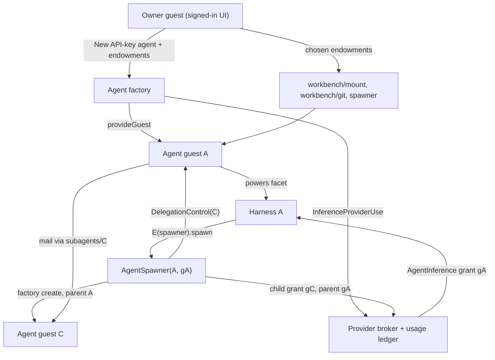

# The API-key agent workbench: endowments, budgeted subagents, and git VFS tools

| | |
|---|---|
| **Created** | 2026-10-27 |
| **Updated** | 2026-10-27 |
| **Author** | kriscendobot (prompted) |
| **Status** | Proposed |
| **Parent** | [API-key inference providers and pinned guest agents](api-key-inference-providers-and-pinned-agents.md) (PR [#1543](https://github.com/endojs/endo-but-for-bots/pull/1543)) |
| **Companion** | minion.town `designs/agent-chat-clip.md` (the chat Clip) |
| **Grounded against** | `endojs/endo-but-for-bots` `llm` at `844ce3df7b`, and the #1543 head `81e5e47ae3` |

## What is the Problem Being Solved?

The parent design lets a minion.town owner import an API key, create a Lal or
Fae agent pinned to a dedicated guest, and message it. The maintainer's
scenario (kriskowal, 2026-10-27, arc tracker
[minion.town#227](https://github.com/kriscendobot/minion.town/issues/227))
extends that into a working environment:

1. When the owner creates an agent, they give it **endowments** chosen from
   their inventory.
2. One endowment can be a **token-budgeted subagent spawner**. With it, an
   agent creates subagents, splits its token budget and endowments among them,
   converses with them, and holds a **control facet** for each delegation
   (pause, resize the budget, revoke).
3. Agents work in a **git virtual file system** through the tools that already
   exist: hashline edit, grep, glob, glorp, and the rest.
4. All of this runs behind a **chat conversation surface integrated as a
   Clip**. That part lives in the minion.town companion design.

This design adds no parallel mechanisms. Each capability comes from a design
that already exists; this document names that source, the small delta it
needs, and the order in which the deltas land. The parent's phases 1-5 are
taken as given and are not changed here.

## Reuse inventory

The Roadmap column refers to [`README.md`](README.md) § Roadmap. M3 is the
current client-side-bridge milestone, where the parent sits.

| Capability | Supplied by | Roadmap | Delta this design needs |
|---|---|---|---|
| Key custody, per-agent grant, reservation and settlement, the usage ledger | [api-key-inference-providers-and-pinned-agents](api-key-inference-providers-and-pinned-agents.md) | M3 | Child grants and ancestor-chain admission ([§ Budget](#budget-a-child-grant-is-an-attenuation-of-its-parents-grant)) |
| Attenuating a grant into a limited share with an admin facet | [hosted-agent-subscriptions](hosted-agent-subscriptions.md) § Delegation (`attenuate(limits) -> { share, admin }`, `provideSubscriptionShare`) | M3 | Apply the same limits/admin split to durable `InferenceGrantRecord`s |
| Agent guest, `@pins` responder, wake, reconciler | Parent § Agent creation; [daemon-guest-bot-incarnation](daemon-guest-bot-incarnation.md) (Implemented) | M3 | A `parentAgentId` on `AgentRecord`; a new operation kind `endow` |
| Spawn, ask, and stop a subagent | Fae `SubagentSpawnerInterface` and `makeSubagentTools` / `makeSubagentDelegations` (`packages/fae/src/subagent.js`, `packages/fae/SUBAGENTS.md`); the subagents of [floot-daemon-owned-turns](floot-daemon-owned-turns.md) | not on roadmap (Complete) | Make the factory the spawner, so a child is a parent-design agent with its own grant |
| Splitting the control facet from the child facet | [endo-reminder](endo-reminder.md) § Delegation and attenuation, Mode B (`ReminderScheduler` / `ReminderControl`) | M3 | Same split, applied to agents |
| Turn interrupt compared with emergency stop | [hosted-agent-sandbox-unification](hosted-agent-sandbox-unification.md) § lifecycle table | M10 | Pause = no new turns; revoke = stop now |
| Endowment picker | [chat-inventory-create-menu](chat-inventory-create-menu.md) § Three-pane wizard, Endowments pane | M9 | Reused as an optional third step of **New API-key agent** (companion design) |
| Reply-chain transcript per conversation | [lal-reply-chain-transcripts](lal-reply-chain-transcripts.md) (Complete) | M1 | None. Each child conversation is a reply chain |
| Streaming a reply | [daemon-message-streaming](daemon-message-streaming.md) (Complete: `editMessage`, `done`) | — | The responder streams harness text deltas through `editMessage` |
| Mount, search, writes | `EndoMount` (`packages/daemon/src/interfaces.js`): `glob`, `grep`, `glorp`, `readText`, `writeText`, `list`, `stat`, `subView`, `readOnly`; [mount-stream-glob-grep](mount-stream-glob-grep.md) | M3 | None for the bundle. The `readOnly()` view drops search, so the bundle grants a read-only mount instead ([§ VFS](#the-workbench-vfs-tool-bundle)) |
| Exact-string edit | [endopi-edit-tool](endopi-edit-tool.md) (lal `editText`, fae `edit`) | M3 | None |
| Hashline edit | `packages/daemon/src/hashline.js` (parser, validator, splice); [cli-edit-verb](cli-edit-verb.md) | M3 | Wire `EndoMount.edit` and `readHashlines`, which the module header promises and no guard exposes yet |
| Git | `@endo/exo-git` reader ⊂ writer ⊂ rewriter facets; [daemon-git-capability](daemon-git-capability.md), [daemon-git-next-steps](daemon-git-next-steps.md), [agentry-git-verb-gaps](agentry-git-verb-gaps.md) | M3 | None. The bundle picks a tier |
| Bounded reads | Asked for by [agentry-git-eval-scenarios](agentry-git-eval-scenarios.md) | M3 | `readLines(path, { offset, limit })` |
| Tool catalog from held facets | [endo-agent-tools](endo-agent-tools.md), [daemon-agent-tools](daemon-agent-tools.md) | M3 | Register the bundle's tools in Lal (`packages/lal/tools/fs.js`) and Fae (`packages/fae/setup-fs-tools.js`) |
| Monitoring a stream from a tool | [agent-follow-stream-tool](agent-follow-stream-tool.md) | M3 | None. This design does not need it |

**"Glorp".** `glorp` is the fused glob-plus-grep method on `EndoMount`. Its
signature is `glorp(globPattern, grepPattern, { maxResults?, followSymlinks? })`,
and it returns `Array<{ file, line, text }>`. It landed in PR #713 (`mount.js`,
`platform/src/fs/search.js`, the lal tool dispatch, and the MCP tool), and its
result equals `grep(p, glob(g))`. No design document owns it. Its guard comment
points to `platform-search-pushdown.md`, which does not exist on `llm`. This
design treats it as an existing tool. The missing design record is a gap for
the next grooming pass, not for this design.

## Capability graph



## Endowments at creation

The parent design gives an agent no endowments (parent § User experience):
the harness's powers profile fixes its authority. This design adds an
**endowment set**, which is a list of capabilities the owner introduces into
the agent guest under fixed names. The harness's tool catalog is derived from
what the guest holds, as the parent's confinement table already requires.

- **Operation.** The factory gains one `AgentOperation` kind, `endow`. Its
  request is `{ add: [{ name, ownerPetName }], remove: [name] }`, and it is
  idempotent under the parent's rules. Creation with endowments is a `create`
  followed by an `endow`, both under one client idempotency key. The `endow`
  operation resolves each `ownerPetName` **through the owner guest's own
  powers** (`E(ownerGuest).lookup`), so the owner can endow only what the owner
  holds. It writes the value into the agent guest under `endowments/<name>`.
  This is the `introducedNames` mechanism
  ([lal-fae-form-provisioning](lal-fae-form-provisioning.md)), driven by the
  factory instead of a manager guest that holds the host.
- **Forbidden endowments.** The factory refuses with `endowment-forbidden`
  any value it minted itself whose transfer would break accounting or
  ownership: an `AgentInference`, an `InferenceProviderDirectory` / `Admin` /
  `Use`, an agent-management facet, or a `DelegationControl`. A spawner is
  admitted only as the `spawner` entry the factory mints itself (below), never
  as a passed-through value. The factory recognizes its own facets by formula
  type, which it already knows; this test is about provenance, not caller
  identity.
- **Durability.** An endowment must be a formula the daemon can name.
  Ephemeral remotables are refused with `endowment-not-durable`. Fae's spawner
  applies the same rule.
- **Bundles.** Two endowments are minted by the factory instead of being looked
  up: the **workbench** (§ VFS) and the **spawner** (§ Spawner). The owner
  chooses them as options in the endowments step. Each is a factory formula
  whose only state is the ids it binds, the same pattern as `AgentInference`
  (parent § Durable grant identity).

## Budget: a child grant is an attenuation of its parent's grant

The spawner's token budget is not a second ledger. A child's spend is recorded
in the parent design's one usage ledger, by its one writer, the broker.

- **Record.** `InferenceGrantRecord` gains `parentGrantId?` and
  `grantPath` (the grant ids from the root grant down to this one), plus a
  third state: `'active' | 'paused' | 'revoked'`. A child record is created
  only by the factory, through the broker's `InferenceProviderUse`. It is
  never created through the parent's `AgentInference`, which stays a pure
  request endpoint.
- **Limits.** A child's limits must be at most the parent's limits, field by
  field: a model allowlist that is a subset, a per-turn output cap,
  concurrency, request rate, maximum turns, wall clock, and a token or dollar
  budget with the **same period** as the parent's. This is the
  `ShareLimits` shape of
  [hosted-agent-subscriptions](hosted-agent-subscriptions.md) § Delegation,
  applied to durable records. A request for limits above the parent's fails
  with `limits-exceed-parent`. It is refused, not clamped, so the parent sees
  what it actually received.
- **Admission is a chain check.** For each request on grant `g`, the broker
  computes the worst-case reservation (parent § Cost and abuse controls). It
  admits the request only if the reservation fits the remaining budget,
  concurrency, and rate of **every grant on `g.grantPath`**, and every
  ancestor is `active`. The reservation row carries `grantPath`. "Remaining
  for ancestor `a`" is `a`'s cap minus the sum of rows whose path contains `a`
  in the current period, which is a prefix query on one table. Settlement
  replaces the reservation on the same row. The guarantee "a child can never
  exceed its parent's remaining budget" is therefore enforced at the same
  atomic admission point that enforces the parent's own cap.
- **Oversubscription is allowed.** The sum of the children's caps may exceed
  the parent's cap. The chain check still stops the subtree at the parent's
  cap. Children compete for the parent's remaining budget first come, first
  served. A guaranteed reservation per child is open question 2.
- **Attribution.** Each row still names its own agent and provider, so the
  Providers page shows per-agent usage. A subtree total is the same prefix
  query.

## The budgeted spawner and the delegation control facet

The spawner is a factory facet bound to one parent agent and that agent's
grant. It is a superset of Fae's `SubagentSpawnerInterface`, so Fae's
`spawnSubagent` / `askSubagent` / `stopSubagent` tools and its
`makeSubagentDelegations` (one outstanding ask per child, matching replies by
`replyTo`, consuming late replies) work unchanged. Lal gets the same three
tools in `packages/lal/tools/`.

```ts
interface AgentSpawner {
  // Fae-compatible. `capabilities` values must be capabilities the caller holds.
  spawn(name: string, options: {
    systemPrompt: string;
    capabilities?: Array<{ name: string; value: unknown }>;
    harness?: 'lal' | 'fae';          // default: the parent's harness
    model?: string;                    // must be in the parent's allowlist
    limits: ChildLimits;               // each field at most the parent's
    allowSpawn?: { maxDepth: number; maxChildren: number };
    idempotencyKey: string;
  }): Promise<{ name: string; locator: string; control: DelegationControl }>;
  stop(name: string): Promise<void>;   // = E(control).revoke()
  list(): Promise<Array<DelegationSummary>>;
  getHeadroom(): Promise<{ depthRemaining: number; childrenRemaining: number;
                           budgetRemaining: BudgetReading }>;
  help(): string;
}

interface DelegationControl {
  getStatus(): Promise<DelegationSummary>; // state, limits, usage, deferred count
  pause(): Promise<void>;
  resume(): Promise<void>;
  resize(limits: ChildLimits): Promise<void>;
  revoke(): Promise<void>;
  help(): string;
}
```

**Spawn** is the parent's `create` operation, run by the factory with
`parentAgentId` set. `AgentRecord` gains `parentAgentId?`, `rootAgentId`, and
`depth`. Its `ownerId` is copied from the parent and stays immutable, so a
child belongs to the same owner, counts against that owner's agent quota, and
appears in the owner's agent view as a tree (the companion design). The steps
are the parent's: guest, grant (here a child grant), responder, name, commit,
activate. The "name" step binds the child at `subagents/<name>` in the
**parent agent's** guest, as Fae does. It also binds the control at
`subagent-controls/<name>`. The child holds neither its own control nor the
parent's.

**Confinement.**

- *Endowments.* A child holds only what `spawn` passes in `capabilities`.
  Those values come from the parent's own hand (the parent may attenuate them
  first, for example with `E(mount).subView(path)` or a read-only mount), plus
  a `spawner` the factory mints when `allowSpawn` is given. A child can never
  hold more than its parent, because the only route into the child guest is
  values the parent already holds. The forbidden-endowment rule above applies
  to every value.
- *Budget.* The child grant's limits are at most the parent's, and admission
  is a chain check (§ Budget).
- *Key material.* The spawner holds no `InferenceProviderUse` and no
  `SecretBlob`. It asks the factory, which asks the broker, so a child receives
  only its own `AgentInference`. The parent's model and provider are inherited,
  and a child cannot name another provider.
- *Spawning depth.* A child spawner's `maxDepth` is at most its parent's
  remaining depth minus one, and its `maxChildren` is at most the parent's.

**Control semantics.** Authority comes from holding the control facet. The
owner's agent-management capability reaches every descendant through the
factory, so the owner can always pause or revoke a delegation the agent forgot
about.

| Method | Effect | Cascade | In-flight turn |
|---|---|---|---|
| `pause()` | Commits the child grant `paused` and the child's desired wake off. This is the parent design's `set-wake`, plus the grant state | Descendants' admissions see a paused ancestor and are **deferred** with code `ancestor-paused`, without counting toward the 8-attempt bound | Runs to completion within its wall clock |
| `resume()` | Grant back to `active`, desired wake restored | Deferred descendants retry oldest first | — |
| `resize(limits)` | The parent's `set-limits` on the child grant, still at most the parent's limits; lowering below current usage refuses later turns | Descendants whose limits exceed the new ceiling are clamped by the chain check, without rewriting their records | Unaffected; the next admission sees it |
| `revoke()` | The parent's `delete` for the child | The child's grant is fenced first (generation increments, parent § Fencing), so every descendant fails admission at once with `agent-deleted`. The reconciler then deletes descendants depth-first, leaf first, each as an ordinary `delete` | Cancelled, and charged at full reservation if no usage arrived |

`revoke()` is a method rather than the `cancelled` `Promise<never>` argument
the designer norms prefer. A promise does not survive a daemon restart, and
revocation must be durable. The control facet is held only by the parent, and
the child cannot reach it, so cancellation authority still rests with whoever
holds the control.

Reattaching a parent that has live children fails with
`agent-has-delegates` in the first release, because the children's grants
are bound to the parent's provider. The parent design's `delete` of a parent
cascades exactly like `revoke()`.

**Abuse controls.** Deployment ceilings bound each one, and the owner can
lower them per agent. The defaults below are proposals (open question 1):

| Control | Default | Refusal |
|---|---|---|
| Maximum depth below the owner-created agent | 3 | `spawn-depth-exceeded` |
| Live children per agent | 8 | `spawn-fanout-exceeded` |
| Agents per tree, all depths | 32 | `spawn-tree-exceeded` |
| Spawns per tree per hour | 20 | `spawn-rate-limited` (transient) |
| Owner's total agents | the parent design's agent quota | `agent-quota-exceeded` |

Fae's two disagreeing limit sets (`SUBAGENTS.md`'s 1 / 8 / 300 s and
`hosted-agent/src/workload-limits.js`'s 32 / 1024 / 24 h) stay in place for
Fae's own unbrokered spawner. A brokered agent's factory configuration refuses
the Fae spawner caplet, under the same rule by which the parent refuses
`authSecretName`. So a brokered agent spawns only through `AgentSpawner`, and
only these ceilings apply.

**Conversation.** A parent talks to a child by ordinary mail to
`subagents/<name>`. The child's pinned responder (parent phase 5) answers.
Each child conversation is a reply chain
([lal-reply-chain-transcripts](lal-reply-chain-transcripts.md)). An ask that
the broker defers on the child's side shows as `deferred` in
`getStatus()`. The child does not reply to its parent with refusal details,
which keeps the parent design's rule that refusals produce no reply.

## The workbench: VFS tool bundle

The workbench is a factory-minted endowment that binds one mount and one git
facet over it. The owner picks the mount, the git tier, and a subtree root.

| Tool | Method | Tier | Exists? |
|---|---|---|---|
| `list`, `stat`, `readText` | `EndoMount.list` / `stat` / `readText` | read | yes |
| `readLines` | `readLines(path, { offset, limit })`, at most 2000 lines and a byte bound | read | **new** (small) |
| `glob`, `grep`, `glorp` | `EndoMount.glob` / `grep` / `glorp`, `maxResults` required and capped at 1000 | read | yes |
| `readHashlines` | renders lines with `hashline.js` anchors | read | **new** (wiring) |
| `writeText`, `makeDirectory`, `move`, `remove` | `EndoMount` | write | yes |
| `editText` | exact-string edit ([endopi-edit-tool](endopi-edit-tool.md)) | write | yes |
| `editHashline` | `EndoMount.edit(path, ops, { expectedSha256 })` over `hashline.js` | write | **new** (wiring) |
| `gitStatus`, `gitDiff`, `gitLog`, `gitShow`, `gitBranches` | exo-git reader | read | yes |
| `gitAdd`, `gitCommit`, `gitCreateBranch`, `gitSwitch` | exo-git writer | write | yes |

**Confinement.**

- *Subtree.* The bound mount is `E(mount).subView(root)`. Paths outside it
  cannot be expressed, and the shared walker's `isConfinedPath` and
  `isDeniedSegment` (`.ssh`, `.env`, and the rest) apply to every search.
- *Read-only.* A read tier binds a mount **provided** with `readOnly: true`
  rather than the `readOnly()` view, because the view drops `glob`, `grep`,
  and `stat` ([mount-stream-glob-grep](mount-stream-glob-grep.md) § gap). The
  git facet is then `E(git).readOnly()`. A read-only workbench never
  advertises a write tool, as
  [daemon-agent-tools](daemon-agent-tools.md) already requires.
- *Excluded.* The rewriter tier (`rebase`, `cherryPick`, `reword`), every
  `GitRemote` (`push`, `fetch`), shell, and network are excluded. A pushed
  result reaches the owner as a commit on a branch, and the owner pushes
  through their own git-remote capability (minion.town
  `designs/git-remote-capability.md`). Granting push is open question 4.
- *Search cost.* `glob`, `grep`, and `glorp` take regular expressions
  supplied by the model. The guard's ReDoS warning applies, so the bundle
  enforces `maxResults` and a wall clock per call.
- *Children.* A parent can hand a child a narrower workbench by passing
  `subView`-ed or read-only facets in `capabilities`. A child can never receive
  a wider one.

**What backs the mount on minion.town** is open question 3. Owners hold no
`EndoMount` today. The recommendation is a per-owner workspace directory under
the owner's storage quota, provided by the host as a mount, with `provideGit`
over it and the owner's git-remote partition as its remote.

## Ownership map

| Boundary | Mechanism | Policy | Durable state | Lifecycle / commit authority | Value crossing |
|---|---|---|---|---|---|
| Owner -> factory (`endow`) | Agent operation record | The owner endows only what the owner holds; the forbidden-endowment list | `AgentRecord` endowment list | The factory commits; the agent guest's pet store commits names as a participant | Capabilities inward; summaries outward |
| Agent -> spawner -> factory (`spawn`) | `AgentSpawner` formula bound to the parent agent and grant | Depth, fan-out, tree, and rate ceilings; limits at most the parent's | `AgentRecord.parentAgentId` and operation records | The factory coordinates; the guest, grant, and responder are participants (the parent's steps) | Capabilities the parent holds inward; `{ name, locator, control }` outward |
| Factory -> broker (child grant) | `InferenceProviderUse.createChildGrant` | Child limits at most the parent's | `InferenceGrantRecord.parentGrantId` / `grantPath` | The provider registry commits the record | Grant id inward; a durable `AgentInference` outward |
| Harness -> broker (turn) | `AgentInference` request | Chain check over `grantPath` | Usage ledger rows tagged with `grantPath` | The broker admits, settles, and cancels | Request bytes inward; response bytes and usage outward |
| Parent -> control -> factory | `DelegationControl` formula | The holder of the control decides | The child's `AgentRecord` and grant state | The factory commits pause, resize, and delete; the reconciler cascades | Commands inward; `DelegationSummary` outward |
| Harness -> workbench | `EndoMount` subview and exo-git facet | Tier and subtree chosen by the owner or parent | The mount's files and the git objects | The mount commits writes; git commits are the agent's | Paths and edits inward; text and results outward |

Persistent state has one owner per datum. The factory owns agent lifecycle,
including parentage. The provider registry owns grant records, including
parentage and pause state. The usage ledger owns all spend, including subtree
spend. The mount owns workspace bytes. Endo owns restart and replay. The
broker owns admission and its classification. The factory owns cascade.

## Phased implementation

These phases start after the parent's phase 5 lands. W1-W4 can run in
parallel with the parent's phases 6 and 7. W6 needs the parent's phase 6
canary provider.

1. **W1: Endowments (Endo).** The `endow` operation, the forbidden and
   non-durable refusals, and tool catalogs derived from held endowments in Lal
   and Fae. Tests: the owner can endow only held names; each forbidden facet
   is refused; a crash at each boundary leaves exactly the requested
   endowment set; a restart revives the endowments; removing an endowment
   drops its tools at the next turn.
2. **W2: Workbench bundle (Endo).** The workbench formula, `readLines`,
   `EndoMount.edit` and `readHashlines` over `hashline.js`, a stale-hash CAS
   refusal, tool registration in both harnesses, read and write tiers, and
   search caps. Tests: a read tier exposes no write or git-write tool;
   `..`, a symlink escape, and a denied segment are refused; `glorp` equals
   `grep(glob)` within the subtree; a `maxResults` overrun is truncated and
   flagged; hashline edits with a stale anchor are refused; a commit lands on
   the bound worktree only.
3. **W3: Child grants and chain admission (Endo).** `parentGrantId`,
   `grantPath`, the `paused` state, `createChildGrant`, the chain check,
   `limits-exceed-parent`, and cascade fencing. Tests against the parent's
   fake upstream: a child reservation that fits its own cap but not an
   ancestor's is refused; concurrent siblings cannot jointly exceed the
   parent; a paused ancestor defers a grandchild with `ancestor-paused` and
   does not consume its attempt count; revoking the middle of a three-level
   chain fences the leaf's next call; usage rows sum correctly per agent and
   per subtree; a restart preserves all of it.
4. **W4: Spawner and control facet (Endo).** `AgentSpawner`,
   `DelegationControl`, the parentage fields on `AgentRecord`, the depth-first
   cascade reconciler, the abuse ceilings, Fae compatibility, Lal subagent
   tools, and the refusal of Fae's own spawner for brokered agents. Tests:
   every refusal code in the abuse table; a child never holds a capability its
   parent lacked; passing an `AgentInference` or control facet is refused;
   `stop` equals `revoke`; a crash at each spawn and cascade boundary leaves
   no orphan guest, grant, or responder; the owner can revoke a grandchild
   directly; a late child reply after revoke is consumed, not delivered.
5. **W5: Responder streaming (Endo).** The pinned responder sends its reply
   with `done: false` and coalesces harness text deltas into `editMessage`
   calls, at most 4 per second, ending with `done: true`. A cancelled turn
   ends with `done: true` and a fixed `turn-cancelled` note. Tests: a follower
   sees monotonically growing edits and exactly one final edit; a restart
   during a stream leaves the message final and marked interrupted.
6. **W6: Live end-to-end canary (minion.town + Endo).** This phase follows the
   companion design's chat-Clip phases. It uses the **dedicated low-budget
   canary key** from the parent's phase 6, on production, with the browser
   recipe the parent's phase 3 uses. The scenario, recorded with usage
   receipts:
   1. A fresh guest account signs in and imports the canary key as a
      provider.
   2. It creates a Lal agent with a write workbench over a scratch repository
      and a spawner (`maxDepth: 2`, `maxChildren: 2`).
   3. In the chat Clip, it asks the agent to spawn a child with a read-only
      sub-workbench, have the child `glorp` for a marker string, and then
      apply a hashline edit itself and commit.
   4. It verifies the commit in the repository, the child in the delegation
      tree, and per-agent and subtree usage on the Providers page.
   5. It resizes the child below its usage and observes refusal; pauses the
      child and observes a deferred ask; resumes; revokes the child and
      observes cascade deletion.
   6. It retires the provider and observes that the agent and any child stop.
   7. It runs the parent's secret-retention check, extended to child agent
      transcripts and the clip's storage.

   Launch of the workbench beyond the canary allowlist requires W6 to pass.

## Design Decisions

1. **The factory is the spawner.** A subagent is an ordinary parent-design
   agent with a parent pointer. It is not a Fae-internal guest triple.
   Lifecycle, recovery, ownership, and the owner's view therefore come for
   free.
2. **One ledger; the chain check is the attenuation.** Child budgets are
   ceilings checked at the existing atomic admission point. No allocation is
   moved between accounts.
3. **The parent's endowments bound the child structurally.** There is no
   per-call allowlist. A child holds what it was handed.
4. **Durable revocation is a control-facet method.** The capability that
   carries it is separated from the child's facet (reminder Mode B), because a
   `cancelled` promise does not survive a restart.
5. **Search stays on a read-only mount.** The bundle grants
   `readOnly: true` mounts rather than the `readOnly()` view.

Considered and rejected: a per-child token allocation debited from the parent
at spawn. Reason: it duplicates ledger state, and it strands budget in idle
children. Considered and rejected: letting the parent's `AgentInference`
mint child grants. Reason: it would make the request endpoint an
administrative facet.

## Open questions

1. **What should the default ceilings be?** The defaults for depth (3), live
   children per agent (8), agents per tree (32), and spawns per hour (20),
   with each owner allowed to lower them.
2. **Should a child have a guaranteed reservation?** Ceilings alone let one
   busy child starve its siblings. Should `ChildLimits` add a `reserve`, an
   amount held back for that child from the parent's remaining budget, in the
   first release?
3. **What backs the workbench mount on minion.town?** Is it a per-owner host
   workspace directory provided as an `EndoMount` with `provideGit`, a mount
   over the owner's git-remote partition, or something else?
4. **May an agent push?** Should a workbench ever include a `GitRemote` push
   tier, for example scoped to one branch of the owner's partition, or does
   push stay with the owner?
5. **Should a paused parent's in-flight children keep running?** This design
   pauses admission for the whole subtree but lets in-flight turns finish.
   Should `pause` instead cancel in-flight subtree turns?
6. **Should endowments be added to the API-key agent dialog?** The parent
   design deliberately has no endowments step. Is adding one as an optional
   third step acceptable, or should endowments stay an agent-detail action
   after creation?

## Prompt

> Design: the agent workbench on minion.town (chat clip, budgeted subagent
> spawner, git VFS tools). A guest creates an account, adds their Claude API
> key, creates an agent bound to that inference provider with endowments
> chosen from their inventory, and converses with it. Then: (1) the endowments
> may include a token-budgeted subagent spawner: agents create subagents ad
> nauseam, distributing their token budget and endowments among them,
> converse with them, and manage the control facet of each delegation
> (revoke, resize budget, pause); (2) agents work in the git virtual file
> system using edit-with-hashline, grep, glob, glorp, and the rest of the
> tools the garden has been building, so this is a viable working
> environment; (3) all of that presumes a chat conversation surface
> integrated as a Clip. Maximize reuse of designs already planned; do not
> invent parallel mechanisms. The spawner's token budget must be a real
> attenuation of the #1543 accounting, not a second ledger. End in
> builder-sized phases that slot after #1543's phase 5, with a live
> end-to-end run using the dedicated canary key. (kriskowal, 2026-10-27,
> via the garden job `design-claude-api-agent-workbench-20261027`.)
