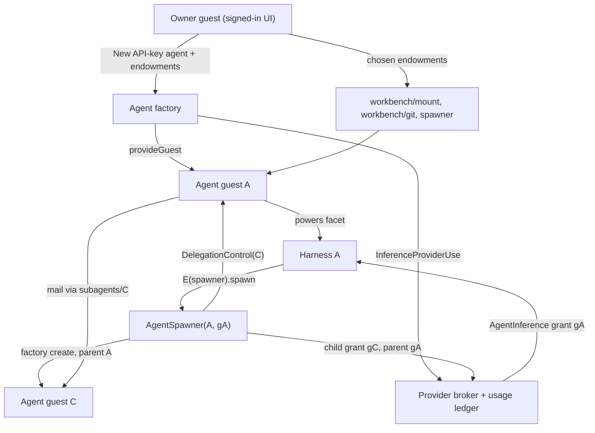

# The API-key agent workbench: endowments, budgeted subagents, and git-VFS tools

| | |
|---|---|
| **Created** | 2026-10-27 |
| **Updated** | 2026-10-27 |
| **Author** | kriscendobot (prompted) |
| **Status** | Proposed |
| **Parent** | [API-key inference providers and pinned guest agents](api-key-inference-providers-and-pinned-agents.md) (PR [#1543](https://github.com/endojs/endo-but-for-bots/pull/1543)) |
| **Companion** | minion.town `designs/agent-chat-clip.md` (the chat Clip) |
| **Grounded against** | `endojs/endo-but-for-bots` `llm` at `844ce3df7b`, and the #1543 head `81e5e47ae3`, which is this PR's frozen base. The in-repo claims below were rechecked at that base by reading the code and design text; none was verified by execution |

## What is the Problem Being Solved?

The parent design lets a minion.town owner import an API key, create a Lal or Fae agent (the daemon's two agent harnesses, `packages/lal` and `packages/fae`) pinned to a dedicated guest, and message it.
The maintainer's scenario (kriskowal, 2026-10-27, arc tracker [minion.town#227](https://github.com/kriscendobot/minion.town/issues/227)) extends that into a working environment:

1. When the owner creates an agent, they give it **endowments** chosen from their inventory.
2. One endowment can be a **token-budgeted subagent spawner**.
   With it, an agent creates subagents, splits its token budget and endowments among them, converses with them, and holds a **control facet** for each delegation (pause, resize the budget, revoke).
3. Agents work in a **git virtual file system** through tools that mostly exist already: grep, glob, glorp, exact-string edit, and the git reader and writer.
   (`glorp` is the fused glob-plus-grep search, defined below.)
   Hashline reads and edits, which anchor each line by a short hash of its content (`packages/daemon/src/hashline.js`), are new wiring over existing code.
   Bounded line reads are a small new method.
4. All of this runs behind a **chat conversation surface integrated as a Clip**.
   That part lives in the minion.town companion design.

The parent's phases 1-5 are taken as given and are not changed here.

## Reuse inventory

Each capability below comes from a design that already exists, and this design adds no parallel mechanism.
The table names the source, the small delta it needs, and where it sits on [`README.md`](README.md) § Roadmap.
M3 is the current client-side-bridge milestone, where the parent sits.

| Capability | Supplied by | Roadmap | Delta this design needs |
|---|---|---|---|
| Key custody, per-agent grant, reservation and settlement, the usage ledger | [api-key-inference-providers-and-pinned-agents](api-key-inference-providers-and-pinned-agents.md) | M3 | Child grants and ancestor-chain admission ([§ Budget](#budget-a-child-grant-is-an-attenuation-of-its-parents-grant)) |
| Attenuating a grant into a limited share with an admin facet | [hosted-agent-subscriptions](hosted-agent-subscriptions.md) § Delegation (`attenuate(limits) -> { share, admin }`, `provideSubscriptionShare`) | M3 | Apply the same limits/admin split to durable `InferenceGrantRecord`s |
| Agent guest, `@pins` responder, wake, reconciler | Parent [§ Agent creation, wake, and deletion operations](api-key-inference-providers-and-pinned-agents.md#agent-creation-wake-and-deletion-operations); [daemon-guest-bot-incarnation](daemon-guest-bot-incarnation.md) (Implemented) | M3 | A `parentAgentId` on `AgentRecord`; a new operation kind `endow` |
| Spawn, ask, and stop a subagent | Fae `SubagentSpawnerInterface` and `makeSubagentTools` / `makeSubagentDelegations` (`packages/fae/src/subagent.js`, `packages/fae/SUBAGENTS.md`); the subagents of [floot-daemon-owned-turns](floot-daemon-owned-turns.md) | not on roadmap (Complete) | Make the factory the spawner, so a child is a parent-design agent with its own grant |
| Splitting the control facet from the child facet | [endo-reminder](endo-reminder.md) § Delegation and attenuation: agent to subagent, the Mode B paragraph (`ReminderScheduler` / `ReminderControl`) | M3 | Same split, applied to agents |
| Turn interrupt compared with emergency stop | [hosted-agent-sandbox-unification](hosted-agent-sandbox-unification.md) § One binding vocabulary (its `lifecycle` states table) | M10 | Pause = no new turns; revoke = stop now |
| Endowment picker | [chat-inventory-create-menu](chat-inventory-create-menu.md) § Pane 3: Endowment selection | M9 | Proposed for reuse as an optional third step of **New API-key agent** (companion design; open question 6) |
| Reply-chain transcript per conversation | [lal-reply-chain-transcripts](lal-reply-chain-transcripts.md) (Complete) | M1 | None |
| Streaming a reply | [daemon-message-streaming](daemon-message-streaming.md) (Complete: `editMessage`, `done`) | n/a | The responder streams harness text deltas through `editMessage` |
| Mount, search, writes | `EndoMount` (`packages/daemon/src/interfaces.js`): `glob`, `grep`, `glorp`, `readText`, `writeText`, `list`, `stat`, `subView`, `readOnly`; [mount-stream-glob-grep](mount-stream-glob-grep.md) | M3 | None for the bundle. The `readOnly()` view keeps only `has`, `list`, `listTree`, and `lookup`, dropping `glob`, `grep`, `glorp`, `stat`, and `readText`, so the bundle grants a mount provided read-only instead ([§ The workbench](#the-workbench-vfs-tool-bundle)) |
| Exact-string edit | [endopi-edit-tool](endopi-edit-tool.md) (lal `editText`, fae `edit`) | M3 | None |
| Hashline edit | `packages/daemon/src/hashline.js` (parser, validator, renderer, splice); [cli-edit-verb](cli-edit-verb.md) | M3 | Wire `EndoMount.edit`, which the `hashline.js` header promises and no guard exposes yet, and add `readHashlines` (new) |
| Git | `@endo/exo-git` reader, then writer, then rewriter facets (each wider than the last); [daemon-git-capability](daemon-git-capability.md), [daemon-git-next-steps](daemon-git-next-steps.md), [agentry-git-verb-gaps](agentry-git-verb-gaps.md) | M3 | None. The bundle picks a tier |
| Bounded reads | Asked for by [agentry-git-eval-scenarios](agentry-git-eval-scenarios.md) | M3 | `readLines(path, { offset, limit })` |
| Tool catalog from held facets | [endo-agent-tools](endo-agent-tools.md), [daemon-agent-tools](daemon-agent-tools.md) | M3 | Register the bundle's tools in Lal (`packages/lal/tools/fs.js`) and Fae (`packages/fae/setup-fs-tools.js`) |

**"Glorp".**
`glorp` is the fused glob-plus-grep method on `EndoMount`.
Its signature is `glorp(globPattern, grepPattern, { maxResults?, followSymlinks? })`, and it returns `Array<{ file, line, text }>`.
It was introduced by commit `d117f74f12` and amended by `8b9241f127` and `3aa902d003` (the PR #713 panel fixes, which touch `mount.js`, `platform/src/fs/search.js`, the lal tool dispatch, and the MCP tool), and its result equals `grep(p, glob(g))`.
No design document owns it.
The workbench depends only on the shipped signature and the `grep(glob)` equality, which W2 tests.

## Capability graph



## Endowments at creation

The parent design gives an agent no endowments (parent § User experience): the harness's powers profile fixes its authority.
This design adds an **endowment set**, which is a list of capabilities the owner introduces into the agent guest under fixed names.
The harness's tool catalog is derived from what the guest holds, as the parent's confinement table already requires.

- **Operation.**
  The factory gains one `AgentOperation` kind, `endow`.
  Its request is one list of endowments to set and one list of names to remove:
  `{ set: [{ as, source }], remove: [as] }`, where `source` is either `{ lookup: from }` or `{ mint: bundle, options }`.
  Every endowment has the same shape, "give the agent this value under name `as`"; the `source` discriminator says where the value comes from.
  A `lookup` source resolves the owner pet name `from` **through the owner guest's own powers** (`E(ownerGuest).lookup`), so the owner can endow only what the owner holds.
  A `mint` source names a factory bundle (`'workbench'` or `'spawner'`) and that bundle's options (§ The workbench; § The budgeted spawner).
  Either kind of value is written into the agent guest under `endowments/<as>`.
  A refusal names the offending entry's `as` and, for a lookup, the owner pet name `from`.
  The operation is idempotent under the parent's rules.
  Creation with endowments is a `create` followed by an `endow`, both under one client idempotency key.
  The `lookup` path is the `introducedNames` mechanism ([lal-fae-form-provisioning](lal-fae-form-provisioning.md)), driven by the factory instead of a manager guest that holds the host.
- **Forbidden endowments.**
  The factory refuses with `endowment-forbidden` any value it minted itself whose transfer would break accounting or ownership: an `AgentInference`, an `InferenceProviderDirectory` / `Admin` / `Use`, an agent-management facet, or a `DelegationControl`.
  A spawner is admitted only through a `mint` source, never through a `lookup` or a `spawn` capability.
  The factory recognizes its own facets by formula type, which it already knows; the test is about provenance, not caller identity.
  The test catches only the factory's facets passed directly.
  A caplet the owner (or a parent agent) holds that forwards to one of them has a different formula type and is accepted.
  So this list is a guard against the obvious mistake, not a confinement or accounting boundary.
  What bounds spend is the chain check (§ Budget): any inference a forwarder reaches is charged to the grant it reaches, and that grant's path is checked at admission.
- **Durability.**
  An endowment must be a formula the daemon can name.
  Ephemeral remotables are refused with `endowment-not-durable`.
  Fae's spawner applies the same rule.
- **Source of truth.**
  The factory's `AgentRecord` endowment list is the intent and is authoritative.
  The `endowments/<as>` names in the agent guest's pet store are a projection of it.
  After a crash between the two writes, the factory's reconciler rewrites the projection to match the record.
- **Bundles.**
  The two minted bundles are the **workbench** ([§ The workbench](#the-workbench-vfs-tool-bundle)) and the **spawner** ([§ The budgeted spawner](#the-budgeted-spawner-and-the-delegation-control-facet)).
  The owner chooses them as options in the endowments step.
  Each is a factory formula whose only state is the ids it binds, the same pattern as `AgentInference` (parent [§ Durable grant identity](api-key-inference-providers-and-pinned-agents.md#durable-grant-identity)).

## Budget: A child grant is an attenuation of its parent's grant

A child's spend is recorded in the parent design's one usage ledger, by its one writer, the broker; there is no second ledger.

- **Record.**
  `InferenceGrantRecord` gains `parentGrantId?` and `grantPath`, and its `state` gains one value, `'paused'`, so it becomes `'active' | 'paused' | 'revoked'`.
  `grantPath` encodes the grant ids from the root grant down to this one as a string with a trailing separator, `gRoot/gB/gC/`.
  With that encoding, "the path contains ancestor `a`" is exactly "the path starts with `a`'s own `grantPath`", so the subtree test is a true prefix match.
  `parentGrantId` is the canonical ancestry.
  `grantPath` is a denormalized index of it, computed once at creation from the parent's `grantPath` and never rewritten, so the two cannot disagree.
  Limits and `state` are the only mutable fields.
  Because ancestry is immutable, the first release does not move a child to another parent (see `agent-has-delegates` below).
  A child record is created only by the factory, through the broker's `InferenceProviderUse`.
  It is never created through the parent's `AgentInference`, which stays a pure request endpoint.
- **Limits.**
  A child's limits must be at most the parent's limits, field by field: a model allowlist that is a subset, a per-turn output cap, concurrency, request rate, maximum turns, wall clock, and a token or dollar budget amount.
  The budget's period is not a limit; it is always exactly the parent's period.
  This is the `ShareLimits` shape of [hosted-agent-subscriptions](hosted-agent-subscriptions.md) § Delegation, applied to durable records.
  A `spawn` or `resize` request for limits above the parent's fails with `limits-exceed-parent`.
  The request fails rather than being clamped, so the parent is never handed a smaller grant than it asked for without knowing.
- **Admission is a chain check.**
  For each request on grant `g`, the broker computes the worst-case reservation (parent [§ Cost and abuse controls](api-key-inference-providers-and-pinned-agents.md#cost-and-abuse-controls)).
  It admits the request only if every grant on `g`'s path is `active` and the reservation fits each one's remaining budget, concurrency, and rate.
  The reservation row carries `grantPath`.
  "Remaining for ancestor `a`" is `a`'s cap minus the sum of the current period's rows whose `grantPath` starts with `a`'s.
  Settlement replaces the reservation on the same row.
  A row's `grantPath` is never rewritten: after a `resize` or a revoke, the spend a descendant already made still counts against every ancestor for that period.
- **Rows across a period reset.**
  A row belongs to the budget period in which its reservation was admitted.
  A turn admitted before a reset and settled after it updates its row in the closed period only.
  Its late usage, and any overrun beyond the reservation, is recorded against the closed period and never reduces the new period's budget; the Providers page shows it as a closed-period overrun.
  The 72-hour deferral bound (§ Deferred work under a pause) is measured in wall-clock time and is unaffected by resets.
- **Serialization mechanism.**
  The parent states that admission is atomic at the broker (parent [§ Cost and abuse controls](api-key-inference-providers-and-pinned-agents.md#cost-and-abuse-controls)) but does not name the mechanism, so this design names it, and the parent's phase 2 adopts it.
  The broker keeps one in-vat promise queue per provider record, and every admission, settlement, cancellation, and grant `state` write for that provider runs as one entry on it.
  An entry reads and writes only the broker's own durable store, in the broker's vat; it makes no `E()` call and awaits nothing remote, so a slow CapTP peer cannot hold the queue.
  Upstream calls happen after the admission entry has written its reservation row and returned.
  Every grant in a tree shares one provider, because a child inherits its parent's provider and cannot name another, so the chain check runs as part of the admission entry: it reads the ancestor totals, checks them, and writes the reservation row in one step.
  Two concurrent sibling admissions are two entries, and a settlement is a separate entry, so none of them interleaves with another's read-check-write.
- **Computing the aggregate.**
  The broker keeps a running total per grant per period, the sum of the current period's rows whose `grantPath` starts with that grant's.
  It updates the totals of every grant on a row's path in the same queue entry that writes or settles the row, so the chain check reads at most depth-plus-one totals, not the rows.
  The totals are derived and never authoritative: on daemon start and on any mismatch the broker rebuilds them from the ledger rows by prefix scan, which is also how tests verify them.
- **Oversubscription is allowed.**
  The sum of the children's caps may exceed the parent's cap.
  The chain check still stops the subtree at the parent's cap.
  Children compete for the parent's remaining budget first come, first served, in the order the per-provider queue admits them.
  The parent's own turns draw from the same remaining budget as its subtree, so a parent with busy children can be left unable to run its own coordination turn.
  Until a reserve exists (open question 2), a parent protects itself by giving its children budget amounts that sum below its own remaining budget, which `getHeadroom()` reports; `spawn` does not enforce that.
- **Attribution.**
  Each row still names its own agent and provider, so the Providers page shows per-agent usage.
  A subtree total is the same prefix sum.

## The budgeted spawner and the delegation control facet

The spawner is a factory facet bound to one parent agent and that agent's grant.
It keeps the `spawn` and `list` shapes of Fae's `SubagentSpawnerInterface`, but not `stop`: a name that reads as a reversible halt must not perform an irreversible delete on a new interface that also has `pause`.
Fae's `spawnSubagent` / `askSubagent` / `stopSubagent` tools and its `makeSubagentDelegations` (one outstanding ask per child, matching replies by `replyTo`, consuming late replies) reach it through a small adapter in Fae's tool layer, which implements the legacy `stop(name)` as `E(control).revoke()` on the stored control.
Lal gets the same three tools in `packages/lal/tools/`, through the same adapter.

```ts
interface AgentSpawner {
  // Fae-compatible. Each `capabilities` value must be one the caller holds.
  spawn(name: string, options: {
    systemPrompt: string;
    capabilities?: Array<{ name: string; value: unknown }>;
    harness?: 'lal' | 'fae';          // default: the parent's harness
    model?: string;                    // must be in the parent's allowlist
    limits?: Partial<ChildLimits>;     // omitted fields inherit the parent's
    allowSpawn?: { maxDepth: number; maxChildren: number };
  }): Promise<{ name: string; locator: string; control: DelegationControl }>;
  list(): Promise<Array<string>>;              // legacy Fae shape: child names only
  listDelegations(): Promise<Array<DelegationSummary>>;
  getHeadroom(): Promise<{ depthRemaining: number; childrenRemaining: number;
                           budgetRemaining: BudgetReading }>;
  help(): string;
}

interface DelegationControl {
  getStatus(): Promise<DelegationSummary>;
  pause(): Promise<void>;   // halts admission of new turns; does not cancel
  resume(): Promise<void>;
  resize(limits: Partial<ChildLimits>): Promise<void>; // merges; omitted fields keep their recorded values
  revoke(): Promise<void>;
  help(): string;
}

interface ChildLimits {
  models: Array<string>;          // subset of the parent's allowlist
  maxOutputTokensPerTurn: number;
  maxConcurrentTurns: number;
  requestsPerMinute: number;
  maxTurns: number;
  wallClockSeconds: number;       // per turn
  budget: { unit: 'tokens' | 'usd'; amount: number }; // period is always the parent's
}

interface BudgetReading {
  unit: 'tokens' | 'usd';
  remaining: number;              // after the chain check: the smallest along the path
  periodResetsAt: string;         // ISO 8601
  estimated: boolean;             // true if any settled row is `estimated`
}

interface DelegationSummary {
  name: string;
  state: 'active' | 'paused' | 'revoked';
  // Why the next admission would wait, when `state` is `active`.
  // Absent when `state` is `paused` or `revoked`, which already say why.
  blockedBy?: 'ancestor-paused' | 'budget' | 'rate' | 'concurrency';
  limits: ChildLimits;            // effective: field-wise minimum along the grant path; read this one
  recordedLimits: ChildLimits;    // what this grant's record holds
  usage: BudgetReading;
  deferredCount: number;
  children: number;
}
```

**Refusals.**
Every refusal named in this design (`limits-exceed-parent`, `spawn-depth-exceeded`, `endowment-forbidden`, and the rest) is a thrown `Error` whose `code` property carries the fixed code, the same convention as the parent's refusal codes.
The harness tool wrappers turn a thrown refusal into a tool result that names the code, so the model sees it.

**Idempotency.**
A `spawn` is keyed by `(parent agent, name)`, which is already unique among a parent's live children, so a retried `spawn` over a flaky CapTP link returns the existing child instead of creating a second one.
The caller supplies no key.
`pause`, `resume`, `resize`, and `revoke` are idempotent by their target state: repeating one is a no-op once the state holds.
`resize` merges: each field it names replaces the recorded value, and each field it omits keeps the recorded value; it never resets a field to the parent's.

**Spawn** is the parent's `create` operation, run by the factory with `parentAgentId` set.
`AgentRecord` gains `parentAgentId?`, `rootAgentId`, and `depth`, all fixed at creation.
Its `ownerId` is copied from the parent and stays immutable, so a child belongs to the same owner, counts against that owner's agent quota, and appears in the owner's agent view as a tree (the companion design).
The steps are the parent's: guest, grant (here a child grant), responder, name, commit, activate.
The "name" step binds the child at `subagents/<name>` in the **parent agent's** guest, as Fae does.
It also binds the control at `subagent-controls/<name>`.
The child holds neither its own control nor the parent's.

**Confinement.**

- **Endowments.**
  A child holds only what `spawn` passes in `capabilities`, plus a `spawner` the factory mints when `allowSpawn` is given.
  The passed values come from the parent's own hand.
  The parent may attenuate them first, for example with `E(mount).subView(path)` or a read-only mount, or it may pass them unattenuated.
  So, apart from the minted spawner, a child can hold at most what its parent holds: equal authority is allowed, wider is not.
  The minted spawner is itself bounded by the parent's remaining depth, fan-out, and budget (below).
  The forbidden-endowment test applies to every passed value, with the same limit: it refuses the factory's facets passed directly, not a forwarder to them, and spend stays bounded by the chain check, not by that test.
- **Budget.**
  The child grant's limits are at most the parent's, and admission is a chain check (§ Budget).
- **Key material.**
  The spawner holds no `InferenceProviderUse` and no `SecretBlob`.
  It asks the factory, which asks the broker, so a child receives only its own `AgentInference`.
  The parent's model and provider are inherited, and a child cannot name another provider.
- **Spawning depth.**
  A child spawner's `maxDepth` is at most its parent's remaining depth minus one, and its `maxChildren` is at most the parent's.

**Control semantics.**
Authority comes from holding the control facet.
The owner's agent-management capability reaches every descendant through the factory, so the owner can always pause or revoke a delegation the agent forgot about.

| Method | Effect | Cascade | In-flight turn |
|---|---|---|---|
| `pause()` | Commits the child grant's `state` as `paused`. That one record field is the only fact `pause` writes; wake is not touched | Admissions on the child and every descendant see a non-`active` grant on the path and are **deferred** with code `paused` or `ancestor-paused` | Each turn already admitted runs to completion within its per-turn wall clock, and no further admission is granted. A tool-using loop therefore stops at its next admission: the bound on work after `pause` is one turn's wall clock per in-flight turn in the subtree, and no reservation beyond those already written |
| `resume()` | Commits the grant's `state` back to `active` | Each deferred ask in the subtree is retried at once, oldest first | n/a |
| `resize(limits)` | The parent's `set-limits` on the child grant, refused with `limits-exceed-parent` if above the parent's limits. Lowering below current usage makes later admissions fail with a budget refusal until the period resets | Descendants' records are not rewritten. Their effective limits are the field-wise minimum along the path, which the chain check enforces and `getStatus()` reports as `limits` | Unaffected; the next admission sees it |
| `revoke()` | The parent's `delete` for the child | The child's grant is committed `revoked` first (the parent's fencing also increments its `generation`), so every descendant fails admission at once with `agent-deleted`. The reconciler then deletes descendants depth-first, leaf first, each as an ordinary `delete` | In the same broker queue entry as the `revoked` commit, every in-flight turn whose `grantPath` starts with the child's is cancelled. Each settles under the parent's cancellation rule (below) |

**Why `pause` writes one fact.**
Pause and wake are kept separate so a crash cannot leave them disagreeing.
The grant `state` is authoritative, and the responder needs no wake change: while wake is on, the responder reads the message, the broker defers the turn, and the message enters the parent's durable deferred queue (parent [§ Confinement and wake-on-message](api-key-inference-providers-and-pinned-agents.md#confinement-and-wake-on-message)).
The owner's wake toggle stays an independent `set-wake` operation.
`pause` is kept rather than replaced by "resize to zero" for two reasons.
It preserves the child's limits, so `resume` restores them without the parent having to remember them.
And it defers with a code that says why, where a zero budget reads as an ordinary budget refusal.

**Deferred work under a pause.**
A deferral caused by a paused grant does not count toward the parent's eight-attempt bound, but the parent's 72-hour bound still applies, measured from the first deferral.
So a forgotten paused subtree does not hold work forever: after 72 hours each deferred ask becomes `refused` with `retry-exhausted`, as any other deferred message does.
Besides `resume()`, the responder's ordinary deferred-retry backoff (at most one hour) re-attempts admission, so a resume that the responder misses is still picked up.
A pause holds no reservations: in-flight turns settle normally, and no new reservation is written while paused.
Paused time is not credited back.
The budget period keeps running, and the per-turn wall clock applies only to turns that are running.

**What the parent sees.**
The child does not reply to its parent with refusal details, which keeps the parent design's rule that refusals produce no reply.
Instead, the parent's `askSubagent` tool decides **before** it sends, not by observing the child afterwards.
It calls `E(control).getStatus()`; if `state` is `paused` or `revoked`, or `blockedBy` is `ancestor-paused`, it does not send.
It returns a tagged result of fixed shape, `{ status: 'not-sent', name, reason: 'paused' | 'ancestor-paused' | 'revoked' }`, and takes no outstanding-ask slot.
This is a returned result, not a thrown refusal, because nothing was refused: the parent's own delegation is in a state the parent can see and change, and the model can resend after `resume()`.
Every other `askSubagent` outcome keeps Fae's existing shapes.

The ordering guarantee is limited, and the design states it rather than hiding it.
`getStatus()` reads the same grant records the broker admits against, so a pause committed before the check is always seen.
A pause committed after the check and before the child's admission is not: the message is sent, the child's turn is deferred, and the ask behaves as any unanswered ask does.
It holds its slot until Fae's ask timeout (`timeoutSeconds`, default 300 s, at most 3600 s), never for the 72-hour deferral bound, and a late reply is consumed by the existing late-reply rule.
Budget, rate, and concurrency waits are transient and are not pre-checked; an ask that meets one is deferred and retried by the responder as usual.

**Revocation durability.**
`revoke()` is a method rather than the `cancelled` `Promise<never>` argument that the maintainer prefers for cancellable capabilities ([#609](https://github.com/endojs/endo-but-for-bots/issues/609)), because a promise does not survive a daemon restart and revocation must be durable.
The control facet is held only by the parent, and the child cannot reach it, so cancellation authority still rests with whoever holds the control.
**One commit owner.**
The grant `state` (`active`, `paused`, `revoked`) has one owner, the provider registry, and it is the only durable fact `pause`, `resume`, and the fencing step of `revoke` write.
The factory's `AgentRecord` `deleting` mark is derived from it: the factory writes `deleting` after the grant is `revoked`, and if a crash falls between the two, the reconciler sees a `revoked` grant under a live `AgentRecord` and writes `deleting`.
`resize` is the registry's `set-limits` on the grant.
So every control method has exactly one committer, the registry, and the factory and reconciler only converge from what it committed.

From the `revoked` commit, every descendant fails admission because its path contains a non-`active` grant, and every descendant turn already in flight was cancelled in the same broker queue entry (§ Control semantics), so neither a crash mid-cascade nor the delay before the next reconciler sweep lets a descendant spend.
A cancelled descendant turn settles on its own row under the parent's cancellation rule, whatever the state of the grants on its path; its `grantPath` keeps charging the ancestors, as every row does.
The descendants' guests hold no key material, only their own `AgentInference`, which now fails every call.
The reconciler restores one invariant on every sweep: **no `AgentRecord` that is not `deleted` has an ancestor that is `deleting` or `deleted`**.
It drives each such descendant through the ordinary `delete`, leaf first, so after any crash the remaining descendants are fenced and are then deleted, never left live.

**Reattachment.**
The parent design's `reattach` operation moves an agent to a different provider.
Reattaching an agent that has live children fails with `agent-has-delegates` in the first release, because the children's grants and their fixed `grantPath` are bound to the parent's provider.
The parent design's `delete` of a parent cascades exactly like `revoke()`.

**Abuse controls.**
Deployment ceilings bound each control, and the owner can lower them per agent.
The defaults below are proposals (open question 1):

| Control | Default | Refusal |
|---|---|---|
| Maximum depth below the owner-created agent | 3 | `spawn-depth-exceeded` |
| Live children per agent | 8 | `spawn-fanout-exceeded` |
| Agents per tree, all depths | 32 | `spawn-tree-exceeded` |
| Spawns per tree per hour | 20 | `spawn-rate-limited` (transient) |
| Owner's total agents | the parent design's agent quota | `agent-quota-exceeded` |

**Charging a revoked subtree.**
A `revoke()` charges only turns that were in flight; a child with no in-flight turn costs nothing to revoke.
Each cancelled turn is settled by the parent's existing rule for cancellation: the full reservation is charged and marked `estimated`, and a late usage report from the upstream replaces the estimate.
This is not a deterrent added by this design; it is the parent's conservative accounting for a turn whose upstream cost is unknown.
The charge lands on the cancelled turn's own row, so it counts against the revoker's grant and its ancestors, which delegated that spend in the first place.
A parent that cycles spawn and revoke therefore spends its own budget, at most one reservation per in-flight turn, at a rate bounded by the spawn-rate ceiling.

Fae has two limit sets that disagree: `packages/fae/SUBAGENTS.md` § Bounds sets a delegation depth of 1, eight live subagents per parent, and a 300-second ask timeout (capped at 3600 s), while `packages/hosted-agent/src/workload-limits.js` sets `subagents: 1024` (a child count), `subagentDepth: 32`, and a 24-hour `subagentReplyTimeoutSeconds`.
Both stay in place for Fae's own unbrokered spawner.
A brokered agent's factory configuration refuses the Fae spawner caplet, under the same rule by which the parent refuses `authSecretName` (parent [§ Harness adapter boundary](api-key-inference-providers-and-pinned-agents.md#harness-adapter-boundary)).
So a brokered agent spawns only through `AgentSpawner`, and only these ceilings apply.

**Conversation.**
A parent talks to a child by ordinary mail to `subagents/<name>`.
The child's pinned responder (parent phase 5) answers.
Each child conversation is a reply chain ([lal-reply-chain-transcripts](lal-reply-chain-transcripts.md)).

## The workbench: VFS tool bundle

The workbench is a factory-minted endowment that binds one mount and one git facet over it.
The owner picks the mount, the git tier, and a subtree root.

| Tool | Method | Tier | Exists? |
|---|---|---|---|
| `list`, `stat`, `readText` | `EndoMount.list` / `stat` / `readText` | read | yes |
| `readLines` | `readLines(path, { offset, limit })`, at most 2000 lines and a byte bound | read | **new** (small) |
| `glob`, `grep`, `glorp` | `EndoMount.glob` / `grep` / `glorp`, `maxResults` required and capped at 1000 | read | yes |
| `readHashlines` | renders lines with `hashline.js` anchors | read | **new** (wiring) |
| `writeText`, `makeDirectory`, `move`, `remove` | `EndoMount` | write | yes |
| `editText` | exact-string edit ([endopi-edit-tool](endopi-edit-tool.md)) | write | yes |
| `editHashlines` | `EndoMount.edit(path, ops, { expectedSha256 })` over `hashline.js` | write | **new** (wiring) |
| `gitStatus`, `gitDiff`, `gitLog`, `gitShow`, `gitBranches` | exo-git reader | read | yes |
| `gitAdd`, `gitCommit`, `gitCreateBranch`, `gitSwitch` | exo-git writer | write | yes |

**Confinement.**

- **Subtree.**
  The bound mount is `E(mount).subView(root)`.
  Paths outside it cannot be expressed, and the shared walker's `isConfinedPath` and `isDeniedSegment` (`.ssh`, `.env`, and the rest) apply to every search.
- **Read-only.**
  A read tier binds a mount **provided** with `readOnly: true` rather than the `readOnly()` view, because the view drops `glob`, `grep`, `glorp`, `stat`, and `readText` ([mount-stream-glob-grep](mount-stream-glob-grep.md) § Confinement, deny patterns, and attenuations; `packages/daemon/src/mount.js`, `readOnly()`).
  The git facet is then `E(git).readOnly()`.
  A read-only workbench never advertises a write tool, as [daemon-agent-tools](daemon-agent-tools.md) already requires.
- **Excluded.**
  The rewriter tier (`rebase`, `cherryPick`, `reword`), every `GitRemote` (`push`, `fetch`), shell, and network are excluded.
  An agent's result reaches the owner as a commit on a branch, and the owner pushes through their own git-remote capability (minion.town `designs/git-remote-capability.md`).
  Granting push is open question 4.
- **Search cost.**
  `glob` and the glob half of `glorp` take glob patterns supplied by the model.
  `grep` and the grep half of `glorp` take regular expressions supplied by the model, so the guard's warning about regular-expression denial of service (ReDoS) applies.
  The bundle enforces `maxResults` and a wall clock per call on all three.
- **Children.**
  A parent can hand a child a narrower workbench by passing `subView`-ed or read-only facets in `capabilities`, or the same workbench unattenuated.

**What backs the mount on minion.town** is open question 3.
Owners hold no `EndoMount` today.
The recommendation is a per-owner workspace directory under the owner's storage quota, provided by the host as a mount, with `provideGit` over it and the owner's git-remote partition as its remote.

## Ownership map

| Boundary | Mechanism | Policy | Durable state | Lifecycle / commit authority | Value crossing |
|---|---|---|---|---|---|
| Owner -> factory (`endow`) | Agent operation record | The owner endows only what the owner holds; the forbidden-endowment test | `AgentRecord` endowment list (authoritative); `endowments/<as>` in the agent guest is a projection | The factory commits the record; the reconciler rebuilds the projection | Capabilities inward; summaries outward |
| Agent -> spawner -> factory (`spawn`) | `AgentSpawner` formula bound to the parent agent and grant | Depth, fan-out, tree, and rate ceilings; limits at most the parent's | `AgentRecord.parentAgentId` and operation records | The factory coordinates; the guest, grant, and responder are participants (the parent's steps) | Capabilities the parent holds inward; `{ name, locator, control }` outward |
| Factory -> broker (child grant) | `InferenceProviderUse.createChildGrant` | Child limits at most the parent's | `InferenceGrantRecord.parentGrantId` (canonical) and `grantPath` (index) | The provider registry commits the record | Grant id inward; a durable `AgentInference` outward |
| Harness -> broker (turn) | `AgentInference` request | Chain check over `grantPath`, as one entry on the per-provider admission queue | Usage ledger rows tagged with `grantPath`; derived per-grant totals | The broker admits, settles, and cancels | Request bytes inward; response bytes and usage outward |
| Parent -> control -> registry | `DelegationControl` formula | The holder of the control decides | The child's grant `state` and limits | The provider registry commits pause, resume, resize, and the `revoked` fence; the factory's `deleting` mark and the reconciler's cascade derive from it | Commands inward; `DelegationSummary` outward |
| Harness -> workbench | `EndoMount` subview and exo-git facet | Tier and subtree chosen by the owner or parent | The mount's files and the git objects | The mount commits writes; git commits are the agent's | Paths and edits inward; text and results outward |

## Phased implementation

These phases start after the parent's phase 5 lands.
W1-W5 are Endo-side and can run in parallel with the parent's phases 6 and 7; W5 depends only on the parent's phase 5 responder.
W6 needs the parent's phase 6 canary provider, and it is gated on the answer to open question 3, because no minion.town owner holds a mount until that is settled.

1. **W1: Endowments (Endo).**
   The `endow` operation with its `set` (lookup or mint source) and `remove` lists, the forbidden and non-durable refusals, the reconciler that rebuilds the pet-store projection from the record, and tool catalogs derived from held endowments in Lal and Fae.
   Tests: the owner can endow only held names; each forbidden facet passed directly is refused, naming the entry; a crash at each boundary leaves the pet store matching the record's endowment set; a restart revives the endowments; removing an endowment drops its tools at the next turn.
2. **W2: Workbench bundle (Endo).**
   The workbench formula, `readLines`, `EndoMount.edit` and `readHashlines` over `hashline.js`, a stale-hash compare-and-swap refusal, tool registration in both harnesses, read and write tiers, and search caps.
   W2 builds against any `EndoMount`, and its tests use a temporary-directory mount, so it does not wait on open question 3.
   Tests: a read tier exposes no write or git-write tool; `..`, a symlink escape, and a denied segment are refused; `glorp` equals `grep(glob)` within the subtree; a `maxResults` overrun is truncated and flagged; hashline edits with a stale anchor are refused; a commit lands on the bound worktree only.
3. **W3: Child grants and chain admission (Endo).**
   `parentGrantId`, `grantPath`, the `paused` state, `createChildGrant`, the per-provider admission queue, the chain check and derived per-grant totals inside it, and `limits-exceed-parent`.
   Tests against the parent's fake upstream: a child reservation that fits its own cap but not an ancestor's is refused; 16 sibling admissions issued concurrently against a parent whose remaining budget fits exactly 5 reservations admit exactly 5, with the other 11 refused for budget; a settlement racing an admission leaves the totals equal to a prefix scan of the rows; a turn admitted before a period reset and settled after it charges the closed period only and leaves the new period's budget whole; the derived totals rebuilt after a restart equal those before it; a paused ancestor defers a grandchild with `ancestor-paused`, does not consume its attempt count, and expires it after 72 hours; revoking the middle of a three-level chain fences the leaf's next call; usage rows sum correctly per agent and per subtree; a restart preserves all of it.
4. **W4: Spawner and control facet (Endo).**
   `AgentSpawner`, `DelegationControl`, the parentage fields on `AgentRecord`, the depth-first cascade reconciler and its invariant, the abuse ceilings, Fae compatibility, Lal subagent tools, and the refusal of Fae's own spawner for brokered agents.
   Tests: every refusal code in the abuse table; a child never holds a capability its parent lacked; passing an `AgentInference` or control facet directly is refused (a forwarding caplet is accepted, and its spend is still stopped by the chain check); the Fae adapter's `stop` equals `revoke`; a retried `spawn` returns the existing child; `askSubagent` to a paused child returns `{ status: 'not-sent', reason: 'paused' }` and sends nothing; a pause committed after `askSubagent`'s check releases the ask at the ask timeout; `resize` merges and keeps omitted fields; `getStatus()` reports the effective `limits` after an ancestor `resize`; revoking a parent cancels its descendants' in-flight turns before the next reconciler sweep; a crash at each spawn and cascade boundary leaves no orphan guest, grant, or responder, and no live descendant of a deleted agent; the owner can revoke a grandchild directly; a late child reply after revoke is consumed, not delivered.
5. **W5: Responder streaming (Endo).**
   The pinned responder sends its reply with `done: false` and coalesces harness text deltas into `editMessage` calls, at most four per second, ending with `done: true`.
   A cancelled turn ends with `done: true` and a fixed `turn-cancelled` note.
   Tests: a watching client sees monotonically growing edits and exactly one final edit; a restart during a stream leaves the message final and marked interrupted.
6. **W6: Live end-to-end canary (minion.town + Endo).**
   This phase follows the companion design's chat-Clip phases.
   It uses the **dedicated low-budget canary key** from the parent's phase 6, on production, with the browser recipe the parent's phase 3 uses.
   The scenario, recorded with usage receipts:
   1. A fresh guest account signs in and imports the canary key as a provider.
   2. It creates a Lal agent with a write workbench over a scratch repository and a spawner (`maxDepth: 2`, `maxChildren: 2`).
   3. In the chat Clip, it asks the agent to spawn a child with a read-only sub-workbench and have the child `glorp` for a marker string.
      The parent agent then applies a hashline edit itself and commits.
   4. It verifies the commit in the repository, the child in the delegation tree, and per-agent and subtree usage on the Providers page.
   5. It resizes the child below its usage, and the resize succeeds; the child's next admission is then refused for budget.
      It pauses the child and observes that an ask is not sent; resumes; revokes the child and observes cascade deletion.
   6. It retires the provider and observes that the agent and any child stop.
   7. It runs the parent's secret-retention check, extended to child agent transcripts and the clip's storage.

   Launch of the workbench beyond the canary allowlist requires W6 to pass.

## Design Decisions

1. **Revocation is a control-facet method** (§ Revocation durability).
2. **No per-child allocation debited at spawn.**
   Considered and rejected: a per-child token allocation debited from the parent's budget at spawn.
   It duplicates ledger state, and it strands budget in idle children.
   A hard partition, for an owner who wants guarantees, is open question 2.
3. **The parent's `AgentInference` does not mint child grants.**
   Considered and rejected: letting it mint them.
   It would make the request endpoint an administrative facet.

## Open questions

1. **Are the default ceilings right?**
   Are the proposed defaults in the abuse-controls table the right deployment ceilings, and should each owner be able to lower them per agent?
2. **Should a child, or the parent itself, have a guaranteed reservation?**
   Ceilings alone let one busy child starve its siblings, and let a busy subtree starve the parent of its own coordination turn.
   Should `ChildLimits` add a `reserve`, an amount held back for that child from the parent's remaining budget, and should `spawn` hold back a reserve for the parent's own turns, in the first release?
3. **What backs the workbench mount on minion.town?**
   Is it a per-owner host workspace directory provided as an `EndoMount` with `provideGit`, a mount over the owner's git-remote partition, or something else?
4. **May an agent push?**
   Should a workbench ever include a `GitRemote` push tier, for example scoped to one branch of the owner's partition, or does push stay with the owner?
5. **Should a paused delegation's in-flight turns keep running?**
   This design pauses admission for the whole subtree but lets in-flight turns finish.
   Should `pause` instead cancel in-flight subtree turns, perhaps as an option?
6. **Should endowments be added to the API-key agent dialog?**
   The parent design deliberately has no endowments step.
   Is adding one as an optional third step acceptable, or should endowments stay an agent-detail action after creation?

## Prompt

> Design: the agent workbench on minion.town (chat clip, budgeted subagent
> spawner, git VFS tools). A guest creates an account, adds their Claude API
> key, creates an agent bound to that inference provider with endowments
> chosen from their inventory, and converses with it. Then: (1) the endowments
> may include a token-budgeted subagent spawner: agents create subagents ad
> nauseam, distributing their token budget and endowments among them,
> converse with them, and manage the control facet of each delegation
> (revoke, resize budget, pause); (2) agents work in the git virtual file
> system using edit-with-hashline, grep, glob, glorp, and the rest of the
> tools the garden has been building, so this is a viable working
> environment; (3) all of that presumes a chat conversation surface
> integrated as a Clip. Maximize reuse of designs already planned; do not
> invent parallel mechanisms. The spawner's token budget must be a real
> attenuation of the #1543 accounting, not a second ledger. End in
> builder-sized phases that slot after #1543's phase 5, with a live
> end-to-end run using the dedicated canary key. (kriskowal, 2026-10-27,
> via the garden job `design-claude-api-agent-workbench-20261027`.)
