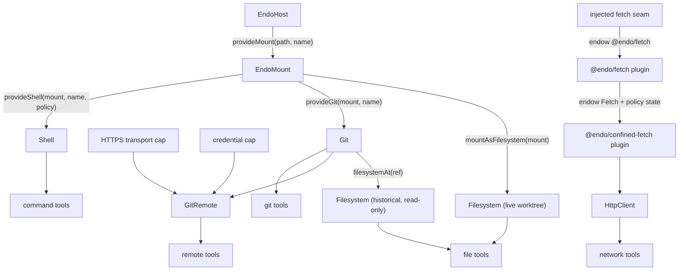

# Daemon Agent Tools (Claw-like Capabilities)

| | |
|---|---|
| **Created** | 2026-03-02 |
| **Updated** | 2026-10-19 |
| **Author** | Kris Kowal, endolinbot (prompted) |
| **Status** | In Progress |

## Status

**2026-10-19 re-sweep.** Checked against `llm` at `ca5aaefb23`. Since
the 2026-08-06 sweep, more of the plan has landed than this record showed.
The daemon `provideHttpClient` formula and `makeHttpTool` landed on
2026-07-10 (`38b6274d81`, Phase 3.6). The `@endo/fetch` unconfined plugin
landed on 2026-07-25. Capability-based workspace provisioning and the worked
version-controlled-filesystem loop landed in #707 (Phase 4). The
`@endo/agent-tools` MCP adapter and the single-guest stdio MCP server
`@endo/agent-mcp-stdio` landed in #1336. The confined in-guest agent
[endo-claude](endo-claude.md) has also landed as `@endo/claude`, with its
confinement flags and the CLI and Agent SDK inference backends (#1357). Four items remain open, sequenced in
§ Next Slice and § Implementation Plan:

1. the **sandbox shell engine** (Phase 2c), now the minimal next slice,
   because a host-engine `Shell` granted to a confined `endo-claude` guest
   would let that guest escape its OS slice (§ Relationship to Neighboring
   Designs);
2. the **endo-claude acceptance loop** (Phase 7): the Phase 4 worked loop
   run by a confined guest through its MCP surface;
3. **reconciling the two HTTP provisioning paths** (Phase 8, Open
   Question 4);
4. the grant-sensitive package-manager projection (#950, open).

The rest of this section is the 2026-08-06 record, kept for provenance.

This document began as a pre-trio sketch (2026-03-02) whose own revision
note (2026-05-18) deferred to the then-unwritten mount and git designs.
The 2026-07-06 reconciliation pass resolves that note: the sketch's
`Dir` / `Shell` / `Git` interfaces are replaced by the vocabulary that
actually landed, and the document is repositioned as the capability-layer
map and build sequence for Milestone 3's "Claw-like coding capabilities
available to agents" pillar.

What has shipped, by layer:

- **Capability substrate.** `EndoMount` is complete
  ([daemon-mount-capabilities](daemon-mount-capabilities.md), all five
  phases). The local `Git` capability over `EndoMount` landed in #364
  (hardening #371), immutable trees and the bulk archive path in #367,
  `GitRemote` with controllers in #365, and the fd-pipe askpass credential
  envelope in #368. `Git.filesystemAt(ref)` landed per
  [endo-fs-from-git](endo-fs-from-git.md).
- **Tool surface.** `@endo/agent-tools` exists on `llm`
  ([endo-agent-tools](endo-agent-tools.md)): `makeTool`, `makeGitTool`,
  and `makeMountReadTool` emit the canonical `ToolRecord` (#523), and the
  code-mode TypeScript declaration renderer shipped in #524. The
  2026-07-08 batch then landed the file-tool set (`list` / `edit` / `stat`,
  #614), the **Shell capability** and `makeShellTool` (`provideShell` plus
  the host-spawner engine, #615), and the mount-bridged local git `status`
  / `add` tools (#616) — Phase 1 in full, plus the Shell capability and
  tool (Phase 2a/2b; the sandbox engine 2c is still gated and open).
  The local Git catalog now derives its reader, writer, and rewriter
  inventories from the granted facet. The compatibility
  `makeGitHistoryTool` remains the explicit four-tool history inventory, and
  mount-bridged conflict checkout completes the JSON conflict-recovery path.
- **Network tier.** The confined-HTTP substrate landed as a standalone
  package pair on 2026-07-08 (#566): `@endo/http-confine` (the pure
  confinement core) and `@endo/exo-http-client` (the `HttpClient` /
  `HttpClientControl` capability), realizing
  [endoclaw-network-fetch](endoclaw-network-fetch.md). The daemon formula was
  superseded by the `@endo/fetch` / `@endo/confined-fetch` plugin split; those
  plugins, their policy store, and `makeHttpTool` are the remaining delta
  (§ Tool Groups, § Implementation Plan).
- **Package-management tier.** `@endo/exo-package-manager` provides the
  portable reader, safe-installer, and project-executor facets (#948).
  The daemon-backed base-session design is #949, the grant-sensitive
  `@endo/agent-tools` projection is #950, and the optional execution-backend
  design is #953.
  Code mode may consume the facets directly; #950 is part of the reviewed
  JSON-tool tail already in flight when that surface was parked.
- **Remaining** (the phased delta in § Implementation Plan below): the
  **network tool** (plugin provisioning plus `makeHttpTool`),
  the **sandbox-spawner shell engine** (Phase 2c, gated on
  [endo-posix-sandbox](endo-posix-sandbox.md)), and the provisioning and
  across-turn persistence wiring.

## What is the Problem Being Solved?

AI coding agents like Claude Code ("Claw"), Cursor, and Devin have a
standard set of tools: read files, write files, execute shell commands,
run git operations, search codebases. These tools operate with ambient
authority — the agent has the same filesystem and process access as the
user running it.

Endo's capability model can provide these same tools with principled
confinement: an agent receives a `Filesystem` capability scoped to a
project worktree, a `Shell` capability that can only execute approved
commands in that worktree, a `Git` capability scoped to the same
repository, and a `GitRemote` bounded to one endpoint with
non-extractable credentials. The agent can do useful coding work without
ambient access to `~/.ssh`, `~/.aws`, or the ability to run arbitrary
network commands.

The capability shapes themselves are settled elsewhere and are not
re-opened here:

- the mount / git / remotes **trio**
  ([daemon-mount-capabilities](daemon-mount-capabilities.md),
  [daemon-git-capability](daemon-git-capability.md),
  [daemon-git-remotes](daemon-git-remotes.md)) owns `EndoMount`,
  `EndoMountEntry`, `Git`, and `GitRemote`;
- [endo-agent-tools](endo-agent-tools.md) owns the tool surface: the
  canonical `ToolRecord`, wire schemas, the confinement axis and
  attenuation levers, git authority tiers, and petname capability
  arguments.

What this document owns is the remainder:

1. the **capability-to-tool-group map** — which daemon capability backs
   each of the four Claw-like tool groups, stated once so the milestone
   has a single index;
2. the **Shell capability** — the one tool group whose backing capability
   has no owning design (the trio never covered process execution, and
   [endo-agent-tools](endo-agent-tools.md) explicitly defers "the
   command-tool family and its `Spawner` seam");
3. the **build order** that turns the shipped substrate into the M3 exit
   pillar.

## Tool Groups, Reconciled

| Group | 2026-03 sketch | Reconciled backing | Status |
|---|---|---|---|
| Filesystem | `Dir` from [daemon-capability-filesystem](daemon-capability-filesystem.md) | `Filesystem` (`@endo/platform/fs/extended`) via `mountAsFilesystem(mount)` for the live worktree and `Git.filesystemAt(ref)` for history | read tool landed (#523); list / edit / stat landed (#614) |
| Shell | `makeShell({ cwd, allowedCommands, … })` from a raw path | `Shell` capability derived from a writable `EndoMount`, executing through the `Spawner` seam (§ Shell Capability) | capability + `makeShellTool` landed (#615, host-spawner engine); sandbox engine (Phase 2c) remaining |
| Git (local) | `Git` exo over a repository path string | `Git` over `EndoMount` via `provideGit(mountCap, petName)` ([daemon-git-capability](daemon-git-capability.md)) | capability landed (#364); facet-derived catalogs landed (`makeGitTool`); mount-bridged `status` / `add` landed (#616), with conflict checkout added in Phase 6 |
| Git (remote) | deliberately omitted ("network access is a separate capability") | `GitRemote` = `Git` + bounded HTTPS transport + non-extractable credential ([daemon-git-remotes](daemon-git-remotes.md)) | capability landed (#365, #368); `makeGitRemoteTool` landed (#705) |
| Network (HTTP) | not in sketch (network excluded from `Git`, Design Decision 3) | `HttpClient` / `HttpClientControl` from `@endo/exo-http-client` over the `@endo/http-confine` core, granted standalone from an injected `fetch` seam (not mount-derived) | capability landed (#566); daemon `provideHttpClient` + `makeHttpTool` landed (2026-07-10); `@endo/fetch` plugin landed (2026-07-25); choosing between the two provisioning paths is open (Phase 8) |
| Package management | not in sketch | Portable `EndoPackageManager` reader, safe-installer, and project-executor facets over an injected, snapshot-revalidating backend | portable facets in #948; daemon-backed base-session design in #949; grant-sensitive agent-tools projection in #950; optional backend design in #953 |
| Search | `grep` / `glob` on `Dir` | daemon mount `glob` / `grep` (eager, daemon-capped), reached in code mode and through `@endo/agent-mcp-stdio`'s static catalog; the Shell group's allowlisted `grep` remains a fallback | mount methods landed; streaming search is [mount-stream-glob-grep](mount-stream-glob-grep.md) (Not Started) |

> **The JSON tool-wrapper surface is parked — see #731.** The `ToolRecord`
> wrappers the Status column names (`makeGitTool`, `makeGitRemoteTool`,
> `makeShellTool`, `makeHttpTool`) are parked as future work in favor of code
> mode as the primary agent surface. The capability substrate in the
> Reconciled-backing column is unaffected: code mode consumes those
> capabilities directly, and they stay prioritized. The parking bars *new*
> JSON-tool work, not the reviewed tail already in flight: PRs #705
> (`makeGitRemoteTool`, this design's § Phase 3), #707 (§ Phase 4 provisioning
> and the worked loop), and #950 (the package-manager facet projection) are
> grandfathered
> ([daemon-git-next-steps](daemon-git-next-steps.md) § Phased Build Plan,
> *Status and the #731 grandfathering*).

Three properties of the reconciled map, each a correction to the sketch:

- **One filesystem cap reads worktree and history.** The sketch's `Dir`
  could only see live files. `mountAsFilesystem(mount)` and
  `Git.filesystemAt(ref)` present the *same* `Filesystem` shape, so the
  same read / list / stat tools serve both, and `readOnly()` / `chroot`
  are uniform attenuations
  ([endo-agent-tools](endo-agent-tools.md) § Filesystem-targeted file
  tools).
- **Paths convert to descriptors at the boundary.** Agent-facing tools
  accept user-friendly relative path strings, then immediately convert
  them into `EndoMountEntry` values (or `Filesystem` walks); no free-form
  path string crosses into a capability method
  ([daemon-mount-capabilities](daemon-mount-capabilities.md)
  § Migration Notes).
- **The remote group exists.** The sketch's Design Decision 3 excluded
  network from `Git` and left remotes unspecified; the landed model
  grants them separately as `GitRemote`, so push authority is
  grant-gated: a read-only `Git` cannot construct a `GitRemote` at all.

## The Mount Is the Root Authority

Every coding-tool authority derives from an already-authorized
`EndoMount`; nothing is minted from a raw host path once the mount model
exists. This is the same invariant
[daemon-git-capability](daemon-git-capability.md) Design Decision 1
states for `provideGit`, extended to the whole tool surface:



The host-private bridge for trusted providers that need the physical
worktree (native git today, the shell's child-process working directory
tomorrow) is `EndoHost.provideHostPath(cap)`
([daemon-mount-capabilities](daemon-mount-capabilities.md)
§ Host-Private Physical Backing); the guest never observes the path.

The **Network (HTTP) tier is the deliberate exception** to "everything
derives from the mount": there is no filesystem to root it in, so its
root authority is a host-injected `fetch` (and `now`) seam rather than an
`EndoMount`. That is why `HttpClient` hangs off `fetchSeam`, not `mount`,
in the graph above. Everything else about it stays within the model —
the confinement is capability-structural (origin allowlist, rate and
response-byte caps, timeout, revocation, redirect containment) and the
policy-bearing `HttpClientControl` is host-retained while only the
use-facing `HttpClient` is bound into the guest petstore, exactly the
control / client split the Shell and Git grants use.

## Shell Capability

The net-new normative design. Everything in this section is
implementation-ready for a builder; the rest of the document defers to
designs that already carry their own normative content.

### Construction

```js
const worktree = await E(host).provideMount('/repo', 'repo-worktree');
const shell = await E(host).provideShell(worktree, 'repo-shell', {
  allowedCommands: ['node', 'npm', 'yarn', 'make', 'grep', 'sed', 'awk'],
  env: { CI: 'true' }, // explicit passlist; nothing inherited
  timeoutMs: 60_000,
  maxOutputBytes: 1_048_576,
});
```

`provideShell(mountCap, petName, policy)` mirrors `provideGit`:

1. takes a **writable** `EndoMount` capability (cap-passing only, no
   pet-name lookup, no raw path);
2. resolves the child working directory through
   `EndoHost.provideHostPath` — host-private, never guest-visible;
3. rejects a read-only mount with a structured error. A child process
   holds OS-level write authority over its working tree; a read-only
   mount cannot bound that, and constructing a "read-only shell" would
   misrepresent the authority actually granted;
4. bakes the policy into the `shell` formula at construction time
   (formula-owned, like `GitRemote`'s Phase 1 endpoint policy), so the
   capability reconstitutes across daemon restart with the same bounds.

Attenuation is construction-time: a narrower grant is a new
`provideShell` call with a shorter allowlist. There is no
`Shell.readOnly()` — a shell that cannot mutate is not a shell, and
pretending otherwise would invite the misrepresentation rejected in
point 3.

### Interface

```ts
type ShellPolicy = {
  allowedCommands: string[];
  timeoutMs: number;
  maxOutputBytes: number;
};

type ShellResult = {
  stdout: string;
  stderr: string;
  exitCode: number | null;
  signal: string | null;
  truncated: boolean;
};

interface Shell {
  inspect(): Promise<ShellPolicy>;
  exec(
    command: string,
    args: string[],
    options?: { timeoutMs?: number },
  ): Promise<ShellResult>;
}
```

- **Argv arrays only.** `(command, args[])`, never a shell string; no
  shell interpolation on the guest surface (the `shell: true` mode that
  `@endo/host-shell` and genie's host spawner expose for operators is
  deliberately absent here). This is the sketch's Design Decision 4,
  kept verbatim.
- **Allowlist before spawn.** `command` must be a member of
  `allowedCommands`. Policy closures in the genie style
  (`rejectPatterns`, `rejectFlags` — see
  `packages/genie/src/tools/command.js`) run after the allowlist check
  and may veto or annotate; they are advisory hardening, not the
  boundary (see § The honest boundary).
- **Sanitized environment.** The child env is exactly the policy's
  passlist plus a fixed minimal base (`PATH` from a policy-owned
  `searchPath`, `LC_ALL=C`); the host process env is never inherited.
  No secret reaches a child by default.
- **Bounded output.** `stdout` / `stderr` accumulate to
  `maxOutputBytes` each and set `truncated`; a per-call `timeoutMs` can
  only narrow the policy value. Timeout kills the process group.
- **Buffered first.** `exec` returns a complete `ShellResult`.
  Streaming stdio for long-running processes is deferred; when a
  consumer needs it, the exo-stream shapes proven by
  `@endo/host-shell` (`PassableBytesReader` stdout / stderr, an
  awaitable `{ code, signal }`) are the named path, added as sibling
  methods rather than a change to `exec`.

### Execution engine: the `Spawner` seam

The shell formula's implementation executes through the `Spawner`
interface genie already ships (`packages/genie/src/tools/spawner.js`):
`spawn(argv, opts) → ProcessLike`, where `ProcessLike` mirrors
`DriverProcess` from `@endo/sandbox/types.d.ts`. Two engines exist in
tree today:

| Engine | Where | Confinement |
|---|---|---|
| host spawner | `makeHostSpawner` (genie) wrapping `child_process.spawn` | none beyond the policy closures; the child holds host-process ambient authority |
| sandbox spawner | `makeSandboxSpawner` (genie) over an `@endo/sandbox` slice | kernel-level: bwrap namespace, `network: 'none'` default, worktree bind-mounted as the writable upper layer ([endo-posix-sandbox](endo-posix-sandbox.md), In Progress Phase 3) |

The engine is chosen host-side at `provideShell` time and is invisible
in the capability surface: the same `Shell` interface, the same tool
records, the same wire schemas. This is the same
backend-private-data-plane discipline as
[daemon-git-capability](daemon-git-capability.md) Design Decision 10.

Relationship to `@endo/host-shell`: that package is a one-command
formula (each instance re-runs a single command captured in its `env`,
streaming stdio) aimed at operator one-offs and plumbing. The `Shell`
capability is the multi-invocation, allowlisted, agent-facing sibling.
They share the unconfined-plugin loading shape (the shell formula, like
host-shell, reaches `node:child_process` through the daemon's
unconfined-module worker path) and, eventually, the stream shapes.

### The honest boundary

The 2026-03 sketch implied that an allowlist confines a shell. It does
not, and this reconciliation states the boundary truthfully, adopting
the confinement-axis vocabulary of
[endo-agent-tools](endo-agent-tools.md) § The confinement axis:

- Under the **host engine**, the `Shell` capability bounds *which
  commands start* and *with what env, cwd, timeout, and output budget* —
  but a started child is an ordinary host process. `grep` from the
  allowlist can read `~/.ssh` if the OS user can. The policy closures
  are a veto on the command string, "advice, not a boundary".
- Under the **sandbox engine**, the same capability surface gains a
  kernel boundary: the child sees only the slice's filesystem view
  (the worktree), its own pid namespace, and no network unless the
  slice profile grants it.

The host engine is therefore a transitional posture for trusted-operator
deployments, and the sandbox engine is the destination for granting
shells to less-trusted agents. Hosts choose per grant; the design makes
the difference legible instead of papering over it.

### Tool adapter

`makeShellTool(shellCap)` in `@endo/agent-tools` closes over the `Shell`
capability and emits canonical `ToolRecord`s
(`makeTool` over a MethodGuard, hand-authored wire schema pinned by the
divergence gate — all per [endo-agent-tools](endo-agent-tools.md); this
document introduces no rival tool shape). Genie's existing
`makeCommandTool({ name, program?, spawner, policies })` remains the
unconfined dev-repl binding over the bare `Spawner`; the two are the two
poles of the confinement axis with one seam between them.

## Granting and Provisioning

The sketch's `endo grant fae fs /home/user/project` CLI is replaced by
the capability-derivation flow plus petname binding:

```js
// Host provisions a workspace for agent 'fae':
const worktree = await E(host).provideMount('/repo', 'repo-worktree');
const git = await E(host).provideGit(worktree, 'repo-git');
const shell = await E(host).provideShell(worktree, 'repo-shell', policy);
// The Filesystem view is derived, not separately minted:
// mountAsFilesystem(worktree) from @endo/platform/fs/extended, or
// git.filesystemAt(ref) for history. GitRemote composes per
// daemon-git-remotes § Capability Construction.

// Bind into the agent's petstore; the names are what the LLM utters:
await E(faePowers).storeIdentifier('workspace', worktreeId);
await E(faePowers).storeIdentifier('repoGit', gitId);
await E(faePowers).storeIdentifier('repoShell', shellId);
```

Tool composition is conditional on the grant: a tool group is composed
into the agent's catalog only when the caller holds the backing
capability, so an ungranted group is *absent from the catalog*, not
present-but-failing (the sketch's "agent tool discovery" idea, now
realized as the `extra`-array composition and the build-time `scope`
filtering of [endo-agent-tools](endo-agent-tools.md)). Capability
arguments on the wire are petname strings resolved fail-closed against
the guest petstore; across-turn persistence of cap-bearing results
follows [endo-agent-tools](endo-agent-tools.md) § Persisting a
cap-bearing result across turns.

That petname rule is **only** for capability-valued arguments, not for
high-cardinality data like filenames. File tools and `git add`-style
tools keep accepting relative path strings that are authenticated by the
mount or git capability at the boundary; they do not require every file
to have a guest petstore name.

The network tier grants the same control / client split but is **not
daemon-provisioned** (redirected 2026-07-13; the earlier host-method
sketch `provideHttpClient(name, { allowedOrigins, policyMode, … })` is
superseded): per [endo-fetch](endo-fetch.md), the unconfined `@endo/fetch`
base supplies unfettered `Fetch` only to the provisioning integration, which
endows it plus a state directory to `@endo/confined-fetch`. The confined
plugin mints the `HttpClient` / `HttpClientControl` pair, retains the
policy-bearing control facet, and binds only the use-facing `HttpClient` into
the guest petstore. #566 landed the package pair (`@endo/http-confine` plus
`@endo/exo-http-client`); the two plugins, their durable virtual-file-system
policy store, and the `makeHttpTool` binding are the remaining wiring (§
Implementation Plan, Network tier). The
conditional-composition rule is unchanged: the network tool group is
absent from the catalog unless the agent holds the `HttpClient`.

Form-based provisioning
([lal-fae-form-provisioning](lal-fae-form-provisioning.md)) keeps its
shape; the `capabilities: 'fs,shell,git'` field of the sketch becomes
the host running the derivation flow above and binding the petnames.

## Next Slice: the Sandbox Shell Engine

This is the minimal first slice of the remaining work: one engine
adapter, one policy field, and the tests that prove the boundary. It adds
no new capability, tool, wire schema, or formula type. It only fills the
engine row that § Execution engine already reserves.

### Why this slice first

The other open items consume something this slice provides, or are
decisions rather than builds. The [endo-claude](endo-claude.md) guest
runs inside a required `@endo/claude-sandbox` OS slice, but a `Shell`
granted to that guest runs children through the daemon's host spawner,
on the host, outside that slice. Any allowlisted command that reads files
(`grep`, `node`, `sed`) then reads with the daemon user's authority. That
is exactly the escape § The honest boundary describes. Until a `Shell`
can run under the sandbox engine, the only safe grant to a confined
agent is no shell at all, and the endo-claude acceptance loop (Phase 7)
cannot include its build step.

### Shape

- **Spawner adapter.** `makeSandboxSpawner(slice)` in
  `@endo/host-spawner`, beside `makeHostSpawner`. It returns a `Spawner`
  whose `spawn(argv, opts)` calls `E(slice).spawn(argv, sandboxOpts)` and
  adapts the resulting `ProcessHandle` to `ProcessLike`: `pid()` to
  `pid`, the `stdout()` / `stderr()` `PassableBytesReader`s to
  `AsyncIterable<Uint8Array>`, and `wait` / `kill` forwarded. The
  `host-spawner.js` doc comment already describes this adapter. It maps
  the `Shell` policy's `timeoutMs` and `maxOutputBytes` onto the slice's
  `SpawnOpts.timeoutMs` / `stdoutByteLimit` / `stderrByteLimit`, so the
  kernel-side limits and the `exo-shell` buffer caps agree. It rejects
  `opts.shell === true`: the `Shell` capability never sets it, and the
  adapter has no reason to wrap argv in `/bin/sh -c`.
- **Policy field.** `ShellPolicy` gains `engine: 'host' | 'sandbox'`,
  defaulting to `'host'` so existing formulas reconstitute unchanged. The
  field is formula-owned like the rest of the policy, so a sandboxed
  shell stays sandboxed across restart. `inspect()` reports the engine,
  which makes the confinement posture visible to the holder.
- **Slice construction.** For `engine: 'sandbox'`, the host passes a
  `SandboxFactory` capability as `policy.sandbox`. The factory is the
  `@endo/sandbox` plugin's make-unconfined product, which the host already
  holds. The daemon does not reach for it ambiently, and the formula
  records the factory's identifier beside the mount's. The shell
  formula's maker calls `E(factory).make` with an explicit
  `network: 'none'` and the factory's default seccomp profile. It then
  binds the shell's own writable mount into the slice with
  `E(slice).mount(mountCap, '/work', 'rw')` and sets the per-spawn `cwd`
  to `/work`. The slice belongs to the shell formula's incarnation: it is
  disposed on cancellation and re-made on reincarnation, so no slice state
  is durable. `SandboxHandle.policy()` attestations exist today only for
  the hosted-agent profile, so the shell does not require one (Open
  Question 5).
- **Unavailable backend fails closed.** If `listBackends()` reports no
  usable driver (for example, macOS or a kernel without user namespaces),
  `provideShell(..., { engine: 'sandbox' })` rejects with a structured
  error. It never falls back to the host engine.

### Tests

Run on a Linux runner with `bwrap`, skipped with a recorded reason where
`listBackends()` reports no driver:

- a sandboxed `cat` of a host path outside the mount (for example the
  daemon's state directory) fails, while the same call under the host
  engine succeeds (a negative test paired with a positive one);
- a write under `/work` is visible through `mountAsFilesystem(mount)`;
- a network attempt from an allowlisted `node -e` fails;
- timeout and output-cap truncation behave identically across engines,
  sharing one table of cases with the existing `exo-shell` tests;
- restart reconstitutes `engine: 'sandbox'`, and `inspect()` reports it;
- an unavailable backend rejects at `provideShell`.

## Relationship to Neighboring Designs

- **[daemon-mount](daemon-mount.md) and
  [daemon-mount-capabilities](daemon-mount-capabilities.md).** The mount is
  the root authority for every tool group except the network tier (§ The
  Mount Is the Root Authority). This design adds no mount methods. The
  sandbox engine is a second consumer of the same writable mount
  capability: the host engine reaches the physical directory through
  `provideHostPath`, while the sandbox engine binds the capability into
  the slice with `SandboxHandle.mount`. Search uses the mount's `glob` /
  `grep`. The sub-mount and capability-VFS work still open under
  `daemon-mount` Phase 4 would let a host grant a shell over a
  subdirectory without a separate host path, but this design does not
  depend on it.
- **[endo-agent-tools](endo-agent-tools.md) and
  [endo-claude](endo-claude.md).** `endo-claude` depends on
  `endo-agent-tools` for the MCP-adapter projection, which landed in
  #1336. The confined `claude -p` has no built-in tools (`--tools ""`), so
  its coding capabilities are exactly the capabilities this design
  provisions into its guest's petstore. It reaches them through
  `@endo/agent-mcp-stdio`'s static catalog: `evaluate` in code mode over
  the petnamed `Filesystem`, `Git`, `GitRemote`, `Shell`, and
  `HttpClient`, plus the mount search methods. The JSON `ToolRecord`
  wrappers stay parked (#731). Code mode is the surface `endo-claude`
  uses, so Phase 7 needs no new JSON tool. Two consequences follow. A
  guest's catalog stays static while its grant decides which calls
  succeed, and the § Granting conditional-composition rule applies to
  code-mode declarations, not to the MCP tool list. And a `Shell` granted
  to an `endo-claude` guest must be `engine: 'sandbox'` (§ Next Slice).
- **[fs-interface-reconciliation](fs-interface-reconciliation.md) and
  [fs-interface-consolidation](fs-interface-consolidation.md).** These own
  the one `Filesystem` method catalog (`lookup`, `write`, `move`,
  `remove`, `makeDirectory`, and the rest) that the file tools,
  `mountAsFilesystem`, `Git.filesystemAt`, and the `@endo/fetch` policy
  store all target. This design consumes that catalog and adds no verbs.
  The file tools follow the reconciled names as the catalog's migration
  phases land; a renamed verb is a follow-up edit to
  `json-tools/fs.js` and the generated code-mode declarations, not a
  change to this design. The sandbox engine sits beside the catalog
  rather than on it: a child process sees the mount as a POSIX directory,
  not as a `Filesystem`.

## Ownership Map

| Boundary | Mechanism | Policy | Durable state | Lifecycle / commit authority | Value crossing |
|---|---|---|---|---|---|
| host → `shell` formula | daemon `provideShell` | host-supplied `ShellPolicy` (allowlist, env, limits, engine) | the formula record (mount id, sandbox-factory id, policy) | the daemon: formula incarnation and cancellation | a writable `EndoMount` capability, an optional `SandboxFactory` capability, and the policy record |
| `shell` formula → engine | `Spawner` (`makeHostSpawner` / `makeSandboxSpawner`) | none: the engine enforces the limits the formula passes | none | the formula: it creates and disposes the slice per incarnation | argv, sanitized env, cwd, limits |
| engine → slice | `@endo/sandbox` `SandboxHandle` | the slice profile (`network: 'none'`, seccomp) | none (scratch only) | the slice handle: dropping it kills the process tree | a `ProcessHandle` |
| guest → `Shell` | `exo-shell` `exec` / `inspect` | allowlist check before spawn | none | per call: an execution result (`ShellResult`), never a commit | argv and an optional narrower timeout; a `ShellResult` back |

Answers to the four ownership questions: the daemon formula owns the
persistent state (the policy). Nothing in the shell commits or discards;
`exec` returns an execution result, and mount writes are immediate, as
with any writer. Restart is reconstitution from the formula, with a fresh
slice. Execution classification (host versus sandbox) is decided once,
at `provideShell`, by the host.

## Implementation Plan

Phases are ordered by what gates the M3 exit pillar. Phase 0 records
the landed substrate; Phases 1–3 are dispatchable builder work; Phase 4
is the integration pass that demonstrates the pillar. As of 2026-10-19,
Phase 3.6 (`makeHttpTool`, 2026-07-10) and Phase 4 (#707) have also
landed. The remaining builder work, in order, is Phase 2c (§ Next Slice),
Phase 7, and Phase 8. The 2026-08-06 record follows: as of 2026-08-06,
Phase 1 (#614), Phase 2a/2b (#615), the local mount-bridged git
tools (#616, Phase 3.5), and the push tier (#705, Phase 3) have landed on
`llm`; the remaining builder work is the network tool wiring (Phase 3.6),
the sandbox shell engine (Phase 2c), and the Phase 4 worked loop.

The loop-level, cross-design sequencing of the git-capability stack is
canonical in [daemon-git-next-steps](daemon-git-next-steps.md) § Phased
Build Plan (accepted 2026-07-11): its Phases 1 and 3 dispatch this
document's Phases 3 and 4, and its Phase 4 dispatches this document's
Phases 5–6. This section stays normative for each tool-layer
deliverable's shape.

### Phase 0: Substrate (landed — record only)

- [x] `EndoMount` completion — descriptors, snapshot, `provideHostPath`
  ([daemon-mount-capabilities](daemon-mount-capabilities.md), all phases).
- [x] Local `Git` over `EndoMount` (#364; hardening #371; archive #367).
- [x] `GitRemote` + controllers (#365); fd-pipe askpass (#368).
- [x] `Git.filesystemAt(ref)` ([endo-fs-from-git](endo-fs-from-git.md)).
- [x] `@endo/agent-tools` with `makeTool`, `makeGitTool`,
  `makeMountReadTool` on the canonical `ToolRecord` (#523); code-mode
  declaration renderer (#524).

### Phase 1: Complete the file-tool set — landed (#614)

- [x] `list`, `edit` (write), and `stat` tools over the `Filesystem`
  interface, as separate makers so a read-only deployment composes only
  the read slice ([endo-agent-tools](endo-agent-tools.md)
  § Filesystem-targeted file tools is normative for shapes and names).
  Landed as `makeMountListTool` / `makeMountEditTool` / `makeMountStatTool`
  plus the composite `makeMountFsTools` in
  `packages/agent-tools/src/json-tools/fs.js`.
- [x] A read-only `Filesystem` never advertises an edit tool
  (build-time filtering, matching `makeGitTool`'s facet-derived catalog
  filtering). `makeMountFsTools` drops the `scope:'write'` edit tool when
  the backing is `readOnly()`.
- [x] Tests over a real `makeNodeFilesystem` plus a daemon-backed `Mount`
  (no hand-rolled petstore stubs). `test/mount-fs-tools.test.js` runs
  every behavior against both backings; resolution is by mount-relative
  path authenticated at the boundary, per the § Granting petname rule
  (paths are not petnamed).

### Phase 2: Shell capability and command tools — 2a / 2b landed (#615)

- [x] 2a — the daemon `shell` formula and `provideShell` per § Shell
  Capability: writable-mount derivation via `provideHostPath`,
  formula-owned policy, host-spawner engine, hardening tests
  (allowlist enforcement, env sanitization — assert no host env
  leakage, argv-only spawn, timeout kill, output-cap truncation,
  read-only-mount rejection, restart reconstitution with identical
  policy, `inspect()` reveals no host path). Landed as the `'shell'`
  formula plus `host.provideShell`, the `@endo/exo-shell` engine, and
  the `@endo/host-spawner` spawner; hardening asserted across
  `packages/daemon/test/shell.test.js` and `packages/exo-shell/test/`.
- [x] 2b — `makeShellTool` in `@endo/agent-tools`: `ToolRecord` plus
  hand-authored wire schema and divergence gate; port genie's policy
  closures (`rejectPatterns`, `rejectFlags`) as policy inputs. Landed in
  `packages/agent-tools/src/json-tools/shell.js` (`exec` / `inspect` records,
  schema ⟷ guard divergence gate, `makeAdvisoryVeto`).
- [ ] 2c — the sandbox-spawner engine behind a `provideShell` option.
  Specified in § Next Slice (2026-10-19); `@endo/sandbox`'s Linux `bwrap`
  driver with `network: 'none'` (its Phase 1) is all this needs from
  [endo-posix-sandbox](endo-posix-sandbox.md).
  Optional for the M3 exit; required before granting shells to
  less-trusted agents (§ The honest boundary). The `@endo/host-spawner`
  `Spawner` interface is shaped to accept a sandbox `DriverProcess`
  adapter, but only the host `child_process` engine ships today.

### Phase 3: Push tier — landed (#705)

- [x] `makeGitRemoteTool(remoteCap)` per
  [endo-agent-tools](endo-agent-tools.md) § Git authority tiers:
  `fetch` / `pull` / `push` tools whose bounds come entirely from the
  granted `GitRemote`; no policy re-statement in the tool layer.
  Landed as `packages/agent-tools/src/json-tools/git-remote.js`
  (`inspect` / `fetch` / `pull` / `push` records, schema <-> guard
  divergence gate), together with `GitRemote.push`'s `forceWithLease`
  option — the capability form of `--force-with-lease`, which is what
  makes a git branch usable as a transactional ledger
  ([daemon-git-remotes](daemon-git-remotes.md) § Force-with-lease).

### Phase 3.5: Local mount-bridged git tools — landed (#616)

- [x] `makeGitMountTools(gitCap)` in `packages/agent-tools/src/json-tools/git-mount.js`:
  `status`, `add`, and `checkoutConflict` tools over the *local* `Git`
  capability, bridging
  live `EndoMountEntry` remotables across the JSON wire where `makeGitTool`
  could not carry live-capability signatures. Network operations stay
  excluded; the push tier remains the separately granted `GitRemote`
  (Phase 3).
- [ ] Revisit petname-backed results when a git or file tool returns a
  live capability rather than high-cardinality path data. Today file and
  path arguments stay as boundary-authenticated relative strings; #424
  petname persistence has not landed, and remains the future direction
  for cap-bearing results.

### Phase 3.6: Network (HTTP) tier

The confined-HTTP substrate landed in #566 as `@endo/http-confine` (the
pure confinement core) and `@endo/exo-http-client` (the `HttpClient` /
`HttpClientControl` capability); the provisioning is redrafted as the
`@endo/fetch` base plus `@endo/confined-fetch` plugin
([endo-fetch](endo-fetch.md)). Only the tool binding remains in this
document's scope.

- ~~Reconcile the largely in-flight daemon HTTP formula from #286 onto
  the shared HTTP core~~ — **superseded by
  [endo-fetch](endo-fetch.md)** (2026-07-13): per the maintainer's
  unconfined-plugin direction on PR #609, no daemon HTTP formula is
  built. The `HttpClient` / `HttpClientControl` pair is provisioned by
  the unconfined base `@endo/fetch` plugin endows `Fetch` and a state directory
  to `@endo/confined-fetch`. The confined plugin owns
  policy persistence and restart reconstitution; #286's formula shape is
  superseded outright and its CLI intent survives as the `endo http` eventual
  surface sketched there.
- [x] `makeHttpTool` in `@endo/agent-tools` (landed 2026-07-10 with the
  daemon `provideHttpClient` formula, `38b6274d81`; the `@endo/fetch`
  plugin followed on 2026-07-25, so two provisioning paths now exist; see
  Phase 8): `ToolRecord` plus
  hand-authored wire schema and divergence gate, mirroring `makeGitTool`
  / `makeShellTool`; bounds come entirely from the granted `HttpClient`
  ([endo-fetch](endo-fetch.md) Phase 3 tracks the binding against the
  plugin-provisioned client).

### Phase 4: Provisioning and the worked loop — landed (#707)

- [x] Wire the § Granting and Provisioning flow end to end for one
  agent harness (lal front-loaded binding first; fae's `adopt` accretion
  follows).
  Landed as `makeWorkspaceTools` / `provisionWorkspaceTools` /
  `provisionHistoryTools` in `packages/agent-tools/src/workspace.js`.
- [x] Run the worked reference flow of
  [daemon-git-next-steps](daemon-git-next-steps.md) § Open Work as the
  acceptance test: branch → edit via file tools → status / diff / commit
  via git tools → push via the remote tool → inspect the pushed ref via
  `filesystemAt` — with a shell-tool build step (`npm test`) in the
  middle. That single pass demonstrates the M3 pillar.

### Phase 5: Commit-metadata history verbs (agentry eval lane)

These phases extend the local `Git` capability for the agentry code-mode
stack-surgery eval lane, per
[agentry-git-verb-gaps](agentry-git-verb-gaps.md). The acceptance contract is
the `stack-surgery` scenario in `designs/agentry-git-eval-scenarios.md` (draft
PR #636, branch `design/agentry-git-eval-scenarios`).

- [x] `commit({ amend })` and `reword(ref, message)` across the local Git and
  code-mode surfaces: exo + `GitInterface` guard + `GitBackend` + native impl +
  code-mode regen (`packages/agent-tools/generated/code-mode-globals/git-declarations.js`).
  The default writer JSON inventory retains only new-commit creation.
  `makeGitTool` derives reader, writer, and rewriter catalogs from the granted
  facet, while the explicit `makeGitHistoryTool` compatibility maker retains
  the fixed `commit`, `reword`, `cherryPick`, and `rebase` history inventory.
  Both makers project the same canonical rewriter schemas and guards for those
  four tools.
- [ ] Extend the `473b718b3` contract test (branch
  `docs/agentry-git-rebase-evals`) so the exo type, `GitInterface`,
  `packages/exo-git/src/types.js`, `types.d.ts`, and the generated
  code-mode declarations cannot drift.
- [x] Tests: read-only rejection for each mutator; non-interactive editor
  behavior, branch attachment, and merge-topology preservation for reword.

### Phase 6: Stack-replay and conflict resolution (agentry eval lane)

Grouped because replay produces the conflicts the selection verb resolves;
per [agentry-git-verb-gaps](agentry-git-verb-gaps.md). The acceptance contract
is the `stack-surgery` scenario in `designs/agentry-git-eval-scenarios.md`
(draft PR #636, branch `design/agentry-git-eval-scenarios`).

- [x] `cherryPick(ref, options?)` and rebase `start`, `continue`, `abort`, and
  `skip` across all surfaces. Each mode has a closed JSON shape; `start`
  requires `upstream` and alone accepts `autosquash`.
- [x] `checkoutConflict(entries, side)` across all surfaces:
  `entriesToRepoPaths` lineage + `ours` stage 2 / `theirs` stage 3 index
  semantics; JSON as
  `checkoutConflict({ paths, side })` resolving strings to authenticated
  `EndoMountEntry` values (the capability method stays entry-based). During a
  rebase, Git's intuitive branch roles invert: `ours` is the upstream plus the
  commits replayed so far, and `theirs` is the commit being replayed.
- [x] Stopped rebase recovery directs the caller to inspect status, resolve and
  stage conflicts, then continue, skip the stopped commit, or abort.
- [x] Tests: facet membership, read-only rejection, autosquash validation,
  conflict-side lineage, index semantics, closed rebase controls, and
  conflict-recovery descriptions.

### Phase 7: The endo-claude acceptance loop

- [ ] Provision an [endo-claude](endo-claude.md) guest with a workspace
  mount, `Git`, `GitRemote` (against a local bare-repo endpoint), and an
  `engine: 'sandbox'` `Shell` bound into its petstore.
- [ ] Drive the Phase 4 loop through `@endo/agent-mcp-stdio`'s `evaluate`
  tool against those petnames, scripted rather than model-driven so the
  test is deterministic: edit, then the build step, then status and
  commit, then push, then `filesystemAt` on the pushed ref.
- [ ] Negative leg: the `endo-claude` session provisioner refuses to
  bind a `Shell` whose `inspect()` reports `engine: 'host'`. The check
  reads the held capability's own posture; it does not consult a list of
  guests.
- [ ] Gated on Phase 2c and on the `endo-claude` confinement core.
  This is the M3 pillar demonstrated from inside a confined guest, which
  is the "confined in-guest agent" half of the milestone's client-side
  bridge.

### Phase 8: One HTTP provisioning path

- [ ] Choose between the daemon `provideHttpClient` formula and the
  `@endo/fetch` plugin (Open Question 4). Remove or deprecate the other,
  and update § Granting and Provisioning plus
  [endo-fetch](endo-fetch.md) to match.
- [ ] Add an `http` group to `makeWorkspaceTools` /
  `provisionWorkspaceTools`, composed only when an `HttpClient` is
  granted, so the network tier reaches the same provisioning helper as
  the other groups. (Code mode already declares `HttpClient` globals.)

## Dependencies

| Design | Relationship |
|---|---|
| [daemon-mount-capabilities](daemon-mount-capabilities.md) | Root authority: `EndoMount`, `EndoMountEntry`, `provideHostPath` (the shell's cwd bridge). Complete. |
| [daemon-git-capability](daemon-git-capability.md) | Local `Git` capability and `filesystemAt` historical read. |
| [daemon-git-remotes](daemon-git-remotes.md) | `GitRemote` backing the push tier. |
| [endo-agent-tools](endo-agent-tools.md) | Normative tool surface (`ToolRecord`, wire schemas, attenuation levers, petnames); this document feeds it the Shell capability and the build order. |
| [agentry-agent-builder](agentry-agent-builder.md) | Consumer: `defineAgent` composes the tool groups per agent. |
| [endo-fs-backend-seam](endo-fs-backend-seam.md), [endo-fs-from-git](endo-fs-from-git.md) | The `Filesystem` substrate file tools target. |
| [endoclaw-network-fetch](endoclaw-network-fetch.md) | The network-fetch capability shape (`HttpClient` / `HttpClientControl`) this document's HTTP tier realizes; landed via `@endo/exo-http-client` (#566). |
| [http-confine](http-confine.md) | The shared confinement core (`@endo/http-confine`) that the HTTP capability — and the `endo http` CLI track — sit on; `@endo/confined-fetch` composes it rather than reimplementing policy. |
| [cli-http-client](cli-http-client.md) | Records the controller + client split decision that superseded (in part) the original single-formula endoclaw-network-fetch shape; the parallel `endo http` daemon/CLI track. |
| [trust-on-first-bind](trust-on-first-bind.md) | TOFU policy for allowlist-bearing caps; the `makeTrustOnFirstBindPolicyAdapter` the HTTP capability composes. |
| [endo-posix-sandbox](endo-posix-sandbox.md) | Kernel-confinement engine for the Shell (Phase 2c). Supersedes the sketch's [daemon-os-sandbox-plugin](daemon-os-sandbox-plugin.md) dependency. |
| [daemon-git-next-steps](daemon-git-next-steps.md) | The version-controlled-filesystem-loop milestone Phase 4 demonstrates. |
| [endo-claude](endo-claude.md) | Consumer: the confined in-guest agent whose petstore receives these capabilities; Phase 7 is its acceptance loop. |
| [fs-interface-reconciliation](fs-interface-reconciliation.md) | Owns the `Filesystem` method catalog the file tools target; see § Relationship to Neighboring Designs. |
| [lal-fae-form-provisioning](lal-fae-form-provisioning.md) | Provisioning UI shape for capability grants. |
| [daemon-capability-filesystem](daemon-capability-filesystem.md) | Historical `Dir` / `File` sketch (Reference); superseded for this surface by the mount trio and `Filesystem`. |

## Design Decisions

1. **Capabilities, not configurations.** (Kept from the sketch.) The
   agent holds a `Filesystem`, a `Git`, a `Shell` — never a path string
   or an access descriptor. It cannot name what no method returns.
2. **Everything derives from the mount.** (New; generalizes
   [daemon-git-capability](daemon-git-capability.md) Design Decision 1.)
   `provideShell` takes a mount cap exactly as `provideGit` does; no
   host API mints a coding-tool capability from a raw path once the
   mount model exists.
3. **Git split by authority.** (Kept, and validated by the landed
   model.) Local `Git` excludes network; remotes are separately granted
   `GitRemote` bundles; a read-only `Git` structurally excludes push.
4. **Shell is array-based, allowlisted, env-sanitized — and honest
   about its boundary.** (Kept and extended.) Argv tuples, no shell
   strings, explicit env passlist; and the design says plainly that
   only the sandbox engine adds a kernel boundary, so hosts grant the
   host-engine shell as a trusted-operator posture, not as confinement.
5. **Shell attenuation is construction-time policy.** (New.) No
   `Shell.readOnly()`; a narrower shell is a new grant with a shorter
   allowlist. This keeps the mutability of the capability legible from
   its construction.
6. **One tool shape, owned elsewhere.** (New.) Every group emits
   [endo-agent-tools](endo-agent-tools.md)' `ToolRecord` via `makeTool`;
   this document defines capabilities and sequencing, never a rival
   tool contract. The sketch's `tools.register(...)` registry is gone.
7. **Buffered `exec` first, streaming later.** (New.) The first slice
   returns a bounded `ShellResult`; streaming stdio arrives as sibling
   methods on the proven exo-stream shapes when a consumer needs it.
8. **Conditional composition over always-present tools.** (Kept.) An
   ungranted group is absent from the catalog, so the tool list itself
   is an accurate statement of the agent's authority.
9. **Network is a fourth grant-gated tier, rooted in a `fetch` seam, not
   the mount.** (New; #566.) The HTTP capability is the deliberate
   exception to Design Decision 2: it has no filesystem to derive from,
   so its root authority is a host-injected `fetch` seam. It keeps the
   rest of the model — capability-structural confinement (origin
   allowlist, rate and byte caps, timeout, revocation, redirect
   containment), a host-retained `HttpClientControl` versus a
   guest-bound `HttpClient`, and TOFU boundary policy
   ([trust-on-first-bind](trust-on-first-bind.md)) — and reuses the
   shared `@endo/http-confine` core so the `endo http` CLI track and the
   agent tier do not carry parallel confinement logic.

## Open Questions

1. Resolved: **should the daemon-hosted `Shell` ship before the sandbox
   engine (Phase 2a before 2c), or wait for slices?** It shipped first
   (#615). Recommendation at the time: ship 2a
   with the host engine and the honest-boundary posture — the same
   staging [endo-agent-tools](endo-agent-tools.md) accepted for genie's
   unconfined command tools — so the tool surface, wire schemas, and
   provisioning wiring are exercised while
   [endo-posix-sandbox](endo-posix-sandbox.md) converges. The
   alternative (wait for slices) couples the M3 pillar to sandbox
   phase work that is not otherwise on its critical path.
2. **Search substrate.** Does an allowlisted `grep` through the Shell
   group suffice for M3, or does a capability-backed search (a
   `Filesystem`-level `glob` / content search, adjacent to genie's
   host-path FTS5 memory tools) deserve its own design? The interim
   answer here is Shell-based; a real agent transcript showing the
   interim failing would promote the follow-up, to be filed as its own
   design if promoted. (2026-10-19: the daemon mount's eager `glob` /
   `grep` have since landed and are what `@endo/agent-mcp-stdio` exposes;
   the open part is only streaming search,
   [mount-stream-glob-grep](mount-stream-glob-grep.md).)
3. **Streaming / interactive processes.** Which consumer first needs a
   long-running process (a dev server, a REPL, a watch task) rather
   than bounded `exec`? That consumer decides when the exo-stream
   sibling methods land and whether they need pty semantics that
   `@endo/host-shell`'s pipe shapes do not cover.

4. **Which HTTP provisioning path is canonical: the daemon
   `provideHttpClient` formula or the `@endo/fetch` plugin?** Both are on
   `llm`. The formula landed on 2026-07-10, three days before
   [endo-fetch](endo-fetch.md) redirected the tier to unconfined plugins
   (the maintainer's direction on PR #609), and was not removed. The
   plugin landed on 2026-07-25. This document has followed the redirect
   since 2026-07-13, which points to the plugin, but the formula is the one
   `provideShell` / `provideGit` resemble, and the one the daemon's
   `getHttpClientControl` serves. Phase 8 removes whichever is not chosen.
5. **Should a sandboxed shell require an attested slice?**
   `SandboxHandle.policy()` attests only the hosted-agent profile
   (rootless podman, `broker-only` network). The § Next Slice shape
   relies on the factory honoring an explicit `network: 'none'` and proves
   it with a test, not an attestation. Should a general-purpose attestation
   for `bwrap` slices be added to `@endo/sandbox` before shells are
   granted to confined guests, or does the test suffice?
6. **One slice per shell, or one slice per `exec`?** § Next Slice gives
   each shell incarnation one long-lived slice, which is cheap and keeps
   the `/work` bind stable. The cost is that a background process left by
   one `exec` can outlive it inside the slice. A slice per `exec` removes
   that at the price of a namespace setup per call. Which does the first
   consumer need?

## Prompt

> Design work on endojs/endo-but-for-bots: reconcile the stale
> `daemon-agent-tools` sketch (Not Started, its own 2026-05-18 revision
> note defers to the later mount/git designs) against the now-landed
> `daemon-mount-capabilities`, `daemon-git-capability`, and
> `daemon-git-remotes` designs, producing a buildable, phased spec for
> the endoclaw filesystem/shell/git agent-tool surface (`Dir`/`Shell`/
> `Git` capabilities scoped through mount descriptors) and correcting
> the design record's status, so a subsequent builder can deliver M3's
> "Claw-like coding capabilities available to agents" pillar.

> 2026-10-19 re-scope (design step for M3): take `daemon-agent-tools`
> and produce a scoped design. Cover the minimal first slice, how it
> relates to `daemon-mount`, `endo-claude` (which depends on
> `endo-agent-tools`), and the fs-interface reconciliation, and a phased
> build plan. Do not start a build.
