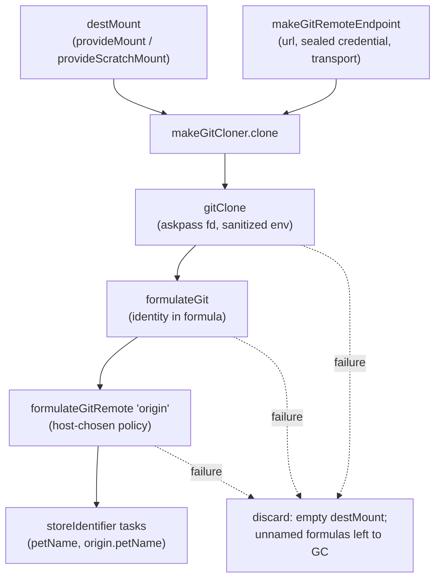

# Repository Bootstrap: `provideGitClone` and the Commit-Identity Boundary

| | |
|---|---|
| **Created** | 2026-10-22 |
| **Author** | Kris Kowal (prompted) |
| **Status** | Proposed |

## Status

This design is the home that [daemon-git-remotes](daemon-git-remotes.md) § Repository Bootstrap and `clone` and [daemon-git-next-steps](daemon-git-next-steps.md) § Reconciliation deltas deferred to.
It has two parts: a record of what is already on `llm`, and a normative revision of the bootstrap surface.

Already on `llm`:

- **Clone seam (#538).** `gitClone` in `@endo/git` (`native-git-backend.js`) is the host-only native clone.
  `makeGitRemoteEndpoint` and `makeGitCloner` in `@endo/exo-git` (`git-remote.js`, `git-cloner.js`) compose an endpoint and an empty mount into a `(Git, GitRemote)` pair.
  `EndoHost.provideGitClone(opts)` in `@endo/daemon` (`host.js`) wires the daemon's formula machinery into that seam.
- **Commit identity (#706, merged 2026-07-16).** `provideGit` and `provideGitClone` both accept a formula-owned `identity: GitCommitIdentity`, which `normalizeGitIdentity` validates.
  Committer fields are optional and default to the author.

The revision (§ Design) closes five gaps in the shipped surface.
Gaps 1 to 4 come from the #709 design panel (2026-07-17).
Gap 5 comes from the first in-tree caller.

1. **Origin policy is wider than its sibling.** The shipped `makeRemote` step hardcodes `allowedDirections: ['fetch', 'push']` over `refs/heads/*`.
   `provideGitRemote` defaults to `['fetch']`, and [daemon-git-remotes](daemon-git-remotes.md) § Agent MVP Profile restricts push to `refs/heads/agent/*`.
   The host cannot narrow the policy at clone time.
2. **Nothing binds a pet name.** `provideGitClone` takes no `petName` and registers no `storeIdentifier` task.
   It is also the only `provide*` method whose subject is not the first positional argument.
3. **No layer owns discard.** A clone aborted mid-transfer leaves partial content in a mount that the call required to be empty, so the caller cannot retry into it.
4. **A safety claim has no test.** No test exercises the credential-rotation abort (`captureCredentialVersion`, `assertCredentialUnchanged`, `watchChange`).
5. **The caller works around gaps 1 and 2.** The floot workspace bootstrap (`packages/floot/src/system-prompt.js`) calls `provideGitClone`, throws the result away, then calls `provideGit` and `provideGitRemote` again over the same mount to get a named `Git` and a narrower `origin`.
   It passes `identity` twice, and it leaves an unnamed fetch+push `origin` formula for GC to collect.

## What is the Problem Being Solved?

[daemon-git-remotes](daemon-git-remotes.md) § Repository Bootstrap and `clone` names two product flows.
In the first, the host already has a worktree mount and derives `Git` and `GitRemote` from it.
The second is "you give me a URL, the agent runs, and its commits are attributed correctly".
Two facts shape the second flow:

- **Cloning is constructive.** Before the clone there is no repository and no `Git` to attenuate, so `clone` cannot be a method on `Git` or on `GitRemote`.
  It must combine mount authority, endpoint policy and sealed credential authority before the capabilities the agent loop uses exist.
- **Attribution is authority.** The agent must not choose the identity its commits carry.
  The identity is also a separate thing from the credential that authorizes a push.

Both steps stay host-mediated.
The host decides which remotes get cloned into which mounts, and which name appears on the commits.
The guest receives only the resulting capabilities.

## Design

### The bootstrap call

```ts
provideGitClone(
  destMount: EndoMount,             // daemon-minted, writable, empty
  petName: string | string[],       // names the cloned Git
  options: {
    endpoint: {
      url: string;                  // no embedded credentials
      credential?: GitCredential;   // daemon-minted; sealed
      allowLocalFileTransport?: boolean; // default false
    };
    identity?: GitCommitIdentity;   // formula-owned, guest-immutable
    origin?: {
      petName?: string | string[];  // names the origin GitRemote
      allowedDirections?: Array<'fetch' | 'push'>; // default ['fetch']
      fetchRefspecs?: string[];     // default +refs/heads/*:refs/remotes/origin/*
      pushRefspecs?: string[];
      allowedBranches?: string[];
      defaultPullRef?: string;
      allowForcePush?: boolean;
      allowTags?: boolean;
      allowDelete?: boolean;
    };
  },
): Promise<{ git: ReadWriteEndoGit; remote: GitRemote }>;
```

The argument order is `(subject, petName, options)`, the same as `provideGit` and `provideGitRemote`.
The `origin` record takes the same policy fields that `provideGitRemote` accepts, minus three that the clone fixes: `name` (always `origin`), `url` and `credential` (both come from the endpoint, so the remote talks to the server that was cloned).
`allowLocalFileTransport` is inherited from the endpoint and cannot be set on `origin`.
Policy normalization is the existing `git-remote-policy.js` path, so a clone-minted `origin` cannot hold a policy that `provideGitRemote` would reject.

**Defaults.** `origin` defaults to fetch-only, the same as `provideGitRemote`.
To push, the host opts in, typically with the Agent MVP Profile: `{ allowedDirections: ['fetch', 'push'], allowedBranches: ['refs/heads/agent/*'] }`.
The hardcoded fetch+push over `refs/heads/*` is removed.

**Names.** `petName` names the `Git`, and `origin.petName` names the remote if given.
Both `storeIdentifier` tasks are deferred and run only after the whole composition succeeds.
An unnamed `origin` is reachable only through the returned reference.
Once that reference is dropped, the existing formula mark-and-sweep (`collectIfDirty`, [daemon-content-store-gc](daemon-content-store-gc.md)) collects it.
Retention is owned by whoever names the formula, as it is for every other `provide*` method.

**Migration.** The one-object form `provideGitClone({ destMount, endpoint, identity })` is removed, and the build migrates every in-tree caller in the same change.
Today those are the floot bootstrap, `packages/daemon/test/git-remote.test.js` and `git-authority-types.test-d.ts`.
The floot bootstrap shrinks to a single call that passes its push-to-`agent` policy as `origin`, with no separate `provideGit` and `provideGitRemote` re-derivation.

### Composition and commit/discard



`provideGitClone` validates its inputs and then calls `makeGitCloner(...).clone(...)`.
The cloner runs the native clone, mints the `Git` formula over the destination, and mints the `origin` formula.
It checks that the endpoint credential has not changed between every pair of steps.
A credential change during the native clone aborts the git subprocess through the `AbortController` that is wired to `endpoint.watchChange`.

**Discard is owned by the host method.**
On entry, `gitClone` proves the destination is empty, and the caller is expected to hold the mount exclusively until the call returns.
If any step after the emptiness check fails, `provideGitClone` empties the destination before it rethrows.
That leaves the mount as it was on entry, so the caller can retry into the same mount.
Formulas minted before the failure have not been named, because naming is deferred to the last step, so formula GC collects them.
Content another writer puts in the mount during the call is discarded along with the partial clone: concurrent writes to a clone destination are caller error.
`makeGitCloner` itself stays portable and does no filesystem cleanup, because the emptying happens through the daemon's mount host path.

### Clone-time restrictions (unchanged)

The `gitClone` boundary checks the following before it spawns git, and `native-git-backend.test.js` already covers these checks:

- the URL must not embed credentials (`user:pass@`);
- `http:` is rejected, and a credential requires `https:`;
- `file:` requires `allowLocalFileTransport`;
- the destination must be empty;
- credential material reaches git only through the `GIT_ASKPASS` fd-pipe helper ([daemon-git-remotes](daemon-git-remotes.md) § Initial Backend);
- git is spawned with an argv array, with `--end-of-options` before positional arguments.

### The commit-identity boundary as a capability shape

**The `Git` capability is the pen.**
An identity is data that the host writes into a `git` formula when the formula is constructed.
The right to make commits that carry that identity belongs to whoever holds that `Git` (or a writable attenuation of it).
No method looks up who is calling and then picks a name.
The attenuations follow from this:

| Holder has | Can attribute commits to |
|---|---|
| a writable `Git` with identity *I* | *I* (author and committer per `GitCommitIdentity`) |
| a read-only `Git` | nothing; it cannot commit |
| a history-rewrite `Git` (`allowHistoryRewrite`) | *I* as committer. `reword` keeps the original author, and `commit({ amend })` keeps the amended commit's author |
| two `Git`s over the same mount with identities *I* and *J* | both, and each commit carries the identity of the `Git` that made it |
| a `GitRemote` or a `GitCredential` | no one. Pushing moves commits that already exist and never re-attributes them |

The table has four consequences:

- **Identity and credential stay separate.** The forge's record of who pushed comes from the credential, while the commit author comes from the identity.
  Neither is derived from the other. A host that wants them to match passes both.
- **Changing an identity means minting a new `Git`.** The host creates a new formula over the same mount, as it does to re-pin a `Git` ([daemon-git-capability](daemon-git-capability.md) Design Decision 7).
  The old `Git` keeps its identity, and whoever holds it can still commit with it until the host revokes it.
  There is no mutable shared identity.
- **Delegating a `Git` delegates its identity.** A guest that passes its `Git` to a sub-agent lends it the right to commit under that identity.
  To keep sub-agent work distinguishable, the host mints the sub-agent its own `Git` with its own identity.
  This is the same rule that applies to delegating any capability, and it is why attribution belongs to the `Git` formula rather than to whoever is calling.
- **`provideGitClone` passes `identity` through to the cloned `Git` only.** The `origin` remote carries no identity.
  The identity is never used to decide whether an action is allowed.
  It only labels commits made through a `Git` the holder already has.

Considered and rejected: a guest-visible `setIdentity()`. Reason: the guest would choose its own attribution.
Considered and rejected: deriving the identity from the credential's account. Reason: it merges two authorities that must be revocable separately, and the forge account is not necessarily the right commit author.
Considered and rejected: a separate `GitIdentity` capability passed into `provideGit`. Reason: nothing can be done with an identity except write it into a `Git` formula, the host already supplies it as plain data the guest cannot reach, and a new formula type would add revocation and GC surface without letting anyone do anything new.

## Ownership map

| Boundary | Mechanism | Policy | Durable state | Lifecycle / commit authority | Value crossing |
|---|---|---|---|---|---|
| host method to mount layer | `getMountHostPath` | the mount's own (`readOnly`, deny patterns) | the `mount` / `scratch-mount` formula | the caller provisions and retires the mount; `provideGitClone` empties it on failure | `EndoMount` in, host path internally |
| host method to cloner seam (`@endo/exo-git`) | `makeGitCloner` | none; it composes injected makers | none | the cloner orders the steps and fences the credential; the host method decides commit or discard | endpoint, `clone`, `makeGit`, `makeRemote` in; `{ git, remote }` out |
| cloner to native backend (`@endo/git`) | `gitClone` subprocess | clone-time restrictions above | the worktree bytes in the mount | ends when the subprocess exits or the signal aborts it | URL, path, credential (fd only), `AbortSignal` |
| host method to formula store | `formulateGit`, `formulateGitRemote`, deferred `storeIdentifier` | `identity` in the `git` formula; `origin` policy in the `gitRemote` formula | both formulas | named on success; otherwise unnamed and collected by mark-and-sweep | formula ids |
| credential layer to cloner | `GitRemoteEndpoint` (`ensureCredentialUsable`, `watchChange`) | the credential controller's rotation and revocation | credential material, daemon-process-local | the credential controller can abort a clone in progress | sealed credential; the guest never sees the material |

The four ownership questions:

- **Persistent state** belongs to the formula store (the identity and `origin` policy) and the mount (the bytes).
- **Commit or discard** belongs to `provideGitClone`.
- **Restart and replay** belong to formula reincarnation. A clone that has not finished when the daemon restarts produced no named formula and is not resumed. The caller retries into the emptied mount.
- **Execution classification** (credential-change abort versus any other failure) belongs to the cloner, through `assertCredentialUnchanged` in its `catch`.

Naming check: the cloner returns a composition result, `{ git, remote }`, and none of its types are named for host lifecycle concepts.

## Dependencies

| Design | Relationship |
|---|---|
| [daemon-mount-capabilities](daemon-mount-capabilities.md) | Supplies the destination: a writable, empty `EndoMount`. |
| [daemon-git-capability](daemon-git-capability.md) | Defines the product: an ordinary mount-derived `Git` whose formula carries the identity. |
| [daemon-git-remotes](daemon-git-remotes.md) | Defines the endpoint, credential, policy and Agent MVP Profile shapes. Its § Repository Bootstrap points here. |
| [daemon-git-next-steps](daemon-git-next-steps.md) | The roadmap. Its Phase 2 (identity) is the shipped half of § The commit-identity boundary. |
| [daemon-content-store-gc](daemon-content-store-gc.md) | The formula mark-and-sweep that collects unnamed formulas from a failed bootstrap. |
| [daemon-capability-persona](daemon-capability-persona.md) | A possible future source of per-persona identity (deferred). |
| [daemon-capability-bank](daemon-capability-bank.md) | The future durable home for credential material that the endpoint seals. |

## Phased implementation

One build job, rooted at `llm`:

1. **Surface.** Change `provideGitClone` to `(destMount, petName, options)` with the `origin` record and a fetch-only default.
   Defer the `storeIdentifier` tasks to the end of the composition.
   Update `EndoHost['provideGitClone']` in `types.d.ts` and the `interfaces.js` guard.
2. **Discard.** Empty the destination on any failure after the emptiness check, and rethrow the original error.
3. **Callers.** Migrate the floot bootstrap to a single call, and migrate the daemon tests.
4. **Tests.** Add:
   - a credential rotated during the native clone aborts the subprocess, rejects the call, and leaves the mount empty;
   - a failure injected after `formulateGit` leaves the mount empty and no pet name bound, and a retry into the same mount succeeds;
   - the default `origin` refuses `push`, and an `origin` that opts into the Agent MVP Profile pushes only `refs/heads/agent/*`;
   - `petName` and `origin.petName` resolve after a daemon restart;
   - an `origin` policy that `provideGitRemote` would reject is rejected here too.

## Design Decisions

1. **Host-mediated, never guest authority.** This is the second flow of [daemon-git-remotes](daemon-git-remotes.md) § Repository Bootstrap and `clone`.
2. **The mount is an input, not a product.** Mount policy is decided once, at the mount layer.
   Considered and rejected: minting the mount inside `provideGitClone` (the original roadmap sketch). Reason: it would duplicate the `provideMount` / `provideScratchMount` option surface behind clone flags. Callers create a scratch mount in one call anyway.
3. **Clone lives on neither `Git` nor `GitRemote`.** Both attenuate a repository that already exists. The seam takes the endpoint and the mount, the two authorities that exist before the repository does.
4. **`makeGitCloner` stays a standalone portable maker.** That keeps a later guest-held `GitCloner` plus `GitClonerController` an addition rather than a rewrite.
5. **`origin` policy is host-chosen data that defaults to fetch-only.** The clone-time default matches `provideGitRemote`, and the Agent MVP Profile is opt-in.
6. **Discard belongs to the host method, and naming happens last.** A failed bootstrap leaves an empty mount and no named formulas.
7. **Identity is construction-time formula data, and the `Git` is its bearer capability** (§ The commit-identity boundary as a capability shape).
8. **Keep the `{ git, remote }` return.** Considered and rejected: returning only `Git` like the other `provide*` methods. Reason: the remote is only reachable through the composition, and an unnamed `origin` would be unreachable.

## Open Questions

- Should verifiable attribution become a capability, by signing commits with a daemon-sealed signing key handed to `provideGit` / `provideGitClone` the way `GitCredential` is? Under this design the identity is a label and not proof. A signing key would be a real new authority (it can be used, rotated and revoked), unlike the `GitIdentity` capability rejected above. Tracking issue: to be filed.
- Should `provideGitClone` accept an optional `depth` / `singleBranch` bound on the native clone, so a host can cap what a large remote costs on disk? Today it does a full clone.

## Prompt

> Design step for endojs/endo-but-for-bots (base `llm`): write `designs/daemon-git-clone.md`, specifying `provideGitClone(...)` repository bootstrap (mount creation + endpoint policy + sealed credential authority + clone into the new mount) and the commit-author/identity boundary as a capability shape. This is the open item in `daemon-git-next-steps` that the `GitRemote` composition (`daemon-git-remotes` § Repository Bootstrap) now unblocks, and it serves the capability git remote arc.
