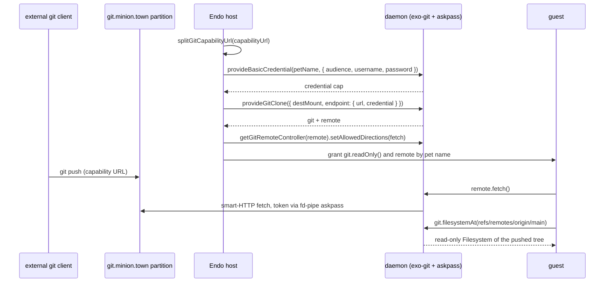

# Daemon Git Remotes over Capability URLs

| | |
|---|---|
| **Created** | 2026-09-29 |
| **Updated** | 2026-10-24 |
| **Author** | kriscendobot (prompted) |
| **Status** | Proposed |

> **Read in order.**
> This is an increment on [daemon-git-remotes](daemon-git-remotes.md)
> (doc 3 of the git trio) and requires it.
> It is the Endo-side consumer of the capability-addressed git remote
> designed in `kriscendobot/minion.town` `designs/git-remote-capability.md`
> ([kriscendobot/minion.town#41](https://github.com/kriscendobot/minion.town/pull/41)).
> That design's first increment is deployed at `https://git.minion.town`
> ([kriscendobot/minion.town#86](https://github.com/kriscendobot/minion.town/pull/86),
> [kriscendobot/minion.town#136](https://github.com/kriscendobot/minion.town/pull/136)).

## Summary

Let the host adopt a **git capability URL**
(`https://x-access-token:<token>@git.minion.town/<partition>`) as a daemon
`GitRemote`.
The token must never reach a formula, an error message, a git process's
argv, or the guest.
One new pure helper in `@endo/exo-git`, `splitGitCapabilityUrl`, splits the
URL into a credential-free endpoint URL and the basic-auth fields.
The host feeds those fields to the landed `provideBasicCredential`, and the
landed `provideGitRemote` or `provideGitClone` does the rest.
For a clone that must be fetch-only before it is granted, the host narrows
the origin with the landed `GitRemoteController.setAllowedDirections`.
The slice adds no host method and no `provideGitClone` option.
It also fixes a live leak: today the embedded-credential rejection echoes
the whole URL, token included, back over CapTP.

This is the next mergeable slice of M3's `daemon-git-remotes` row.
It closes the client half of the M3 exit criterion's capability-addressed
`git push` ("a capability-addressed `git push` lands an artifact into an
Endo directory") using only landed substrate.
An external client pushes to a partition.
A daemon-side `GitRemote` bound to that partition fetches it into a `Git`, and
that `Git`'s `filesystemAt(ref)` is the Endo directory view.

## Reconciliation: what has landed, and what the dependency actually needs

**Landed on `llm` (as of 2026-09-29).**
Phases 1-5 of [daemon-git-remotes](daemon-git-remotes.md) § Implementation
Plan shipped in #365; fd-pipe askpass in #368; host-mediated
`provideGitClone` in #538; commit identity in #706.
Hardening and ergonomics followed: #532 (independent `file:` fetch of a
pushed branch), #633 and #734 (public types), #929 (policy normalization,
`defaultPullRef`), #973 (bounded network-sourced results), #1022 (`help()`),
#1145 (`credentialHealth()`).
The agent-facing push tier `makeGitRemoteTool` shipped in #705, and nested
Git grants for code mode in #958.
Phases 6 (interactive provisioning) and 7 (extended transports) remain open,
and issue #378 carries the hardening follow-ups on the landed code.

**What the capability-addressed git remote needs from Endo.**
The `designs/README.md` M3 row states that minion.town § 12's Endo
follow-on "is the git trio + `makeGitRemoteTool`".
That covers only one of the two directions minion.town § 12 names:

- **Endo as client** (a daemon agent fetching from or pushing to a
  partition).
  The git trio already covers this except for one gap: nothing turns a
  capability URL into a `GitRemote`.
  `normalizeGitRemoteUrl` in `@endo/exo-git` rejects embedded userinfo, and
  nothing splits it.
  **This document closes that gap.**
- **Endo as server** (§ 12 items 1, 3, 4, 7: the partition primitive,
  capability-URL minting and revocation, the git-object <-> CAS database,
  per-partition reclamation).
  The trio does not cover any of this.
  Minion.town's increment 1 implements it outside Endo (`git http-backend`
  over one bare repo per partition).
  If the server half moves into the daemon, its Rust backing is
  [endor-git-bindings](endor-git-bindings.md) (M11).
  Moving it into the daemon is a separate design (**to be filed**) and is not
  on the M3 critical path, because the deployed minion.town server already
  provides the server half.

Minion.town § 12 item 2 (widening the MCP guest facet with `send`
attachments, `request`, and `identify`) belongs to minion.town and to
[endo-guest-stdio-mcp](endo-guest-stdio-mcp.md), not to this stack.

## Design

### `splitGitCapabilityUrl`

```ts
splitGitCapabilityUrl(text: string): {
  url: string;
  audience: string;
  username: string;
  password: string;
};
```

- A pure function in `@endo/exo-git`, next to `normalizeGitRemoteUrl`, and
  exported from the package index.
  It accepts only `https:` URLs whose userinfo carries a non-empty password
  (the token).
  `url` is the input with userinfo removed; `audience` is
  `new URL(url).origin`.
  A missing username defaults to `x-access-token`, the fixed non-secret
  username minion.town mints.
- Host code (the CLI, or a caplet holding the host) calls it and passes
  `{ audience, username, password }` to the landed
  `provideBasicCredential(petName, ...)`.
  The capability URL itself never crosses CapTP.
  The password crosses once, as the landed `provideBasicCredential` argument
  already does, and reaches only the process-local material map in
  `manager.js`.
- `url` is **not a secret**.
  The partition id in its path names a partition and grants nothing, so
  `GitRemote.inspect()` may show it (Design Decision 8 of
  [daemon-git-remotes](daemon-git-remotes.md) is unchanged).
- Errors never contain the input.
  An unparseable URL fails with `"capabilityUrl is not a valid https URL"`;
  a URL with no token fails with `"capabilityUrl carries no token"`.
  Neither message quotes the argument.

A daemon-side compound method (`provideGitCapabilityCredential`, split plus
mint) was considered and dropped: it would be exactly this helper followed by
`provideBasicCredential`, and it would add a secret-parsing host entry point,
which Open question 3 argues against.

### Fetch-only clone through the landed controller

The landed `provideGitClone` mints its origin with
`allowedDirections: ['fetch', 'push']` and `pushRefspecs:
['refs/heads/*:refs/heads/*']` (`packages/daemon/src/host.js`, the
`makeRemote` callback).
Granting that `remote` unchanged in an ingestion flow would give the guest
push authority.
The landed host-side controller already narrows it:
`getGitRemoteController(remote)` returns a `GitRemoteController` whose
`setAllowedDirections` validates through the policy normalizer
(`git-remote-policy.js`), persists through the remote's formula state
(`persistGitRemoteState` in `manager.js`), and invalidates in-flight
operations.
The narrowed policy is formula-owned, so the guest cannot widen it, and a
restart revives it fetch-only.

The ingestion flow narrows the origin before anything is granted:

```js
import { splitGitCapabilityUrl } from '@endo/exo-git';

const { url, audience, username, password } =
  splitGitCapabilityUrl(capabilityUrl);
const credential = await E(host).provideBasicCredential('inbox-cred', {
  audience,
  username,
  password,
});
const { git, remote } = await E(host).provideGitClone({
  destMount: scratch,
  endpoint: { url, credential },
});
const controller = await E(host).getGitRemoteController(remote);
await E(controller).setAllowedDirections(['fetch']);
// Grant the guest `E(git).readOnly()` and `remote`. After `remote.fetch()`,
// `filesystemAt('refs/remotes/origin/main')` is the pushed artifact, and
// `remote.push()` rejects with "does not permit 'push'".
```

Until `setAllowedDirections` resolves, only the host holds `remote`, so push
is enabled but unreachable by the guest.
That holds only if the window is not interrupted.
`provideGitClone` persists the origin formula with fetch+push before the
narrowing call, so a host crash, a thrown error, or a retry between the two
calls leaves a durable fetch+push remote behind.
The rule for host code is therefore: do not name `remote` in the pet-name
store, and do not grant it, until `setAllowedDirections(['fetch'])` has
resolved.
A host that retries after a failure narrows again before granting (the call
is idempotent), and a remote that never reached a grant is discarded with the
scratch mount.
The fallback, if a reviewer judges the window too wide, is the atomic form
this slice dropped: a policy option on `provideGitClone` (Open question 5).
The guest receives `readOnly()` of the `Git` rather than the read-write cap,
because reading the artifact needs no commit authority.

When the host does intend to grant push to an existing worktree,
`provideGitRemote(git, 'partition', { name: 'origin', url, credential,
allowedDirections: ['fetch', 'push'], pushRefspecs:
['refs/heads/main:refs/heads/main'] })` binds the partition directly.

### Attenuation is stated, never inferred

A minion.town capability URL does not reveal whether it is a `read` or a
`readwrite` token; minion.town's attenuation is a field on its server-side
record.
The daemon therefore infers nothing from the URL.
The host states the directions: `provideGitRemote` takes
`allowedDirections` and defaults to `['fetch']`, while `provideGitClone`
mints fetch+push and the host narrows it through the controller.
The two landed defaults differ; this slice does not change either, and the
worked example above shows the narrowing step a fetch-only grant needs.
The server enforces its own attenuation independently: a `read` token's push
gets a 403.
Each gate is owned by the side that holds the authority, and neither trusts
the other.

### Secret hygiene fix on the landed path

`normalizeGitRemoteUrl` (`packages/exo-git/src/git-remote-policy.js`) quotes
its input in all three of its rejections:
`is not a valid URL: ${q(urlText)}`,
`must use https: for the MVP transport: ${q(urlText)}`, and
`must not include embedded credentials: ${q(urlText)}`.
The scheme check runs before the credentials check, so
`http://x-access-token:<token>@host/p` leaks through the scheme message even
if the credentials message is fixed.
The same function also backs `normalizeGitRemotePolicy`, which every
`GitRemoteController` policy update runs, so callers other than the two
`provide*` methods can reach these messages.
A host that passes a capability URL straight to `provideGitRemote` or
`provideGitClone` therefore gets the token back inside a rejection that
crosses CapTP and lands in logs and agent transcripts.
This slice routes all three sites through one redacting helper: a URL that
parses is printed with username and password replaced by `***`, and an
unparseable input is quoted not at all.
The embedded-credentials message also names `splitGitCapabilityUrl` as the
right entry point.

### Redaction boundary

The capability URL stays in the host's process; `splitGitCapabilityUrl` is
the only code that sees it whole.
The only secret that crosses into the daemon is the password, through the
landed `provideBasicCredential` argument, whose boundary is the landed
material map.
Concretely:

- **Formula records.** The persisted `git-credential` formula is
  `{ type, kind: 'basic', audience }`, the landed shape.
  The username is material, like the password, not formula state.
  The `GitRemote` formula holds the credential-free `url` and the policy.
- **Pet-name store.** It records only the pet name and the formula id.
- **Audit surfaces.** The landed `GitRemoteController.audit()` log records
  `create`, `policy`, and `revoke` events, each with a policy snapshot whose
  `url` is credential-free.
  The credential controller keeps no audit log, and CapTP does not record
  arguments.
  The audit entries for outbound ref updates
  ([daemon-git-remotes](daemon-git-remotes.md) § Implementation Plan, Phase
  4) have not landed; when they do, they may name only the pet name, the
  credential kind, the audience, and the credential-free `url`.
  This document makes that a constraint on that work.
- **Errors.** No message quotes the argument (§ `splitGitCapabilityUrl`,
  § Secret hygiene fix on the landed path).
- **Git processes.** The token reaches git only through the landed fd-pipe
  askpass, never argv, environment, or a temp file.

The tests in § Implementation plan check each item against real persisted
bytes and real spawned processes, not against in-memory objects.

### Restart behavior

Credential material is process-local by design
([daemon-git-remotes](daemon-git-remotes.md) § Initial Backend).
After a daemon restart, a capability-URL credential therefore reports
`revoked: true` through `credentialHealth()`.
It stays unusable until the host calls `rotate({ username, password })`.
A capability URL is shown once, so to recover, the host must have kept the
URL itself.
This slice keeps the landed invariant and documents the recovery; durable
custody is the bank item in [daemon-git-next-steps](daemon-git-next-steps.md)
§ Beyond the Loop.



## Ownership map

| Boundary | Mechanism | Policy | Durable state | Lifecycle / commit authority | Value crossing |
|---|---|---|---|---|---|
| Host code -> daemon host method | `splitGitCapabilityUrl` in `@endo/exo-git` (host side), landed `provideBasicCredential` | Host decides whether to adopt a URL | Formula: kind, audience only | Host (pet-name store, `GitCredentialController`) | Audience, username, and password, once, in the landed method argument; never the whole URL |
| Daemon -> `GitRemote` formula | Landed `provideGitRemote` / `provideGitClone`, narrowed by the landed `GitRemoteController.setAllowedDirections` | Host-stated `allowedDirections`, refspecs, force flags | Formula: credential-free URL + policy | Host via `GitRemoteController` | Credential cap reference; never material |
| `GitRemote` -> minion.town server | Native git over HTTPS, token via fd-pipe askpass | Server-side attenuation (`read` / `readwrite`), partition confinement | Server: refs, objects, token hashes | Minion.town operator (mint, revoke) | Packfiles on the HTTPS data plane; never CapTP |
| `Git` -> guest | Landed `filesystemAt(ref)` | Read-only view | None new | Daemon (view lifetime follows `Git`) | `Filesystem` capability |

The four ownership questions:

- **Persistent state:** the daemon persists only credential-free policy;
  the token lives in process memory; the minion.town server owns refs,
  objects, and token bindings.
- **Commit or discard:** the remote ref advance belongs to the minion.town
  server (the `receive-pack` ref lock); the local remote-tracking ref advance
  belongs to the daemon's landed `fetch` fence.
- **Restart and replay:** after a daemon restart the host re-supplies
  material through `rotate`; the server's durable token bindings make that
  replay idempotent.
- **Execution classification:** a 401 means the token was revoked
  server-side, a 403 means the attenuation is too weak, a 404 means the URL
  names the wrong partition.
  The server decides which one applies.
  The daemon currently passes all three through as the failing operation's
  error; mapping them to structured results is the existing in-flight-failure
  item in [daemon-git-remotes](daemon-git-remotes.md) § Testing Plan, not
  part of this slice.

## Implementation plan (one PR, base `llm`)

1. `@endo/exo-git`: `splitGitCapabilityUrl`, exported from the package
   index, plus unit tests (userinfo split, default username, `http:`
   rejected, no token rejected, messages never contain the input).
2. `@endo/exo-git`: route all three `normalizeGitRemoteUrl` rejections
   (invalid URL, non-`https:` scheme, embedded credentials) through one
   redacting helper.
   Update the existing `/embedded credentials/` assertions in
   `packages/daemon/test/git-remote.test.js` to also assert that the token
   substring is absent, and add cases for an `http:` URL with userinfo and
   an unparseable token-bearing string, through both `provideGitRemote` and
   `normalizeGitRemotePolicy` (the path every `GitRemoteController` policy
   update runs).
   Before landing, grep `normalizeGitRemoteUrl` for every remaining
   `${q(` interpolation; the count must be zero.
3. Integration test in `packages/daemon/test/git.test.js`: stand up the
   existing HTTP credential fixture requiring Basic `x-access-token:<token>`,
   split a capability URL, mint the credential with `provideBasicCredential`,
   call `provideGitClone`, and narrow the origin with
   `getGitRemoteController(remote).setAllowedDirections(['fetch'])`.
   Push from an independent client, `fetch`, and read the pushed file through
   `filesystemAt`.
   Then, holding only what the guest would be granted, assert that
   `remote.push()` rejects with "does not permit 'push'" and that the fixture
   received no `git-receive-pack` request.
   Repeat the push rejection after a daemon restart, to show the narrowed
   policy is formula-owned.
   Cover the failure modes this document names:
   - after the restart, `credentialHealth()` reports `revoked: true` and
     `fetch` fails; `rotate({ username, password })` restores it;
   - a token the fixture no longer accepts (rotated or revoked server-side)
     makes `fetch` reject with the 401 passed through, and the rejection
     carries no token;
   - a credential whose audience does not match the remote's origin is
     refused at `provideGitClone` / `provideGitRemote` construction;
   - interrupting between `provideGitClone` and `setAllowedDirections`
     leaves no pet name for `remote`, so nothing grantable carries push.
4. Redaction test against real serialization, in the same file: after
   adoption, read every file under the daemon's state directory (formula
   records and the pet-name store) and the daemon log as raw bytes, and
   assert the token appears in none of them.
   Also assert its absence from `inspect()`, from
   `GitRemoteController.audit()`, and from every rejection produced by the
   error cases.
5. Argv test: extend the landed fake-git test
   (`NativeGitBackend askpass keeps credential out of argv, env, and temp
   files`) with a case whose credential comes from a split capability URL,
   so the spawned git process's argv, environment, and temp files are
   observed directly.
6. Help text: name `splitGitCapabilityUrl` in the `provideBasicCredential`
   and `provideGitClone` help entries (`help-text-data.js`), including the
   fetch-only narrowing step and restart recovery through `rotate`.
   The `provideGitClone` entry also says that a host that skips the
   narrowing step grants push even on a `read` token, and that the server's
   403 is then the only backstop.
7. On merge, flip this document's status to Complete and record the PR in
   [daemon-git-remotes](daemon-git-remotes.md) § Implementation Progress.
   (The reconciliation edits to that document and to the README M3 rows land
   with this design.)

Out of this slice: a guest-side adoption verb (the host adopts and grants),
CLI flags such as `--capability-url-file`, exact-URL credential scoping, and
durable custody.

## Open questions

1. **Should a capability-URL credential bind to its exact URL rather than
   its origin?**
   The landed audience check is origin-level, so two partitions' credentials
   on `git.minion.town` are interchangeable to the daemon, and a host
   mis-binding one gets a 404 from the server rather than a construction-time
   refusal.
   Recommend: add an optional exact-URL scope to basic credentials, as a
   follow-up, since the server's confinement already fails
   closed.
2. **Should git capability URLs join the `#v=1` capability-URL locator
   family?**
   Design PR
   [endojs/endo-but-for-bots#1360](https://github.com/endojs/endo-but-for-bots/pull/1360)
   (`capability-url-locators`, open, not yet accepted) proposes locators as `endo://`
   or `https` URLs with a `#v=1` fragment, while minion.town's git URL
   carries its token in userinfo because stock `git` needs it there.
   Recommend: keep them separate families, and let `endo store --locator`
   recognize a userinfo git URL only after #1360 is accepted.
3. **Should the daemon accept `{ capabilityUrl }` directly, through a new
   host method or on `provideGitClone` and `provideGitRemote`?**
   It would save the host one call, at the cost of daemon-side entry points
   that parse secrets and a whole token-bearing URL crossing CapTP.
   Recommend: not in this slice; the host-side helper keeps parsing in one
   pure function.
4. **Who keeps a show-once capability URL across a daemon restart before the
   bank lands?**
   Recommend: the adopting operator, as with any other rotated credential;
   revisit when [daemon-capability-bank](daemon-capability-bank.md) lands.
5. **Should `provideGitClone` take an `allowedDirections` option so narrowing
   is atomic?**
   The two-step form leaves a fetch+push origin persisted if the host fails
   between the calls (§ Fetch-only clone through the landed controller).
   Recommend: not in this slice; the host rule (no pet name and no grant
   before narrowing) and its test close the window, and the option can follow
   if a second caller needs it.

## Dependencies

| Design | Relationship |
|---|---|
| [daemon-git-remotes](daemon-git-remotes.md) | Parent: `GitRemote`, credentials, fd-pipe askpass, `provideGitClone`. This slice adds one pure `@endo/exo-git` helper and a message fix, and composes the landed `provideBasicCredential`, `provideGitClone`, and `GitRemoteController`. |
| [daemon-git-capability](daemon-git-capability.md) | `Git.filesystemAt(ref)`, the Endo directory view of the fetched artifact. |
| [daemon-git-next-steps](daemon-git-next-steps.md) | Stack roadmap; its bank item owns durable credential custody. |
| `kriscendobot/minion.town` `designs/git-remote-capability.md` ([kriscendobot/minion.town#41](https://github.com/kriscendobot/minion.town/pull/41)) and its deployed increment 1 ([kriscendobot/minion.town#86](https://github.com/kriscendobot/minion.town/pull/86)) | The server this slice talks to: capability-URL shape, `x-access-token` username, server-side attenuation and confinement. |
| [endor-git-bindings](endor-git-bindings.md) | Future Rust backing for a daemon-side server half; not needed by this slice. |
| Design PR [endojs/endo-but-for-bots#1360](https://github.com/endojs/endo-but-for-bots/pull/1360) (`capability-url-locators`, open) | Sibling capability-URL family (`#v=1` fragment); see Open question 2. |

## Prompt

> Design the next implementation increment for `endojs/endo-but-for-bots`'s
> M3 `daemon-git-remotes` capability, reconciling its landed phases with the
> capability-addressed git-remote dependency and identifying the mergeable
> next slice.
