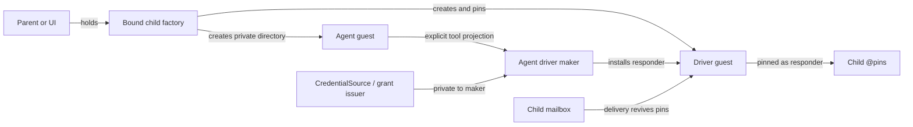
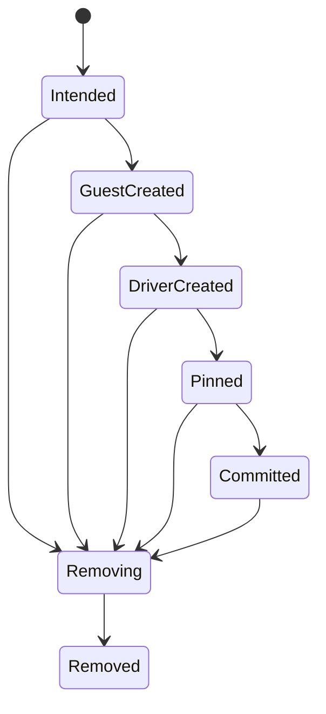

# A capability-scoped factory for durable child-agent guests

| | |
|---|---|
| **Created** | 2026-10-26 |
| **Author** | kriscendobot (prompted) |
| **Status** | Proposed |
| **Source** | Replaces the closed, pre-`@endo/inference` proposal in [PR #1102](https://github.com/endojs/endo-but-for-bots/pull/1102), after the confinement core in [PR #1015](https://github.com/endojs/endo-but-for-bots/pull/1015) merged and the daemon and inference dependencies below landed |

## Summary

Add `@endo/exo-agent-factory`, a provider- and harness-neutral service that
turns a held `AgentDriverMaker` capability into a durable child guest. The
factory owns a private namespace and a monotonically attenuated policy. The
caller chooses a maker by capability, not by a provider name or account
identifier. The child receives only the ordinary capabilities explicitly named
in its endowments. Credentials, the root host, and the factory's private
directory never cross into the child.

The design extracts the topology already exercised by Fae's
`provisionFaeAgent` and `SubagentSpawner`, then closes its crash and restart
gaps with an append-only operation journal and the daemon's landed caller-elected
`@pins` directory. `@endo/inference` and the Claude backends are adapters, not
the factory's identity. A deployment can use the same mechanism for Claude,
Codex, local models, Fae, or Lal.

This is the current replacement for PR #1102. It deliberately does **not**
restore that proposal's Claude-specific account families, lease vocabulary, or
automatically recursive factory. Those choices predated the generic inference
seam and the daemon's caller-elected pins.

## Why the old proposal no longer builds cleanly

PR #1102 began as a recursive Claude-agent factory with a special-name map,
credential-family identifiers, single-use child leases, and a separate
revocation protocol. Review narrowed it to guest special names. The daemon then
landed caller-selected ordinary names, networks, and pins in
[PR #1306](https://github.com/endojs/endo-but-for-bots/pull/1306), and review
selected the general endowments-map work in
[PR #1343](https://github.com/endojs/endo-but-for-bots/pull/1343) instead of a
child-agent-specific naming change. PR #1102 closed with no remaining
independent scope in that shape.

The relevant substrate has since changed:

- `@endo/inference` landed in
  [PR #1403](https://github.com/endojs/endo-but-for-bots/pull/1403). Its
  `CredentialSource` owns admission and credential delivery, while
  `GuestToolProjection` supplies the confined tool surface.
- Claude CLI and Agent SDK backends landed in
  [PR #1412](https://github.com/endojs/endo-but-for-bots/pull/1412), after the
  confinement core in PR #1015. The factory no longer needs to know what
  "Claude credentials" are.
- Guest MCP projection landed in
  [PR #1336](https://github.com/endojs/endo-but-for-bots/pull/1336).
- The daemon now revives caller-elected values in `@pins` before publishing a
  mailbox delivery (PR #1306). A child responder can therefore have ordinary
  mail-wake semantics without a new daemon bot protocol.
- Fae already has a narrow `SubagentSpawner` and a host-side provisioning
  topology in `packages/fae/src/subagent-host.js`. It proves useful separation
  between the agent guest, the driver guest, and a maker held by the parent,
  but its subagents are intentionally not durable across a daemon restart.

The missing M3 capability is consequently not a Claude account concierge. It
is a generic, durable, capability-authorized composition of these landed parts.

## Goals and non-goals

### Goals

1. A holder can create, enumerate, and remove child agents only inside the
   namespace and resource policy embodied by its factory capability.
2. The creator selects an inference implementation by passing a held maker
   capability. No provider, account, credential, or owner identifier authorizes
   a provisioning action.
3. The child receives exactly its explicit endowments and a private ordinary
   directory. It does not receive the root `EndoHost`, credentials, or an
   ambient way to provision peers.
4. A committed child resumes after daemon restart and mailbox delivery. A crash
   during provisioning or removal converges without duplicating a guest,
   credential grant, or runner.
5. The generic service is implementable and testable with fake inference. Live
   Claude credentials are not a prerequisite.

### Non-goals

- Provider discovery, API-key custody, subscription login, account selection,
  pricing, and UI. The open provider-registry design in
  [PR #1543](https://github.com/endojs/endo-but-for-bots/pull/1543) can mint
  makers and consume this factory.
- Defining an agent loop. Fae, Lal, Agentry, and future loops provide adapters.
- Automatically giving a child another child factory. Recursion is an explicit
  endowment decision.
- Generalizing every guest endowment into special names. PR #1343 remains an
  optional daemon-wide simplification, not a dependency.
- Making every guest directory non-extensible. The hardening proposed by
  [PR #1368](https://github.com/endojs/endo-but-for-bots/pull/1368) remains
  useful but is not required to express this authority boundary.
- Inventing an imperative `cancel()` authority. In-flight inference continues
  to receive the mandatory `cancelled: Promise<never>` from
  `@endo/inference`; durable removal is a separate state transition.

## Capability surface

The public package exports guards and types for three remotable facets. Names
below describe the contract; implementation may use exo classes or exo class
kits.

```ts
interface AgentDriverMaker {
  installDriver(context: {
    agent: EndoGuest;
    driverGuest: EndoGuest;
    lifecycle: AgentLifecycle;
    instructions?: string;
  }): Promise<{ responder: Passable }>;
}

interface ChildAgentFactory {
  bind(
    maker: AgentDriverMaker,
    policy?: ChildAgentPolicy,
  ): Promise<BoundChildAgentFactory>;
}

interface BoundChildAgentFactory {
  create(
    name: string,
    options?: {
      instructions?: string;
      endowments?: Record<string, Passable>;
    },
  ): Promise<ChildAgentSummary>;
  list(): Promise<ChildAgentSummary[]>;
  remove(name: string): Promise<void>;
}
```

`ChildAgentSummary` contains safe data: the child name, lifecycle state,
creation time, and a stable operation id. It contains no credential,
provider-account, formula, or host-private namespace identifiers.

`ChildAgentPolicy` is data chosen by the factory's authority holder: maximum
retained children, maximum instruction size, and an endowment-name guard.
`bind` intersects it with the parent policy; it cannot widen quota or admit an
endowment name the parent excluded. The returned bound factory closes over the
maker capability. A guest holding only a bound factory therefore cannot swap in
an unrelated provider or harness.

`installDriver` is a trusted host-side adapter contract, not a method exposed to
the child. It formulates its loop with `driverGuest` as powers and returns the
durable responder value whose incarnation starts or rejoins that loop. The
driver formula must depend on the driver guest formula, as Fae's current
`makeUnconfined(..., { powersName })` drivers do, so cancelling the powers guest
cannot strand a live runner. The factory stores the responder in the child's
`@pins`; it does not assume that calling a method on the responder starts a
turn. `AgentLifecycle` is a read-only facet over the operation state. Every
runner checks it before opening its message follower and between turns. A
runner reincarnated while removal is retrying therefore remains quiescent.

Holding a facet is the authorization check. The implementation does not compare
`ownerId`, `callerId`, provider strings, or formula identifiers. Formula
identifiers remain audit labels, consistent with `@endo/inference`; they are
never bearer credentials.

### Explicit recursion

The service does not automatically install a factory into a new child. A
creator that intends delegation first asks a trusted host-side policy component
for an attenuated bound factory, then includes that capability in the child's
ordinary `endowments` under an application-chosen name. A child without that
endowment cannot create descendants. Siblings receive distinct factory facets
and private namespace roots.

This is both simpler and narrower than PR #1102's recursive default. It also
matches the Fae precedent: a parent receives a narrow spawner rather than an
`EndoHost`.

## Provisioned topology

Each committed child consists of four durable pieces:



1. **Agent guest.** Owns its pet store, mailbox, and explicitly supplied
   ordinary endowments. It never sees the maker or credential source.
2. **Driver guest.** Supplies powers to the loop installed by the maker. Its
   directory holds the child facet and only the adapter-specific capabilities
   needed by the loop. The driver is separated so the child cannot call its own
   privileged runner directly.
3. **Pinned responder.** A responder formulated with the driver guest is stored
   in the child's caller-elected `@pins` directory. Mail delivery revives it
   through the behavior landed in PR #1306.
4. **Factory record.** The private factory directory records intent, created
   formula references, current phase, and terminal state. Neither the record nor
   its directory is endowed to the child.

An `@endo/inference` adapter implements `AgentDriverMaker` by closing over an
`InferenceBackend`/`CredentialSource` composition and a harness. On each turn it
passes the child-derived `GuestToolProjection` to `infer`. Credentials are
acquired and released inside the backend boundary. They are not fields of
`create`, records in the child directory, or values in an inference request.

## Durable lifecycle

Provisioning is a recorded state machine, not a sequence whose last successful
line is remembered only in RAM:



Before an external effect, the coordinator appends the next intent to an
operation journal in its private directory. After the effect, it appends the
resulting stable reference. Journal entries use monotonically numbered pet
names, following the existing mailbox and `@endo/workflow` numbered-marshal
idiom. The latest complete prefix is authoritative; a summary value is only an
index and may be rebuilt.

Names for the child guest, driver guest, pin, and factory record are derived
from the factory's unguessable private namespace plus the durable operation id,
not directly from user text. The user-visible child name is a unique key within
that factory. Replaying a phase looks up the derived name before creating it,
and verifies that an existing entry is the one recorded by the operation.

At startup and before servicing a mutation, the coordinator reconciles every
nonterminal operation:

- before `Committed`, it rolls forward when the recorded effect can be proved,
  otherwise removes proved partial resources in reverse order;
- after `Committed`, it never silently rolls back a visible child;
- `Removing` retries idempotent removal until no factory-owned reference,
  driver, pin, or guest remains, then appends `Removed`;
- a name stays reserved while any nonterminal record exists, so retries cannot
  fork one logical child into two formula graphs.

The coordinator serializes `bind`, `create`, and `remove` within each namespace.
Quota accounting reserves a slot when `Intended` is appended and releases it
only at `Removed`. This closes the same check-then-create race that Fae's current
spawner closes with its in-turn promise chain, while leaving recovery based on
durable state rather than the in-memory queue.

Removing a child means deleting durable resources, not cancelling a single
turn. The coordinator first removes the responder pin so a later delivery
cannot revive it, then cancels the driver powers guest (which tears down the
dependent runner), records that boundary, and removes private references and
the agent guest. An adapter still supplies `@endo/inference`'s mandatory
`cancelled` promise to each active turn; there is no new public cancellation
method. `Removing` is appended before these effects, so a driver formula that
the daemon reincarnates during a cancel retry sees an inactive lifecycle and
does not rejoin the mailbox loop. If a crash interrupts the sequence,
reconciliation repeats it.

## Ownership map

| Boundary | Mechanism | Policy | Durable state | Lifecycle / commit authority | Value crossing |
|---|---|---|---|---|---|
| Caller → bound factory | `create`, `list`, and `remove` facets | Factory creator binds maker, namespace, quota, instruction bound, and allowed endowment names; `bind` only attenuates | Factory coordinator owns the child-name index and numbered operation journals | Coordinator reserves quota, commits a visible child, and decides roll-forward versus cleanup | `create` options enter; safe `ChildAgentSummary` data leaves |
| Factory coordinator → daemon | `EndoHost`/`EndoDirectory` create, store, pin, and remove operations | Coordinator decides which formulas form one child; daemon applies generic formula rules | Daemon exclusively owns formula/content state; coordinator exclusively owns logical-child phase and stable references | Coordinator owns logical commit/removal; daemon owns individual formula incarnation/cancellation | `EndoGuest`, directory, responder, and stable-reference capabilities, named in daemon vocabulary |
| Mailbox/`@pins` → driver | Delivery revives the pinned responder; driver follows child mail | Coordinator's `AgentLifecycle` admits or quiesces the loop | Daemon owns mailbox/pins; driver owns its cursor and idempotency ledger | Daemon revives formulas; driver replays from its cursor; coordinator ends the logical child | Mail notification and message number enter the driver; no provider authority crosses |
| Driver → inference backend | `InferenceBackend.infer` over a `GuestToolProjection` | `CredentialSource` decides provider admission; held tool facets authorize calls | Driver owns turn/effect progress; provider owns credential and usage records | Driver decides whether to publish/retry an `InferResult`; backend owns only one execution | `InferRequest` and `InferResult`, named in `@endo/inference`'s execution vocabulary |

**Persistent state.** The coordinator owns child lifecycle journals, daemon
formulas own guest/mail/pin state, the driver owns turn progress, and the
provider owns credentials and usage. Each datum has one writer; the coordinator
stores stable references rather than copying another owner's state.

**Commit/discard.** The coordinator alone commits or removes a logical child.
The driver alone commits an agent turn's cursor/effects after interpreting an
inference result. A provider refusal cannot silently remove a child.

**Restart/replay.** The daemon reincarnates formulas and pins. The coordinator
replays incomplete lifecycle operations. The driver replays messages from its
own cursor and idempotency ledger. Stable references in the lifecycle journal
connect the three recovery domains.

**Execution classification.** `@endo/inference` classifies one provider
execution as an `InferResult`; the driver decides retry/publication; the
coordinator decides child lifecycle. The inner/outer naming check therefore
passes: no backend type is named for commit, rollback, replay, or persistence.
`AgentLifecycle` and operation phases are explicitly outer coordinator terms,
while the inner backend retains `InferRequest`/`InferResult`.

## Dependency readiness

| Dependency | Current status | Relationship |
|---|---|---|
| [#1015](https://github.com/endojs/endo-but-for-bots/pull/1015), `@endo/claude` confinement core | Merged | Historical trigger and one backend family; no longer the generic factory boundary |
| [#1306](https://github.com/endojs/endo-but-for-bots/pull/1306), caller-elected names/networks/pins | Merged | Required for durable mail wake |
| [#1336](https://github.com/endojs/endo-but-for-bots/pull/1336), guest stdio MCP | Merged | Supplies the Claude CLI projection path; not required by fake or SDK adapters |
| [#1403](https://github.com/endojs/endo-but-for-bots/pull/1403), `@endo/inference` | Merged | Required by the provider-neutral inference adapter |
| [#1412](https://github.com/endojs/endo-but-for-bots/pull/1412), Claude backends | Merged | Optional concrete makers for Claude CLI and Agent SDK |
| [#1343](https://github.com/endojs/endo-but-for-bots/pull/1343), one arbitrary endowments map | Open | Compatible simplification; not a blocker because ordinary endowments can be stored through existing guest APIs |
| [#1368](https://github.com/endojs/endo-but-for-bots/pull/1368), non-extensible agent directories | Open | Defense in depth; not a blocker |
| [#1543](https://github.com/endojs/endo-but-for-bots/pull/1543), API-key providers and pinned agents | Open design | Downstream/companion consumer: provider selection mints makers, while this design owns generic child lifecycle |

All required dependencies are therefore on `llm`. An implementation can start
without stacking on an open pull request or waiting for a live provider secret.

## Implementation plan

One implementation pull request against `llm` should contain independently
reviewable commits:

1. Add `@endo/exo-agent-factory` guards, the policy intersection, the private
   factory directory, the append-only operation journal, and fake host/maker
   conformance tests.
2. Extract the child/driver topology from `packages/fae/src/subagent-host.js`
   into the package. Preserve the current Fae `SubagentSpawner` surface as an
   adapter; do not widen Fae guests to an `EndoHost`.
3. Add daemon-backed coordinator wiring: derived private names, guest and driver
  creation, caller-elected `@pins`, lifecycle-gated crash reconciliation, and
  idempotent removal.
4. Add `@endo/inference` and Fae/Lal maker adapters. Claude CLI and Agent SDK
   makers should be thin compositions of the landed backends, not copied loops.
5. Document how a deployment such as PR #1543 obtains a maker and attenuated
   factory and passes only the bound facet to a UI or parent agent.

Estimated size is **L, 1–1.5 developer weeks**. Most logic is lifecycle and
recovery testing; the inference and daemon substrates already exist. This
replaces work already counted in M3 rather than adding a new milestone.

## Verification

### Capability and policy tests

- A holder of one bound factory cannot address a sibling factory's namespace.
- `bind` can reduce but never widen child quota, instruction size, or allowed
  endowment names.
- `bind` accepts a maker capability, never a provider/account string, and the
  child cannot recover that maker from its directory.
- Credentials, root host, private factory directory, formula identifiers, and
  operation records are absent from child endowments and summaries.
- A child can provision descendants only when explicitly given an attenuated
  bound factory; two siblings receive distinct facets.

### Recovery matrix

Inject a crash before and after every state transition and external effect:

- creation converges to exactly one committed child or to no child;
- a user-visible name remains reserved while cleanup is incomplete;
- a committed mail-wake child resumes through `@pins` after daemon restart;
- a runner reincarnated during a removal retry observes inactive lifecycle and
  does not reopen its mailbox follower;
- removal converges with no retained responder, driver, guest, or factory
  reference;
- collision with an unrelated pre-existing derived name fails closed and does
  not delete the unrelated value.

### Adapter and confinement tests

- A fake `AgentDriverMaker` receives only the intended child facet and
  instructions.
- A fake `@endo/inference` backend observes the child-derived
  `GuestToolProjection`; credential acquire/release remains inside its
  `CredentialSource`.
- MCP catalog membership remains pinned for a turn, and an unlisted call is
  rejected by the existing projection layer.
- Existing Fae subagent tests pass against the adapter, including child quota,
  explicit capability attachment, stop, and recursive cleanup.
- One Lal or Fae mail loop survives a daemon restart without duplicate output.

The portable acceptance gate uses fake inference and is suitable for CI. A live
Claude turn is useful integration evidence but belongs to the Claude backend's
credential-gated acceptance lane; it does not gate this generic factory.

## Rejected alternatives

### Revive PR #1102 unchanged

It would duplicate landed pins, couple the factory to Claude credential names,
and make recursion ambient. Its special-name-only scope was also overtaken by
the broader endowments-map work in PR #1343.

### Authorize by owner or provider id

An identity comparison turns policy into an ambient registry lookup and makes
delegation require impersonation or a second authorization system. Passing a
maker and holding a bound factory are the two authorities needed for the
action; identifiers remain labels.

### Put the driver and credentials in the agent guest

That makes the agent able to invoke or leak its own provider authority and
collapses the confinement boundary. The separate driver guest keeps the child
facet on the tool side and the credential source on the inference side.

### Wait for PR #1343 or PR #1368

Both improve the daemon's general guest surface, but neither is required to
store explicit ordinary capabilities, create a caller-elected `@pins`
directory, or keep the coordinator's directory private. Depending on them would
make this design needlessly stacked again.

### Make Fae's current spawner the universal API

It is valuable prior art, but its host helper derives a multi-guest topology
without a durable operation record and deliberately does not pin subagents.
Retaining that behavior as an adapter is appropriate; making it the persistence
contract would preserve the restart gap this design is meant to close.

---

*Prompt: Redesign the M3 top-priority child-guest provisioning capability in endojs/endo-but-for-bots after merged PR #1015; replace closed design PR #1102 with a current, dependency-ready implementation design.*
