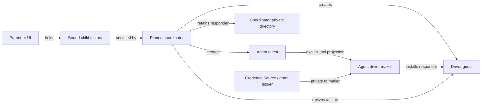
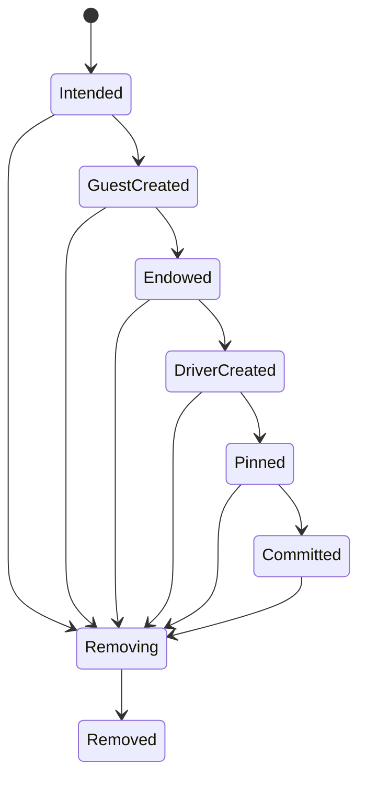

# A capability-scoped factory for durable child-agent guests

| | |
|---|---|
| **Created** | 2026-10-26 |
| **Author** | kriscendobot (prompted) |
| **Status** | Proposed |
| **Source** | Replaces the closed, pre-`@endo/inference` proposal in [PR #1102](https://github.com/endojs/endo-but-for-bots/pull/1102), after the confinement core in [PR #1015](https://github.com/endojs/endo-but-for-bots/pull/1015) merged and the daemon and inference dependencies below landed |

## Summary

Add `@endo/exo-agent-factory`, a provider- and harness-neutral service that
turns a held `AgentDriverMaker` capability into a durable child guest. The
factory owns a private namespace and a monotonically attenuated policy. The
caller chooses a maker by capability, not by a provider name or account
identifier. The child receives only the ordinary capabilities explicitly named
in its endowments. Credentials, the root host, and the factory's private
directory never cross into the child.

The design extracts the topology already exercised by Fae's
`provisionFaeAgent` and `SubagentSpawner`, then closes its crash and restart
gaps with an append-only operation journal and a pinned coordinator formula
that revives every committed child's runner. `@endo/inference` and the Claude backends are adapters, not
the factory's identity. A deployment can use the same mechanism for Claude,
Codex, local models, Fae, or Lal.

## Why the old proposal no longer builds cleanly

PR #1102 began as a recursive Claude-agent factory with a special-name map,
credential-family identifiers, single-use child leases, and a separate
revocation protocol. That shape was not merely overtaken: the maintainer
rejected its breadth in review ("Please narrow the scope of this to just
endowing a new guest with special names on the options bag"). The daemon then
landed caller-selected ordinary names, networks, and pins in
[PR #1306](https://github.com/endojs/endo-but-for-bots/pull/1306), and review
selected the general endowments-map work in
[PR #1343](https://github.com/endojs/endo-but-for-bots/pull/1343) instead of a
child-agent-specific naming change. PR #1102 closed with no remaining
independent scope in that shape.

The relevant substrate has since changed:

- `@endo/inference` landed in
  [PR #1403](https://github.com/endojs/endo-but-for-bots/pull/1403). Its
  `CredentialSource` owns admission and credential delivery, while
  `GuestToolProjection` supplies the confined tool surface.
- Claude CLI and Agent SDK backends landed in
  [PR #1412](https://github.com/endojs/endo-but-for-bots/pull/1412), after the
  confinement core in PR #1015. The factory no longer needs to know what
  "Claude credentials" are.
- Guest MCP projection landed in
  [PR #1336](https://github.com/endojs/endo-but-for-bots/pull/1336).
- The daemon now revives a host's caller-elected `@pins` at start and a guest's
  pins before publishing a mailbox delivery (PR #1306). A pinned coordinator
  can therefore revive each child's runner without a new daemon bot protocol.
- Fae already has a narrow `SubagentSpawner` and a host-side provisioning
  topology in `packages/fae/src/subagent-host.js`. It proves useful separation
  between the agent guest, the driver guest, and a maker held by the parent,
  but its subagents are intentionally not durable across a daemon restart.

The missing M3 capability is consequently not a Claude-account-specific
service. It is a generic, durable, capability-authorized composition of these landed parts.

### Scope decision

Restoring a child-agent factory reverses a scope the maintainer narrowed, so
it is not justified by the new substrate alone. This design responds to a
later maintainer brief that asked for exactly that reconsideration: "Redesign
the M3 top-priority child-guest provisioning capability ... after merged PR
#1015; replace closed design PR #1102 with a current, dependency-ready
implementation design." What #1102's review rejected — Claude credential
names, ambient recursion, a bespoke lease and revocation protocol, and a
child-agent-specific special-name change — stays out (§ Rejected
alternatives). Maintainer approval of this design is the explicit
confirmation that the restored, provider-neutral scope is wanted; the
implementation waits for it.

## Goals and non-goals

### Goals

1. A holder can create, enumerate, and remove child agents only inside the
   namespace and resource policy embodied by its factory capability.
2. The creator selects an inference implementation by passing a held maker
   capability. No provider, account, credential, or owner identifier authorizes
   a provisioning action.
3. The child receives exactly its explicit endowments and a private ordinary
   directory. It does not receive the root `EndoHost`, credentials, or an
   ambient way to provision peers.
4. A committed child resumes after daemon restart and mailbox delivery. A crash
   during provisioning or removal converges without duplicating a guest,
   credential grant, or runner.
5. The generic service is implementable and testable with fake inference. Live
   Claude credentials are not a prerequisite.

### Non-goals

- Provider discovery, API-key custody, subscription login, account selection,
  pricing, and UI. The open provider-registry design in
  [PR #1543](https://github.com/endojs/endo-but-for-bots/pull/1543) can mint
  makers and consume this factory.
- Defining an agent loop. Fae, Lal, Agentry, and future loops provide adapters.
- Automatically giving a child another child factory. Recursion is an explicit
  endowment decision.
- Generalizing every guest endowment into special names. PR #1343 remains an
  optional daemon-wide simplification, not a dependency.
- Making every guest directory non-extensible. The hardening proposed by
  [PR #1368](https://github.com/endojs/endo-but-for-bots/pull/1368) remains
  useful but is not required to express this authority boundary.
- Inventing an imperative `cancel()` authority. In-flight inference continues
  to receive the mandatory `cancelled: Promise<never>` from
  `@endo/inference`; durable removal is a separate state transition.

## Capability surface

The public package exports guards and types for four remotable facets. Names
below describe the contract; implementation may use exo classes or exo class
kits.

```ts
interface AgentDriverMaker {
  installDriver(context: {
    agent: EndoGuest;
    driverGuest: EndoGuest;
    lifecycle: AgentLifecycle;
    instructions?: string;
  }): Promise<{ responder: Passable }>;
}

interface ChildAgentFactory {
  bind(
    maker: AgentDriverMaker,
    policy?: ChildAgentPolicy,
  ): Promise<BoundChildAgentFactory>;
}

interface BoundChildAgentFactory {
  create(
    name: string,
    options?: {
      instructions?: string;
      endowments?: Record<string, Passable>;
    },
  ): Promise<{ summary: ChildAgentSummary; handle: EndoHandle }>;
  lookup(name: string): Promise<EndoHandle>;
  list(): Promise<ChildAgentSummary[]>;
  remove(name: string): Promise<void>;
  attenuate(
    name: string,
    policy: ChildAgentPolicy,
  ): Promise<BoundChildAgentFactory>;
  listDerived(): Promise<DerivedNamespaceSummary[]>;
  revokeDerived(name: string): Promise<void>;
}

interface AgentLifecycle {
  isActive(): Promise<boolean>;
  followActive(): Promise<AsyncIterable<boolean>>;
}
```

`ChildAgentSummary` contains safe data: the child name, lifecycle state,
creation time, and a stable operation id. It contains no credential,
provider-account, formula, or host-private namespace identifiers.

The `handle` is the child guest's ordinary mailbox handle (its `@self`), the
same contact value a host receives when it names a guest. It is an address,
not a callable object: daemon mail is addressed by pet name, so the caller's
send path is fixed and has two steps.

```js
await E(myPowers).storeValue(handle, 'helper'); // name the address once
await E(myPowers).send('helper', ['Hello.'], [], []); // then mail it
```

A parent or UI stores the handle in its own pet store and sends messages to
that name. Replies arrive in the parent's own mailbox. A directly callable
mail object would have to carry delivery authority the handle deliberately
omits, so the design keeps the daemon's one send path rather than adding a
second. The handle designates the child's mailbox only; it carries none of the
child's powers, its pins, or the driver. `lookup` returns the same handle for a
committed child of this bound factory, so a holder that discarded the `create`
result can reach the child again without a second naming system. This mirrors
Fae's sibling surface, which hands the parent a contact value rather than the
sibling's powers.

`ChildAgentPolicy` is data chosen by the factory's authority holder: maximum
retained children, maximum instruction size, and an endowment-name guard.
`bind` intersects it with the root policy; it cannot widen quota or admit an
endowment name the root excluded. The returned bound factory closes over the
maker capability. A guest holding only a bound factory therefore cannot swap in
an unrelated provider or harness.

Every `bind` and every `attenuate` allocates a fresh subordinate namespace with
its own child-name index and operation journal. No two issued facets share a
name index, so two holders can each create a child named `helper` without
seeing or removing the other's. `attenuate` derives a further bound factory
over the same maker whose policy is the intersection of its argument with the
issuing facet's policy. The derived namespace is nested: each child it creates
also reserves a slot in every ancestor namespace's quota, so attenuation cannot
multiply the root quota. A bound factory can neither enumerate nor remove the
individual children of a namespace it derived; the derived facet's holder
manages those.

The issuing facet nonetheless remains the lifecycle owner of every namespace it
derives, so losing a derived facet never strands durable state. `attenuate`
names the derived namespace in the issuer's own derived-namespace index, which
is separate from its child-name index. `listDerived` reports each derived
namespace's name, phase, and retained-child count. `DerivedNamespaceSummary`
carries no namespace id, formula identifier, or child name. `revokeDerived` is
the reclaiming authority:

1. It appends `Revoking` to the derived namespace's record. From then on the
   derived facet, and every facet derived from it, rejects every call.
2. It recursively revokes that namespace's own derived namespaces, depth first.
3. It removes each of that namespace's children by the ordinary `Removing`
   sequence (§ Durable lifecycle), releasing each ancestor's quota slot.
4. It appends `Revoked` once no child or nested namespace remains.

`revokeDerived` resolves at `Revoked`, joins an in-flight revocation, and is
replayed by reconciliation after a crash like any other nonterminal record. The
root host, holding the root facet, can therefore reclaim everything below each
`bind` result by revoking it.

#### Operation semantics

- `create` resolves only after the operation appends `Committed`. It rejects
  without side effects when the policy refuses the instructions, an endowment
  name, or the quota. It rejects when the name is already bound to a child in
  any phase other than `Removed`; the error names the existing phase.
- `remove` resolves only after the operation appends `Removed`. Calling it on a
  name already in `Removing` joins the in-flight removal and resolves when it
  finishes. Calling it on a name this namespace has never bound, or whose
  child is already `Removed`, rejects.
- `list` reports every child whose operation is not yet `Removed`, including
  children still being created and children in `Removing`, each with its
  current phase. A `Removed` child no longer appears and its name is free.
- `lookup` rejects for a name that is not `Committed`.

### Issuance

Only the deploying host holds the root `ChildAgentFactory`. It installs the
coordinator (§ Provisioned topology) and receives the root facet from it. It
obtains a maker separately, for example from a provider registry or by
formulating an `@endo/inference` adapter over a backend it already holds. It
then binds and hands out only the bound facet:

```js
// Deploying host, holding its own EndoHost powers.
const root = await E(host).lookup(['agent-factory', 'root']);
const maker = await E(host).lookup(['makers', 'claude-sdk']);
const forUi = await E(root).bind(maker, {
  maxChildren: 8,
  maxInstructionBytes: 16_384,
  endowmentNames: ['workspace', 'notes'],
});
// The UI or parent agent receives forUi and nothing else.
await E(host).storeValue(forUi, ['ui-guest-inbox', 'child-agents']);

// Inside the UI, holding forUi plus its own unrelated authority. Here the UI
// already holds `notes`, a capability it received earlier under its own pet
// name; the factory supplies nothing but the child.
const notes = await E(uiGuest).lookup('notes');
const { handle } = await E(forUi).create('helper', {
  instructions: 'Summarize new notes.',
  endowments: { notes },
});
await E(uiGuest).storeValue(handle, 'helper');
await E(uiGuest).send('helper', ['Start with today.'], [], []);
```

`bind` is callable only by a holder of the root facet, which never leaves the
deploying host. A parent agent that should delegate receives a facet from
`attenuate`, never the root. Neither facet reveals the coordinator's private
directory or the maker.

`installDriver` is a trusted host-side adapter contract, not a method exposed to
the child. It formulates its loop with `driverGuest` as powers and returns the
durable responder value whose incarnation starts or rejoins that loop. The
driver formula must depend on the driver guest formula, as Fae's current
`makeUnconfined(..., { powersName })` drivers do, so cancelling the powers guest
cannot strand a live runner. The coordinator retains the responder in its own
private directory (§ Provisioned topology); it does not assume that calling a
method on the responder starts a turn. `AgentLifecycle` is a read-only facet
over the operation state. Every runner checks it before opening its message
follower and between turns. A runner reincarnated while removal is retrying
therefore remains quiescent. The facet is itself a durable formula, so a
revived runner obtains a live one without a coordinator call.

Holding a facet is the authorization check. The implementation does not compare
`ownerId`, `callerId`, provider strings, or formula identifiers. Formula
identifiers remain audit labels, consistent with `@endo/inference`; they are
never bearer credentials.

### Explicit recursion

The service does not automatically install a factory into a new child. A
creator that intends delegation calls `attenuate` on its own bound factory
(keeping `revokeDerived` for the result), then
includes the result in the child's ordinary `endowments` under an
application-chosen name. A child without that endowment cannot create
descendants. Because every `attenuate` allocates a fresh namespace, siblings
receive distinct factory facets and private namespace roots.

This is both simpler and narrower than PR #1102's recursive default. It also
matches the Fae precedent: a parent receives a narrow spawner rather than an
`EndoHost`.

## Provisioned topology

### The coordinator

The coordinator is one durable formula per deployment. The deploying host
creates a dedicated child host, `agent-factory`, with `provideHost`, and
formulates the coordinator with `makeUnconfined('@main', specifier, {
powersName: 'agent-factory' })`. The coordinator's powers are therefore that
child host, not the root host: it can create guests, directories, and
formulas only inside the `agent-factory` namespace, and that namespace is its
private directory. The deploying host stores the coordinator's result under a
pet name and pins it in the root host's `@pins`.

Revival follows from those two facts. At daemon start the root host's pins are
reincarnated (`revivePins`), which incarnates the coordinator. The coordinator's
incarnation runs reconciliation (§ Durable lifecycle) before it answers any
facet call, then provides every `Committed` child's responder from its private
directory, so each runner resumes without waiting for mail. Facets issued by
the coordinator are durable formulas derived from it (below), so a holder's
facet also revives the coordinator on first use.

### Durable facets

`bind`, `attenuate`, and the per-child lifecycle are not in-memory exos that
die with an incarnation. Each is an `evaluate` formula in the coordinator's
private directory whose code calls the coordinator, for example
`E(coordinator).boundFacet(namespaceId)` or
`E(coordinator).lifecycleFor(operationId)`, with the coordinator as its only
endowment. The daemon re-evaluates such a formula on revival, and the formula
depends on the coordinator, so the result is always a facet of the live
incarnation. The namespace and operation ids in the source are coordinator
labels, never authority: the formula's holder already holds the facet.

The driver guest's directory holds the child's lifecycle formula under a fixed
name. A revived runner resolves it from its powers and calls `isActive` before
opening its follower.

### Pieces of one child

Each committed child consists of four durable pieces:



1. **Agent guest.** Owns its pet store, mailbox, and explicitly supplied
   ordinary endowments. It never sees the maker or credential source.
2. **Driver guest.** Supplies powers to the loop installed by the maker. Its
   directory holds the child facet and only the adapter-specific capabilities
   needed by the loop. The driver is separated so the child cannot call its own
   privileged runner directly.
3. **Retained responder.** A responder formulated with the driver guest is
   stored in the coordinator's private directory, which the child cannot name.
   The coordinator revives it at start. While the coordinator is live, the
   runner follows the child's mailbox directly, so mail delivery needs no
   revival of guest-held state.
4. **Factory record.** The private factory directory records intent, created
   formula references, current phase, and terminal state. Neither the record nor
   its directory is endowed to the child.

The child's own `@pins` is deliberately not the retention path. The daemon
creates that directory guest-writable, so a child could delete or replace a
responder stored there and defeat restart. The daemon also keeps a host-only
pin directory per guest, which mail delivery revives, but it exposes no
host-side API to write it today. If that writer lands, the coordinator can
additionally retain the responder there for mail-wake without changing this
contract. Until then, retention through the pinned coordinator is the whole
guarantee, and it never depends on a value the child can mutate.

An `@endo/inference` adapter implements `AgentDriverMaker` by closing over an
`InferenceBackend`/`CredentialSource` composition and a harness. On each turn it
passes the child-derived `GuestToolProjection` to `infer`. Credentials are
acquired and released inside the backend boundary. They are not fields of
`create`, records in the child directory, or values in an inference request.

## Durable lifecycle

Provisioning is a recorded state machine, not a sequence remembered only by its
last successful step in RAM:



Before an external effect, the coordinator appends the next intent to an
operation journal in its private directory. After the effect, it appends the
resulting stable reference. Journal entries use monotonically numbered pet
names, following the existing mailbox and `@endo/workflow` numbered-marshal
idiom. The latest complete prefix is authoritative; a summary value is only an
index and may be rebuilt.

Names for the child guest, driver guest, responder, and factory record are
derived from the namespace id plus the durable operation id, not directly from
user text, and they live only in the coordinator's private directory. The
user-visible child name is a unique key within that namespace.

Ownership during recovery is proved by location and intent, not by a reference
appended after the effect. Only the coordinator writes its private directory:
it is the coordinator's own powers, and no facet, child, or driver receives it.
The intent entry names the derived name before the effect runs.

The two daemon creation calls do not behave alike, so neither is treated as an
adopting primitive. `provideGuest(name)` returns whatever value the name
already holds, of any formula type, and skips its own option handling in that
case. `makeUnconfined(..., { resultName })` has no adoption path at all: it
always formulates a new caplet and only then writes the result name, replacing
any previous binding. Fae's `provisionFaeAgent` prechecks every owned name for
the same reason. Each creation phase therefore runs one explicit
precheck-and-proof step, and never relies on the daemon call alone:

1. Check the derived name with `has` in the coordinator's private directory.
2. If it is bound, adopt it only after proving its formula type matches the
   phase (a guest for `GuestCreated`, an unconfined caplet whose powers are the
   recorded driver guest for `DriverCreated`). Do not call the creation
   primitive again.
3. If it is unbound, call the primitive with the derived name and record the
   resulting stable reference.

The step is race-free because only the coordinator writes its private
directory and it serializes each namespace's operations. Its crash cases are
these:

- **Crash before the call.** The name is unbound, so replay creates exactly one
  value.
- **Crash after formulation but before the name is written.** The name is
  unbound and the formula is retained by no name. Nothing in the factory can
  reach it, and the daemon's collector reclaims it when collection is enabled.
  Replay creates one replacement, which is the only formula any factory record
  or name refers to.
- **Crash after the name is written but before the reference is appended.** The
  name is bound, so replay adopts by step 2 and never formulates a second
  caplet over it.

The appended stable reference remains an index for removal and audit, not the
ownership proof.

An entry at a derived name with the wrong formula type for its phase can arise
only from a coordinator defect. Reconciliation fails closed on it: the
operation stays nonterminal and reserved, and the coordinator reports the
mismatch rather than deleting or overwriting the entry.

### Installing endowments

Endowment installation is an authority-bearing write that happens after guest
creation and before any driver exists, so it has its own phase, `Endowed`. The
`Intended` entry retains the desired endowments themselves, not only their
names: the coordinator stores each value in the operation's private record
under a derived name before the operation starts. Recovery therefore never
depends on the caller's arguments.

During `GuestCreated`, the coordinator installs each endowment into the child
guest by `storeValue` under its endowment name. Each write is idempotent by
proof: if the child already binds that name, the coordinator compares the
child's identifier for it with the identifier of the retained value. An equal
identifier counts as done, and a different one fails closed. The coordinator
then lists the child's directory and confirms it holds exactly the daemon's
built-in special names plus the endowment names. Only then does it append
`Endowed`. The child has no running driver before `Endowed`, so nothing but the
coordinator can have written its directory. A crash during installation
replays the same writes and converges, and the child never runs partially
endowed. `Removing` releases the retained endowment values with the rest of
the operation's private record.

At startup and before servicing a mutation, the coordinator reconciles every
nonterminal operation:

- before `Committed`, it rolls forward when the recorded effect can be proved,
  otherwise removes proved partial resources in reverse order;
- after `Committed`, it never silently rolls back a visible child;
- `Removing` retries idempotent removal until no factory-owned reference,
  driver, pin, or guest remains, then appends `Removed`;
- a name stays reserved while any nonterminal record exists, so retries cannot
  fork one logical child into two formula graphs.

The coordinator serializes `bind`, `attenuate`, `create`, and `remove` within
each namespace. Quota accounting reserves a slot when `Intended` is appended and
releases it only at `Removed`. Fae's current spawner prevents the same
check-then-create race by serializing the check-and-create operation with a
promise chain. The coordinator keeps that serialization but bases recovery on
durable state rather than the in-memory queue.

Removing a child means deleting durable resources, not cancelling a single
turn. The coordinator first removes the retained responder so a later restart
cannot revive it, then cancels the driver powers guest (which tears down the
dependent runner), records that boundary, and removes private references and
the agent guest. An adapter still supplies `@endo/inference`'s mandatory
`cancelled` promise to each active turn; there is no new public cancellation
method. `Removing` is appended before these effects, so a driver formula that
the daemon reincarnates during a cancel retry sees an inactive lifecycle and
does not rejoin the mailbox loop. If a crash interrupts the sequence,
reconciliation repeats it.

## Turn publication

A driver turn reads one child message, calls `infer`, and publishes the
resulting reply by daemon `send`. The daemon offers no transactional
publication, so the driver cannot commit its cursor and the send atomically.
The daemon also cannot distinguish an `infer` call that never started from one
that ran provider work or tool calls and then crashed. The contract is
therefore **at-least-once inference and at-least-once publication, with at
most one recorded result per turn**:

1. Each turn's key is the child's message number for the message it answers,
   which the daemon assigns durably and which is stable across replay.
2. Before calling `infer`, the driver appends `TurnStarted(key)` to its ledger.
   After `infer` returns, it appends `TurnResult(key, result)` holding the
   `InferResult` before publishing anything.
3. It publishes the reply by `send` with `replyToMessageNumber` set to the key,
   then appends `Published(key)` and advances its cursor past the message.

The key travels in the reply's existing `replyTo` field. Daemon `send` takes
strings, edge names, capability names, and an optional reply-to message
number, and accepts no other metadata. The design adds no wire field.

On replay:

- A turn with `Published` is skipped.
- A turn with `TurnResult` but no `Published` republishes the recorded result
  with the same reply-to, without calling `infer` again. The duplicate is
  byte-identical.
- A turn with only `TurnStarted` re-runs `infer`. If the crash fell after
  provider work or a tool effect, that work happens twice. Provider usage is
  billed twice, and a tool call repeats unless its owner made it idempotent.
  The factory adds no effect journal for either. Each tool facet's owner
  decides whether its operation needs an idempotency key, and an adapter whose
  backend offers a request-idempotency key may pass the turn key through.

Once a result is recorded, the turn never calls `infer` again, and no turn
publishes two different replies. Duplicate publication is resolved on the
reading side. A driver publishes exactly one reply per turn, and no other
message carries that turn's reply-to. A reader may therefore collapse
byte-identical messages from the same sender with the same `replyTo`. Fae and
Lal conversation views do not do this today. Adding it is an explicit work item
(§ Implementation plan) with its own acceptance test.

## Ownership map

| Boundary | Mechanism | Policy | Durable state | Lifecycle / commit authority | Value crossing |
|---|---|---|---|---|---|
| Caller -> bound factory | `create`, `list`, `remove`, `attenuate`, `listDerived`, and `revokeDerived` facets | Factory creator binds maker, namespace, quota, instruction bound, and allowed endowment names; `bind` only attenuates | Factory coordinator owns the child-name index and numbered operation journals | Coordinator reserves quota, commits a visible child, and decides roll-forward versus cleanup | `create` options enter; safe `ChildAgentSummary` data leaves |
| Factory coordinator -> daemon | `EndoHost`/`EndoDirectory` create, store, pin, and remove operations | Coordinator decides which formulas form one child; daemon applies generic formula rules | Daemon exclusively owns formula/content state; coordinator exclusively owns logical-child phase and stable references | Coordinator owns logical commit/removal; daemon owns individual formula incarnation/cancellation | `EndoGuest`, directory, responder, and stable-reference capabilities, named in daemon vocabulary |
| Mailbox -> driver | Coordinator revives the retained responder at start; driver follows child mail | Coordinator's durable `AgentLifecycle` admits or quiesces the loop | Daemon owns the mailbox and message numbers; driver owns its cursor and turn ledger | Daemon revives formulas; driver replays from its cursor; coordinator ends the logical child | Mail notification and message number enter the driver; no provider authority crosses |
| Driver -> inference backend | `InferenceBackend.infer` over a `GuestToolProjection` | `CredentialSource` decides provider admission; held tool facets authorize calls | Driver owns turn ledger and recorded results; provider owns credential and usage records | Driver decides whether to publish/retry an `InferResult`, keyed by message number; backend owns only one execution | `InferRequest` and `InferResult`, named in `@endo/inference`'s execution vocabulary |

A provider refusal cannot silently remove a child: only the coordinator appends
`Removing`. No backend type names a commit, rollback, replay, or persistence
step; `AgentLifecycle` and the operation phases are coordinator terms.

## Dependency readiness

| Dependency | Current status | Relationship |
|---|---|---|
| [#1015](https://github.com/endojs/endo-but-for-bots/pull/1015), `@endo/claude` confinement core | Merged | Historical trigger and one backend family; no longer the generic factory boundary |
| [#1306](https://github.com/endojs/endo-but-for-bots/pull/1306), caller-elected names/networks/pins | Merged | Supplies root `@pins` revival for the coordinator and guest creation options; a future host-side writer for guest host-only pins would add mail-wake |
| [#1336](https://github.com/endojs/endo-but-for-bots/pull/1336), guest stdio MCP | Merged | Supplies the Claude CLI projection path; not required by fake or SDK adapters |
| [#1403](https://github.com/endojs/endo-but-for-bots/pull/1403), `@endo/inference` | Merged | Required by the provider-neutral inference adapter |
| [#1412](https://github.com/endojs/endo-but-for-bots/pull/1412), Claude backends | Merged | Optional concrete makers for Claude CLI and Agent SDK |
| [#1343](https://github.com/endojs/endo-but-for-bots/pull/1343), one arbitrary endowments map | Open | Compatible simplification; not a blocker because ordinary endowments can be stored through existing guest APIs |
| [#1368](https://github.com/endojs/endo-but-for-bots/pull/1368), non-extensible agent directories | Open | Defense in depth; not a blocker |
| [#1543](https://github.com/endojs/endo-but-for-bots/pull/1543), API-key providers and pinned agents | Open design | Downstream/companion consumer: provider selection mints makers, while this design owns generic child lifecycle |

All required dependencies are therefore on `llm`. An implementation can start
without stacking on an open pull request or waiting for a live provider secret.

## Implementation plan

Two implementation pull requests against `llm` carry these steps, each as
independently reviewable commits.
The first lands step 1 and the coordinator logic of step 3 (precheck and
proof, the `Endowed` phase, lifecycle-gated reconciliation, idempotent
removal, and `revokeDerived`) against a narrow private-host port, so the
recovery state machine is reviewed apart from any daemon wiring.
The second lands step 2, the daemon side of step 3 (the pinned coordinator
formula and durable facet formulas over a real `agent-factory` host), and
steps 4 through 6.

1. Add `@endo/exo-agent-factory` guards, the policy intersection, the private
   factory directory, the append-only operation journal, and fake host/maker
   conformance tests.
2. Extract the child/driver topology from `packages/fae/src/subagent-host.js`
   into the package. Preserve the current Fae `SubagentSpawner` surface as an
   adapter; do not widen Fae guests to an `EndoHost`.
3. Add daemon-backed coordinator wiring: the pinned coordinator formula, durable
   facet formulas, derived private names, precheck-and-proof guest and driver
   creation, the `Endowed` phase, lifecycle-gated crash reconciliation,
   idempotent removal, and `revokeDerived`.
4. Add `@endo/inference` and Fae/Lal maker adapters. Claude CLI and Agent SDK
   makers should be thin compositions of the landed backends, not copied loops.
5. Add the driver turn ledger and reply-to-keyed publication (§ Turn
   publication), and a worked deployment example following § Issuance for a
   consumer such as PR #1543.
6. Add reader-side collapse of byte-identical same-sender replies with an
   equal `replyTo` to the Fae and Lal conversation views. This is the only
   consumer change the publication contract needs, and it changes no daemon
   API.

Estimated size is **L, 1-1.5 developer weeks**. Most logic is lifecycle and
recovery testing; the inference and daemon substrates already exist. This
replaces work already counted in M3 rather than adding a new milestone.

## Verification

### Capability and policy tests

- A holder of one bound factory cannot address a sibling factory's namespace.
- `bind` can reduce but never widen child quota, instruction size, or allowed
  endowment names.
- `bind` accepts a maker capability, never a provider/account string, and the
  child cannot recover that maker from its directory.
- Credentials, root host, private factory directory, formula identifiers, and
  operation records are absent from child endowments and summaries.
- A child can provision descendants only when explicitly given an attenuated
  bound factory; two siblings receive distinct facets.
- Two facets from separate `bind` or `attenuate` calls each create a child
  named `helper`; neither `list` shows the other's, and neither `remove`
  reaches it. An attenuated namespace's children count against the issuing
  namespace's quota.
- The issuer of a derived namespace sees it in `listDerived` and reclaims its
  children and quota with `revokeDerived` without holding the derived facet.
- The `handle` from `create` and `lookup` delivers mail to the child and
  exposes none of its powers, pins, or driver.
- `create` and `remove` resolve only at `Committed` and `Removed`; duplicate,
  unknown, and in-flight names behave as § Operation semantics specifies.

### Recovery matrix

Inject a crash before and after every state transition and external effect:

- creation converges to exactly one committed child or to no child;
- a user-visible name remains reserved while cleanup is incomplete;
- a committed child's runner resumes after daemon restart through the pinned
  coordinator, with no holder call and no mail;
- a child that deletes or replaces every entry in its own `@pins` still resumes
  after restart and still answers mail;
- for both `provideGuest` and `makeUnconfined`, a crash after the derived name
  is written but before the stable reference is appended rolls forward by the
  precheck adopting the named value, with no second `makeUnconfined` call. A
  crash between formulation and the name write leaves the name unbound, and
  replay produces exactly one named value;
- a crash at each endowment write converges to `Endowed` with exactly the
  retained endowments installed, and a pre-bound endowment name with a
  different identifier fails closed;
- a crash at each step of `revokeDerived` converges to `Revoked`, with every
  nested namespace and child removed and every ancestor quota slot released;
  a revoked derived facet rejects every call, including after restart;
- facets held by a parent and a revived runner's lifecycle facet work after
  restart without being re-issued;
- a runner reincarnated during a removal retry observes inactive lifecycle and
  does not reopen its mailbox follower;
- removal converges with no retained responder, driver, guest, or factory
  reference;
- an entry at a derived name with the wrong formula type fails closed, stays
  reserved, and is not deleted.

### Adapter and confinement tests

- A fake `AgentDriverMaker` receives only the intended child facet and
  instructions.
- A fake `@endo/inference` backend observes the child-derived
  `GuestToolProjection`; credential acquire/release remains inside its
  `CredentialSource`.
- MCP catalog membership remains pinned for a turn, and an unlisted call is
  rejected by the existing projection layer.
- Existing Fae subagent tests pass against the adapter, including child quota,
  explicit capability attachment, stop, and recursive cleanup.
- One Lal or Fae mail loop survives a daemon restart at each turn-ledger crash
  cut, including a crash inside `infer` after a fake tool effect. No turn calls
  `infer` again once its result is recorded. A crash before `TurnResult`
  re-runs `infer` and repeats the fake tool effect, which the test asserts
  rather than hides. The only republication is the recorded reply with the
  same `replyTo`.
- End to end through the daemon, a republished reply reaches the parent with
  the original `replyTo`. The Fae and Lal views each show it once.

The portable acceptance gate uses fake inference and is suitable for CI. A live
Claude turn is useful integration evidence but belongs to the Claude backend's
credential-gated acceptance lane; it does not gate this generic factory.

## Rejected alternatives

### Revive PR #1102 unchanged

It would duplicate landed pins, couple the factory to Claude credential names,
and make recursion ambient. Its special-name-only scope was also overtaken by
the broader endowments-map work in PR #1343.

### Authorize by owner or provider id

An identity comparison turns policy into an ambient registry lookup and makes
delegation require impersonation or a second authorization system. Passing a
maker and holding a bound factory are the two authorities needed for the
action; identifiers remain labels.

### Put the driver and credentials in the agent guest

That makes the agent able to invoke or leak its own provider authority and
collapses the confinement boundary. The separate driver guest keeps the child
facet on the tool side and the credential source on the inference side.

### Wait for PR #1343 or PR #1368

Both improve the daemon's general guest surface, but neither is required to
store explicit ordinary capabilities, pin the coordinator in the root host's
`@pins`, or keep the coordinator's directory private. Depending on them would
make this design needlessly stacked again.

### Make Fae's current spawner the universal API

It is valuable prior art, but its host helper derives a multi-guest topology
without a durable operation record and deliberately does not pin subagents.
Retaining that behavior as an adapter is appropriate; making it the persistence
contract would preserve the restart gap this design is meant to close.
