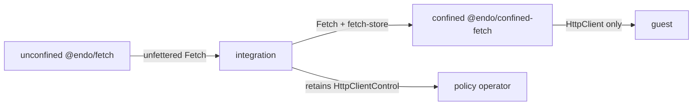

# `@endo/fetch` and `@endo/confined-fetch`: Outbound HTTP Plugins

| | |
|---|---|
| **Created** | 2026-07-13 |
| **Updated** | 2026-10-31 |
| **Author** | Kris Kowal (prompted) |
| **Status** | In Progress |
| **Supersedes** | [endoclaw-network-fetch](endoclaw-network-fetch.md) (provisioning; the capability shape is landed and carries over) |
| **Parent** | [endoclaw](endoclaw.md) |

## What is the Problem Being Solved?

Agents under SES lockdown have no ambient network access. Confined outbound
HTTP is half of the M3 exit criterion: "Agents have scheduled execution and
confined outbound HTTP" ([README](README.md) § Milestone 3). The capability
itself landed in PR [#566](https://github.com/endojs/endo-but-for-bots/pull/566):
the `HttpClient` / `HttpClientControl` facet pair of `@endo/exo-http-client`
over the pure confinement core `@endo/http-confine`.

What never landed is provisioning, policy persistence, and revival. Earlier
drafts put that work in daemon formulas. The maintainer's PR #609 direction is
to use unconfined plugins and the virtual file system for durable tracking.
The review of this design adds an important attenuation boundary: the direct,
unfettered HTTP capability must be separate from the confined capability. A
confined plugin receives that base capability and a state directory as its
endowments. It does not acquire ambient network access merely by existing.

## Design

### Two plugins and an explicit attenuation boundary

The design has two thin packages.

- `@endo/fetch` is an **unconfined base plugin**. Its `make()` receives the
  worker's ambient `fetch` and returns a `Fetch` capability with
  `fetch(url, options)`. This capability is intentionally unfettered: it makes
  no allowlist, policy, persistence, or revival decisions. An integration
  retains it and treats granting it as granting direct HTTP authority.
- `@endo/confined-fetch` is a **confined plugin**. Its `make()` is endowed with
  the base `Fetch` capability and a writable state directory. It constructs
  `HttpClient` / `HttpClientControl` over the endowed base, never over ambient
  `fetch`, and returns a `ConfinedFetchService` that exposes `client()`,
  `control()`, and `help()`.

The base package is the sole bridge from an unconfined worker to real network
access. The confined package is useful only when an integration intentionally
endows both the base capability and its private state directory. A guest gets
only `client()`. It never receives the base `Fetch`, the directory, or the
control facet.



### Base plugin

`@endo/fetch` exports the standard unconfined-caplet maker:

```js
export const make = (powers, context, { env }) => { /* returns Fetch */ };
```

It adapts the unconfined worker's ambient `fetch` into a passable `Fetch`
service. `powers`, `context`, and `env` are accepted for the normal plugin
shape but do not supply policy or storage. The package is deliberately small:
it has no dependency on `@endo/http-confine`, the virtual file system, or the
policy machinery. Its tests use an injected transport seam instead of a live
network.

### Confined plugin endowments

`@endo/confined-fetch` exports a confined-caplet maker. Its powers resolve:

1. `fetch`: the base `Fetch` capability supplied by an integration. This is
   the only transport used to construct `makeHttpClientAndControl`.
2. `fetch-store`: a writable virtual-file-system directory, private to this
   confined service.
3. `timer`: the `Timer` capability, the plugin's only source of time
   (§ Time in a confined worker).
4. `fetch-policy-authority` (optional): the referral target for
   trust-on-first-bind decisions. Without it, prompt modes are unavailable and
   unknown origins fail closed.

Initial `allowedOrigins`, `maxRequestsPerMinute`, `maxResponseBytes`, and
`policyMode` arrive through `env` only on first provisioning. The directory is
authoritative across restart. The integration provisions one confined service
per guest, retains `control()`, and grants only `client()` to that guest.

### Durable policy on the virtual file system

The private state directory uses the reconciled virtual-file-system tree verbs:

```
fetch-store/
  config.json      # allowedOrigins, maxRequestsPerMinute, maxResponseBytes,
                   # policyMode, revoked
  bindings.json    # origin -> state, decidedAt, source, note?
```

Writes are serialized and use write-then-`move` within the directory. Atomic
within-directory `move` is a required backing contract, as in
[endo-reminder](endo-reminder.md). The rate-limit window and audit ring remain
ephemeral. They are bounded operational state, not durable policy.

`@endo/exo-http-client` needs an `initialBindings` input and an
`onPolicyChange(snapshot)` callback. The callback runs after every durable
mutation, including a request-time trust-on-first-bind pin, so the confined
plugin can persist a complete snapshot without putting VFS code in the pure
capability package. `@endo/http-confine` changes only to stop reading ambient
time, per § Time in a confined worker.

### Time in a confined worker

A confined-worker compartment (`makeBundle` / `makeArchive` in
`packages/daemon/src/worker.js`) is endowed with no `setTimeout`, no
`AbortController`, and a tamed `Date` whose `now()` throws. Today the
confinement stack reads all three ambiently:

| Use | Where | Ambient read |
|---|---|---|
| Per-request deadline | `makeRequestSignal` (`@endo/http-confine`) | `setTimeout`, `clearTimeout`, `AbortController` |
| Revocation aborts in-flight requests | `makeHttpConfinement` controller set | `AbortController` |
| Rate-limit window | `makeRateLimiter` (`now` seam) | `Date.now` via the `@endo/exo-http-client` default |
| Policy-prompt timeout | `makeTrustOnFirstBindPolicyAdapter` | `setTimeout`, `clearTimeout` |
| `decidedAt` and audit `at` stamps | `makeTrustOnFirstBindPolicyAdapter` | `Date.now` default |

**Decision: inject time seams into the pure packages and endow a `Timer`
capability to the confined plugin.** This follows the precedent set across the
repository: `@endo/cancel`'s `makeDelay(setTimeout)` (`delay-lite`) binds the
ambient timer at the edge, `@endo/reminder`'s scheduler and `@endo/workflow`'s
service take `setTimeout` / `clearTimeout` / `now` seams, and thixotrope's
`TimerPowers` do the same. In every case the pure code takes time as an
argument and exactly one unconfined place holds the ambient source. Time is
authority, so the confined plugin gets it the way it gets the network: as an
endowment.

1. **Cancellation becomes promise-based.** `@endo/http-confine` replaces its
   `AbortController` use with `makeCancelKit` from `@endo/cancel`. A request
   carries a `cancelled` token. Revocation cancels every in-flight kit, and
   `limitResponseBytes` takes the same token. The `FetchLike` options carry
   `cancelled`. Only the ambient-`fetch` edge (the `@endo/fetch` base, or an
   unconfined caller of `@endo/exo-http-client`) converts it with
   `toAbortSignal`. `@endo/confined-fetch`'s transport then forwards the token
   to `E(base).fetch` directly and drops its `fromAbortSignal` bridge.
2. **The only timer seam is `delay`.** `@endo/http-confine` and
   `@endo/exo-http-client` take `delay: (ms, cancelled) => Promise<undefined>`,
   the `makeDelay` return type. The request deadline is
   `delay(timeoutMs, requestCancelled)`, and settling the request cancels it.
   The prompt timeout races `delay(policyPromptTimeoutMs, promptCancelled)`.
   The rate limiter holds one slot per request and releases it after
   `delay(60_000, serviceCancelled)`. That is the same sliding window as
   before, but it needs no clock.
3. **Stamps await `now`.** The `@endo/exo-http-client` `now` seam may return a
   promise. The adapter awaits it where it stamps a binding or an audit event.
   Those paths are already asynchronous on the request side. The control
   mutators that stamp (`revokeBinding`, `unpin`) become `M.callWhen`. That is
   invisible to remote callers, who already use `E()`.
4. **Ambient defaults live only at the unconfined edge.** `@endo/http-confine`
   requires its seams and reads no globals. `@endo/exo-http-client` keeps
   lazily resolved ambient defaults (`delay` from `@endo/cancel/delay`,
   `Date.now`) for unconfined callers. `@endo/confined-fetch` always passes
   seams built from its endowment.
5. **A `Timer` capability is endowed.** The confined plugin resolves a
   required `timer` power, an unconfined, stateless `Timer` with
   `delay(ms, cancelled?)` and `now()`, both `M.callWhen`, plus `help()`. It
   adapts that power into the local seams:
   `delay = (ms, c) => E(timer).delay(ms, c)` and `now = () => E(timer).now()`.
   Unlike `delay-lite`, the `Timer` must clear its host timer when `cancelled`
   rejects. It must also reject any `ms` above `2 ** 31 - 1`, as thixotrope's
   `MAX_TIMER_DELAY_MS` does, rather than let Node clamp it to roughly 1 ms. The
   integration provisions it unconfined beside the base `Fetch`, retains it, and
   re-endows it at revival. A guest never receives it.

Considered and rejected:

- **Enforce the deadline in the `@endo/fetch` base.** That covers only one of
  the five uses. The rate window, prompt timeout, and stamps would still need
  time, so it adds a second timing mechanism without removing the endowment.
  The base already aborts its socket when `cancelled` rejects, so a
  confined-side deadline reaches the socket through the same token.
- **Add timers or a clock to the daemon's confined-worker `endowments`.** That
  would give ambient time, and a timing channel, to every confined plugin
  rather than only the one that is granted it.
- **Reuse `@endo/reminder` or the daemon's `makeTimer` formula.** `@endo/reminder`
  delivers scheduled messages to agent inboxes, and `makeTimer` is an interval
  ticker. Neither is a passable `delay(ms, cancelled)` capability.
- **Keep confined-fetch unconfined.** That is today's workaround. It gives the
  stateful plugin the ambient `fetch` that the two-plugin split exists to
  withhold.

### Revival and agent-tool binding

The integration owns both retention and re-endowment. It pins the confined
service under `@pins`, restores the base `Fetch`, the `Timer`, and the same
`fetch-store` at boot, and lets `revivePins()` re-incarnate the confined plugin. A revoked
service therefore revives revoked. The package README carries this recipe;
Familiar and the online Gateway are candidate owners.

`makeHttpTool` remains in [daemon-agent-tools](daemon-agent-tools.md) Phase
3.6. It binds the `HttpClient` granted to a guest. The tool does not choose a
transport or policy and therefore never needs the unfettered base capability.

### What this supersedes

[endoclaw-network-fetch](endoclaw-network-fetch.md)'s daemon provisioning,
[cli-http-client](cli-http-client.md)'s formula packaging, and the
`provideHttpClient` half of [daemon-agent-tools](daemon-agent-tools.md) Phase
3.6 are superseded. Their landed facet split, SSRF defenses, and eventual CLI
surface remain normative where referenced.

## Dependencies

| Design | Relationship |
|---|---|
| [http-confine](http-confine.md) | Pure confinement core under the facets |
| [trust-on-first-bind](trust-on-first-bind.md) | Policy machine whose bindings the confined plugin persists |
| [endo-reminder](endo-reminder.md) | Precedent for VFS state and integration-owned revival |
| [platform-fs](platform-fs.md), [fs-interface-reconciliation](fs-interface-reconciliation.md) | State-directory API and tree verbs |
| [daemon-agent-tools](daemon-agent-tools.md) | `makeHttpTool` consumes the granted confined client |
| [inventory-cancel-and-liveness](inventory-cancel-and-liveness.md) | `@endo/cancel` tokens and `delay` that replace `AbortController` and ambient timers |
| [endoclaw-oauth](endoclaw-oauth.md) | Consumes a granted `HttpClient`, never the base `Fetch` |

## Implementation Phases

### Phase 1: Base and confined plugin boundary (S)

Add `packages/fetch` (`@endo/fetch`) as the unconfined adapter over ambient
`fetch`, with a deterministic transport seam. Add `packages/confined-fetch`
(`@endo/confined-fetch`) that requires an endowed base `Fetch` and
`fetch-store`, constructs the existing client/control pair over that base, and
returns `ConfinedFetchService`. Tests prove the confined package cannot fetch
without the endowed base and that a guest receives only `HttpClient`.

### Phase 2: Durable policy and TOFU bindings (S)

Add serialized `config.json` / `bindings.json` persistence in the confined
package. Add `initialBindings` and `onPolicyChange` to
`@endo/exo-http-client`. Tests prove restart reconstitution, durable
revocation, and a request-time TOFU pin that survives restart and remains
revocable.

### Phase 3: Integration, revival, and tool binding (S)

Document provisioning that retains the base capability privately, endows the
confined plugin with it plus a state directory, pins the confined service, and
grants only its client facet. Exercise the restart path end to end on an
in-memory filesystem. Implement `makeHttpTool` separately in
`daemon-agent-tools` Phase 3.6 against the granted client.

### Phase 4: Confined-worker time (S)

Thread the `delay` / `now` seams and cancel-kit cancellation through
`@endo/http-confine` and `@endo/exo-http-client`, and drop `AbortController`
from both. Add the unconfined `Timer` and the required `timer` power to
`@endo/confined-fetch`. Tests run the confined plugin in a `Compartment`
endowed exactly like `packages/daemon/src/worker.js`'s `endowments` and drive a
fake `Timer`. They prove the deadline, revocation abort, the rate window, the
prompt timeout, and the stamps without any ambient time. They also prove that a
cancelled `Timer.delay` clears its host timer.

## Design Decisions

1. **Two plugins, not one.** The base unconfined plugin provides explicit
   unfettered HTTP authority. The confined plugin receives that authority only
   as an endowment plus a state directory.
2. **The base capability is never guest-facing.** Giving it to a guest would
   bypass allowlisting, caps, revocation, and trust-on-first-bind policy.
3. **State belongs to the confined service.** The base plugin is stateless;
   policy and bindings are private to one guest's confined service.
4. **Persist through an `@endo/exo-http-client` callback.** A control wrapper
   cannot observe request-time pins.
5. **Revival is integration-owned.** The integration is responsible for
   restoring the required endowments before reviving the confined service.
6. **Time is an endowment.** The pure packages take `delay` / `now` seams and
   promise-based cancellation. The confined plugin's only time source is an
   endowed `Timer`. The deadline is not moved into the base, and the daemon's
   worker endowments are not widened.

## Implementation status

PR [#723](https://github.com/endojs/endo-but-for-bots/pull/723) landed the
earlier single-plugin shape and the `@endo/exo-http-client` persistence seams
(Phase 2). The split into the unconfined `@endo/fetch` base and the stateful
`@endo/confined-fetch` plugin (Phase 1) and the in-memory restart exercise of
Phase 3 follow in a separate PR. `makeHttpTool` remains with
[daemon-agent-tools](daemon-agent-tools.md) Phase 3.6.

Until Phase 4 lands, the confined plugin must be provisioned with
`makeUnconfined`, because `@endo/http-confine` still reads ambient timers that
confined-worker compartments do not endow (§ Time in a confined worker).

## Open questions

1. Which package should export the `Timer` maker? The recommendation is a
   small unconfined entry beside the base (`@endo/fetch/timer.js`), because the
   integration already provisions that package unconfined. A general-purpose
   home such as `@endo/cancel` would serve other confined plugins that need
   time, at the cost of adding `@endo/exo` to a package that does not depend on
   it yet.

## Prompt

> Divide the capability into a base, unconfined plugin that provides
> unfettered HTTP access and a confined plugin endowed with that base plus a
> state directory.
