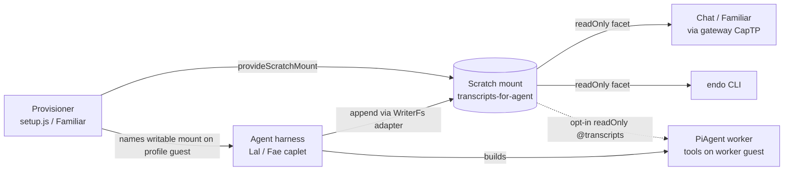

# EndoPi: Pi-Compatible JSONL Transcript Format

| | |
|---|---|
| **Created** | 2026-05-15 |
| **Updated** | 2026-11-17 |
| **Author** | Kris Kowal (prompted) |
| **Status** | In Progress |
| **Parent** | [endopi](endopi.md) |

## Status

- **Done:** the format library `@endo/jsonl-transcript` (#669, merged
  2026-07-29). It holds the entry constructors, the parser, the append-only
  `makeSessionWriter`, `readSessionFile`/`loadFromJsonl`, the graph
  projection, and `docs/session-format.md`.
- **Not done:** nothing depends on that library yet, so no agent writes a
  session file. This revision settles how agents and applications reach
  transcripts before that wiring is built.
- **Superseded:** draft #692 projects the same format inside
  `@endo/conversation-tree`. It duplicates #669 and should be closed.

## Motivation

The maintainer's note on [endoclaw](endoclaw.md) § *Persistence and Memory*
asks that session history be stored as Pi-compatible JSONL "at least for
offline operator inspect-ability, but also the claw itself can use these as a
form of memory if within its workspace."

The maintainer's review of #669 (2026-07-15) asked the open integration
question: *"How does this integrate with an application like Chat, Familiar,
or Gateway? I assume that an agent provider needs to take this on as a
dependency and that a capability needs to be surfaced so an agent can use
it."* This revision answers it. Yes, the agent provider takes the dependency.
The capability it surfaces is an existing one, a daemon **scratch mount**, so
the design adds no new formula type.

Two assumptions in the first revision no longer hold, and this revision drops
them:

1. **A Lal reply-chain graph.** Lal now runs on a `PiAgent` (`makePiAgent` from
   `@endo/agentry/harness`, called in `spawnWorkerLoop` in
   `packages/lal/agent.js`). Its transcript is the PiAgent's linear `messages`
   list, and it has no cross-restart continuity.
2. **A guest-side writer that opens `$ENDO_STATE/sessions/...` by path.** A
   caplet that computes paths under the daemon state directory holds ambient
   filesystem authority, and an application cannot reach such a file over
   CapTP. The writer now writes through a capability it was given.

## Design

### The capability: a transcripts scratch mount

The provisioner of an agent (the `setup.js` of Lal or Fae, the Familiar's
bundled-agent provisioning in [familiar-bundled-agents](familiar-bundled-agents.md),
or an operator at the CLI) creates one scratch mount per agent with the host's
existing `provideScratchMount` ([daemon-mount](daemon-mount.md)). The mount is
named under the host's own pet store as `transcripts-for-<agent>`:

```js
await E(host).provideScratchMount('transcripts-for-lal');
```

The mount is the only durable state the design adds. It already gives the
design what it needs:

- **Append.** `MountFile.append(text)` writes a line through the daemon's
  confined file powers.
- **Attenuation.** `readOnly()` returns a facet whose mutation methods throw.
  Every reader holds that facet, never the writable one.
- **Operator inspection.** The scratch mount's root is a real directory under
  the daemon `statePath`, derived from the formula number, so `cat`, `grep`,
  and `jq` work on the files directly. The `endo` CLI can resolve that path.
- **CapTP reach.** A mount is a remotable, so Chat and the Familiar reach it
  over the gateway like any other capability. The gateway needs no change.

Files inside the mount use the layout of the format library's
`sessionFileName`, `<timestamp>_<sessionId>.jsonl`, flat at the mount root. The
per-guest directory level of the old `$ENDO_STATE/sessions/<guest-id>/` path
goes away, because the mount already belongs to one agent.

### The writer: the agent provider's harness

The agent provider takes `@endo/jsonl-transcript` as a dependency. Lal is the
first consumer, and Fae should follow the same pattern. Its trusted harness
code owns the projection. Model-driven tools never touch it.

- **Projection policy.** Each PiAgent message that completes a turn (`user`,
  `assistant`, `toolResult`) becomes one `message` entry. Its `parentId` is the
  previous entry's id, so a session file is a single-path tree. Branching and
  `compaction` entries are added later by
  [endopi-iterative-compaction](endopi-iterative-compaction.md) and do not
  change the file shape. Endo metadata that Pi does not define goes in
  `custom` entries with an `endo:*` kind: the Endo `messageId`/`replyTo` of
  the mail message that started the turn, and `value` references from
  [daemon-value-message](daemon-value-message.md). These entries record ids
  only, never live references.
- **Ids.** Entry ids are UUIDv7, which Pi's own tools expect. The Endo
  `messageId` that started a turn is stored in an `endo:mail` custom entry.
- **Sink.** `makeSessionWriter` already takes an injected `WriterFs`
  (`mkdir`, `readFile`, `truncate`, `open(path, 'a', mode)` returning a
  `{ write, close }` handle). The harness supplies an adapter over the
  writable mount. `mkdir` resolves trivially, because the files sit at the
  mount root. `readFile` returns the bytes of the file's `text()` and throws when the file is absent, which the writer reads as a fresh session. `open` creates an absent file with the mount's `makeFile`. `truncate`
  becomes a `writeText` of the complete prefix, used only to repair a torn tail
  on reopen. The handle's `write` becomes the file's `append`, and `close`
  resolves trivially. The file mode is the daemon's concern, not the
  adapter's. The library itself does not change.
- **Session lifecycle.** A worker opens a new session file when it spawns.
  Before it builds the PiAgent, it reads the newest file in the mount and seeds
  `initialState.messages` from that file's `message` entries. The seam for this
  is already noted at the `makePiAgent` call in `spawnWorkerLoop`. Resuming
  appends to the same file. Starting a fresh session is an explicit provisioner
  or operator choice.

### Isolation: the model's tools cannot reach the writer

The writable mount reaches the caplet as a pet name on the **profile** guest
that `makeUnconfined` runs under, for example `profile-for-lal`. The harness
looks it up once at startup and keeps it in its closure.

Model-driven tools (`lookup`, `evaluate`, `send`, and the rest) run against the
**worker** guest's powers. The worker guest's pet store never names the
writable mount. This follows the rule Floot applies to its private turn
journal (`providePrivateTurnStorage` in
`packages/floot/src/private-turn-storage.js`): storage the harness writes is not
exposed to the guest the model drives.

Where Lal today runs a worker on its profile powers, the build must move that
worker onto a sub-guest, or else drop the write facet's pet name after lookup.
Otherwise a model could tamper with its own history.

### Readers

| Reader | Capability held | How it gets it |
|--------|-----------------|----------------|
| Operator, at a shell | the directory on disk | the scratch mount's derived path |
| Operator, at the `endo` CLI | `transcripts-for-<agent>` (read-only facet) | host pet name |
| Chat, Familiar | read-only facet | host pet name, over the gateway |
| The agent itself, as memory | read-only facet, opt-in | provisioner introduces it to the worker guest as `@transcripts` |

Every application reader uses the format library's `loadFromJsonl` /
`assemblePath` on the `text()` of a file, so Chat and the CLI share one parser
with the writer.

- **Chat.** Chat lists the host's `transcripts-for-*` names and renders a
  session as a read-only, linear view. Chat runs in the browser, so it needs
  only the pure entry, reader, and graph modules, not the Node writer. The
  Chat viewer is a follow-on phase. Until it exists, operators read
  transcripts at the CLI.
- **Familiar.** The Familiar is the Electron shell around Chat and a bundled
  daemon. Its bundled-agent provisioning calls the same provisioner code, so
  bundled agents get a transcripts mount with no Familiar-specific logic. The
  only change is that the agent bundle includes `@endo/jsonl-transcript`.
- **Gateway.** The gateway ([daemon-web-gateway](daemon-web-gateway.md)) is a
  CapTP transport. It carries the read-only facet like any other remotable and
  gains no endpoint. A weblet sees transcripts only if its host grants it the
  facet.
- **Agent memory.** Granting `@transcripts` (read-only) to the worker guest
  makes "the claw uses these as memory" an explicit, revocable grant. By
  default it is not granted.

### Ownership map



| Boundary | Mechanism | Policy | Durable state | Lifecycle / commit | Value crossing |
|----------|-----------|--------|---------------|--------------------|----------------|
| Format library ↔ harness | `@endo/jsonl-transcript` (pure format; writer over an injected `WriterFs`) | none | none | none | entry objects, JSONL lines |
| Harness ↔ mount | daemon mount (`append`, `text`, `writeText`) | harness: which messages become entries, when a session starts or resumes | mount (daemon-managed directory) | harness: a line is committed when `append` resolves; torn tail repaired on reopen | text lines |
| Provisioner ↔ harness | pet name on the profile guest | provisioner: whether a mount exists, whether memory is granted | the host pet store | provisioner creates the mount; the daemon's formula graph keeps it alive | writable mount reference |
| Mount ↔ readers | `readOnly()` facet over CapTP or the CLI | the host decides who gets a facet | none (readers are stateless) | none | read-only mount reference, file text |

The four ownership questions:

- **Persistent state** belongs to the scratch mount, which the daemon manages.
- **Commit and discard** belong to the harness. A line exists once its `append`
  resolves. Nothing else discards lines, except the operator removing a file.
- **Restart and replay** belong to the harness. On worker spawn it repairs the
  tail and seeds the PiAgent from the newest file.
- **Execution classification** belongs to the PiAgent. Its stop reason is
  recorded in the `assistant` entry. The transcript layer only records
  outcomes, so the format library has no turn or crank concept.

## Dependencies

| Design | Relationship |
|--------|--------------|
| [daemon-mount](daemon-mount.md) | Provides `provideScratchMount`, `append`, `readOnly()` |
| [endopi-iterative-compaction](endopi-iterative-compaction.md) | Writes `compaction` entries into the same file |
| [daemon-value-message](daemon-value-message.md) | `value` messages recorded as `endo:*` custom entries |
| [familiar-bundled-agents](familiar-bundled-agents.md) | Provisioning path the Familiar reuses |
| [daemon-web-gateway](daemon-web-gateway.md) | Transport for Chat/Familiar readers; unchanged |
| [lal-transcript-memory-management](lal-transcript-memory-management.md) | Its reply-chain tree is not this design's model; Lal's transcript is the PiAgent list |
| [endoclaw](endoclaw.md) | Source of the "Pi-compatible jsonl" directive |

## Phased implementation

1. **Done (#669).** The format library.
2. **Lal wiring (one build).** Lal's `setup.js` provisions
   `transcripts-for-lal`. The harness builds the mount `WriterFs` adapter,
   moves the worker onto a sub-guest, projects PiAgent messages to entries, and
   seeds `initialState.messages` on spawn. Tests use an in-memory mount:
   append, then restart, then resume; a torn tail is repaired; the worker guest
   cannot `lookup` the writable mount.
3. **CLI.** `endo session list <mount-name>` and
   `endo session show <mount-name> <session-id>`. Both use the read-only facet
   by pet name and never walk `statePath`.
4. **Fae and Familiar.** Apply the same provisioning to Fae and to the
   Familiar's bundled agents.
5. **Chat viewer.** A read-only session view over `transcripts-for-*`.
6. **Compaction.** Lands with
   [endopi-iterative-compaction](endopi-iterative-compaction.md).

Considered and rejected: projecting from `@endo/conversation-tree` (#692),
because it duplicates #669 and assumes the retired reply-chain model. Also
rejected: a guest-computed `$ENDO_STATE/sessions/` path, because it needs
ambient filesystem authority and CapTP cannot reach the file. Also rejected:
storing entries as pet-store values the way Floot's journal does, because the
values cannot be inspected with `cat` or `jq`, which defeats the format's
purpose.

## Open questions

- Should the `$HOME/.pi/agent/sessions/` compatibility path be offered at all?
  An operator could make an external, non-scratch `provideMount` there instead
  of a scratch mount. That would give Pi's own tools the files, at the cost of
  storing agent history outside daemon state. The suggested default is the
  scratch mount, with the external mount available on request.
- Should the agent be granted read-only memory access (`@transcripts`) by
  default? The suggestion is no: it is an explicit grant at provisioning.
- Does one transcripts mount per agent suffice when a Lal manager spawns many
  sub-guest workers? Or should each worker get its own mount? The suggestion is
  one mount per agent, with the worker's guest id recorded in the session
  header.

## Citation

- [`packages/coding-agent/docs/session-format.md`](https://github.com/badlogic/pi-mono/blob/main/packages/coding-agent/docs/session-format.md)
- [`packages/coding-agent/src/core/session-manager.ts`](https://github.com/badlogic/pi-mono/blob/main/packages/coding-agent/src/core/session-manager.ts)
- `packages/jsonl-transcript/docs/session-format.md` (the in-repo format reference)

## Prompt

> Extracted from [endopi](endopi.md) § *Session model*. The maintainer's
> directive on endoclaw § *Persistence and Memory* names this as the
> shape: Pi-compatible JSONL on disk, both for operator inspect-ability
> and for the agent's own long-term memory.
>
> Revision (2026-11-17): settle the Chat, Familiar, and Gateway capability
> boundary before further implementation, answering the maintainer's
> 2026-07-15 review question on #669.
