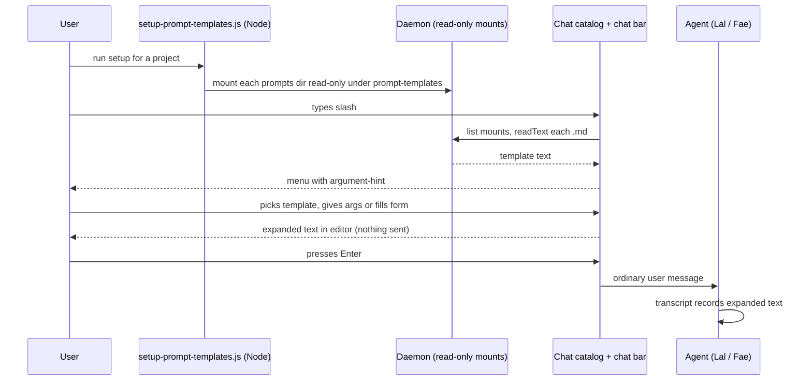

# EndoPi: Prompt Templates

| | |
|---|---|
| **Created** | 2026-05-15 |
| **Updated** | 2026-11-17 |
| **Author** | Kris Kowal (prompted) |
| **Status** | Proposed |
| **Parent** | [endopi](endopi.md) |

## Status

A first build is open as draft
[#1640](https://github.com/endojs/endo-but-for-bots/pull/1640)
(`@endo/prompt-templates`, `packages/chat/setup-prompt-templates.js`,
`packages/spaces-util/src/prompt-template-catalog.js`). It was written
against the earlier, thinner version of this document, which said Pi
templates use `{{var}}` placeholders. Pi does not: it uses shell-style
`$1` / `$@` placeholders and an `argument-hint` frontmatter key. This
revision fixes the format so that a template written for Pi expands the
same way in Endo, and keeps #1640's capability shape (read-only mounts
under one pet name), which is sound. The build follow-up is a rework of
#1640, not a new PR. § *Delta from #1640* lists the changes.

## Motivation

Reusable user-prompt scaffolds (a "code review" prompt, a "write a PR
description" prompt, a "summarize this thread" prompt) are an ergonomic
affordance every coding harness offers. Pi calls them *prompt
templates*: a markdown file, expanded into the editor when the user
types `/templatename args...`. Endo's Chat command bar
(`packages/spaces-util/src/chat-bar-component.js`) has built-in slash
commands from `COMMANDS` in `command-registry.js` but no user-authored
ones.

The goal is format compatibility: the same file under `~/.pi/agent/prompts/`
or `~/.agents/prompts/` behaves the same in Pi and in Endo Chat.

## Design

### File format

A template is one UTF-8 markdown file. The file name without `.md` is the
command name. Frontmatter is optional.

```markdown
---
description: Review staged changes for one concern
argument-hint: <focus> [scope]
---
Review the ${2:-staged} changes for bugs, focusing on $1.
Extra notes from the user: ${@:3}
```

- **Name.** The basename without `.md`. A name must match
  `^[A-Za-z0-9][A-Za-z0-9._-]*$`; any other file is skipped with a
  diagnostic. Names are case-sensitive.
- **`description`** (optional). Shown in the `/` menu. When absent, the
  first non-empty body line, truncated to 60 characters.
- **`argument-hint`** (optional). Shown after the name in the menu, and
  the source of form labels (§ *Missing arguments*). Tokens in
  `<angle brackets>` are required; tokens in `[square brackets]` are
  optional. The *n*th token labels `$n`.
- **Other keys** are ignored without warning, so a file written for a
  harness with more keys (for example Claude Code's `model:`) still
  loads. Frontmatter is read with the line-oriented reader already in
  #1640's `parsePromptTemplate`, extended to `argument-hint`; no YAML
  dependency.
- Input normalization: strip a leading BOM, convert CRLF to LF, drop
  leading blank lines and trailing whitespace from the body.

### Argument splitting

The slash line `/name rest` splits `rest` into arguments by Pi's rules
(cited below), which are narrower than a POSIX shell:

1. Whitespace separates arguments.
2. A `'` or `"` starts a quoted argument **only at the start of an
   argument**; an apostrophe inside a word (`don't`) is text.
3. A quoted argument ends at the matching quote; the quotes are removed;
   `""` is an empty argument.
4. A quote with no matching close is kept as literal text.
5. Inside a quoted argument, a backslash before the same quote character
   is kept as text (it does not escape). Other backslashes are kept as
   typed.

`parseCommandArguments` in `substitute.js` implements these rules (rules
2, 4 and 5 differ from #1640's current version).

### Substitution

The placeholder grammar is exactly Pi's:

| Placeholder | Expands to |
|---|---|
| `$1`, `$2`, … | The *n*th argument, or empty |
| `$@`, `$ARGUMENTS` | All arguments joined with one space |
| `${1:-default}` | The first argument, or `default` if absent or empty |
| `${@:-default}` | All arguments, or `default` if there are none |
| `${@:N}` | Arguments from position *N* (1-based), joined with spaces |
| `${@:N:L}` | *L* arguments from position *N* |

Substitution is a single left-to-right pass with one regular
expression over the body, so a substituted value containing `$1`,
`${…}`, or `$&` stays literal. Text that does not match the grammar
(`$PATH`, `$0`, a lone `$`) stays literal. There is no escape syntax,
matching Pi.

`extractVariables` becomes `analyzePlaceholders(body)`, which returns
`{ maxPosition, usesRest }`: the highest `$n` / `${n…}` index, and
whether any `$@`, `$ARGUMENTS` or `${@…}` form appears.

### Invocation in Chat

Expansion fills the editor; it never sends. The agent loop runs only
when the user presses Enter, as with any typed message.

1. **Menu.** Templates appear in the `/` menu and command popover as
   commands of category `templates`, with `argument-hint` shown after
   the name. A built-in command name or alias always wins; a template
   with that name is skipped with a diagnostic, so a project file cannot
   redefine `/clear`. The `skill:` prefix is reserved for
   [endopi-skills-markdown-format](endopi-skills-markdown-format.md).
2. **Complete arguments.** `/name args` with every required position
   (`<…>` tokens in `argument-hint`) filled expands directly.
3. **Missing arguments.** If a required position is empty, the chat bar
   shows its inline command form (`inline-command-form.js`), one text
   field per `argument-hint` token, prefilled with any arguments already
   typed. With no `argument-hint`, fields are generated as `$1`…`$n` up
   to `maxPosition`, all optional, and the form opens only when the user
   invoked the template with no arguments at all. Submitting the form
   expands into the editor.
4. **Excess arguments.** If there are more arguments than `maxPosition`
   and the template has no rest form (`usesRest` false), the line stays
   in the editor with an error. Otherwise excess arguments are consumed
   by the rest form.

The form here is the chat bar's inline command form, not
[lal-fae-form-provisioning](lal-fae-form-provisioning.md)'s form
request: an editor expansion has no message and no recipient.

### Where templates come from: capability, not path

Chat runs in a browser and reads no disk. The Chat profile holds a pet
name `prompt-templates` naming an EndoDirectory whose entries are
**read-only mounts**, one per template directory. Chat's catalog
(`prompt-template-catalog.js`) lists that directory and each mount,
adapting each mount to a `PromptTemplateSource` (`list()`,
`readText(name)`), and calls `loadPromptTemplates(sources)`. An agent
profile without the name sees no templates.

Precedence: sources are applied in entry-name order and a later source
overrides an earlier one with the same template name (with a
diagnostic). The setup script names entries so project directories sort
after global ones.

The Node-side setup script (`packages/chat/setup-prompt-templates.js`)
finds directories and creates the mounts. It is the only code that reads
the filesystem, and running it is the user's grant, the analog of Pi's
"project trust" step. Directories, in increasing precedence:

1. `~/.pi/agent/prompts/`
2. `~/.agents/prompts/` (cross-harness)
3. `.agents/prompts/` in each directory from the repository root down to
   the working directory (outside a repository, the working directory
   only)
4. `.pi/prompts/` in the working directory

Only direct `.md` children load; files over 1 MiB are skipped. The catalog
rereads on every `/` menu open, so an edited file needs no reload; a
reload that finishes after a newer one is discarded.

### Shared discovery walker

[endopi-skills-markdown-format](endopi-skills-markdown-format.md)
(draft [#1643](https://github.com/endojs/endo-but-for-bots/pull/1643),
`@endo/skills`) walks the same home / repository-root / cwd ladder with
different leaf names. The walk is one function,
`listConventionalDirectories({ cwd, home, leaves })`, returning ordered
absolute paths. It lives in whichever of the two packages merges first
(its `src/node.js`); the second imports it rather than keeping a copy.
The ladder's bounds (stop at the repository root and at `$HOME`) are
part of that function, so both features read the same set of
directories.

### Composition with skills

A template body may mention `/skill:name`. It passes through expansion
literally; once the skills build lands, the agent loop handles it on
submit like any slash command in a user message. No change here.

### Fit with transcripts, providers, and the RPC bridge

- **Transcripts.** The expanded text is an ordinary user message. Under
  [endopi-jsonl-transcript-format](endopi-jsonl-transcript-format.md)
  (format library merged in #669; capability boundary in draft #1669) it
  is written as a `message` entry with role `user` and the expanded
  text. No template name or arguments are recorded, matching Pi. The
  user may edit the expansion before sending, so the expanded text is
  the only accurate record.
- **Providers.** Templates are provider-neutral text. They select no
  model and carry no provider key; frontmatter such as `model:` is
  ignored. [endopi-provider-registry-and-oauth](endopi-provider-registry-and-oauth.md)
  is unaffected.
- **RPC bridge.** In
  [endopi-stdio-rpc-bridge](endopi-stdio-rpc-bridge.md) (#667) the
  client sends text it has already composed. A terminal client that
  wants templates uses `@endo/prompt-templates` itself; the bridge does
  not expand templates.
- **Extension packages.** When
  [endopi-extension-package-manifest](endopi-extension-package-manifest.md)
  lands, a package's `prompts` entry becomes one more read-only mount in
  the `prompt-templates` directory. That is not part of this build.



## Ownership map

| Boundary | Mechanism | Policy | Durable state | Lifecycle authority | Value crossing |
|---|---|---|---|---|---|
| Filesystem -> daemon | Setup script | User chooses which project to grant | Files on disk, owned by the user | User runs or removes the setup | Read-only mount capability |
| Daemon -> Chat | Catalog over CapTP | Precedence by entry order; built-ins win | None in Chat (reread on every menu open) | Revoking the pet name removes all templates | Template text |
| Chat -> agent | Chat bar send | User reviews and presses Enter | Agent transcript | Agent owns its transcript | Plain user message text |

Persistent state is the user's files plus the agent's transcript; Chat
keeps none. The only commit decision is the user's Enter. There is
nothing to replay: a restart rereads the mounts.

## Security

Template text is untrusted (a project may ship it). Chat gains only
read-only mounts the user created. Expansion never sends. Text renders
through text nodes, so markup and `@name` tokens stay literal.
Built-in names cannot be shadowed. A long template can hide text below
the fold; the user's review before Enter is the remaining defense, as in
Pi.

## Delta from #1640

The rework of #1640 is:

1. Replace `{{name}}` with the Pi placeholder grammar in
   `substitute.js`; replace `extractVariables` with
   `analyzePlaceholders`; drop the `variables` field of
   `PromptTemplate` for `argumentHint: readonly ArgumentHintToken[]`
   plus `maxPosition` and `usesRest`.
2. Align `parseCommandArguments` with § *Argument splitting*.
3. Read `argument-hint` in `parsePromptTemplate`; drive form fields
   and the required check from it (§ *Invocation in Chat*).
4. Apply the excess-argument rule only when `usesRest` is false.
5. Reconcile the directory walk with #1643 per § *Shared discovery
   walker*.
6. Get CI green (the #1640 gauntlet halted on red CI at head
   `24cd13406c`).
7. Replace this file's implementation notes with a `## Status` section
   once built.

## Dependencies

| Design | Relationship |
|--------|--------------|
| [chat-slot-slash-commands](chat-slot-slash-commands.md) | Sibling slash-command infrastructure |
| [endopi-skills-markdown-format](endopi-skills-markdown-format.md) | Shares the discovery walker; owns `/skill:` |
| [endopi-jsonl-transcript-format](endopi-jsonl-transcript-format.md) | Records the expanded text as a user message |
| [endopi-extension-package-manifest](endopi-extension-package-manifest.md) | Future source of package-provided templates |

## Phased implementation

1. **Format.** Parser, Pi argument splitting, Pi substitution, unit tests
   including Pi's own documented examples.
2. **Sources.** Shared walker, setup script, catalog over read-only
   mounts.
3. **Chat bar.** Menu entries, direct expansion, inline form for missing
   required arguments, excess-argument error. Component tests assert no
   message is sent on expansion.

## Test plan

- Table tests for each placeholder form, including defaults with empty
  arguments, `${@:N:L}` past the end, and values that contain
  placeholders (single-pass).
- Splitting tests for each of the five rules, including `don't`, an
  unterminated quote, and `"a\"b"`.
- Discovery tests against real temporary directories for order and
  repository / home bounds, shared with `@endo/skills`.
- Chat-bar component tests: menu, direct expansion, form path,
  excess arguments, built-in protection, stale-reload guard.
- A template copied verbatim from Pi's documentation expands to the same
  text in both harnesses.

## Out of scope

- **Running templates as agent prompts.** Templates expand the editor;
  autonomous prompts belong to endoclaw's proactive messages.
- **Typed variables.** Arguments are strings, as in Pi.
- **Nested directories and globs.** Pi's settings and package manifests
  can select nested files; Endo loads direct children only until the
  extension manifest lands.

## Open questions

- Should `{{name}}` named placeholders survive as an Endo-only
  extension alongside Pi's grammar? This design says no: two grammars
  in one body make the expansion harder to predict, and `argument-hint`
  already supplies form labels. Keeping them would preserve #1640's
  current behavior.
- Should a template be invocable by an agent, not just the user (for
  example, a guest asking Chat to fill its editor)? This design limits
  templates to the user, because an agent-filled editor is a new path
  for untrusted text into the user's send.

## Citation

- [`packages/coding-agent/docs/prompt-templates.md`](https://github.com/badlogic/pi-mono/blob/main/packages/coding-agent/docs/prompt-templates.md)
  (locations, `description`, `argument-hint`, placeholder grammar,
  argument splitting rules)
- [`packages/coding-agent/src/core/prompt-templates.ts`](https://github.com/badlogic/pi-mono/blob/main/packages/coding-agent/src/core/prompt-templates.ts)

## Prompt

> Extracted from [endopi](endopi.md) § *Prompt templates*. Small,
> self-contained, low-risk; useful before larger workflow features
> land.
>
> Revised 2026-11-17 (garden job `design-endopi-prompt-templates`): turn
> the Proposed design into a concrete, buildable design covering the
> template format, argument substitution, and how it fits the endopi
> transcript and provider work already in flight.
