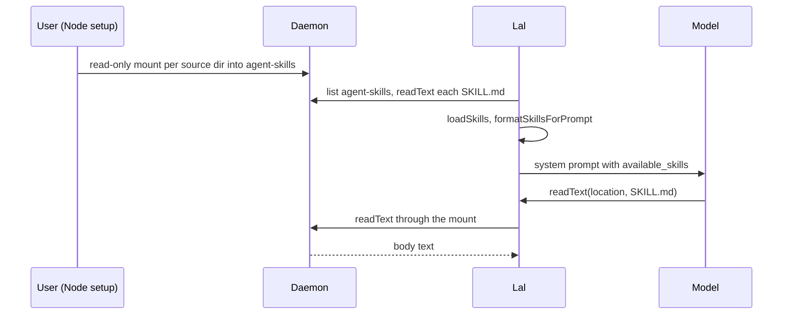

# EndoPi: Markdown Skill Format (agentskills.io)

| | |
|---|---|
| **Created** | 2026-05-15 |
| **Updated** | 2026-11-17 |
| **Author** | Kris Kowal (prompted) |
| **Status** | Proposed |
| **Parent** | [endopi](endopi.md) |

## Status

The format library is built in draft
[#1643](https://github.com/endojs/endo-but-for-bots/pull/1643) as a new
`@endo/skills` package (parser, lenient validation, discovery, prompt
rendering, `/skill:` expansion). It is not yet wired into Lal, because Lal
had no sanctioned way to reach skill directories. This revision settles
that boundary (skills arrive as read-only mounts, the same shape the
sibling [endopi-prompt-templates](endopi-prompt-templates.md) design uses
in draft [#1671](https://github.com/endojs/endo-but-for-bots/pull/1671)),
resolves the earlier open questions, and lists the changes #1643 needs in
§ *Delta from #1643*.

## Motivation

[endoclaw-skill-registry](endoclaw-skill-registry.md) covers the
daemon-side *granting* surface: skills as pet names in an EndoDirectory.
It does not cover the *authoring* shape the coding-agent ecosystem has
standardized on: a directory with a `SKILL.md` at its root, frontmatter
naming and describing the skill, a free-form markdown body, and optional
helper files alongside.

Pi, Claude Code, and Codex all read the
[agentskills.io specification](https://agentskills.io/specification)
shape. Endo joining it means:

1. The Endo agent consumes skills written for other harnesses without
   translation.
2. A skill authored for Endo works in other harnesses.
3. Progressive disclosure (names and descriptions in the system prompt,
   bodies read on demand) costs less context than inlining every skill.

## Design

### On-disk shape

```
my-skill/
├── SKILL.md              # required: frontmatter + body
├── scripts/              # optional: helpers the body references
├── references/           # optional: details loaded on demand
└── assets/               # optional: templates, data
```

Only `SKILL.md` is interpreted. The other directories are ordinary files
the model may read through the same capability that delivered the skill.

### Frontmatter

```markdown
---
name: my-skill
description: What this skill does and when to use it.
license: MIT
compatibility: Requires git, bash.
allowed-tools: read bash
disable-model-invocation: false
metadata:
  author: example
---

# My Skill

Run `./scripts/process.sh <input>`. See [API reference](references/api.md).
```

| Key | Source | Rule | On violation |
|-----|--------|------|--------------|
| `name` | spec | 1-64 chars; lowercase `a-z`, `0-9`, `-`; no leading, trailing, or doubled `-`; equals the directory name | warning; the directory name is used when absent |
| `description` | spec | 1-1024 chars | absent or empty: **error**, skill not loaded; too long: warning |
| `license` | spec | free text | none |
| `compatibility` | spec | at most 500 chars | warning |
| `metadata` | spec | one-level string map | non-string values dropped with a warning |
| `allowed-tools` | spec (experimental) | whitespace-separated names | none; advisory only (§ *Authority*) |
| `disable-model-invocation` | Pi / Claude Code | boolean | non-boolean treated as `false` with a warning |

Unknown keys are ignored. Leniency follows Pi: a skill written for another
harness loads with warnings rather than being rejected. Diagnostics carry
the source label and entry name and are surfaced to the operator (Lal's
log), never to the model.

The parser reads a YAML subset with no YAML dependency: top-level
`key: value`, single- and double-quoted values, `|` and `>` block
scalars, and one nested level under `metadata`. Anything else is ignored
with a warning. `SKILL.md` files over 1 MiB are rejected.

### Sources: capability, not path

Lal is a confined guest and reads no disk. Its profile may hold the pet
name **`agent-skills`**, naming an EndoDirectory whose entries are
**read-only mounts**, one per skill *source* directory (a directory whose
children are skill directories). An agent without the name has no skills.

The name is `agent-skills`, not `skills`, because
[endoclaw-skill-registry](endoclaw-skill-registry.md) reserves `skills`
for a directory of daemon-formula skill descriptors; the two must not
collide (§ *Integration with the registry*).

Lal adapts each mount to the `SkillSource` interface of `@endo/skills`
(`list()`, `readSkillText(entry)`, `locate(entry)`) and calls
`loadSkills(sources)`. `locate` returns a pet-name path, for example
`agent-skills/20-agents-user/my-skill/SKILL.md`, which the model can pass
straight to `readText`.

Precedence: sources apply in entry-name order; a later source overrides
an earlier skill of the same name, with a warning. The setup script
prefixes entry names (`10-`, `20-`, ...) so project sources sort after
user sources.

### Setup: the user's grant

A Node script, `packages/skills/setup-skills.js`
(`endo-skills-setup <agent-pet-name> [--no-cross-harness]`), finds source
directories, creates one read-only mount per existing directory, and
writes them into the named agent's `agent-skills` directory, replacing
entries it wrote before. It is the only code that reads the filesystem.
Running it is the user's grant, the analog of Pi's project-trust step.

Directories, in increasing precedence, found with the walker shared with
prompt templates (`listConventionalDirectories({ cwd, home, leaves })`,
§ *Shared discovery walker* in
[endopi-prompt-templates](endopi-prompt-templates.md)):

1. `~/.claude/skills`, `~/.codex/skills` (cross-harness; skipped with
   `--no-cross-harness`)
2. `~/.pi/agent/skills`
3. `~/.agents/skills`
4. `.agents/skills` in each directory from the repository root down to
   the working directory (outside a repository, the working directory
   only)
5. `.claude/skills`, `.pi/skills` in the working directory

This answers the old question of which project-local directory Endo
uses: all of them, in a fixed order, because the point is to read skills
other harnesses already wrote.

### System prompt

At each agent incarnation (start or restart) Lal loads the skills once
and appends `formatSkillsForPrompt(skills, { readHint })` to its system
prompt: a preamble plus an `<available_skills>` list of name,
description, and location per skill. Skills with
`disable-model-invocation: true` are omitted. Names, descriptions, and
locations are XML-escaped so skill text cannot close its element. Lal's
`readHint` tells the model to read a skill with
`readText(<location minus SKILL.md>, "SKILL.md")` and to resolve relative
references against the skill's directory path.

The list is a snapshot. Lal also follows the `agent-skills` directory with
`followNameChanges`; when an entry is added or removed it reloads, and
the new list takes effect at the next round's system prompt. Edits
*inside* a mounted directory take effect at the next incarnation. There
is no cache beyond this snapshot. Rebuilding the list every round was
rejected: it rereads every `SKILL.md` per round and changes the system
prompt mid-conversation, which defeats provider prompt caching.

Lal lists at most 200 skills, in precedence order, and logs a warning for
the rest.

### `/skill:name`

An inbox message whose text starts with `/skill:<name> [args]` is
expanded by `expandSkillCommand` before the round runs: the current
`SKILL.md` body (reread, not the snapshot) inside a
`<skill name location>` element, followed by the arguments. This works
for skills hidden by `disable-model-invocation`. An unknown name produces
an error reply to the sender and runs no model round. The transcript
([endopi-jsonl-transcript-format](endopi-jsonl-transcript-format.md))
records the expanded text as an ordinary user `message`, matching how
prompt templates are recorded.

Chat needs no change: it sends `/skill:` text literally, and
[endopi-prompt-templates](endopi-prompt-templates.md) reserves the
`skill:` prefix so no template shadows it.

### Authority: skills carry text, not capabilities

A skill is instructions. It gains the agent nothing the agent does not
already hold. Consequences:

- **`allowed-tools` is advisory.** Enforcing it would be a per-call
  allowlist of tool names checked against "which skill is active", an
  identity-style check this codebase avoids, and the notion of an
  active skill is not well defined once several are loaded. It is parsed
  and kept on `Skill.allowedTools` and not enforced. The structural form
  of the same idea is a skill that *ships with* attenuated capabilities.
  That is the registry bridge's job (Phase 4), where the grant is a held
  capability rather than a name list.
- **`scripts/` do not run.** Lal has no shell. A skill whose body says
  "run `./scripts/x.sh`" works only in an agent that holds an execution
  capability. The model can still read scripts as text. Endo adds no
  execution path for skills.

### Integration with the registry

The mount path above is the *authoring* surface.
[endoclaw-skill-registry](endoclaw-skill-registry.md) is the *granting*
surface. The bridge (Phase 4) is a daemon-side `SkillSource` over a
registry `skills` directory, so a skill received by `request` or mail
appears in the same `<available_skills>` list with no filesystem write.
It waits on that design.



## Ownership map

| Boundary | Mechanism | Policy | Durable state | Lifecycle / commit | Value crossing |
|----------|-----------|--------|---------------|--------------------|----------------|
| Filesystem → daemon | `setup-skills.js` | User chooses agent and whether to include cross-harness dirs | Files on disk, owned by the user | User reruns or removes the mounts | Read-only mount capability |
| Daemon → Lal | `agent-skills` directory, mounts | Entry-name order sets precedence | Mount formulas in the daemon | Daemon persists; Lal reloads on name changes or restart | `SkillSource` reads (text) |
| Lal → model | `@endo/skills` rendering, `readText` tool | `disable-model-invocation`, 200-skill cap | None (snapshot in memory) | Rebuilt per incarnation | Escaped descriptor list; bodies on request |

Persistent state is owned by the user's disk and the daemon's mount
formulas. Lal commits nothing. Restart replays nothing: a new incarnation
rereads the mounts. Skill text is classified as untrusted input
everywhere. Naming check: `@endo/skills` is a format library and names
only format concepts (`Skill`, `SkillSource`), not agent-lifecycle ones.

## Security

Skill text is prompt input from wherever the user mounted it, and a
mounted directory is a prompt-injection surface. The defenses are that
the user's setup run is the only grant, mounts are read-only, the model
sees only escaped descriptors until it chooses to read, and a skill adds
no authority (§ *Authority*). Diagnostics never reach the model.

## Delta from #1643

1. Add `setup-skills.js` and its bin entry (§ *Setup*). Keep
   `discoverSkills` for Node hosts and tests, but drive it from
   `listConventionalDirectories` once whichever of #1643 and #1640 merges
   first exports it.
2. Add a mount-backed `SkillSource` whose `locate` returns pet-name paths.
3. Make the prompt preamble host-specific: `formatSkillsForPrompt(skills,
   { readHint })`. The current text ("use the read tool", "absolute
   path") fits only a filesystem host.
4. Check the validator against the frontmatter table above, including
   the 500-char `compatibility` limit and doubled or edge hyphens in
   `name`.
5. Wire Lal: load at incarnation, `followNameChanges` on `agent-skills`,
   the 200-skill cap, and `/skill:` expansion in the inbox loop.
6. Replace the design-doc *Implementation notes* section in #1643 with a
   pointer to this revision.

## Test plan

- Parser: every row of the frontmatter table, block scalars, a foreign
  Claude Code skill with unknown keys loads with warnings only.
- Precedence: two sources defining one name; later wins, one warning.
- Mount source: a skill under `agent-skills` lists with a pet-name
  location that `readText` resolves, against a scratch daemon.
- Escaping: a description containing `</skill>` renders inert.
- Lal: adding an `agent-skills` entry changes the next round's prompt,
  not the current one; `/skill:` on an unknown name replies with an error
  and runs no round; a `disable-model-invocation` skill is absent from the
  prompt but expands by command.
- Setup: `--no-cross-harness` skips the Claude Code and Codex directories;
  rerunning replaces its own entries and leaves others alone.

## Phased implementation

1. **Format library.** Parse, validate, discover, render, expand (#1643,
   plus deltas 3 and 4).
2. **Mount source and setup script.** Deltas 1 and 2.
3. **Lal integration.** Delta 5. Fae follows the same wiring later.
4. **Registry bridge.** A `SkillSource` over
   [endoclaw-skill-registry](endoclaw-skill-registry.md); waits on that
   design.
5. **Extension packages.** A package's skills become one more mount
   under [endopi-extension-package-manifest](endopi-extension-package-manifest.md).

## Dependencies

| Design | Relationship |
|--------|--------------|
| [endoclaw-skill-registry](endoclaw-skill-registry.md) | Daemon-side granting surface; Phase 4 |
| [endopi-prompt-templates](endopi-prompt-templates.md) | Shares the discovery walker and mount shape; reserves `skill:` |
| [endopi-jsonl-transcript-format](endopi-jsonl-transcript-format.md) | Records expanded `/skill:` text |
| [endopi-extension-package-manifest](endopi-extension-package-manifest.md) | Skills shippable as packages |
| [lal-fae-form-provisioning](lal-fae-form-provisioning.md) | Skill grants part of provisioning |

## Open questions

- Should cross-harness directories (`~/.claude/skills`, `~/.codex/skills`)
  be on by default? Many of those skills assume a shell Lal lacks, so they
  would advertise work Lal cannot do. Recommendation: on by default, as
  the earlier revision of this design proposed, because the setup run is
  an explicit grant and `--no-cross-harness` is available.

## Citation

- [`packages/coding-agent/docs/skills.md`](https://github.com/badlogic/pi-mono/blob/main/packages/coding-agent/docs/skills.md)
- [`packages/coding-agent/src/core/skills.ts`](https://github.com/badlogic/pi-mono/blob/main/packages/coding-agent/src/core/skills.ts)
- [`packages/coding-agent/src/core/system-prompt.ts`](https://github.com/badlogic/pi-mono/blob/main/packages/coding-agent/src/core/system-prompt.ts) (skill formatting block)
- [agentskills.io specification](https://agentskills.io/specification) (external), § *Frontmatter*

## Prompt

> Extracted from [endopi](endopi.md) § *Skills system*. Bridges the
> daemon-side skill registry to the on-disk authoring format the
> broader coding-agent ecosystem has standardized on.
