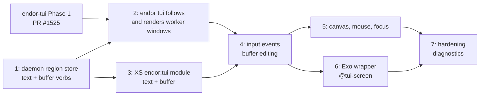

# Endor Bus TUI — Worker-Programmable Terminal UI

| | |
|---|---|
| **Created** | 2026-04-23 |
| **Updated** | 2026-10-22 |
| **Author** | Kris Kowal (prompted) |
| **Status** | Not Started |

## What is the Problem Being Solved?

The `endor` Rust daemon (the in-progress re-implementation of the Endo
daemon that will also subsume the responsibilities now split between
`packages/daemon` and `go/engo`) owns the user's terminal when it is
launched as a TUI.
Its user-facing surface — described in the companion document
`endor-tui.md` — is a single multiplexed screen that composes a Chat
pane, an XS debugger pane, and (eventually) arbitrary other regions
contributed by running workers.

XS workers are confined JavaScript processes.
They cannot write to a file descriptor they were not given.
They have no access to `stdout`, no access to the controlling terminal,
no knowledge of the TTY's size or mode, and no way to produce ANSI
escape sequences that would reach the user.
This is by design: confinement is the whole point.

But workers frequently need to contribute UI to the user.
A long-running agent wants to show status.
An XS debugger plugin wants to show a source listing with a cursor.
A tool invocation wants to stream its output into a scroll region.
A form wants to take keystrokes.
Every one of these is a legitimate workflow, and every one of them
requires the worker to both produce output and observe input — without
ever touching the terminal directly.

The solution is a **capability-mediated TUI** in which the worker
declares what it wants to render and the daemon produces the actual
ANSI bytes on the user's terminal.
Events flow the other direction: the daemon decodes keyboard, mouse,
and resize events and forwards them to whichever worker owns the
region that currently has focus.

This document specifies the worker-side half of that contract in three
layers:

1. **Bus protocol verbs** — the wire protocol on the existing
   endor⇄worker envelope bus (the same CBOR envelope bus described in
   `daemon-engo-supervisor.md` and prototyped in `go/engo/daemon/`) by
   which a worker declares, mutates, and subscribes to events from a
   TUI surface the daemon multiplexes for it.
2. **XS handle API** — a small JavaScript module that any code running
   inside an XS worker can import to manipulate those surfaces as
   ordinary JS handle objects.
   This is the worker's "native" TUI API.
   It is **not** capability-safe by itself: anyone in the worker
   compartment who can `import` the module can open a window.
3. **Exo-based CapTP wrapper** — a set of `makeExo` remotable objects
   that wrap the XS handle API behind `M.interface` method guards, so
   the ability to render into a specific region can be delegated to
   other parties over CapTP, handed to another agent, revoked, or
   stored in a pet store.

The three layers exist because each solves a different problem.
The bus verbs are wire protocol: they must be serializable, versioned,
and survive a worker restart.
The XS handles are a local JS convenience: they hold the per-worker
state (pending draw buffers, event subscriptions) and present it as
ordinary JavaScript.
The Exos are the capability model: they are the surface that an agent
code author interacts with when they write code that is supposed to
run under principle-of-least-authority.

This is the **internal** side of the TUI.
The **external** side — the user-visible layout engine, the Chat pane,
the XS debugger host, the attach/detach story — is specified in the
companion document `endor-tui.md`, which this design depends on and
does not duplicate.

## Design

The design has three layers.
Each subsection describes one layer from the bottom up.

### Layer 1: Bus protocol verbs

The endor⇄worker bus is the CBOR envelope protocol already used for
`spawn`, `exit`, `call`, and `return`.
Every envelope is a 4-element CBOR array `[handle, verb, payload,
nonce]` where `handle` identifies the callee, `verb` is a text string,
`payload` is a CBOR-encoded verb-specific argument, and `nonce` is a
request identifier (0 for fire-and-forget).
See `go/engo/daemon/codec.go` for the existing codec.

TUI verbs are addressed to the daemon's control handle (handle 0) with
a verb name prefixed `tui.` and a payload that is a CBOR map.
Responses use the same nonce and are delivered to the worker's handle.
Event delivery is modeled as fire-and-forget envelopes (nonce 0) sent
from the daemon to the worker and addressed to the worker's handle
with verb `tui.event`.

The TUI verbs fall into five groups:

1. **Screen acquisition** — discover the screen, learn its shape.
2. **Window lifecycle** — create, configure, destroy windows.
3. **Region content** — write cells, lines, or buffers into a region.
4. **Event subscription** — request keyboard/mouse/focus/resize events.
5. **Teardown** — surrender a window or region.

All verbs and their payloads are enumerated below.

#### 1. Screen acquisition

##### `tui.getScreen`

Request the current screen metadata.

Request payload (map):

| Key | Type | Meaning |
|---|---|---|
| (none) | — | No arguments |

Response payload (map):

| Key | Type | Meaning |
|---|---|---|
| `screenId` | int | Daemon-assigned ID for the current screen |
| `cols` | int | Terminal columns |
| `rows` | int | Terminal rows |
| `colorDepth` | int | 1, 4, 8, or 24 (monochrome, 16-color, 256-color, truecolor) |
| `hasMouse` | bool | Mouse reporting available |
| `hasFocus` | bool | Focus in/out reporting available |
| `attached` | bool | User is currently attached to this screen |

A worker may hold several screen IDs concurrently if it is contributing
to multiple terminals (e.g., one TTY per attached user).

#### 2. Window lifecycle

A **window** is the top-level unit a worker reserves.
It has a title, a layout hint, and a lifetime bound to the worker.
It contains one or more **regions**.
A region is a rectangle of character cells that accepts draw calls.

##### `tui.createWindow`

Request payload:

| Key | Type | Meaning |
|---|---|---|
| `screenId` | int | Target screen ID |
| `title` | text | Window title for the layout manager |
| `role` | text | One of `chat`, `debugger`, `status`, `tool`, `form`, `log` |
| `layoutHint` | map | See layout hint below |
| `initialRegions` | array | Optional — initial regions to create atomically |

The `layoutHint` map carries fields that the layout engine in
`endor-tui.md` interprets:

| Key | Type | Meaning |
|---|---|---|
| `minCols` | int | Minimum acceptable width |
| `minRows` | int | Minimum acceptable height |
| `preferredCols` | int | Preferred width |
| `preferredRows` | int | Preferred height |
| `dock` | text | `top`, `bottom`, `left`, `right`, `fill`, or `float` |
| `priority` | int | Eviction priority (higher stays) |

Response payload:

| Key | Type | Meaning |
|---|---|---|
| `windowId` | int | Daemon-assigned ID for the window |
| `regions` | array | Echoed region IDs if `initialRegions` was set |

##### `tui.configureWindow`

Update mutable window attributes.
All fields are optional; only the supplied ones are applied.

Request payload:

| Key | Type | Meaning |
|---|---|---|
| `windowId` | int | Target |
| `title` | text | New title |
| `layoutHint` | map | New layout hint (replaces, does not merge) |

Response: empty map.

##### `tui.destroyWindow`

Surrender a window.
All contained regions are implicitly destroyed.

Request payload:

| Key | Type | Meaning |
|---|---|---|
| `windowId` | int | Target |

Response: empty map.

##### `tui.createRegion`

Create a region inside a window.
Regions within a window tile according to the window's layout policy
(see **Layout model** below).

Request payload:

| Key | Type | Meaning |
|---|---|---|
| `windowId` | int | Parent window |
| `role` | text | `text`, `buffer`, `status`, `input`, `canvas` |
| `layoutHint` | map | Same shape as window layout hint |
| `scrollback` | int | For `buffer` regions, scrollback line capacity |

Response payload:

| Key | Type | Meaning |
|---|---|---|
| `regionId` | int | Daemon-assigned ID |

##### `tui.destroyRegion`

Surrender a single region without tearing down its window.

Request payload:

| Key | Type | Meaning |
|---|---|---|
| `regionId` | int | Target |

Response: empty map.

#### 3. Region content

Drawing is intentionally high-level.
The daemon owns cursor positioning, color reconciliation, and dirty-
rect tracking.
A worker submits *what* it wants the region to show, not the ANSI
sequences to get there.
This keeps the bus protocol independent of the terminal's capabilities
and lets the daemon's renderer choose the cheapest representation.

Three content styles are supported, selected by the region's `role`:

- **`text` region** — single styled string with wrap/clip/scroll
  behavior controlled by the region.
  Used for status lines, titles, command bars.
- **`buffer` region** — append-only styled lines with scrollback.
  Used for logs, Chat transcripts, tool output.
- **`canvas` region** — absolute cell grid with `(col, row)`
  addressable writes.
  Used for the XS debugger source listing, cursors, progress bars.

##### `tui.setText`

For `text` regions only.

Request payload:

| Key | Type | Meaning |
|---|---|---|
| `regionId` | int | Target |
| `runs` | array | Array of `{ text, attrs }` style runs |

Each run has:

| Key | Type | Meaning |
|---|---|---|
| `text` | text | Content |
| `attrs` | map | Style attributes (see **Style attributes**) |

Response: empty map.

##### `tui.appendLines`

For `buffer` regions only.
Appends lines at the bottom; scrollback is maintained by the daemon up
to the region's configured capacity.

Request payload:

| Key | Type | Meaning |
|---|---|---|
| `regionId` | int | Target |
| `lines` | array | Array of lines, each an array of `{ text, attrs }` runs |

Response payload:

| Key | Type | Meaning |
|---|---|---|
| `firstLine` | int | Line number assigned to the first appended line |
| `lastLine` | int | Line number of the last appended line |

Line numbers are monotonically increasing and stable across redraws.
They are the addressing scheme used by `tui.editLine` and
`tui.scrollTo`.

##### `tui.editLine`

Edit a previously-appended buffer line.
Used by streaming updates where an agent rewrites its own in-flight
line.

Request payload:

| Key | Type | Meaning |
|---|---|---|
| `regionId` | int | Target |
| `lineNumber` | int | Line to replace |
| `runs` | array | New styled runs |

Response: empty map (or error if the line has scrolled out of the
daemon-side scrollback).

##### `tui.scrollTo`

Request payload:

| Key | Type | Meaning |
|---|---|---|
| `regionId` | int | Target |
| `lineNumber` | int | Line to scroll into view (negative counts from tail) |
| `anchor` | text | `top`, `middle`, `bottom` |

Response: empty map.

##### `tui.drawCells`

For `canvas` regions only.
Writes a rectangle of styled cells at an absolute position.

Request payload:

| Key | Type | Meaning |
|---|---|---|
| `regionId` | int | Target |
| `col` | int | Left edge (0-based) |
| `row` | int | Top edge (0-based) |
| `cols` | int | Width of the block in cells |
| `rows` | int | Height of the block in cells |
| `cells` | bytes | Packed cell data (see **Cell packing**) |

Response: empty map.

##### `tui.clearRegion`

Request payload:

| Key | Type | Meaning |
|---|---|---|
| `regionId` | int | Target |

Response: empty map.

##### Style attributes

The `attrs` map on every run carries a shallow set of named fields:

| Key | Type | Meaning |
|---|---|---|
| `fg` | int or text | Foreground color (palette index or `#rrggbb`) |
| `bg` | int or text | Background color |
| `bold` | bool | |
| `italic` | bool | |
| `underline` | bool | |
| `reverse` | bool | |
| `strike` | bool | |

Absent keys inherit the region's default attribute (which a worker
sets through a `tui.setDefaultAttrs` verb; payload: `regionId` and
`attrs`).

##### Cell packing

For `tui.drawCells`, cells are packed as CBOR-encoded bytes in
row-major order: for each cell, a three-element array
`[char, fg, bg]` where `char` is a text codepoint string, `fg` and
`bg` are integer attribute indices into a per-call attribute palette
that precedes the cells.
The full payload layout is
`{regionId, col, row, cols, rows, palette, cells}` where `palette`
is an array of `attrs` maps.
This keeps the wire representation compact for large grid updates.

#### 4. Event subscription

##### `tui.subscribeEvents`

Request payload:

| Key | Type | Meaning |
|---|---|---|
| `regionId` | int | Region whose events to subscribe to |
| `kinds` | array | Subset of `key`, `mouse`, `paste`, `focus`, `resize` |

Response payload:

| Key | Type | Meaning |
|---|---|---|
| `subscriptionId` | int | Handle used to unsubscribe |

After `tui.subscribeEvents` returns, the daemon may deliver envelopes
addressed to the worker's handle with verb `tui.event` and nonce 0
(fire-and-forget).
The envelope payload is a map:

| Key | Type | Meaning |
|---|---|---|
| `subscriptionId` | int | Which subscription this event belongs to |
| `regionId` | int | Region |
| `kind` | text | `key`, `mouse`, `paste`, `focus`, `resize` |
| `event` | map | Kind-specific event data (see below) |

###### Key event

| Key | Type | Meaning |
|---|---|---|
| `key` | text | Canonical key name (`a`, `Enter`, `Tab`, `F1`, `Up`, ...) |
| `codepoint` | int | Unicode codepoint if printable, 0 otherwise |
| `ctrl` | bool | |
| `alt` | bool | |
| `shift` | bool | |
| `meta` | bool | |

###### Mouse event

| Key | Type | Meaning |
|---|---|---|
| `col` | int | Column within the region (0-based) |
| `row` | int | Row within the region (0-based) |
| `button` | text | `left`, `middle`, `right`, `wheel-up`, `wheel-down`, `none` |
| `press` | text | `down`, `up`, `move`, `drag` |
| `ctrl` | bool | |
| `alt` | bool | |
| `shift` | bool | |

###### Paste event

Delivered for bracketed paste only.

| Key | Type | Meaning |
|---|---|---|
| `text` | text | The pasted text, unmodified |

###### Focus event

| Key | Type | Meaning |
|---|---|---|
| `focused` | bool | Region now has focus / lost focus |

###### Resize event

| Key | Type | Meaning |
|---|---|---|
| `cols` | int | New region column count |
| `rows` | int | New region row count |

##### `tui.unsubscribeEvents`

Request payload:

| Key | Type | Meaning |
|---|---|---|
| `subscriptionId` | int | Subscription to cancel |

Response: empty map.

#### 5. Teardown and lifecycle notifications

The daemon may send unsolicited envelopes to the worker when global
state changes:

##### `tui.screenChanged`

Sent when the attached terminal changes (reattach, detach, resize at
the terminal level rather than the region level).

Payload:

| Key | Type | Meaning |
|---|---|---|
| `screenId` | int | |
| `cols` | int | |
| `rows` | int | |
| `attached` | bool | |

##### `tui.windowRevoked`

Sent when the daemon unilaterally reclaims a window — for instance
because the user chose to close it, or because a higher-priority
window evicted it.

Payload:

| Key | Type | Meaning |
|---|---|---|
| `windowId` | int | |
| `reason` | text | `user-closed`, `evicted`, `screen-lost` |

After receiving `tui.windowRevoked`, all region IDs that belonged to
the window are invalid and draw calls against them will return an
error.

##### Error shape

Any verb may return an error.
Errors are delivered with verb `error` (existing convention in the
envelope bus) and payload `{ code, message }`:

| Key | Type | Meaning |
|---|---|---|
| `code` | text | `no-such-window`, `no-such-region`, `wrong-role`, `window-revoked`, `screen-lost`, `bad-argument`, `too-large` |
| `message` | text | Human-readable detail |

### Layer 2: XS handle API

Inside an XS worker, the bus verbs above are wrapped by a module
loadable as `endor:tui` from the worker's module graph (the module is
provided by the endor runtime, not from user code).
This module is **not** under SES lockdown in the sense that it is not
a remotable — it returns ordinary objects that a worker's host code
can hold and pass to confined compartments only at its discretion.

The module exports one function:

```js
/** @import { TuiScreen, TuiWindow, TuiRegion } from 'endor:tui' */

/**
 * Acquire the currently attached screen for this worker.
 * Returns undefined when no screen is attached.
 * @returns {Promise<TuiScreen | undefined>}
 */
export const getScreen = async () => { /* ... */ };
harden(getScreen);
```

The `TuiScreen` object has the following shape (informally — the real
type is an ordinary JS object, not an Exo, so the shape is documented
rather than guard-enforced):

```js
const screen = {
  /** @type {number} */ cols,
  /** @type {number} */ rows,
  /** @type {1 | 4 | 8 | 24} */ colorDepth,

  /**
   * @param {object} opts
   * @param {string} opts.title
   * @param {'chat'|'debugger'|'status'|'tool'|'form'|'log'} opts.role
   * @param {object} [opts.layoutHint]
   * @returns {Promise<TuiWindow>}
   */
  createWindow: async ({ title, role, layoutHint }) => { /* ... */ },

  /**
   * Observe screen-level changes (resize, detach).
   * @returns {AsyncIterable<{ cols: number, rows: number, attached: boolean }>}
   */
  changes: () => { /* ... */ },
};
```

A `TuiWindow` has:

```js
const window = {
  /** @type {number} */ windowId,
  /** @type {string} */ title,

  /**
   * @param {object} opts
   * @param {'text'|'buffer'|'canvas'} opts.role
   * @param {object} [opts.layoutHint]
   * @param {number} [opts.scrollback] // for buffer only
   * @returns {Promise<TuiRegion>}
   */
  createRegion: async ({ role, layoutHint, scrollback }) => { /* ... */ },

  /** @param {{ title?: string, layoutHint?: object }} patch */
  configure: async patch => { /* ... */ },

  close: async () => { /* ... */ },

  /**
   * Resolves when the daemon revokes this window (user-closed, evicted).
   * @type {Promise<{ reason: string }>}
   */
  revoked,
};
```

A `TuiRegion` has the union of content and event methods, gated on
role:

```js
const region = {
  /** @type {number} */ regionId,
  /** @type {'text'|'buffer'|'canvas'} */ role,

  // text role
  /** @param {StyledRun[]} runs */
  setText: async runs => { /* ... */ },

  // buffer role
  /**
   * @param {StyledRun[][]} lines
   * @returns {Promise<{ firstLine: number, lastLine: number }>}
   */
  appendLines: async lines => { /* ... */ },
  /** @param {number} lineNumber @param {StyledRun[]} runs */
  editLine: async (lineNumber, runs) => { /* ... */ },
  /** @param {number} lineNumber @param {'top'|'middle'|'bottom'} anchor */
  scrollTo: async (lineNumber, anchor) => { /* ... */ },

  // canvas role
  /** @param {number} col @param {number} row @param {Cell[][]} grid */
  drawCells: async (col, row, grid) => { /* ... */ },

  // all roles
  clear: async () => { /* ... */ },
  /** @param {{ attrs: StyleAttrs }} patch */
  setDefaultAttrs: async patch => { /* ... */ },

  // events
  /**
   * @param {('key'|'mouse'|'paste'|'focus'|'resize')[]} kinds
   * @returns {AsyncIterable<TuiEvent>}
   */
  events: kinds => { /* ... */ },

  close: async () => { /* ... */ },
};
```

`events()` is implemented by subscribing over the bus and pushing each
`tui.event` envelope into a local async iterator.
Closing the iterator unsubscribes.
When the region is destroyed, all outstanding event iterators
terminate.

A `StyledRun` is `{ text: string, attrs: StyleAttrs }`.
A `Cell` is `{ char: string, attrs: StyleAttrs }`.
`StyleAttrs` is the map described in **Style attributes** above.

Every exported name is hardened per project convention, but the
objects themselves are **not** Exos — they are plain JS records whose
methods close over the bus connection.
This is deliberate: the XS handle API is the worker's private
convenience.
Sharing a region across agents happens at Layer 3.

### Layer 3: Exo-based CapTP wrapper

The third layer wraps each XS handle in a `makeExo` remotable with an
`M.interface` method guard.
An agent can then hold a `Window` or `Region` capability, delegate it
to other agents over CapTP, store it in a pet store, or revoke it via
dismissal.

The Exo module is exposed as a guest import named `@endor/tui`.
It is itself a guest module that receives `powers` (including an
initialized `endor:tui` handle) and returns exos parameterized by that
handle.

#### Interface definitions

```js
import { M } from '@endo/patterns';
import { makeExo } from '@endo/exo';
import harden from '@endo/harden';

const StyleAttrsShape = M.splitRecord(
  {},
  {
    fg: M.or(M.number(), M.string()),
    bg: M.or(M.number(), M.string()),
    bold: M.boolean(),
    italic: M.boolean(),
    underline: M.boolean(),
    reverse: M.boolean(),
    strike: M.boolean(),
  },
);

const StyledRunShape = harden({
  text: M.string(),
  attrs: StyleAttrsShape,
});

const LayoutHintShape = M.splitRecord(
  {},
  {
    minCols: M.number(),
    minRows: M.number(),
    preferredCols: M.number(),
    preferredRows: M.number(),
    dock: M.string(),
    priority: M.number(),
  },
);

export const ScreenInterface = M.interface('TuiScreen', {
  help: M.call().returns(M.string()),
  cols: M.call().returns(M.number()),
  rows: M.call().returns(M.number()),
  colorDepth: M.call().returns(M.number()),
  createWindow: M.call(
    harden({
      title: M.string(),
      role: M.string(),
    }),
  )
    .optional(LayoutHintShape)
    .returns(M.promise()),
  changes: M.call().returns(M.remotable()),
});

export const WindowInterface = M.interface('TuiWindow', {
  help: M.call().returns(M.string()),
  id: M.call().returns(M.number()),
  title: M.call().returns(M.string()),
  createRegion: M.call(
    harden({
      role: M.string(),
    }),
  )
    .optional(
      M.splitRecord(
        {},
        { layoutHint: LayoutHintShape, scrollback: M.number() },
      ),
    )
    .returns(M.promise()),
  configure: M.call(
    M.splitRecord(
      {},
      { title: M.string(), layoutHint: LayoutHintShape },
    ),
  ).returns(M.promise()),
  close: M.call().returns(M.promise()),
  whenRevoked: M.call().returns(M.promise()),
});

export const RegionInterface = M.interface('TuiRegion', {
  help: M.call().returns(M.string()),
  id: M.call().returns(M.number()),
  role: M.call().returns(M.string()),
  clear: M.call().returns(M.promise()),
  setDefaultAttrs: M.call(StyleAttrsShape).returns(M.promise()),
  // text role
  setText: M.call(M.arrayOf(StyledRunShape)).returns(M.promise()),
  // buffer role
  appendLines: M.call(
    M.arrayOf(M.arrayOf(StyledRunShape)),
  ).returns(M.promise()),
  editLine: M.call(M.number(), M.arrayOf(StyledRunShape)).returns(
    M.promise(),
  ),
  scrollTo: M.call(M.number(), M.string()).returns(M.promise()),
  // canvas role
  drawCells: M.call(
    M.number(),
    M.number(),
    M.arrayOf(M.arrayOf(harden({ char: M.string(), attrs: StyleAttrsShape }))),
  ).returns(M.promise()),
  // events
  events: M.call(M.arrayOf(M.string())).returns(M.remotable()),
  close: M.call().returns(M.promise()),
});
```

A `TextBuffer` convenience Exo is also provided.
It is a thin wrapper over a `buffer`-role region that keeps a
worker-side mirror of the line numbers, so agent code can say "edit
the last line I appended" without threading line numbers through its
own bookkeeping.

```js
export const TextBufferInterface = M.interface('TuiTextBuffer', {
  help: M.call().returns(M.string()),
  region: M.call().returns(M.remotable()),
  append: M.call(M.arrayOf(StyledRunShape)).returns(M.promise()),
  appendLines: M.call(
    M.arrayOf(M.arrayOf(StyledRunShape)),
  ).returns(M.promise()),
  editLast: M.call(M.arrayOf(StyledRunShape)).returns(M.promise()),
  clear: M.call().returns(M.promise()),
  close: M.call().returns(M.promise()),
});
```

#### Factory

The guest module exposes a single `make(powers)` entry point, per the
convention documented in the root `AGENTS.md`:

```js
/** @import { FarEndoGuest } from '@endo/daemon/src/types.js' */
import { E } from '@endo/far';
import { makeExo } from '@endo/exo';
import harden from '@endo/harden';
import { getScreen } from 'endor:tui';
import {
  ScreenInterface,
  WindowInterface,
  RegionInterface,
  TextBufferInterface,
} from './interfaces.js';

export const make = async powers => {
  const screenHandle = await getScreen();
  if (screenHandle === undefined) {
    return harden({ screen: undefined });
  }

  const wrapRegion = regionHandle =>
    makeExo('TuiRegion', RegionInterface, {
      help: () => 'TUI region — setText/appendLines/drawCells/events/close',
      id: () => regionHandle.regionId,
      role: () => regionHandle.role,
      clear: () => regionHandle.clear(),
      setDefaultAttrs: attrs => regionHandle.setDefaultAttrs({ attrs }),
      setText: runs => regionHandle.setText(runs),
      appendLines: lines => regionHandle.appendLines(lines),
      editLine: (n, runs) => regionHandle.editLine(n, runs),
      scrollTo: (n, anchor) => regionHandle.scrollTo(n, anchor),
      drawCells: (col, row, grid) => regionHandle.drawCells(col, row, grid),
      events: kinds => /* iterator-ref around regionHandle.events(kinds) */ {},
      close: () => regionHandle.close(),
    });

  const wrapWindow = windowHandle =>
    makeExo('TuiWindow', WindowInterface, {
      help: () => 'TUI window — createRegion/configure/close/whenRevoked',
      id: () => windowHandle.windowId,
      title: () => windowHandle.title,
      createRegion: async (spec, extras) =>
        wrapRegion(await windowHandle.createRegion({ ...spec, ...extras })),
      configure: patch => windowHandle.configure(patch),
      close: () => windowHandle.close(),
      whenRevoked: () => windowHandle.revoked,
    });

  const screen = makeExo('TuiScreen', ScreenInterface, {
    help: () => 'TUI screen — createWindow/changes',
    cols: () => screenHandle.cols,
    rows: () => screenHandle.rows,
    colorDepth: () => screenHandle.colorDepth,
    createWindow: async (spec, layoutHint) =>
      wrapWindow(
        await screenHandle.createWindow({ ...spec, layoutHint }),
      ),
    changes: () => /* iterator-ref around screenHandle.changes() */ {},
  });

  return harden({ screen });
};
harden(make);
```

#### Advertisement into the pet store

A worker that wants to make its TUI capabilities reachable by other
agents stores the `screen` Exo — or a specific `window` or `region`
Exo — at a pet name.
The Exo can then be handed out by `E(host).send(...)` or made visible
in the Chat inbox by `E(host).sendValue(...)`.

The usual pattern is for an agent to expose a specific Window for
cross-agent collaboration (two agents rendering into the same window)
and keep the Screen private.
The discoverable pet-name convention is:

| Pet name | Exo type | Meaning |
|---|---|---|
| `@tui-screen` | `TuiScreen` | The worker's own screen handle |
| `<name>-window` | `TuiWindow` | A window dedicated to the named agent |
| `<name>-log` | `TuiTextBuffer` | A shared log buffer |

`@tui-screen` follows the `@`-prefixed reserved-name pattern (see
`packages/daemon/src/pet-name.js`) and is provisioned by the endor
runtime at worker start, not by agent code.

## Layout model

A worker sees only windows and regions; the daemon owns the
composition.
The layout is **region-oriented, not pixel-oriented**.
A region is a rectangle of character cells; coordinates inside a
`canvas` region are absolute, but the region itself is placed by the
daemon's layout engine according to the window's `layoutHint`.

Windows tile by default: the layout engine stacks docked windows
around a central fill area in the priority order given by the
`priority` field.
A `float` dock places the window over the others and is used for
transient overlays (e.g., the command palette).

Regions inside a window tile in document order.
A `buffer` region is line-oriented and does not address cells; a
`canvas` region is cell-addressable but is still placed and resized
by the enclosing window's layout.
The worker learns its final cell dimensions through the region's
`resize` event, which it must handle to redraw.

Crucially, the bus protocol never says "render at terminal row 17":
the daemon translates regions to terminal coordinates at draw time.
This lets the renderer dedupe cells across frames, respond to user
resize without re-uploading the whole scene from the worker, and
reuse the same protocol when the user attaches from a different
terminal shape.

## Lifecycle

### Acquisition

1. Worker starts, connects to the daemon bus (existing mechanism).
2. Worker calls `tui.getScreen` to discover whether a screen is
   attached.
   If the worker is headless (no attached user), the verb returns a
   map with `attached: false` and the worker may choose not to
   create windows.
3. Worker calls `tui.createWindow` with a role and layout hint.
4. Worker calls `tui.createRegion` for each region it wants inside
   the window.
5. Worker calls `tui.subscribeEvents` for regions that accept input.

### Steady state

Content updates are sent as small verbs (`setText`, `appendLines`,
`editLine`, `drawCells`).
The daemon's renderer coalesces updates within a frame budget.

Events flow from daemon to worker as fire-and-forget envelopes.
The XS handle API turns these into async iterables; the Exo wrapper
turns those into remotable iterator refs (see
`packages/daemon/src/reader-ref.js` for the existing pattern).

### Surrender

Explicit:

- `tui.destroyRegion` for a single region.
- `tui.destroyWindow` for a window and all its regions.
- `tui.unsubscribeEvents` for an event subscription without tearing
  down the region.

Implicit:

- Worker disconnect (crash, graceful exit) — the daemon enumerates
  all windows owned by the departed handle and tears them down in a
  single pass.
  This is a property of the handle table, not of the TUI subsystem:
  the existing `Supervisor` in `go/engo/daemon/supervisor.go` already
  unregisters inboxes on `exit`; the endor equivalent extends that
  sweep to include TUI state.
- User-initiated close — the daemon sends `tui.windowRevoked` to the
  worker and invalidates all region IDs under that window.
  Subsequent draw calls return `window-revoked` errors.
- Screen loss — the user detached the terminal.
  The daemon sends `tui.screenChanged` with `attached: false`.
  Windows remain live but no rendering happens; draw calls still
  succeed (buffered) and will be flushed on reattach.

### Reattach

The daemon is the authoritative state for every region.
When the user reattaches, the daemon re-renders all regions from the
state it already holds (scrollback for `buffer` regions, last-set
text for `text` regions, last-drawn cells for `canvas` regions) and
sends `tui.screenChanged` with `attached: true`.
No worker involvement is required.
This is why the protocol is imperative-at-the-worker but
state-centric-at-the-daemon.

## Dependencies

| Design | Relationship |
|---|---|
| `endor-tui.md` | Host side of the same subsystem — defines the terminal owner, the Chat and debugger panes the daemon composes, and the attach/detach story. This document is the worker-facing complement. |
| `daemon-engo-supervisor.md` | The CBOR envelope bus used here is the supervisor's envelope protocol. TUI verbs are layered on it. |
| `daemon-value-message.md` | Exo handles can be shared between agents via `sendValue`, which is the cross-agent advertisement mechanism for TUI capabilities. |
| `workers-panel.md` | The workers panel is itself a TUI consumer — it renders into a window obtained from the same screen Exo. |

## Ownership map

Three components meet in this subsystem: the worker (XS, confined),
the `endor` daemon, and one or more `endor tui` client processes.
[endor-tui](endor-tui.md) § Process model makes `endor tui` a
separate client of the daemon socket (PR #1525 builds it that way),
so "the daemon owns the terminal" in this document means the daemon
owns the **TUI state**, and the client owns the **terminal**.
"Attached" means at least one `endor tui` client is following the
screen.

| Boundary | Mechanism | Policy | Durable state | Lifecycle / commit authority | Value crossing |
|---|---|---|---|---|---|
| worker -> daemon | `tui.*` envelopes on handle 0, dispatched by `handle_control_message` in `rust/endo/src/endo.rs` | daemon validates role, ownership, size caps | none at the worker; window/region IDs are its only references | daemon assigns IDs and commits every mutation; owner-handle sweep on worker exit | CBOR maps (verb payloads), daemon-assigned ints |
| daemon (region store) | a pure store keyed by owner handle | store enforces scrollback caps and ID scoping | **daemon** holds every window and region (in memory; lost on daemon restart per § Known Gaps) | store is the sole writer | — |
| daemon -> `endor tui` client | `tui.screen.follow` snapshot plus delta events | client owns layout, z-order, focus | none; client state is a cache rebuilt from the snapshot on every connect | daemon decides what exists; client decides where it is drawn | window/region descriptors and content |
| client -> daemon -> worker (input) | client sends `tui.input`, daemon forwards as `tui.event` | client decides which region has focus; daemon checks the region has a live subscription | none | daemon routes; worker consumes | decoded key/mouse/resize events, never raw bytes |

The four ownership questions:
persistent state is owned by the daemon's region store;
the commit/discard decision for a mutation is the daemon's (a
rejected verb changes nothing);
restart/replay is the client's job on reconnect (it re-follows and
redraws from the snapshot, no worker involvement) and the worker's
job on daemon restart (it re-requests windows, § Known Gaps);
execution classification (which verbs a region accepts) is the
store's, keyed on region `role`.

Naming check: the store is an inner mechanism and is named for what
it holds (`TuiStore`, `RegionState`), not for the client's layout or
render concepts (no `Frame`, `Pane`, or `Layout` types in the
daemon).

Authority note: window and region IDs are small integers scoped to
the owning worker handle, like a c-list index.
The ID alone is not authority: the store looks up `(owner, id)`, so
worker B naming worker A's region ID gets `no-such-region`.
Cross-worker sharing goes through the Exo wrapper (Phase 6), never
through ID guessing.

## Phases

Sequencing assumption: endor-tui Phase 1 (PR #1525, `endor tui`
skeleton and chat transcript) is in flight on `llm`.
This design's phases are cut so that **Phase 1 needs nothing from
#1525** and can merge independently, and **Phase 2 is the first phase
that builds on #1525's client** (`rust/endo/src/tui/`).
Every phase is one builder PR.
`rust/endo` exists only on `llm`, so per the project's
base-inference rule every phase's PR is based on a frozen `llm-<sha>`
snapshot.



Phases 2 and 3 can be built in parallel once Phase 1 merges.

### Phase 1 — Daemon region store and text/buffer verbs (first mergeable phase)

Scope, all in `rust/endo`:

1. A new `tui_store` module (`rust/endo/src/tui_store.rs`): a pure,
   synchronous `TuiStore` holding windows and regions keyed by
   `(owner Handle, id)`, with no I/O and no terminal dependency.
   One `screenId` (the constant `1`) for now; multi-screen stays in
   § Known Gaps.
2. Codec functions in `rust/endo/src/codec.rs` for the Phase 1
   request and response payloads, as CBOR maps with exactly the keys
   in § Layer 1.
3. A `tui_store::dispatch(store, owner, verb, payload)` function that
   returns the reply payload or error, and one `tui.*` arm in
   `handle_control_message` that calls it and sends the reply with the
   request nonce, covering `tui.getScreen`,
   `tui.createWindow` (without `initialRegions`), `tui.configureWindow`,
   `tui.destroyWindow`, `tui.createRegion` (roles `text` and `buffer`
   only; `status`, `input`, and `canvas` return `wrong-role`),
   `tui.destroyRegion`, `tui.setText`, `tui.appendLines`.
4. The error shape from § Error shape, with codes `no-such-window`,
   `no-such-region`, `wrong-role`, `bad-argument`, `too-large`.
5. Owner sweep: `Supervisor::unregister` (the single funnel for worker
   exit, including the terminated-worker path in
   `process_meter_report`) drops every window and region the handle
   owns in one pass.
6. A hard scrollback ceiling: a `buffer` region's `scrollback` is
   clamped to a daemon constant (default 10 000 lines), and lines past
   capacity are evicted oldest-first while line numbers keep
   counting.
   This is the minimum of Phase 7's caps, pulled forward so Phase 1
   never stores unbounded worker output.

`tui.getScreen` answers `attached: false` until Phase 2 adds clients.
Windows may still be created while detached; their state is kept and
shown when a client attaches (§ Lifecycle, Screen loss).

Out of scope: any client or renderer change, the XS module, events,
canvas, `editLine`, `scrollTo`, `initialRegions`.

Acceptance tests (`cargo test -p endo`):

- **Store unit tests** (`tui_store`, no sockets):
  - create window -> create `text` region -> `setText` -> the store's
    snapshot of that region holds exactly the submitted runs;
  - `appendLines` returns `firstLine`/`lastLine`, and line numbers
    are monotonic across calls;
  - with `scrollback: 3`, appending 5 lines keeps lines 3–5 and the
    next append returns `firstLine: 6`;
  - a requested `scrollback` above the ceiling is clamped;
  - `setText` on a `buffer` region and `appendLines` on a `text`
    region each return `wrong-role` and leave state unchanged;
  - `createRegion` with role `canvas` returns `wrong-role`;
  - `destroyWindow` drops its regions; a later `setText` on one of
    them returns `no-such-region`;
  - **ID scoping**: owner B calling `setText`, `destroyRegion`, or
    `destroyWindow` with owner A's IDs gets `no-such-region` /
    `no-such-window`, and A's state is unchanged;
  - `sweep_owner(A)` removes all of A's windows and regions and none
    of B's.
- **Codec round-trip tests**: every Phase 1 request and response
  payload encodes and decodes to the same value; a payload missing a
  required key, or with a wrong-typed value, decodes to `bad-argument`.
- **Dispatch tests**: call `tui_store::dispatch` with encoded
  payloads for the full Phase 1 sequence (getScreen, createWindow,
  createRegion, setText, appendLines, destroyRegion, destroyWindow)
  and decode each reply; an unknown `tui.*` verb returns
  `bad-argument`.
- **Sweep test**: register a handle on a `Supervisor`, create a window
  for it, call `unregister`, and assert the store holds nothing for
  that handle.
- `cargo clippy -p endo` is clean on the new code.

Exit criterion: a worker speaking raw envelopes can create a status
window with a single text region and update it, and its state is
gone after the worker exits.

### Phase 2 — `endor tui` follows the store and renders worker windows

Builds on #1525's `rust/endo/src/tui/` (`bus.rs`, `state.rs`,
`ui.rs`).

1. Client-facing verbs on the daemon: `tui.screen.follow` (request:
   `{ cols, rows, colorDepth, hasMouse, hasFocus }`; reply: a full
   snapshot of every live window and region) followed by delta
   events `tui.window.added`, `tui.window.changed`,
   `tui.window.removed`, `tui.region.content`.
   `tui.screen.unfollow`, or the client's disconnect, ends the follow.
2. The first follower flips `attached` to `true`; the last one leaving
   flips it back.
   Both send `tui.screenChanged` to every worker that owns a window.
   With several clients, `cols`/`rows` come from the most recently
   attached client (see Open questions).
3. In `endor tui`, worker windows are placed by `layoutHint.dock`
   around the chat layout (`top`/`bottom`/`left`/`right` dock; `fill`
   shares the transcript area; `float` is deferred to Phase 5), with
   lower-`priority` windows hidden first when space runs out.
4. Reconnect (already in #1525's `bus.rs`) re-follows and redraws from
   the snapshot.

Acceptance tests: a `TestBackend` render of a snapshot holding one
`bottom`-docked status window at 80x24 and 50x24; a delta sequence
folded into `App` state matches the equivalent snapshot; a Unix-socket
test in which a raw-envelope fake worker creates and updates a window,
a client follows, the content appears, the client disconnects and
reconnects, and the same content is redrawn with no worker traffic.

### Phase 3 — XS `endor:tui` module for text and buffer regions

The § Layer 2 module, limited to `getScreen`, `createWindow`,
`createRegion` (text, buffer), `setText`, `appendLines`, `destroy`,
served to XS workers the way other host-provided modules are
(`HostPowers::add_module` in `rust/endo/xsnap/src/powers/mod.rs`),
and built on the existing `issueCommand` host function with a
nonce-to-promise table for replies.

Acceptance test: an XS worker spawned by the daemon test harness
imports `endor:tui`, creates a status window, sets its text twice,
and the store snapshot shows the second text; a call on a destroyed
region rejects with an `Error` whose `code` is `no-such-region`.

Exit criterion (the original Phase 1 criterion, end to end): a worker
creates a status window with a single text region and updates it from
agent code, and `endor tui` shows it.

### Phase 4 — Input events and buffer editing

`tui.subscribeEvents` (key and resize only), `tui.unsubscribeEvents`,
`tui.editLine`, `tui.scrollTo`, `tui.windowRevoked` (reason
`user-closed`), the client's focus model (a key to cycle focus into
worker windows, `Esc` back to chat, reusing #1525's mode machine), the
client-to-daemon `tui.input` verb, the XS module's `events()` async
iterator, and `whenRevoked`.

Exit criterion: a worker hosts a scrollable log with a status line
that responds to keystrokes.

### Phase 5 — Canvas regions, mouse, focus events, float windows

`canvas` role, `tui.drawCells`, `tui.clearRegion`, the cell packing
codec, mouse and focus events (mouse remains opt-in per endor-tui
Design Decision 11), and `dock: float`.

Exit criterion: the XS debugger pane in endor-tui § Debugger panel
layout can be rendered from a worker using a single canvas region.
This does not depend on endor-tui Phase 4 (the debugger baseline);
the two meet when the debugger pane moves into a worker.

### Phase 6 — Exo wrapper and pet-store advertisement

Unchanged from the earlier plan: the `@endor/tui` guest module with
`ScreenInterface`, `WindowInterface`, `RegionInterface`,
`TextBufferInterface`, `@tui-screen` auto-provisioning at worker
start, and the cross-agent sharing pattern.

Exit criterion: an agent receives a `TuiWindow` over CapTP from
another agent and renders into it using only `E()` calls.

### Phase 7 — Hardening and diagnostics

Error-code stabilization, per-worker draw-call budgets, configurable
scrollback caps, diagnostic verbs (`tui.listWindows`,
`tui.listRegions`) scoped to a worker's own handles, and a `/tui`
debug panel in the workers inventory.

## Open questions

- With several `endor tui` clients attached at different terminal
  sizes, which size does `tui.getScreen` report: the most recently
  attached client's (Phase 2's provisional rule), the smallest, or one
  `screenId` per client as § Layer 1 already allows?
- Which client's input reaches a worker when several clients are
  attached: any client, or only one that has claimed control the way
  endor-tui Phase 5's debugger observer mode does?
- endor-tui § Relationship to the Daemon Bus says the chat verbs PR
  #1525 speaks (`inbox.follow`, `inventory.follow`, `command.submit`)
  are "defined in endor-bus-tui", but this document defines only the
  worker-facing `tui.*` verbs.
  Should those chat verbs get their own design, or a section here?
- Should the stale open PRs #166 (an earlier `rust/endor` TUI
  skeleton) and #216 (`packages/tui` and `packages/tui-xs` stubs) be
  closed as superseded by #1525 and this phase plan?

## Design Decisions

1. **Three layers, not one.** A direct Exo-only API would couple the
   bus protocol to the capability model and preclude non-Exo users
   (internal tooling, tests) from driving the TUI.
   A bus-only API would force every consumer to re-implement the
   handle bookkeeping.
   Three layers let each do one job.

2. **State at the daemon, verbs at the worker.** The bus protocol is
   imperative ("setText", "appendLines") because workers emit a stream
   of small updates, but the daemon keeps full state for reattach and
   recompose.
   This mirrors the existing message-hub pattern where the daemon is
   the source of truth for message identity even though workers
   produce messages.

3. **Line numbers, not pointers, for buffer edits.** `editLine` takes
   a numeric line ID rather than a handle-to-a-line because line
   numbers survive scrollback eviction deterministically and require
   no cleanup on the worker side.
   A line that has scrolled out returns an error on edit; the worker
   decides whether to append instead.

4. **Events are fire-and-forget envelopes with subscription IDs.**
   Using the nonce-0 envelope instead of a dedicated streaming verb
   keeps the TUI protocol on the same primitives as the rest of the
   bus and reuses the supervisor's routing machinery verbatim.

5. **Regions, not raw terminal access.** The daemon never exposes
   cursor-move or SGR sequences.
   Doing so would bind the protocol to ANSI and preclude alternative
   renderers (Windows console, tmux control mode, remote web
   terminals).
   High-level region content is translated to whatever the renderer
   speaks.

6. **Canvas regions are the escape hatch.** When a worker genuinely
   needs cell-level control (an in-buffer cursor, a progress bar
   inside a line of text), `canvas` provides it without reintroducing
   terminal escape sequences.
   The cell packing format is still abstract: no ANSI, just
   `{char, fg, bg, attrs}`.

7. **Exo wrapper is optional.** A worker that never shares its TUI
   surface cross-agent never touches `@endor/tui`.
   The Exos exist specifically for delegation and capability storage;
   they are not the on-ramp for TUI usage.

8. **The `@tui-screen` reserved name.** Mirrors `@agent`, `@self`,
   `@host`, `@keypair`, `@mail` (see `packages/daemon/src/pet-name.js`
   and the daemon AGENTS.md note).
   The runtime auto-provisions it so agent code need not thread the
   screen through every initialization path.

9. **No cross-window z-order in the bus.** The layout engine owns
   stacking.
   A worker requests a `dock: 'float'` window and accepts whatever
   stacking order the daemon assigns.
   Agents do not fight for foreground.

10. **Failure modes are explicit.** `window-revoked`, `screen-lost`,
    and `wrong-role` are first-class error codes.
    The worker is expected to handle each; the Exo wrapper surfaces
    `whenRevoked` as a dedicated promise so code can race it against
    its own main loop.

## Known Gaps

- [ ] Bidirectional text, combining characters, and grapheme cluster
      widths across the region boundary.
      The codec assumes single-codepoint cells; wide characters
      (CJK, emoji) need a `width` field or a packed multi-cell
      encoding.
- [ ] Image protocols (Kitty, iTerm, Sixel).
      Out of scope for the first pass; a future `image` region role
      could be added without protocol changes elsewhere.
- [ ] Accessibility (screen-reader annotations).
      Needs an orthogonal channel from the rendering channel.
- [ ] Multi-screen arbitration.
      The design admits multiple `screenId`s but does not specify
      how a worker chooses among them or how the daemon presents a
      menu to the user.
- [ ] Persistence of window layout across daemon restart.
      Currently all TUI state is lost when endor restarts; windows
      are re-requested by workers on reconnect.
      A future design could persist layout preferences keyed by
      worker identity.
- [ ] Clipboard and selection.
      The daemon could expose OSC 52-style clipboard verbs; not
      defined here.
- [ ] Performance envelope.
      No rate limits or backpressure are specified for `drawCells`;
      a hostile worker could saturate the bus with canvas updates.
      Phase 7 adds per-worker draw-call budgets.

## Prompt

> Write a design document at
> `/home/kris/designer/designs/endor-bus-tui.md` for TUI management
> from within an XS worker hosted by `endor` (the Rust
> re-implementation of the Endo daemon).
> This has three layers: (1) bus-protocol verbs on the endor⇄worker
> bus that let a worker declare, mutate, and receive events from a
> terminal UI the daemon is multiplexing; (2) an XS-side handle API
> wrapping those verbs as plain handle objects; (3) an Exo-based
> CapTP wrapper exposing the handle API behind method guards.
> Companion to `designs/endor-tui.md`.
> Aim for the depth and precision of `designs/daemon-value-message.md`
> with concrete wire-protocol spec and verb signatures.
