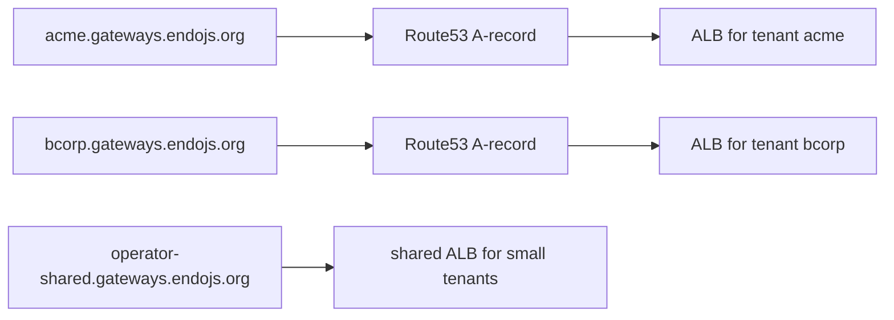
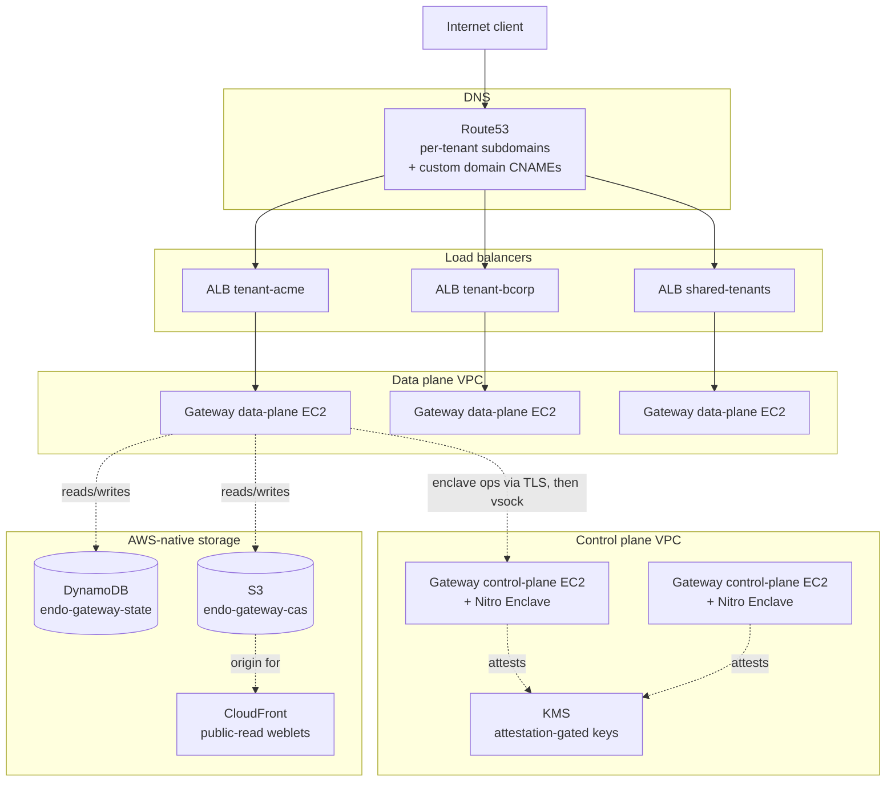

# AWS-Attuned Gateway

| | |
|---|---|
| **Created** | 2026-05-22 |
| **Updated** | 2026-05-23 |
| **Author** | Kris Kowal (prompted) |
| **Status** | Proposed |
| **Depends on** | [gateway-aws-deployment](gateway-aws-deployment.md), [gateway-package](gateway-package.md) |

## What is the Problem Being Solved?

[`gateway-aws-deployment`](gateway-aws-deployment.md) describes how to
take the *generic Linux service* version of the Endo Gateway and run
it on AWS infrastructure (EC2 + ALB + sqlite-on-EBS).
That deployment is **a Linux service that happens to be on AWS**.
This design describes the next step: a Gateway shape that **treats
AWS-native services as first-class capability substrates** rather than
as a stand-in for a generic Linux host.

The maintainer directive frames this design as:

> Consider also designing a Gateway attuned to AWS S3, EC2, Nitro
> Enclaves, Route53, and the appropriate analogue to sqlite for a
> hosted gateway service with a domain name.

For a hosted, multi-tenant Gateway, each of the five named services replaces one generic-Linux subsystem of [`gateway-package`](gateway-package.md) and [`gateway-aws-deployment`](gateway-aws-deployment.md):

| Generic-Linux subsystem | AWS-attuned substitute |
|-------------------------|------------------------|
| Local CAS at `/var/cache/endo-gateway/` (content-addressed static-asset cache) | **S3** with intelligent tiering, per-tenant prefix, storage-class lifecycle transitions, DynamoDB-driven GC |
| EC2 ASG with per-instance gateway processes | **EC2** with mixed control-plane / data-plane fleet shapes; per-tenant storage isolation via tenant-scoped STS session credentials on the shared fleet, dedicated instances for large tenants |
| Per-instance bearer-token signing in Secrets Manager | **Nitro Enclaves** as the trusted execution boundary for key custody and bearer-token issuance |
| Single `gateway.endojs.org` ALB with HTTP `Host` header routing | **Route53** for per-subdomain DNS routing to per-tenant ALBs or to a single ALB with host-based listener rules |
| Local sqlite at `/var/lib/endo-gateway/state.db` (relay registration, ledger) | **DynamoDB** (single-table design) as the cloud-native sqlite analog |

Each substitute is a deliberate trade-off: it picks up AWS-native
durability, scalability, and integration at the cost of portability
and cost-floor.
This design records the trade-offs explicitly so an operator who does
not need AWS-native scale can stay on the simpler shape from
[`gateway-aws-deployment`](gateway-aws-deployment.md).

## Scope

In scope:

- The five AWS-native substitutions named above.
- The configuration seam (`[storage]` section in `config.toml`,
  `type = "aws"`) that switches a Gateway from generic-Linux mode to
  AWS-attuned mode.
- Per-tenant isolation primitives across S3, DynamoDB, and Route53.
- The Nitro Enclave's role in custody of long-lived signing material.
- A consolidated open-questions section folding in the parent stack's
  questions that this design newly resolves and the questions this
  design newly raises.

Out of scope:

- Implementation of `@endo/gateway` itself; that work is the
  [`gateway-package`](gateway-package.md) phased rollout.
- The IaC for the basic AWS deployment; that work is
  [`gateway-aws-deployment`](gateway-aws-deployment.md).
- Cross-cloud AWS-equivalents for other providers (GCP, Azure).
  Sibling designs per provider would re-derive the trade-offs.
- The payment-processor integration for the per-account resource
  ledger
  ([`gateway-package`](gateway-package.md) Open Question 1).
  Payment is orthogonal to AWS-attunement; both can land in either
  order.
- Multi-region active-active.
  Deferred to a follow-up; DynamoDB Global Tables and S3 Cross-Region
  Replication are the candidate building blocks but the operational
  complexity dwarfs the first-cut benefit.

## S3 as the Content-Addressed Store

The Gateway's CAS holds **weblet content trees** (per
[`gateway-package`](gateway-package.md) § Feature 2): static assets the Gateway serves on behalf of a tenant.
These are content-addressed: the object key is the SHA-256 hash of the content.
The generic-Linux Gateway stores them in `/var/cache/endo-gateway/` as plain files.
The AWS-attuned Gateway stores them in S3.

The CAS holds **only immutable content**.
OCapN-Noise session state (negotiated keys, nonce counters, replay windows) is **not** stored in S3, in the CAS, or in DynamoDB.
That state is mutable per frame, and restoring a stale `(key, nonce)` pair from an asynchronous snapshot would reuse a ChaCha20-Poly1305 nonce, which is catastrophic.
Live cipher state therefore stays **process-local**, held behind the `encrypt` / `decrypt` closures of the Noise session that owns it (per [`gateway-package`](gateway-package.md) § Feature 8).
A Gateway acting as a **relay** never holds endpoint cipher state at all: it forwards ciphertext between endpoints and never decrypts.
When a data-plane process restarts, its sessions are lost and peers re-handshake from scratch; no resumption from persisted cipher state exists.

### Bucket layout

A single bucket per Gateway deployment:

```
s3://endo-gateway-cas-<deployment>/
  staging/
    <tenant-id>/
      <upload-id>             # unverified upload, never served
  tenants/
    <tenant-id>/
      cas/
        <sha256-hex>          # verified, immutable bytes
  shared/
    cas/
      <sha256-hex>            # cross-tenant dedup-by-hash for public content
```

Object metadata (MIME type, creation timestamp) lives in S3 object metadata set at the final copy.
Reference counts and GC state live in DynamoDB (§ Garbage collection below), never in S3, because S3 offers no conditional read-modify-write on a sibling object.

### Content verification and immutability

A key that claims to be a SHA-256 hash is only trustworthy if the Gateway checks it.
This matters most for the `public` and `signed-url` modes below, where the client fetches bytes directly from CloudFront or S3 and the Gateway never sees them again.
Every write therefore follows this sequence:

1. The data plane uploads the bytes to a fresh `staging/<tenant-id>/<upload-id>` key.
2. The data plane recomputes SHA-256 over the staged bytes (streaming, or via S3's `ChecksumSHA256` returned for the full object) and compares it to the claimed hash.
   On mismatch, the staged object is deleted and the write fails.
3. On match, the data plane copies the staged object to `tenants/<tenant-id>/cas/<sha256-hex>` with `If-None-Match: *`, so an existing final object is never overwritten.
   A `412 Precondition Failed` means the content already exists; because the key is the hash, the existing object is equivalent and the write succeeds as a dedup.
4. The staged object is deleted.
   A lifecycle rule expires anything left under `staging/` after 1 day; staging objects are never referenced or served.

Final CAS keys are **immutable**: no code path issues a `PutObject` or `CopyObject` onto an existing final key, and the instance and tenant-session policies deny `s3:PutObject` on `tenants/*/cas/*` except through the conditional copy above.
The bucket enables S3 Object Lock in governance mode (or, at minimum, versioning) so an accidental overwrite is detectable and recoverable.

Before **binding** a hash into a Weblet formula's `content_root_ref`, and before issuing a CloudFront URL or presigned URL for it, the Gateway confirms the final object exists and that its stored `ChecksumSHA256` equals the key.
The `gateway-proxy` mode additionally recomputes the hash while streaming and aborts the response on mismatch.
A presigned URL or CloudFront redirect is issued **only** for an object that passed this check.

### Per-tenant prefix

A shared data-plane ASG serves many tenants, so a single EC2 principal tag cannot express "this request's tenant": an instance role or session carries one tag value for its whole lifetime.
Per-tenant isolation is therefore enforced with **per-request, tenant-scoped session credentials**:

1. The **instance role** of a data-plane EC2 has **no** S3 or DynamoDB data access.
   Its only storage-relevant permission is `sts:AssumeRole` and `sts:TagSession` on a single `endo-gateway-tenant-access` role.
2. After authenticating a request and determining its tenant (from the Host header binding and the request's credential), the data plane calls `sts:AssumeRole` on `endo-gateway-tenant-access` with the session tag `tenant-id=<tid>`.
3. The `endo-gateway-tenant-access` trust policy admits only the data-plane instance role, **requires** the `tenant-id` session tag (`aws:RequestTag/tenant-id` present and matching the tenant-id format), and sets no transitive tags (`sts:TransitiveTagKeys` is denied), so a tenant session cannot chain into another tenant.
4. The tenant-access role's permission policy grants S3 access to `s3://endo-gateway-cas-<deployment>/tenants/${aws:PrincipalTag/tenant-id}/*` and `staging/${aws:PrincipalTag/tenant-id}/*`, and DynamoDB access only to items whose partition key begins with `TENANT#${aws:PrincipalTag/tenant-id}` (via `dynamodb:LeadingKeys`).
   Here `${aws:PrincipalTag/tenant-id}` resolves to the **session** tag, which differs per tenant session.
5. The data plane caches each tenant's session credentials for a short duration (15 minutes, the STS minimum, refreshed before expiry) in a per-tenant map, so the `AssumeRole` cost is amortized across requests.
   A request handler receives only the credential for its authenticated tenant; no handler is given a credential map.

A bug that confuses tenants inside one request handler can still misuse that handler's credential, but it cannot reach another tenant's prefix with it.
Cross-tenant access requires an explicit operator override through a separate operator role.

For shared (public) content, the `shared/cas/` prefix holds objects
that any tenant may read but only the operator may write.
This covers the Chat-application bundle, common JavaScript libraries,
and other content that is the same across tenants.

### Garbage collection

S3 lifecycle rules cannot consult a DynamoDB reference count, so expiry of CAS objects is **not** driven by lifecycle rules.
Each CAS object has a DynamoDB GC row (`pk = TENANT#<tid>` or `SHARED`, `sk = CAS#<sha256-hex>`) with attributes `refcount`, `state` (`live` or `condemned`), and `zero_since` / `condemned_at` timestamps.
The state machine:

1. **Reference.** Adding a reference is a conditional update: `SET refcount = refcount + 1 ... CONDITION state = live`.
   If the row is `condemned`, the condition fails; the writer then runs the write sequence of § Content verification (which re-uploads if the object is gone) and **resurrects** the row with a conditional put that only succeeds if the row is absent or still `condemned` with the same `condemned_at`, setting `state = live, refcount = 1`.
2. **Dereference.** `SET refcount = refcount - 1 CONDITION refcount > 0`; when the result is 0, also set `zero_since = now`.
   The condition prevents driving the count negative.
3. **Condemn.** A GC sweeper scans for rows with `refcount = 0` and `zero_since` older than the grace period (default 7 days) and transitions them with `SET state = condemned, condemned_at = now CONDITION state = live AND refcount = 0 AND zero_since = <observed>`.
   Any concurrent reference in between makes the condition fail and the object survives.
4. **Delete.** After a second, shorter delay (default 1 hour, longer than any in-flight write sequence), the sweeper performs a conditional **delete of the DynamoDB row** with `CONDITION state = condemned AND condemned_at = <observed>`.
   Only if that delete succeeds does it issue the S3 `DeleteObject` for the CAS key.
   A reference that resurrected the row in the meantime makes the conditional delete fail, and the S3 object is left in place.

A residual race (a resurrection that lands between the DynamoDB delete and the S3 `DeleteObject`) is closed by step 1: the resurrecting writer always runs the verified write sequence, so it re-uploads the bytes if they are gone.
No lifecycle rule expires objects under `tenants/*/cas/` or `shared/cas/`.
Storage-class transitions (Standard to Standard-Infrequent-Access after 30 days, to Glacier Instant Retrieval after 90 days) are safe and remain lifecycle-driven, because they do not destroy content.
Shared CAS objects are never condemned automatically; the operator manages them.

### Public-read vs. signed-URL for weblet static content

Weblets that serve fully-public content (a brochure site, an open-
source project's documentation) are expected to benefit from **public-read S3 with
CloudFront** in front: cacheable at the edge, with little per-request
Gateway compute (unmeasured; see § Benchmark plan).
The Gateway's role in this case is to *issue redirects* to the
CloudFront URLs rather than to proxy the bytes.

Weblets that serve authenticated content (a tenant's private files,
per-user weblets) use **signed-URL** access: the Gateway issues a
short-lived (5-minute) presigned URL on first request, the client
fetches directly from S3 via the URL.
This is expected to shift bytes off the Gateway while keeping authentication on the
Gateway.

The Weblet formula gains a `s3Mode` field:

```ts
interface WebletFormula {
  // ... existing fields per gateway-package.md ...
  s3Mode?: 'public' | 'signed-url' | 'gateway-proxy';
}
```

`gateway-proxy` is the default (matches the generic-Linux behavior:
the Gateway reads from S3 and serves bytes to the client); the other
two are AWS-attuned modes **expected** to reduce Gateway load, not yet measured optimizations.
Both are opt-in per formula and stay off by default until the benchmark plan below passes.

### Benchmark plan

The `public` and `signed-url` modes become recommended (and eligible to be the default for new public or authenticated weblets) only after a benchmark shows they beat `gateway-proxy`.
The plan, run in Phase D before those modes are recommended:

- **Baseline:** `gateway-proxy` mode on the Phase A data plane (`c7g.large`, 3 instances), reading from the same S3 bucket.
- **Candidates:** `public` (CloudFront redirect) and `signed-url` (presigned S3 redirect).
- **Workloads:** a public workload (a static documentation site: many small assets plus a few multi-megabyte bundles, Zipf-distributed requests, warm and cold edge caches) and an authenticated workload (per-user private files of mixed sizes, every request carrying a valid credential).
  Both workloads are replayed identically against baseline and candidate.
- **Metrics:** Gateway CPU per 1,000 requests; client-observed p50 and p99 time-to-last-byte, including the redirect round trip; and egress plus request cost per GiB served (Gateway data-transfer and ALB versus CloudFront and S3 egress).
- **Acceptance gate:** a candidate mode is recommended for a workload only if it reduces Gateway CPU and per-GiB cost without raising p99 latency by more than 10% relative to the baseline on that workload.
  A mode that fails the gate stays available but off by default, and the result is recorded in this design.

### Why S3 over EFS or FSx

| Storage | Outcome | Reason |
|---------|---------|--------|
| **S3** | Chosen | Object storage matches CAS shape exactly (content-addressed); per-object lifecycle policies; per-prefix IAM; intelligent tiering reduces cost at scale; bound only by request rate (~5,500 GET/prefix/second). |
| EFS | Considered, rejected | POSIX file semantics are overkill (CAS is content-addressed; rename / link / chmod don't apply). Cost is ~3-10x S3 at scale. EFS-IA helps but still pricier than S3-IA. |
| FSx for Lustre | Considered, rejected | Optimized for high-throughput parallel-compute workloads (HPC, ML). Wrong shape for HTTP-serving. |
| EBS (the generic-Linux choice) | Considered, rejected | Per-instance; would require synchronization across the ASG. S3 elides the synchronization problem. |

## EC2 Fleet Shape

[`gateway-aws-deployment`](gateway-aws-deployment.md) uses a single
homogeneous ASG of `c7g.large` instances.
The AWS-attuned variant splits the fleet:

### Control-plane EC2

A small fleet (2 instances) of `c7g.xlarge` instances running the
**administration and registration** subsystems:

- The UDS bootstrap socket
  ([`gateway-package`](gateway-package.md) § Feature 4) for local
  relay registration.
- The admin daemon ([`gateway-package`](gateway-package.md) § Feature 7).
- The per-tenant Route53 record management API
  (a CapTP exo the operator's onboarding tool calls).
- The Nitro Enclave host (see § Nitro Enclaves below).

These instances are long-lived (minimal rotation), hold the Nitro
Enclaves with the per-Gateway signing keys, and are not directly
behind the ALB.
Their security group accepts traffic only from the operator's bastion
or from SSM Session Manager.

### Data-plane EC2

The main ASG (3-9 `c7g.large` instances) running the **HTTP / WS
serving** subsystems:

- HTTP request handling (virtual hosting, Git over HTTP).
- WebSocket framing (Chat, `/ocapn-cbor-np`).
- Per-account resource metering
  ([`gateway-package`](gateway-package.md) § Feature 1).
- CAS read-through caching backed by S3.

These instances are rotation-friendly (instance refresh on new AMI),
stateless (state lives in DynamoDB + S3), and behind the ALB.
They reach the control plane for signing operations via a VPC-internal
TLS channel.

### Why split

Splitting lets the data-plane scale on traffic load while the
control-plane stays small and trusted.
The Nitro Enclave's signing-key custody benefits especially: the
key never reaches a rotation-friendly instance, so the blast radius
of a data-plane compromise is bounded to the lifetime of an issued
bearer token.

A future variant could move the data plane to **Fargate** or
**Lambda** for true per-request scaling; surfaced in Open Questions
below.

## Nitro Enclaves as the Trusted Execution Boundary

The Gateway holds three long-lived secrets that benefit from enclave-backed custody.
Each serves exactly one purpose, and **no key is used for more than one purpose**:

1. **The Noise identity key**: the Gateway's OCapN-Noise responder identity (the `intended-responder` Ed25519 key per [`ocapn-noise-network`](ocapn-noise-network.md)).
   It signs only Noise handshake transcripts.
2. **The account-credential issuing key**: the Ed25519 key that signs the enclave-issued account credential (§ Resolution of bearer-token rotation below).
   It signs only account credentials.
3. **The row-encryption key**: a 256-bit AEAD key for the additional at-rest encryption of sensitive DynamoDB columns (§ At-rest encryption below).
   It encrypts and decrypts only row columns.

Separate keys mean a signature produced for one protocol can never be accepted by another: a Noise handshake signature is not a valid account credential even if its bytes happen to parse as one.
Every signature is additionally domain-separated by a fixed, purpose-specific prefix, so even a future key-reuse mistake would not create a cross-protocol oracle.

A Nitro Enclave is a vsock-attached, attestation-rooted, no-network,
no-disk virtual machine on the parent EC2 instance.
The parent talks to the enclave over `/dev/vsock`; the enclave talks
to nothing else.

### Enclave responsibilities

The enclave exposes **no raw signing or raw decryption operation**.
Each operation is specific to one purpose and checks its input against a policy before using a key:

```ts
interface GatewayEnclaveService {
  /** Sign a Noise handshake transcript hash with the Noise identity key.
   * The enclave signs "endo-gateway/noise-handshake/v1\0" || transcriptHash,
   * and rejects any input that is not exactly 32 bytes. */
  signNoiseHandshake(transcriptHash: Uint8Array): Promise<Uint8Array>;

  /** Issue an account credential with the account-credential issuing key.
   * Validates the complete request before signing (see below) and signs
   * "endo-gateway/account-credential/v1\0" || canonical(credential). */
  issueAccountCredential(request: AccountCredentialRequest): Promise<{
    credential: AccountCredential;
    proof: Uint8Array;     // PCR-quote-signed
  }>;

  /** Verify an account credential against the current and, during a
   * rotation grace period, the prior issuing-key version. */
  verifyAccountCredential(credential: AccountCredential): Promise<
    | { valid: true; tenantId: TenantId; accountId: AccountId; keyVersion: string }
    | { valid: false }
  >;

  /** Encrypt one sensitive column with the row-encryption key. */
  encryptRow(plaintext: Uint8Array, aad: RowAad): Promise<Uint8Array>;

  /** Decrypt one sensitive column; requires a verified credential for
   * the same tenant (see § At-rest encryption). */
  decryptRow(
    ciphertext: Uint8Array,
    aad: RowAad,
    authorization: AccountCredential,
  ): Promise<Uint8Array>;

  /** Get the enclave's attestation document (for KMS key-release
   * conditions). */
  attest(nonce: Uint8Array): Promise<Uint8Array>;
}

interface AccountCredentialRequest {
  tenantId: TenantId;
  accountId: AccountId;           // 256-bit hex per daemon-256-bit-identifiers
  onboardingAuthorization: Uint8Array; // operator-signed, see below
}

interface RowAad {
  tenantId: TenantId;
  table: string;                  // e.g. "endo-gateway-state"
  pk: string;                     // must equal `TENANT#<tenantId>`
  sk: string;
  column: string;
}
```

`issueAccountCredential` signs only after it checks that:

- `accountId` is a well-formed 256-bit hex identifier and `tenantId` is well-formed;
- `onboardingAuthorization` is a signature, by the operator's onboarding key (whose public half is baked into the enclave image and therefore covered by the PCR), over `(tenantId, accountId, expiry)`, and that the authorization has not expired;
- the enclave itself supplies `issuance-time` (from its own clock) and the current `issuing-key-id`, so the caller cannot choose either field.

The parent therefore cannot ask the enclave to sign arbitrary bytes under the issuing key, and cannot mint a credential for an account the operator did not authorize.

`verifyAccountCredential` is the counterpart the data plane calls: it re-derives the domain-separated message from the credential's fields and checks the signature against the issuing-key version named in the credential, accepting the prior version only during a rotation grace period.
Because the issuing key's public half is not secret, a later optimization may export it (with its version) to data-plane instances for local verification; the enclave operation remains the reference verifier.

`encryptRow` and `decryptRow` are an explicit pair over a versioned envelope:

```
envelope = version (1 byte, 0x01)
        || key-version (4 bytes, big-endian KMS key-version index)
        || nonce (24 bytes, random)
        || XChaCha20-Poly1305 ciphertext and 16-byte tag
```

The AEAD's associated data is a canonical encoding of the `RowAad` fields (tenant id, table, partition key, sort key, column name), built inside the enclave.
The enclave rejects any `RowAad` whose `pk` is not `TENANT#<tenantId>`.
Binding the tenant, table, and primary key into the AAD means a ciphertext copied into another row, column, table, or tenant fails authentication on decrypt.
`decryptRow` selects the key by `key-version`, so rows written before a row-key rotation still decrypt until they are re-encrypted.

### Key custody: durable keys and the ephemeral KMS-handshake key

The enclave distinguishes the **durable** keys (the three purpose-specific keys above) from a per-startup **ephemeral** key used only to receive them.

1. **Durable keys.**
   Each of the three keys is wrapped by its **own** AWS KMS key, with a key policy that conditions release on Nitro Enclave attestation matching a specific PCR (Platform Configuration Register; the SHA-384 hash of the enclave image).
   The durable keys survive enclave instance rotation: a new enclave with the same PCR is granted the same keys by KMS.
   Separate KMS keys mean the three can be rotated, audited, and revoked independently.

2. **Ephemeral KMS-handshake key.**
   On each enclave startup, the enclave generates a fresh keypair *only* to wrap the KMS-returned durable-key material in transit.
   The ephemeral key is the response target in the KMS `kms:Decrypt` call's attestation block; it lets KMS encrypt the durable-key material to a key only this enclave instance holds.
   The ephemeral key never signs anything; it exists for the duration of the KMS handshake and is then discarded.

On enclave startup:

1. Enclave generates a fresh ephemeral keypair (KMS-handshake key).
2. Enclave calls `attest(nonce=ephemeral_pubkey)` and the
   attestation document binds the ephemeral public key to this
   enclave instance.
3. Enclave forwards the attestation to KMS via the parent EC2 (the
   parent has IAM permission to call `kms:Decrypt` with an
   attestation document), once per durable key.
4. KMS validates the attestation (PCRs match, image signature is
   from the operator's signing identity), encrypts each **durable
   key** to the ephemeral public key, and returns the
   encrypted blobs.
5. Enclave decrypts the blobs using its ephemeral private key,
   loads the **durable** keys into memory, and is ready.
   The ephemeral key is discarded.

The parent never sees a durable key.
An attacker with full root on a control-plane parent can still invoke the enclave's operations while the enclave is live, but only within each operation's policy:

- it can obtain Noise handshake signatures, which lets it impersonate the Gateway's Noise responder identity for sessions it can intercept while it holds the host, but those signatures are useless as account credentials;
- it cannot mint account credentials without a valid operator onboarding authorization, and cannot choose the issuance time or key version;
- it can decrypt only columns of tenants for which it presents a valid account credential (credentials it observes in live traffic), never an arbitrary row, and each `decryptRow` is logged with its tenant for audit;
- it cannot exfiltrate any durable key, so evicting the compromised instance ends its access.

Cycling the EC2 instance regenerates the ephemeral handshake key but leaves the durable keys unchanged; the new enclave re-acquires them from KMS on attestation.

### Durable-key rotation

Rotation is per key.
Rotating the **account-credential issuing key** (the one whose rotation affects clients) is a separate, deliberate operation:

1. Operator publishes a new enclave image (new PCR).
2. Operator provisions a new key in KMS, with the new PCR as the
   attestation condition.
3. Operator runs the per-account re-issuance flow for outstanding
   account credentials (the old issuing key signs a hand-off record;
   the new issuing key re-issues each account's credential).
4. After a grace period (operator-named, default 30 days), the
   old KMS key is deleted.

The historical-key registry the gateway consults during the
grace period is the KMS key history itself: KMS retains the
prior key version, and data-plane EC2 instances calling
the enclave's `verifyAccountCredential()` operation have the credential's signature checked
against both the current and the prior issuing-key versions
until the grace period ends.

Rotating the Noise identity key changes the Gateway's advertised responder identity and follows the peer-notification story of [`ocapn-noise-network`](ocapn-noise-network.md).
Rotating the row-encryption key needs no client action: new writes use the new `key-version`, and a background job re-encrypts old rows before the prior KMS key is deleted.

### Resolution of bearer-token rotation (parent Open Question 4)

[`gateway-package`](gateway-package.md) Open Question 4 named the
**rotation story for formula-identifier bearer tokens** as unsolved.
The Nitro Enclave shape above gives a concrete answer keyed on the
durable account-credential issuing key (called "the issuing key" below):

- The account credential is a Pass-Invariant-Eq tuple
  `(tenant-id, account-id, issuance-time, issuing-key-id)` signed by the **issuing** key
  under the `endo-gateway/account-credential/v1` domain prefix, as produced by `issueAccountCredential`.
  The `issuing-key-id` is the KMS key version,
  not the enclave PCR (the PCR identifies the enclave image; the
  key version identifies the signing identity backing the token).
- Rotation = new enclave image (new PCR) + new KMS key version
  (new issuing key) + per-account re-issuance flow over a
  grace period.
- During the grace period both the current and prior issuing-key
  versions verify under `verifyAccountCredential`; afterward, only the current verifies and old
  tokens fail closed.
- The issuing key never leaves KMS in plaintext; it is released
  to a specific enclave PCR via the ephemeral-handshake mechanism
  above, so a compromised AMI does not exfiltrate it. The historical-key registry is KMS's own key-version
  history.

**Reconciliation with the parent token model (this is a second
credential shape, not a redefinition of the first).**
[`gateway-package`](gateway-package.md) Design Decision 4 defines
the bearer token as the pre-existing **opaque 256-bit formula
identifier**: a *capability*, keyed by formula id, that grants the
authority of whatever formula it names (the Git repo handle, the
Chat `fetch(token)` target). The signed `(tenant-id, account-id,
issuance-time, issuing-key-id)` credential above is a **different,
account-scoped, time-scoped claim**, and this design does **not**
silently replace the formula-identifier token with it. The two
coexist by construction:

- **Formula-identifier capability tokens** (Git remotes, Chat
  `fetch(token)`) stay exactly as the parent design defines them:
  opaque, formula-keyed, not account-scoped. The AWS-attuned
  variant does not re-key these onto account id; a Git remote URL
  is still a formula-identifier bearer token and rotates only by
  the parent's (still-open) formula-identifier rotation story.
- **The enclave-signed account credential** is a *new, additional*
  credential minted at account onboarding for the **hosted
  multi-tenant** control surface (account provisioning, ledger
  access, tenant-scoped admin). It is the credential the enclave's
  issuing key backs and the one the rotation flow above rotates.
  It is account-scoped precisely because the hosted product's unit
  of tenancy is the account, not the formula.

So Open Question 4's *rotation* concern is resolved **only for the
account credential**, which is the credential the issuing key
signs; the formula-identifier capability tokens are out of that
resolution's scope and keep their parent-design rotation gap. The
mapping "which surfaces use which token" is: Git-over-HTTP and Chat
`fetch(token)` use formula-identifier capabilities; account/ledger/
tenant-admin use the enclave-signed account credential.

On the **Pass-Invariant-Eq** framing the parent question carries
(object identity must hold across a key change so two paths to the
same object still compare `Eq`): the mechanism above resolves the
*verification* side (dual-validity during the grace period, hard
cutover after) but does **not** by itself establish the Eq
property: a hard cutover where old account tokens "fail closed"
is a re-issuance, not an identity-preserving rotation. This design
therefore claims to resolve the **verification and custody** side
of Open Question 4 for the account credential, and explicitly
leaves the Pass-Invariant-Eq identity-preservation question open
(it is the same open question the parent inherits from
[`endo-gateway`](endo-gateway.md) § Open Questions 1). The
remaining *user-visible workflow* question (do clients re-issue on
rotation, or is the old token valid for the full grace period?) is
the operator's product call.

### Cost

Nitro Enclaves are free at the AWS level (no additional charge beyond
the parent instance's CPU / memory).
The constraint is **memory partitioning**: the enclave reserves a
portion of the parent's RAM at launch.
A `c7g.xlarge` (8 GiB) reserves 1 GiB for the enclave (the smallest
size that fits the enclave's runtime plus key material).

## Route53 for DNS-Level Routing

[`gateway-package`](gateway-package.md) § Feature 2 routes by
HTTP `Host` header to a Weblet formula.
[`gateway-aws-deployment`](gateway-aws-deployment.md) aliases a single
`gateway.endojs.org` to the ALB; the wildcard `*.endojs.org` covers
sub-domains, all routed by the Gateway's Host-header logic.

The AWS-attuned variant introduces **DNS-level tenant isolation**:

### Per-tenant subdomains

Each tenant gets a subdomain:



Large tenants (>1000 RPS sustained) get a dedicated ALB; smaller
tenants share an ALB and rely on the Gateway's Host-header routing
within.

### Custom domains

A tenant can bring their own domain (`chat.example.com`):

1. Tenant creates a CNAME `chat.example.com -> acme.gateways.endojs.org`.
2. Operator provisions an ACM certificate (DNS validation) for
   `chat.example.com`.
3. Operator adds `chat.example.com` to the tenant's ALB listener
   rules.
4. Gateway's Host-header routing already handles the inbound traffic
   (the Host is now `chat.example.com` instead of
   `acme.gateways.endojs.org`).

Custom-domain TLS termination uses the same ACM-on-ALB shape as the
default tenant subdomain; no per-instance certificate management.

### Health-checked failover

Route53 health checks against the ALB target group surface failures
at the DNS layer: if all instances in a tenant's ALB go unhealthy,
Route53 fails over to a secondary record (a static maintenance page
on S3, served via CloudFront).
This is cheap insurance against partial outages.

### Resolution of parent Open Question 3

[`gateway-package`](gateway-package.md) Open Question 3 named
**virtual-host name allocation across users** as the collision-prone
case (two users wanting `chat.example.com`).
The AWS-attuned variant **partially resolves** by changing the
allocation namespace: instead of one shared `endojs.org` namespace,
each tenant gets their own subdomain (`<tenant>.gateways.endojs.org`)
plus optional custom domains they bring themselves.
First-bind-wins reduces to *per-tenant* first-bind-wins, which is
trivial (each tenant manages their own namespace).

The cross-tenant case (two tenants both want `chat`) becomes a
non-issue because `acme.gateways.endojs.org/chat` and
`bcorp.gateways.endojs.org/chat` are different URLs.

It is **partial**, not full, because "per-tenant first-bind-wins
is trivial" holds only where a tenant is a **single trust domain**.
A tenant that contains several mutually-distrusting accounts still
needs an intra-tenant allocation rule; that missing half is named
and resolved (falling back to the parent's `authenticated-allocation`
mode keyed by `ACCOUNT#<aid>`) in § Correspondence between
row-identity and handle-identity below.

## DynamoDB as the SQLite Analogue

The "appropriate analogue to sqlite for a hosted gateway service" in
the maintainer directive maps to **DynamoDB** with a **single-table
design**.

### Alternatives considered

| Backend | Outcome | Reason |
|---------|---------|--------|
| **DynamoDB** | Chosen | Serverless (no instances to manage); per-request pricing aligns with the multi-tenant cost model; single-table design covers all access patterns; per-partition-key tenancy is natural; Global Tables open the multi-region door later. |
| Aurora Serverless v2 | Considered, rejected for first cut | Relational, autoscale-to-zero, supports complex queries. Heavier operationally (a database to run); per-second billing has a minimum floor that doesn't suit low-traffic tenants. Reconsider if the Gateway's data model evolves toward needing joins. |
| RDS Postgres (multi-AZ) | Considered, rejected | Always-on, per-AZ instance billing, requires schema migrations to be coordinated with deploys. Operational overhead high relative to the Gateway's actually-modest data needs. |
| DynamoDB + ElastiCache Redis | Considered as composite, deferred | Redis as a hot-path cache in front of DynamoDB is a sensible optimization, deferred until traffic warrants. |
| Per-tenant sqlite on EFS | Considered, rejected | EFS POSIX semantics + sqlite file-locking + many writers = locking pathologies. Wrong tool. |
| Per-tenant DynamoDB *tables* (not single-table) | Considered, rejected | DynamoDB has a per-account table quota (default 2500, raisable to ~10k); per-tenant tables don't scale past mid-thousands of tenants. Single-table with a tenant-prefixed partition key scales arbitrarily. |

### Single-table schema

All data lives in one DynamoDB table `endo-gateway-state`.
The partition key is `pk`, the sort key is `sk`.
Per-tenant items prefix `pk` with the tenant ID:

| pk | sk | Item kind | Attributes |
|----|-----|-----------|------------|
| `TENANT#<tid>` | `META` | Tenant metadata | name, plan, created_at, custom_domains |
| `TENANT#<tid>` | `ACCOUNT#<aid>` | Account record | tenant_account (`<tid>#<aid>`, GSI key), created_at, status, credential_hash (`encryptRow` envelope) |
| `TENANT#<tid>` | `LEDGER#<aid>` | Resource ledger (**deferred: reserved key prefix only, see note below**) | compute, storage, network counters; token balance |
| `TENANT#<tid>` | `WEBLET#<formula-id>` | Weblet binding | virtual_host, content_root_ref, mime_types, ssr_handler |
| `TENANT#<tid>` | `RELAY#<pubkey-hex>` | Relay registration (ephemeral routing metadata only) | hostname, daemon_key_id, registered_at, last_seen, serving_instance |
| `TENANT#<tid>` | `SESSION#<session-id>` | Active OCapN session (hot, metadata only) | last_seen, peer_key_id (never key material or nonce counters) |
| `TENANT#<tid>` or `SHARED` | `CAS#<sha256-hex>` | CAS reference count and GC state | refcount, state (`live` / `condemned`), zero_since, condemned_at |
| `SHARED` | `WEBLET#<formula-id>` | Operator-managed shared weblet (Chat, etc.) | same as WEBLET above |

A **GSI** on `(tenant_account, sk)`, where `tenant_account` is the composite string `<tenant-id>#<account-id>`, lets the Gateway look up everything related to a single account.
The GSI partition key includes the tenant ID because account IDs are tenant-local: two tenants may hold the same account ID, and a GSI keyed by `account_id` alone would return both tenants' rows to one account query.
Every item that participates in the GSI writes `tenant_account` from its own `pk` tenant, and the tenant-scoped session policy (§ Per-tenant prefix) restricts GSI queries to keys beginning with the session's tenant ID.

### The `LEDGER#` row is a reserved prefix, not a settled schema

[`gateway-package`](gateway-package.md) Feature 1b **defers** the
resource ledger: it withholds the `ResourceLedger` shape from the
design surface precisely because the gateway-side-vs-daemon-side
compute-metering **trust boundary** is unsettled, and requires a
follow-up design to land before any phase depends on it. This
AWS-attuned design does **not** override that deferral, and the
`LEDGER#<aid>` row above must not be read as settling the ledger's
schema. It is included only to **reserve the sort-key prefix**
(`LEDGER#`) so a later single-table migration does not collide with
it; the attribute list (`compute, storage, network counters; token
balance`) is illustrative of the *kind* of counters such a row
would hold, not a committed column set. The actual ledger
schema (which counters exist, who may read them, who may charge,
and where the authoritative meter lives: gateway, daemon, or
split) is owned by the parent's Feature 1b follow-up design and
lands there first. If that follow-up chooses a shape incompatible
with a single DynamoDB row (for example, splitting the meter across
the gateway and the user daemon), this reserved prefix is dropped
rather than forcing the ledger into it. This design raises **no**
new resolution of the ledger trust boundary; it defers to the
parent exactly as the parent requires.

### Correspondence between row-identity and handle-identity

The single-table schema introduces a **place-oriented** identity
scheme: `TENANT#<tid>` / `ACCOUNT#<aid>` partition/sort keys where
"who may act" is "whoever the row says" (an ambient, DB-row
identity). [`gateway-package`](gateway-package.md) (§ Capability
Surface, § Feature 4) uses a **capability-oriented** identity,
`UserDaemonHandle`, where authority is "whoever holds the handle."
These are two different kinds of identity, and this design states
their correspondence explicitly rather than letting them run in
parallel unreconciled:

- An `ACCOUNT#<aid>` row is the hosted product's **billing- and
  provisioning-scoped record** for a tenant's account. It is
  **not** itself a capability and confers no OCapN authority; it is
  data the control plane reads under its own IAM/enclave authority.
- A `UserDaemonHandle` remains the sole **capability** that directs
  CapTP traffic to a user's daemon.
  A `UserDaemonHandle` is a CapTP presence, which is connection-relative: it cannot be serialized into a row and reanimated by another process after its connection ends.
  The `RELAY#<pubkey-hex>` row therefore stores **only non-authority routing metadata** (tenant, hostname, daemon public-key id, the data-plane instance currently serving the registration, registration and last-seen timestamps) and **never** anything sufficient to reconstruct a capability.
  Relay registrations are **ephemeral**: when a data-plane instance restarts, the handles it held are gone, its `RELAY#` rows are marked stale, and the affected daemons reconnect to the registration endpoint and re-register, exactly as [`endo-gateway`](endo-gateway.md) describes for restart recovery.
  Until a daemon re-registers, requests for its hostname fail with a 503, as in the generic-Linux shape.
  The row exists so the control plane can see which hostnames are registered and where, not so any process can resume a relay from it.
- A **tenant is a single trust domain** for the purpose of
  first-bind-wins (§ Resolution of parent Open Question 3): the
  "per-tenant first-bind-wins is trivial" claim holds **only**
  because a `TENANT#<tid>` is one trust domain. Where a tenant
  contains several mutually-distrusting **accounts**, the
  intra-tenant allocation among those accounts falls back to the
  parent design's `authenticated-allocation` mode keyed by
  `ACCOUNT#<aid>` namespace, not to row-ownership. This is the
  missing half the earlier draft hedged as "partially resolves":
  cross-tenant is resolved by DNS; intra-tenant cross-account is
  resolved by the parent's authenticated-allocation mode.

The two identity models are therefore **not** orthogonal and
**not** interchangeable: the capability model owns *authority to
act*; the row model owns *durable product/billing state and
non-authority routing metadata*. No place-oriented row is ever the sole
basis for granting CapTP authority.

### At-rest encryption

DynamoDB's built-in at-rest encryption protects the table by default.
Sensitive columns (account-credential hashes, payment-proof binaries) get
**additional** encryption with the enclave-held row-encryption key.
On write, the Gateway calls the enclave's `encryptRow(plaintext, aad)` and stores the returned versioned envelope (§ Enclave responsibilities) as the column value.
On read, it calls `decryptRow(ciphertext, aad, authorization)` with the same `RowAad`.
The AAD binds tenant ID, table, partition key, sort key, and column name, so a ciphertext swapped into another row, column, or tenant fails to decrypt.
`authorization` must be an account credential that `verifyAccountCredential` accepts for the AAD's tenant; the enclave refuses otherwise, so the data plane cannot use `decryptRow` as a general decryption oracle across tenants.
Where a column only needs to be compared (for example a credential hash on login), the comparison runs through `verifyAccountCredential` instead of decrypting at all.
A KMS-only attacker who compromises the per-table KMS key still
cannot read the doubly-encrypted columns.

### Pricing model

DynamoDB has two pricing modes:

- **On-demand** (per-request billing): no capacity planning; pay per
  read/write request.
- **Provisioned** (per-RCU/WCU/hour): capacity-planned; cheaper at
  steady-state but requires planning.

The first-cut Gateway deployment uses **on-demand** for unpredictable
multi-tenant traffic.
Once usage patterns stabilize, individual high-volume tables (Per-
tenant LEDGER, for example) may switch to provisioned with
auto-scaling.

### Resolution of parent Open Question 5

[`gateway-package`](gateway-package.md) Open Question 5 named
**multi-tenant filesystem isolation for the per-user CAS** as
underspecified.
The AWS-attuned variant **resolves** by moving the CAS out of the
filesystem entirely:

- Per-tenant S3 prefixes (`s3://.../tenants/<tid>/cas/`) carry
  per-tenant content with IAM-enforced isolation.
- Dedup happens via **reference-counted entries in DynamoDB**: the
  `CAS#<hash>` rows track the reference count and GC state per tenant (or `SHARED`); the
  S3 object exists once at `s3://.../shared/cas/<hash>` for any
  shareable content, and the per-tenant prefix carries
  copy-on-restrict-access content.

The combination of S3 prefix + tenant-scoped session credentials + the DynamoDB GC state machine (§ Garbage collection)
covers all three cases (per-tenant isolation, cross-tenant
dedup, garbage collection).

## Configuration Seam

[`gateway-aws-deployment`](gateway-aws-deployment.md) § Seam to the
AWS-Attuned Variant named the `[storage]` configuration section.
This design fleshes it out:

```toml
[storage]
type = "aws"

[storage.aws]
dynamodb_table = "endo-gateway-state"
dynamodb_endpoint = ""              # default: regional endpoint
s3_bucket = "endo-gateway-cas-prod"
s3_endpoint = ""                    # default: regional endpoint
nitro_enclave_cid = 10              # vsock context ID
nitro_enclave_port = 7000
region = "us-east-1"

[storage.aws.kms]
noise_identity_key_id = "arn:aws:kms:us-east-1:ACCOUNT:key/UUID"
credential_issuing_key_id = "arn:aws:kms:us-east-1:ACCOUNT:key/UUID"
row_encryption_key_id = "arn:aws:kms:us-east-1:ACCOUNT:key/UUID"

[storage.aws.sts]
tenant_access_role_arn = "arn:aws:iam::ACCOUNT:role/endo-gateway-tenant-access"

[routing]
type = "route53"

[routing.route53]
hosted_zone_id = "Z1234567890ABCDEF"
tenant_subdomain_pattern = "{tenant}.gateways.endojs.org"
default_alb_arn = "arn:aws:elasticloadbalancing:..."
```

A `type = "sqlite"` configuration is the generic-Linux mode; a
`type = "aws"` configuration is this design's mode.
The `@endo/gateway` codebase ships both; the configuration picks.

A future `type = "gcp"` or `type = "azure"` mode would land via a
sibling design without touching this design's contract.

## Deployment Topology

The AWS-attuned deployment topology extends
[`gateway-aws-deployment`](gateway-aws-deployment.md) with the AWS-
native services:



## Dependencies

| Design | Relationship |
|--------|--------------|
| [gateway-package](gateway-package.md) | **Grandparent.** The package design; this design re-targets several of its feature subsystems to AWS-native services. |
| [gateway-packaging-ci](gateway-packaging-ci.md) | **Parent stack (grandparent).** The packaging-CI workflow produces the same `.deb` and Docker artifacts; the AMI build in [`gateway-aws-deployment`](gateway-aws-deployment.md) bakes them in. |
| [gateway-aws-deployment](gateway-aws-deployment.md) | **Parent.** The basic AWS deployment shape. This design replaces several subsystems with AWS-native services. |
| [gateway-bearer-token-auth](gateway-bearer-token-auth.md) | The bearer-token scheme the enclave issues. |
| [ocapn-noise-network](ocapn-noise-network.md) | The signing key the enclave holds for OCapN-Noise responder identity. |
| [daemon-256-bit-identifiers](daemon-256-bit-identifiers.md) | The 256-bit hex bearer-token shape. |

## Phased Implementation

**Phase A**: Configuration seam in `@endo/gateway` (`type = "aws"`
mode of `[storage]` and `[routing]`). DynamoDB single-table schema
lands and Gateway's state-store API switches behind the configuration
flag. S3 CAS lands and Gateway's CAS API switches similarly. Both
fall back to sqlite / local-disk if the AWS-specific configuration is
missing.

**Phase B**: Nitro Enclave skeleton. Enclave image with the
operations above; per-key KMS attestation-conditioned key release; parent EC2
talks to enclave via vsock. The first cut uses the enclave only for
`signNoiseHandshake`; account-credential issuance and verification and the `encryptRow` / `decryptRow` pair
follow in later phases as the Gateway's authentication and ledger
work matures.

**Phase C**: Route53 per-tenant subdomains and ALB-per-tenant
provisioning. The operator's onboarding tool (a separate piece of
software, not part of `@endo/gateway`) calls a Gateway CapTP exo to
provision a tenant; the exo orchestrates the Route53 + ALB + IAM
work via Terraform module instantiations.

**Phase D**: CloudFront for public-read weblets; signed-URL for
authenticated weblets; the Weblet formula's `s3Mode` field lands.
The § Benchmark plan runs in this phase and gates whether either mode is recommended.

**Phase E**: Reference operator-onboarding tool. A CLI or web UI that
provisions a tenant end-to-end (custom domain, Route53 record, ALB,
IAM, DynamoDB tenant prefix, S3 prefix, enclave-issued bearer-token).

These phases live downstream of
[`gateway-package`](gateway-package.md) phase 4 (which lands the OS
packaging) and
[`gateway-aws-deployment`](gateway-aws-deployment.md) phases A
through C (which establish the basic AWS deployment).
Roughly speaking, the AWS-attuned variant is **Milestone 1 plus 2
quarters** (per the README's milestone framing); the multi-tenant
shape is a serious piece of software in its own right.

## Test Catalog

The AWS-native trust boundaries this design introduces carry their
own adversarial coverage obligations, distinct from the
generic-Linux catalog in [`gateway-package`](gateway-package.md)
§ Test Catalog (which this design references rather than repeats).
Each row lands with the phase that lands its boundary.

| Trust boundary | Adversarial tests |
|----------------|-------------------|
| Nitro Enclave attestation / key custody | A `kms:Decrypt` attempt whose attestation PCR does not match the pinned enclave image is denied by the KMS key policy; the parent EC2 (root-compromised) cannot obtain any durable key in plaintext; the ephemeral handshake key never signs anything (a negative assertion). |
| Enclave operation policy (no oracle) | The enclave exposes no operation that signs or decrypts caller-chosen bytes; `signNoiseHandshake` rejects inputs that are not 32 bytes; a Noise handshake signature submitted to `verifyAccountCredential` fails (key separation and domain prefix); `issueAccountCredential` refuses a request without a valid, unexpired operator onboarding authorization, and ignores any caller-supplied issuance time or key id; `decryptRow` refuses when the presented credential's tenant differs from the AAD's tenant. |
| Row-encryption envelope | `decryptRow(encryptRow(x, aad), aad)` returns `x`; a ciphertext moved to a different `pk`, `sk`, column, table, or tenant fails authentication; a `RowAad` whose `pk` is not `TENANT#<tenantId>` is rejected; a tampered `key-version` or `version` byte fails; rows written under the prior row key still decrypt after rotation. |
| Durable-key rotation / dual-verification | A credential signed by the prior issuing-key version verifies under `verifyAccountCredential` **during** the grace period and fails **after** it; a credential signed by neither the current nor prior version always fails; the credential's `issuing-key-id` must match a KMS key version the enclave will verify against. |
| Per-tenant DynamoDB isolation | A request scoped to `TENANT#<a>` cannot read or write `TENANT#<b>` items; **GSI collision**: tenants `a` and `b` each create an account with the same account ID, and an account query through the `(tenant_account, sk)` GSI as tenant `a` returns only tenant `a`'s rows; a tenant-`a` session cannot query a GSI key beginning `b#`; the `LEDGER#` prefix is inert (no code path reads it as a settled ledger) until the Feature 1b follow-up lands. |
| Per-tenant session credentials | The data-plane instance role alone cannot read or write any S3 object or DynamoDB item; `AssumeRole` on the tenant-access role without a `tenant-id` session tag is denied; a tenant-`a` session cannot read `tenants/b/` or `staging/b/` objects or `TENANT#b` items; a tenant session cannot assume the role again with a different tag (no transitive tags). |
| Per-tenant S3 prefix isolation | A signed URL / IAM path scoped to one tenant's prefix cannot read another tenant's objects; the `CAS#` reference count cannot be driven negative to delete an object another tenant still references. |
| Content-addressed integrity | An upload whose bytes do not hash to the claimed key is rejected and never reaches `tenants/*/cas/`; a write to an existing final CAS key does not overwrite it (`If-None-Match`); a final object whose bytes were altered out of band is refused at bind time, is never given a CloudFront or presigned URL, and aborts a `gateway-proxy` stream on mismatch; objects under `staging/` are never served. |
| CAS garbage collection concurrency | A reference added concurrently with the condemn transition either fails the condemn condition or resurrects the row, and the object survives; a resurrection racing the sweeper's conditional row delete leaves the S3 object in place; a resurrection that lands after the S3 delete re-uploads the bytes before the reference commits; no lifecycle rule expires objects under `tenants/*/cas/` or `shared/cas/`; an object with `refcount > 0` is never deleted under randomized interleavings of reference, dereference, condemn, and delete. |
| Noise session state locality | No code path writes Noise keys, nonce counters, or replay windows to S3, the CAS, or DynamoDB; a relay Gateway forwarding a session holds no endpoint cipher state; after a data-plane restart, a peer's next frame on the old session is rejected and a fresh handshake succeeds. |
| Relay registration ephemerality | `RELAY#` rows contain no attribute from which a `UserDaemonHandle` or other capability can be reconstructed; after a data-plane restart, requests for a hostname fail with 503 until the daemon re-registers, and succeed after it does. |
| Route53 / custom-domain binding | A tenant cannot add a custom domain to another tenant's ALB listener rules; ACM validation is required before a custom domain routes. |

## Design Decisions

1. **S3 + DynamoDB + Nitro Enclaves as the AWS-native storage trio.**
   S3 for content (CAS), DynamoDB for state, Nitro Enclaves for
   custody. Each is the AWS-native answer to a specific generic-
   Linux concern.

2. **Per-tenant prefix in S3 + per-tenant partition key in DynamoDB.**
   Tenancy is enforced at the IAM and access-pattern layer through
   per-request, tenant-tagged STS session credentials (the instance
   role itself has no data access); no
   per-tenant tables or buckets means no quota walls.

3. **Single DynamoDB table, single-table design (with a noted
   physical-vs-logical trade-off).**
   Standard DynamoDB best practice. The table holds all entity kinds
   for all tenants; the `(pk, sk)` shape and a single GSI cover the
   access patterns. Single-table design is *easy* (one table to
   provision, one set of IAM policies) but ships accidental
   complexity into every read-and-write path (every consumer must
   know the `pk` / `sk` encoding for each entity kind). The
   first-cut shape collapses physical schema (one table) into
   logical schema (one model); a future refactor lands a code-side
   data-access layer that hides the `(pk, sk)` encoding behind
   entity-kind-specific helpers, decomplecting storage shape from
   logical model. Acknowledged here so the trade-off is visible
   rather than presented as the only natural choice.

4. **Nitro Enclave holds the long-lived key material, one key per purpose.**
   Parent EC2 compromise does not exfiltrate any key. The PCR-gated
   KMS key release ties each key to a specific enclave image, and the
   enclave exposes only policy-checking, domain-separated operations,
   never raw signing or decryption.

5. **Route53 per-tenant subdomain + optional custom domain.**
   Tenancy and DNS namespace are co-managed: each tenant gets a
   subdomain by default and may bring their own domain via CNAME +
   ACM.

6. **Control-plane / data-plane EC2 split.**
   Lets the data plane scale on traffic load while keeping the
   Nitro Enclaves on a small trusted fleet.

7. **CloudFront for public-read weblets.**
   Public static content goes through the CDN; the Gateway is not
   a bytes-shoveling proxy for content that does not need it.

8. **Configuration seam at `[storage].type`.**
   One codebase, two configurations: generic-Linux mode for
   self-hosted deployments and AWS-attuned mode for the hosted
   service. No fork.

## Open Questions

1. **Operator-onboarding API shape.**
   The CapTP exo that provisions a tenant (Route53 record + ALB +
   IAM + DynamoDB prefix + S3 prefix + enclave-issued bearer-token)
   is a substantial piece of software in its own right. The first-
   cut design records that it exists; the actual shape is a follow-up
   design.

2. **Per-tenant cost attribution.**
   AWS cost-attribution at the tenant level requires per-tenant tags
   on every billable resource. Per-tenant S3 prefix and per-tenant
   DynamoDB partition key support cost-allocation tags; per-tenant
   ALB does too. The compute layer (shared EC2 ASG for small
   tenants) is harder to attribute; per-request metering plus a
   monthly cost-divisor is the first-cut answer, surfaced as a
   product question.

3. **Multi-region active-active.**
   DynamoDB Global Tables, S3 Cross-Region Replication, and Route53
   latency-based routing are the building blocks. The Nitro Enclave
   side is the hard part: each region has its own enclaves, each
   with their own ephemeral keys; cross-region bearer-token
   verification needs to either replicate the signing public key or
   route the verification call back to the issuing region.
   Deferred.

4. **Migrating an existing self-hosted Gateway to AWS-attuned mode.**
   A self-hosted operator who outgrows their single VPS wants a
   path to the hosted service. Migrating from `type = "sqlite"` to
   `type = "aws"` is non-trivial: sqlite rows need to be re-keyed
   into DynamoDB's `(pk, sk)` schema; local CAS files need to be
   uploaded to S3 with reference-count records in DynamoDB.
   A `endo-gateway migrate` subcommand could automate; deferred.

5. **Per-tenant rate limits.**
   The Gateway's existing rate-limiter
   ([`gateway-bearer-token-auth`](gateway-bearer-token-auth.md)) is
   global. Per-tenant limits need a new namespace; DynamoDB-backed
   token-bucket per `(tenant, source-ip)` tuple is the candidate
   shape but not designed here.

6. **Lambda / Fargate data plane.**
   The first-cut data plane is EC2. A future variant could move to
   Fargate (per-task billing) or Lambda (per-request billing) for
   bursty workloads. Lambda's 15-minute timeout precludes long-
   lived WebSocket sessions, so the `/ocapn-cbor-np` endpoint would
   stay on EC2 even in a Lambda-fronted design.

7. **Compliance regimes (SOC 2, GDPR, HIPAA).**
   A hosted multi-tenant service raises compliance questions the
   self-hosted shape does not: audit logging, data-residency
   guarantees, breach-notification flows. AWS provides the
   primitives (CloudTrail, regional service deployment, Macie); the
   operator's compliance posture is a product decision the design
   names but does not pin.

## Prompt

The maintainer directive behind this design and its two siblings is recorded once, in [`gateway-packaging-ci`](gateway-packaging-ci.md) § Prompt, rather than repeated here.
