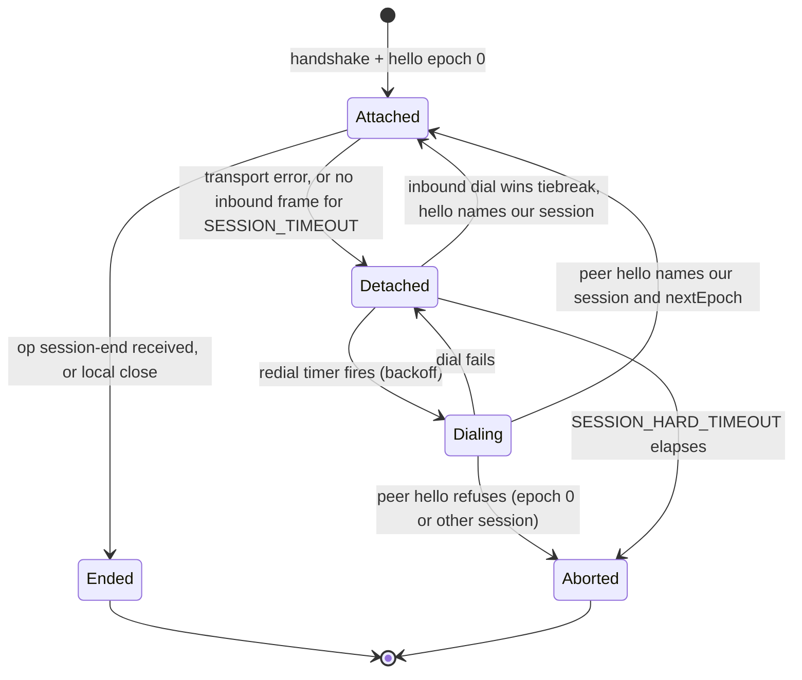
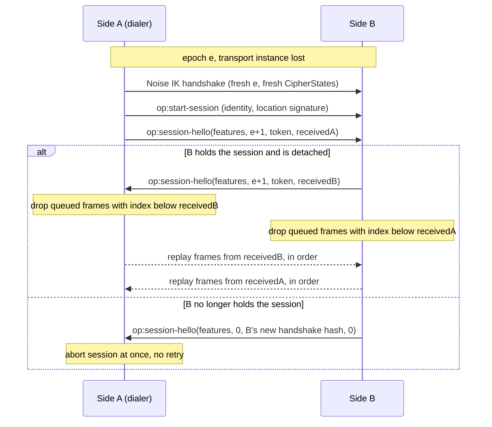

# OCapN-Noise Session Reconnect: Protocol and Build Breakdown

| | |
|---|---|
| **Created** | 2026-10-19 |
| **Author** | Kris Kowal (prompted) |
| **Status** | Proposed |
| **Source** | Firms up [ocapn-noise-session-reconnect](ocapn-noise-session-reconnect.md) against the in-flight stack #1476, #1478, #1481, #1482, #1483 and the cryptographic-review PRs #1487, #1506. |

## Status

This is a companion to
[ocapn-noise-session-reconnect](ocapn-noise-session-reconnect.md), not
a rewrite of it. That document is being edited by three open PRs
(#1481 adds § 7 *Session Control Records*, #1482 adds § Status, #1487
rewrites § 4 to Rekey-only), and `designs/README.md` by two (#1482,
#1487). This file does not touch either, so it can land without
conflicting with any of them.

What it adds:

1. One normative statement of the reconnect protocol **as the stack
   builds it**, with the deviations #1482 lists folded in as rules.
2. The rules the parent design leaves implicit or states differently
   from the implementation (Rules R1–R12).
3. The build work that remains after the stack merges, split so that
   no slice edits a file that #1478, #1482, or #1483 edits until that PR
   has merged.

The stack heads read for this document: #1483 at `9cc4169`
(`build/ocapn-noise-heartbeat-capability`), which includes #1476,
#1478, #1481, and #1482 beneath it.

The `designs/README.md` row for this file is deliberately deferred to
the first PR that edits the README after #1482 and #1487 land (build
slice D1).

## What is the Problem Being Solved?

The parent design was written before any of it was built, and
leaves four questions open:

- whether reconnect continues the Noise CipherState (Resume) or
  re-handshakes (Rekey);
- how the new transport instance names the session it continues;
- whether replayed frames reach CapTP more than once;
- which side redials.

The stack answered each in code: Rekey only, `op:session-hello` with a
session token, exactly-once replay by a session frame index, and
either side redials. Two of those answers contradict the parent
(§ 4's `RESUME` record and its CapTP-layer dedup requirement). A
builder starting the remaining work reads two specs that disagree. This
document pins the one that is built and lists the remaining build
slices.

## Design

### Layers and counters

Three counters are in play. Mixing them up is the main way to get
this protocol wrong.

| Counter | Scope | Owner | Resets |
|---|---|---|---|
| Noise nonce | one direction of one transport instance | Noise CipherState | every epoch (fresh handshake) |
| Session epoch | the session | OCapN-Noise network | never; `0` opens, `+1` per successful reconnect |
| Session frame index | one direction of the session | OCapN-Noise network | never |

Heartbeat frames (`op:ping`, `op:pong`) and control frames
(`op:session-hello`, `op:session-end`) carry no frame index. Only
session frames, the CapTP messages the client wrote, are counted, and
only they are replayed.

### Wire records

All four records travel inside the Noise channel, encrypted under the
current instance's CipherState. They are consumed by the network and
never reach the CapTP session. #1476 and #1481 define them in
`packages/ocapn/src/codecs/operations.js`, and the parent's § 1 and § 7
describe them. They are summarized here only to state the rules:

```text
<op:session-hello features epoch session received>
<op:session-end epoch>
<op:ping epoch sequence>
<op:pong epoch sequence lastAckedRecvNonce>
```

- `features` bit 0 is heartbeat and bit 1 is reconnect. Each takes
  effect only when **both** hellos set it, and reconnect also requires
  heartbeat (#1483).
- `session` is the 32-byte Noise transcript hash of the handshake that
  opened the session (epoch 0), the *session token*.
- `received` is the number of session frames the sender has delivered
  to its CapTP reader across all epochs.
- `lastAckedRecvNonce` is a per-instance Noise nonce. Under Rekey it
  says nothing across epochs.

### State machine



### Reconnect exchange



### Rules

**R1: Rekey only.** Every transport instance runs a full Noise IK
handshake and starts both nonces at 0 under new keys. No CipherState
crosses an instance boundary, so no `(key, nonce)` pair can repeat.
The parent's Option Resume, the `RESUME` / `RESUME-ACK` records, and
Phase 4 are withdrawn by this document, subject to Open question C1
(the maintainer's confirmation on #1487).

**R2: The session token is the resume capability.** A non-zero-epoch
hello continues a session only if its `session` equals the token this
side recorded at epoch 0 **and** the handshake authenticated the same
peer key. The token is derived from a transcript only the two peers
saw, so holding it, from inside an authenticated channel, is the
authority to resume. No identity allowlist is consulted.

**R3: Epoch acceptance.** The responder accepts any `epoch` greater
than its own, not only `epoch + 1`. A dialer that completed a
handshake whose reply was lost retries at the same epoch, and the
peer may have advanced past it. Both sides adopt the dialer's epoch.
A hello whose epoch is at most the current one is a straggler and the
instance is closed without a reply.

**R4: Refusal is an epoch-0 hello.** A side that does not hold the
named session answers a non-zero-epoch hello with its own epoch-0
hello for the new handshake, then closes. The dialer aborts at once
instead of retrying until `SESSION_HARD_TIMEOUT`. A fresh epoch-0
session from a peer whose old session is detached aborts that old
session, because the peer evidently restarted.

**R5: Exactly-once replay by frame index.** On attach, each side
drops queued and unacknowledged session frames whose index is below
the peer's `received`, then sends the rest in index order before any
new frame. A peer `received` greater than this side's sent count is a
protocol violation and aborts the session. CapTP therefore sees each
message exactly once, in order, across any number of reconnects. The
parent's § 4 *Replay idempotence at the CapTP layer* requirement
(dedup by answer position and deliver id) is **not needed** and is
withdrawn. CapTP keeps no reconnect state.

**R6: `op:pong` only trims the retention buffer.** Its
`lastAckedRecvNonce` lets the sender discard frames the peer has
already received on the *current* instance before a loss. It is never
compared across epochs. A pong whose epoch is below the current one
is dropped (R3's straggler rule applies to all control frames).

**R7: Either side redials.** Detachment schedules a redial on both
sides, with exponential backoff from `RECONNECT_BACKOFF_INITIAL` to
`RECONNECT_BACKOFF_MAX`, so a one-way reachability partition still
recovers.

**R8: Crossed hellos.** When both sides dial, the side whose epoch-0
x25519 ephemeral is greater (32-byte big-endian) keeps its own dial
and closes the peer's dial without a hello. The loser accepts the
winner's dial. The winner defers to its own dial for at most
`SESSION_TIMEOUT` across the whole redial run. After that it accepts
the peer's dial, so a winner whose dials keep failing cannot block
recovery. Equal ephemerals (a peer echoing ours) go to the side that
opened the session. P3 is settled: the tiebreaker material is the
ephemerals, as built in `initiatesOnCrossedHellos`.

**R9: Graceful end does not redial.** `op:session-end` (sent on local
`close()` after the outbound queue drains) ends the session on
receipt. A transport that closes without one is a loss.

**R10: Bounded retention.** The frames a session retains for replay
(queued plus sent-but-unacknowledged) are bounded by a frame count and
a byte count. At the bound, `writer.next` waits (back-pressure) and
does not throw. #1478 describes a 64-frame high-water mark. At
`9cc4169`, `enqueueFrame` does not check a bound while detached, and
`unacked` is not counted. Build slice B2 closes that gap.

**R11: Fail-fast near abort.** Inside the last `RECONNECT_BACKOFF_MAX`
of `SESSION_HARD_TIMEOUT`, `writer.next` rejects, as built in #1481.

**R12: `sessionId` is per session, not per instance.** With R2 of the
cryptographic review (#1506), the `np` `sessionId` mixes in a handshake
hash. It must be the **epoch-0** handshake hash (the session token), not
the hash of the instance's latest handshake. Otherwise the CapTP
handoff replay state (`nextHandoffCount`, `usedGiftHandoffs`) would
see a new `sessionId` under one continuing CapTP session. #1506 passes
the hash into `buildSession`, and the stack runs `buildSession` once
per session (a reconnect calls `attach`). The merge should therefore
satisfy this rule, and slice B3 pins it with a test.

## Ownership map

| Boundary | Mechanism | Policy | Durable state | Lifecycle / commit authority | Value crossing |
|---|---|---|---|---|---|
| Transport ↔ network | transport plugin moves bytes for one instance | none | none | network opens and closes instances | encrypted frames |
| Network ↔ CapTP client | network session state machine (epoch, queue, retention, frame index, tiebreak) | network options (`heartbeat`, `reconnect`) | none: in memory only | network decides attach, replay, discard, and abort; CapTP sees only end or error | plaintext CapTP messages, each exactly once |
| Daemon ↔ network | daemon constructs the network | daemon chooses whether heartbeat and reconnect are on, and the timeouts | none | daemon owns network lifetime through its `cancelled` context | options record |

- **Persistent state:** none. A process restart loses the session, and
  R4 turns that into an immediate abort at the peer.
- **Commit and discard:** the network discards a retained frame on
  pong (R6) or on the peer's `received` (R5). Nothing else discards.
- **Restart and replay:** the network replays (R5), and CapTP never
  does.
- **Classification:** the network alone classifies stall versus loss,
  from the heartbeat timeout tied to a pending read (#1476).

## Build Breakdown

Each slice names the files it edits. Slices marked *after-merge* edit a
file that an open stack PR edits. They are based on `llm` after that PR
merges, never stacked into the middle of the stack. File-disjoint
slices can stack on #1483's frozen head now.

| Slice | Files (new unless noted) | Overlap with #1478 / #1482 / #1483 | Base |
|---|---|---|---|
| **B1:** Protocol conformance tests for R3–R9 | `packages/ocapn-noise/test/reconnect-protocol.test.js` (reads `_loss-injector.js`, does not edit it) | none | frozen #1483 head |
| **B2:** Bounded retention (R10) | `packages/ocapn-noise/src/network.js`, `src/types.d.ts` (edit), `test/session-retention.test.js` (new), changeset | `network.js`, `types.d.ts` | *after-merge* of #1483 |
| **B3:** `sessionId` stable across epochs (R12) | `packages/ocapn-noise/test/reconnect-session-id.test.js` | none | after #1506 and #1481 both land on `llm` |
| **B4:** Daemon turns reconnect on | `packages/daemon/src/networks/ocapn.js` (edit), `packages/daemon/test/networks-ocapn-reconnect.test.js` (new), changeset | `daemon/src/networks/ocapn.js` | *after-merge* of #1483; gated on Open question D |
| **D1:** Parent-design reconciliation | `designs/ocapn-noise-session-reconnect.md`, `designs/README.md` (edit) | both design files | *after-merge* of #1482 and #1487 |

- **B1** asserts: a stale-epoch hello is closed unanswered (R3); a hello
  that skips epochs is accepted (R3); a refusal aborts with no further
  dials (R4); a peer `received` greater than the sent count aborts (R5);
  each epoch's handshake hash differs (R1); `op:session-end` produces no
  redial (R9). Run with both codecs.
- **B2** adds `reconnect.maxRetainedFrames` (default 64) and
  `reconnect.maxRetainedBytes` (default 1 MiB), validated alongside the
  existing reconnect options, and counts `outbound` plus `unacked`
  against them. Its test fills a detached session past the bound and
  checks that `writer.next` stays pending until reattach.
- **B3** connects, partitions, reconnects twice, and asserts
  `getLiveness().epoch` advances while `sessionId` is unchanged. A fresh
  session between the same peers gets a different `sessionId`. If
  #1506 is closed instead (Q2 option 2), B3 becomes a test that
  `sessionId` is stable across epochs under the old derivation.
- **B4** passes `reconnect: {}` beside `heartbeat: {}`, and its test
  partitions two in-process daemons' OCapN-Noise link and checks that a
  remote call made during the partition resolves once after it heals.
- **D1** edits the parent § 4: it marks Resume and the `RESUME` record
  withdrawn (per C1), replaces *Replay idempotence at the CapTP layer*
  with a pointer to R5, sets Phase 4 to withdrawn, and adds this
  document's README row and milestone entry.

Proposing `op:session-hello` and `op:session-end` (with `op:ping` and
`op:pong`) to the OCapN specification group is out of scope for this
fork. A tracking issue is to be filed.

## Dependencies

| Design or PR | Relationship |
|---|---|
| [ocapn-noise-session-reconnect](ocapn-noise-session-reconnect.md) | Parent: this firms up its protocol and replaces its Phase 4. |
| [ocapn-noise-cryptographic-review](ocapn-noise-cryptographic-review.md) (#1475) | R3 (Rekey on reconnect) and Q2 (`sessionId`) drive R1 and R12. |
| #1476, #1478, #1481, #1482, #1483 | The implementation this document describes; B1–B4 build on it. |
| #1487 | Carries the C1 reversal this document depends on. |
| #1506 | R2 `sessionId` binding; B3 pins its interaction with reconnect. |

## Design Decisions

1. **Companion file, not an edit of the parent.** The parent is under
   edit in three open PRs, so a parallel edit would conflict with all
   three. D1 folds this document back in once they merge.
2. **Exactly-once at the network, not idempotence at CapTP.** The
   network already numbers session frames. Requiring CapTP dedup on
   top would add per-operation state to every CapTP implementation in
   order to absorb duplicates the network never sends.
3. **Rekey only.** An IK reconnect handshake is one round trip
   (#1487), and it removes the only path to `(key, nonce)` reuse.
4. **Refuse with a hello, not by closing the connection.** A bare close
   looks like a transient failure and is retried until the hard
   timeout. An epoch-0 hello is an authenticated "no".
5. **Back-pressure, not rejection, at the retention bound.** It matches
   #1478's `writer.next` contract. Rejection is reserved for R11's
   about-to-abort window.

## Open Questions

- **C1:** Does the maintainer confirm Rekey-only reconnect (the
  reversal of the tentative "Resume plus rekey cap" decision on #252),
  as requested on #1487? R1, Decision 3, and D1's withdrawal of Phase 4
  wait on this answer.
- **D:** Should the daemon turn reconnect on by default (B4), or keep it
  opt-in until reconnect has run in the field for a while?
- **B2 defaults:** Are 64 frames and 1 MiB the right retention bounds,
  or should the byte bound scale with `SESSION_HARD_TIMEOUT`?

## Prompt

> Design step for endojs/endo-but-for-bots: take the Proposed design
> `ocapn-noise-session-reconnect` (M4, `depends_on: []`, no job on the
> board or plan queue) and firm it up against the in-flight Noise PRs
> #1478, #1482, and #1483 (crossed-hellos and heartbeat/capability
> negotiation). Land the design with a concrete reconnect protocol and a
> build breakdown, and avoid overlapping those PRs' files.
