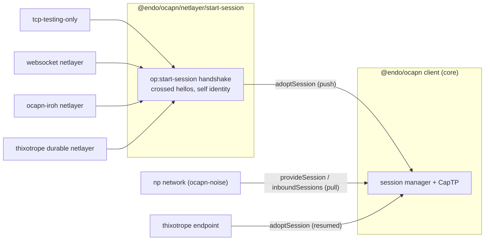

# OCapN TCP-for-Test Extraction

| | |
|---|---|
| **Created** | 2026-02-14 |
| **Updated** | 2026-10-16 |
| **Author** | Kris Kowal (prompted), Kriscendo Bot (prompted) |
| **Status** | In Progress |

## Status

Part of the separation exists on `llm` (as of commit `61cd656cb`,
2026-10-16):

- `OcapnNetwork.provideSession` and `OcapnNetwork.inboundSessions`
  (`packages/ocapn/src/client/types.js`) let a network hand OCapN core an
  already-authenticated `NetworkSession`. In `makeOcapn`
  (`packages/ocapn/src/client/index.js`), `establishSession` tries this
  path first, and `makeInternalSessionFromNetwork` runs CapTP over the
  network's reader and writer with no core handshake.
- The `np` network (`packages/ocapn-noise/src/network.js`, shipped in
  PR #137) uses only that path. Its `exchangeIdentity` runs its own
  `op:start-session` exchange inside the encrypted channel and binds the
  location signature to the Noise handshake hash. Core never sends a
  hello on an `np` session.
- `tcp-testing-only` (`packages/ocapn/src/netlayers/tcp-test-only.js`)
  exposes `sendSessionHandshake`, but that method just calls core's
  `sendHandshake`.

The handshake has not left core yet. `client/index.js` still imports
`sendHandshake` and `handleHandshakeMessageData` from
`client/handshake.js`. It still runs them for every network that
implements `connect` rather than `provideSession`. It still falls back
to them when a network's `provideSession` resolves `undefined`. The
networks on that fallback path today are `tcp-testing-only`, the
WebSocket netlayer (`src/netlayers/websocket.js`), `@endo/ocapn-iroh`'s
netlayer, and `@endo/thixotrope`'s durable netlayer. The remaining work
is to move that path out of core, and that is what this document
specifies.

## What is the Problem Being Solved?

OCapN core still owns the `op:start-session` handshake: the version
check, location-signature verification, crossed-hello resolution, lazy
session-keypair minting, and pre-session `op:abort`. Its connection
bookkeeping exists only to serve that handshake. Three problems follow.

1. **Any network that declines `provideSession` gets a plaintext
   hello.** A routing network that returns `undefined`, or a future
   network that forgets to implement `provideSession`, falls through to
   `connect` and an unauthenticated `op:start-session` with no warning.
   The `np` network avoids this today only because it never takes the
   fallback. Nothing in the structure prevents the regression.
2. **The session-establishment surface is too wide.** Core has five
   entry points (`connect`, `sendSessionHandshake`,
   `handleSessionHandshake`, `provideSession`/`inboundSessions`, and
   `resumeSession`), and `NetLayer.verifyPeerLocation` reaches into the
   middle of the handshake. Every new network has to work out which of
   these it is meant to use.
3. **The trust boundary is implicit.** `tcp-testing-only`'s handshake
   gives weak security: an Ed25519 signature with an empty channel
   binding and no encryption. That weakness sits in core, where it looks
   like an OCapN property rather than a test-network property.

## Design

### Target shape



After this change, core accepts **only** authenticated sessions. It
never parses or sends an `op:start-session`. The handshake becomes a
network adapter that the four `connect`-style netlayers compose. On the
wire, nothing changes.

### Core's session-entry contract

A network factory (`makeOcapn({ network: factory })`) is now called as
`factory(sessionHandlers, logger)`, where:

```js
/**
 * @typedef {object} SessionHandlers
 * @property {(session: AdoptableSession) => AdoptedSession} adoptSession
 *   Synchronously wire an authenticated session into the session
 *   manager and return its inbound sink and restore hooks.
 */

/**
 * @typedef {object} AdoptableSession
 * @property {SessionId} sessionId
 * @property {SelfIdentity} selfIdentity
 * @property {Uint8Array} remotePublicKeyBytes
 * @property {OcapnLocation} remoteLocation
 * @property {OcapnSignature} remoteLocationSignature
 * @property {boolean} isInitiator
 * @property {(bytes: Uint8Array) => void} write  one OCapN message
 * @property {() => void} close
 * @property {object} [hookKey]  passed to `sessionHooks` callbacks in
 *   place of core's internal connection, so an embedder keeps the
 *   identity it registered (the thixotrope records key on it)
 */

/**
 * @typedef {object} AdoptedSession
 * @property {(bytes: Uint8Array) => void} dispatch  one OCapN message
 * @property {(reason?: Error) => void} end  peer gone; aborts CapTP
 * @property {ResumedSession['restoreExport']} restoreExport
 * @property {ResumedSession['restorePendingResolver']} restorePendingResolver
 * @property {ResumedSession['provideImport']} provideImport
 * @property {ResumedSession['advanceAnswerPosition']} advanceAnswerPosition
 */
```

`adoptSession` **pushes**: delivery is synchronous, exactly as
`handleMessageData` delivers today. A frame dispatched in the turn the
handshake completes reaches CapTP in that same turn. The durable netlayer
also needs this, because it records a frame as processed only after
dispatch returns. The **pull** path (`provideSession` returning a
`NetworkSession` with `reader`/`writer`, plus `inboundSessions`) stays as
it is for `np` and `thixotrope-pipe`.

`adoptSession` replaces all four current `NetlayerHandlers` members
(`makeConnection`, `handleMessageData`, `handleConnectionClose`,
`resumeSession`). It covers both fresh sessions and resumed ones: a
resumed session is an `AdoptableSession` whose `selfIdentity` the
embedder rebuilt from persisted key bytes.

Core keeps a `WeakMap` from each adopted or provided session object to
its `InternalSession`. A network may adopt a session and also resolve
the same object from `provideSession` (the adapter does this for
outbound sessions, see below). Core then returns the existing
`InternalSession` instead of building a second one. The same memo
replaces the `getActiveSession` duplicate check in the `inboundSessions`
consumer. If `provideSession` returns an object that was never adopted
and has no `reader`, core throws.

**Legacy-factory guard.** After the factory resolves, a network that has
`connect` but no `provideSession` was written against the old handlers.
`makeOcapn` shuts it down and throws
`makeOcapn: network implements connect without provideSession; wrap it
with makeStartSessionNetwork from @endo/ocapn/netlayer/start-session`.
Today the same misconfiguration fails later, as a `TypeError` on the
first inbound connection.

### The start-session adapter

A new module, `packages/ocapn/src/netlayers/start-session.js`, exported
as `@endo/ocapn/netlayer/start-session`, provides:

```js
/**
 * @param {(handlers: NetlayerHandlers, logger: Logger) => NetLayer | Promise<NetLayer>} makeNetlayer
 * @param {{ codec: OcapnCodec, captpVersion?: string }} options
 * @returns {NetworkFactory}
 */
export const makeStartSessionNetwork = (makeNetlayer, options) => ...
```

The returned factory takes core's `SessionHandlers` and calls
`makeNetlayer` with a `NetlayerHandlers` whose shape **is unchanged**:
`makeConnection`, `handleMessageData`, `handleConnectionClose`,
`resumeSession`. The four netlayers therefore keep their code as it is,
and only their construction sites change. The factory resolves to an
`OcapnNetwork` with these members:

- `networkId`, `location`, `locationId`, `codec`, and `shutdown`,
  forwarded from the inner netlayer.
- `provideSession(location)`, which reuses a session the adapter has
  already established. Otherwise it calls the inner `connect`, sends the
  hello, and resolves with the session once the peer's hello
  validates. Before resolving, it calls `adoptSession`.

The handshake moves into the adapter verbatim and keeps the same
behavior:

| Moves from core | To the adapter |
|---|---|
| `sendHandshake`, `handleSessionHandshakeMessage`, `handleHandshakeMessageData`, `compareSessionKeysForCrossedHellos` (`client/handshake.js`) | same names, module-private except `sendHandshake` |
| `makeSelfIdentity` with its empty channel binding (`makeOcapn`) | adapter-private, plus `makeSelfIdentityFromPrivateKey` exported for resumption |
| lazy keypair minting (`getSelfIdentityForConnection`, `connectionLocationMap`, `connectionSelfIdentityMap`) | adapter-private, with the same flood bound: a keypair is minted only for our own hello or a reply to a validated hello |
| connection-keyed bookkeeping: `getOutgoingConnection`, `makePendingSession`, `rejectPendingSessionForConnection`, `deleteConnection`, and the async-connect race adoption in `establishSession` | an adapter-private table keyed by peer `LocationId` |
| pre-session `op:abort` (version mismatch, bad signature, `verifyPeerLocation` rejection, internal error) | adapter |
| `NetLayer.verifyPeerLocation` | stays on the inner `NetLayer`, which the adapter consults, so `ocapn-iroh` is unchanged |
| `captpVersion` option on `makeOcapn` | adapter option, default `'1.0'` |

After a hello validates, the adapter builds an `AdoptableSession`. Its
`write` and `close` delegate to the `Connection`, and its `hookKey` is
the `Connection`. The adapter calls `adoptSession` and from then on
forwards that connection's `handleMessageData` frames to
`adopted.dispatch`. `handleConnectionClose` on an adopted connection
calls `adopted.end(reason)`. On a pending connection it rejects the
pending `provideSession`.

**Crossed hellos** keep today's rule. When an inbound hello arrives from
a peer we have an outbound connection to, we compare our outbound session
key ID with the peer's key ID. If ours compares greater, the outbound
connection is kept; otherwise the inbound one is kept. The losing
connection gets `op:abort` with reason `"Crossed hellos mitigated"`.
Either way, a pending `provideSession` for that peer resolves to the
surviving session, and each session is adopted exactly once.

`np` keeps its own crossed-hello resolution in `ocapn-noise`. That logic
was never shared and has nothing to do with this rule.

`resumeSession(connection, resumption)` on the adapter's handlers
rebuilds `selfIdentity` from `resumption.selfPrivateKeyBytes` when that
field is present, and otherwise mints a fresh identity. It then adopts
the session without a handshake and returns the `AdoptedSession`, which
satisfies `ResumedSession`. The durable netlayer's
`restoreSession(handlers, connection, token)` contract does not change.

### What remains in core

- `client/handshake.js` is deleted. `makeSession` (the `InternalSession`
  builder) moves to `client/session.js`, because it is not handshake
  logic.
- `establishSession` keeps the self-connect refusal and the
  `establishingSessions` dedupe, then calls `provideSession`. If that
  resolves `undefined`, core throws
  `ocapn: no network accepts location <id>` instead of falling back.
- `handleMessageData` and `handleConnectionClose` leave core, because no
  core-owned `Connection` exists before adoption.
- `sendAbortAndClose` stays for active-session aborts. `op:abort` is a
  CapTP operation as well as a hello reply.
- `OcapnNetwork.connect`, `sendSessionHandshake`, and
  `handleSessionHandshake` are removed from the typedef.
  `tcp-testing-only` drops its `sendSessionHandshake`.

### `np` and the "redundant handshake"

When this design was first written, it assumed `np` would inherit core's
hello. It does not: PR #137 shipped `np` on `provideSession`. The
encrypted `op:start-session` inside `exchangeIdentity` is not redundant
either. It carries the Ed25519 session key used for handoff
certificates, and its signature is bound to the Noise transcript hash.
The Noise X25519 keys cannot provide that. This design does not touch
`np`. It removes the fallback that would let a declining routing network
send a plaintext hello beside `np`.

### Caller migration

Every `network: (handlers, logger) => makeXNetLayer({ handlers, ... })`
becomes `network: makeStartSessionNetwork((handlers, logger) =>
makeXNetLayer({ handlers, ... }), { codec })`:

- `packages/ocapn/test/_util.js`, `test/python-test-suite/index.js`,
  `test/netlayer-*.test.js`, and the `client.test.js` `captpVersion: 'BAD'`
  cases. The bad version moves to the adapter option.
- `packages/goblin-chat/src/host-room.js`, `src/use-goblin-chat.js`, and
  the goblin-chat tests.
- `packages/ocapn-iroh` tests and any `index.js` helper that builds a
  client.
- `packages/thixotrope`: callers of the durable netlayer go through the
  adapter. `src/daemon.js` builds its endpoint session directly from
  core's handlers, and that becomes `sessionHandlers.adoptSession(...)`
  with `hookKey: endpointConnection`. Its
  `records.registerResumedSession` receives the `AdoptedSession`.
- `packages/daemon/src/networks/ocapn.js` passes an `np` network and is
  unaffected.

## Ownership map

| Boundary | Mechanism | Policy | Durable state | Lifecycle / commit authority | Value crossing |
|---|---|---|---|---|---|
| transport netlayer → start-session adapter | netlayer (sockets, framing) | adapter (when to dial) | none | netlayer owns socket close; adapter owns connection close before adoption | one OCapN frame per `handleMessageData` |
| start-session adapter → core | adapter (hello, verify, crossed hellos) | adapter (version, `verifyPeerLocation`) | none | adapter decides accept or abort; after adoption, core owns the session and `end` | `AdoptableSession` / `AdoptedSession` |
| `np` network → core | `np` (Noise, `exchangeIdentity`) | `np` | none | `np` | `NetworkSession` (pull) |
| durable netlayer / thixotrope → adapter or core | durable netlayer (resume tokens) | embedder | embedder's session records | embedder decides resume versus fresh | `SessionResumption` → `AdoptableSession` |

The four ownership questions: **persistent state** belongs to the
embedder (thixotrope records); neither core nor the adapter persists
anything. **Commit/discard** of a candidate session belongs to whichever
network authenticates it, which is the adapter or `np`; core never
refuses an adopted session except on a memo duplicate. **Restart/replay**
belongs to the durable netlayer and its embedder, through `resumeSession`
→ `adoptSession`. **Execution classification** (dispatch, abort on
error) belongs to core.

Naming check: the adapter is named for the protocol it runs
(`start-session`), not for core's session lifecycle. Core's entry point
is `adoptSession`, a core verb, and no network-side name appears inside
core.

## Security Considerations

- Core states its trust assumption in the `SessionHandlers` JSDoc: an
  adopted or provided session is authenticated by its network, and core
  does no peer verification of its own.
- The start-session adapter carries its weakness in its own module doc:
  no encryption, and a location signature with an empty channel binding.
  It is suitable for tests, interop, and transports that are
  authenticated underneath, which today means iroh's QUIC
  `verifyPeerLocation` and the durable netlayer's base transport.
- Removing the `provideSession → undefined → connect` fallback closes a
  silent downgrade path to plaintext hellos.
- The lazy-keypair flood bound and every abort path keep their current
  behavior. The adapter test suite asserts both.

## Test Plan

- **Wire parity:** for each case below, capture the bytes of a
  `tcp-testing-only` hello exchange (both directions, both crossed-hello
  outcomes, version mismatch, bad signature) before and after the change,
  and assert they are byte-identical.
- The existing `packages/ocapn/test/client.test.js` handshake cases pass,
  pointed at the adapter. The python OCapN test suite
  (`test/python-test-suite/`) and the goblin-chat Guile interop tests
  pass unchanged.
- New core test: a network that adopts a hand-built `AdoptableSession`
  reaches CapTP bootstrap with no `op:start-session` on the wire.
  Adopting and then resolving the same object yields one session.
- New core tests: `provideSession` resolving `undefined` rejects with the
  "no network accepts" error, and a legacy `connect`-only network fails
  the construction guard.
- New adapter tests: crossed hellos with each key ordering resolve a
  pending `provideSession` to the survivor and adopt it exactly once. An
  async `connect` raced by an inbound hello adopts the inbound session
  and ends the outbound connection.
- Thixotrope worker-restart and durable-session suites, including XS,
  pass: `resumeSession` through the adapter, and `adoptSession` for the
  endpoint.
- `ocapn-iroh` netlayer tests pass, including `verifyPeerLocation`
  rejection.

## Compatibility Considerations

- The wire is unchanged for every network.
- The API break is source-level only. `makeOcapn`'s factory argument
  receives `SessionHandlers` instead of `NetlayerHandlers`, and the
  `captpVersion` option moves to the adapter. The legacy-factory guard
  turns a missed migration into a clear construction error.
  `@endo/ocapn` is pre-1.0 and every caller is in this repository, so
  all callers migrate in the same PR. A changeset records the break for
  `@endo/ocapn` and a patch for each migrated package.

## Dependencies

| Design | Relationship |
|---|---|
| [ocapn-network-transport-separation](ocapn-network-transport-separation.md) | Parent. The `OcapnNetwork`/`NetworkSession` seam this design needs has already landed. The rest of that design does not block this one. |
| [ocapn-noise-network](ocapn-noise-network.md) | Complete. It already avoids the core handshake; this design removes the fallback. |
| [ocapn-tcp-syrup-framing](ocapn-tcp-syrup-framing.md) | Complete. Its framer delivers one hello per `handleMessageData`, and the adapter relies on that. |
| [gateway-package](gateway-package.md) | Consumer. The relay inherits the post-extraction session shape. |

## Phased implementation

One PR, in four commits:

1. Introduce `SessionHandlers.adoptSession` and the memo in core,
   alongside the existing paths.
2. Add the start-session adapter by `git mv client/handshake.js
   netlayers/start-session.js`, so blame survives, and extend it.
3. Migrate every caller.
4. Delete the fallback, the hooks, and core's connection handlers, and
   add the guard.

## Design Decisions

1. **Push adoption, not the pull `NetworkSession`, for start-session
   netlayers.** Pull delivery would turn synchronous frame dispatch into
   a reader pump. That changes ordering for the durable netlayer's
   processed-frame accounting. Considered and rejected: one unified
   pull-only seam. Reason: it costs thixotrope correctness for symmetry.
2. **The adapter offers netlayers the old `NetlayerHandlers` unchanged.**
   This keeps four netlayers' internals untouched. Considered and
   rejected: rewriting each netlayer as an `OcapnNetwork`. Reason: it
   multiplies the handshake code instead of moving it.
3. **No auto-wrapping in `makeOcapn`.** If core imported the adapter, the
   handshake would be back in core's import graph.
4. **The crossed-hello rule and the abort reasons stay byte-for-byte
   the same,** so interop suites remain the oracle.

## Open questions

1. Should `np`'s in-tunnel identity record keep the `op:start-session`
   name and codec, or move to an `np`-specific record so that
   `op:start-session` belongs only to the start-session adapter? This
   design leaves `np` untouched. Renaming it is a wire change for `np`
   and would need its own design and coordination with other `np`
   implementations.
2. Should a routing network that fronts both `np` and a start-session
   netlayer be a supported configuration, given that the `undefined`
   fallback is gone and composition would have to happen inside the
   routing network? Or should `makeOcapn` accept several networks? No
   such caller exists today.

## Prompt

> Design step for endojs/endo-but-for-bots, plan design
> `ocapn-tcp-for-test-extraction` (M4, no dependencies, no existing job or
> PR). Write the design that moves the `op:start-session` handshake out of
> OCapN core (`packages/ocapn/src/client/handshake.js`) into a
> TCP-for-test network, so OCapN-Noise doesn't run a redundant handshake.

Original 2026-02-14 framing: the `op:start-session` handshake should be
owned by the tcp-for-test network rather than inherited from core, so
that OCapN-Noise, whose Noise handshake already authenticates both
parties, does not run it.
