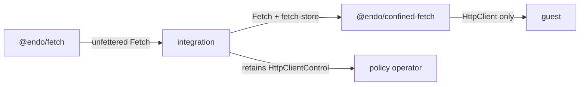

# @endo/confined-fetch

A confined Endo plugin that attenuates an endowed
[`@endo/fetch`](../fetch) capability into **confined outbound HTTP**. A
confined fetch service hands a guest a bounded `HttpClient` (origin allowlist,
request-rate and response-byte caps, manual redirect resolution, and
trust-on-first-bind pins) and retains the `HttpClientControl` for the
integration. The capability itself is
[`@endo/exo-http-client`](../exo-http-client) over
[`@endo/http-confine`](../http-confine)
([design](../../designs/endo-fetch.md)).



## What it is

- **The base is an endowment, not ambient authority.** The only transport the
  client is built over is the endowed `Fetch`. `make()` rejects without it, and
  the service core refuses to start without a transport rather than fall back
  to `globalThis.fetch`.
- **Persistence is a virtual-file-system capability, backing-agnostic.** The
  plugin depends only on the writable-tree verbs of
  [`@endo/platform/fs/extended`](../platform) (`lookup`, `write`, `move`), so
  the backing may be a host directory, an in-memory tree, a daemon mount, or a
  database.
- **The confined capability is `@endo/exo-http-client`'s.** The plugin composes
  `makeHttpClientAndControl` and persists through its `initialBindings` and
  `onPolicyChange` seams, so request-time trust-on-first-bind pins survive
  restart.

## Provisioning

`make(powers, context, { env })` resolves by name through `powers`:

- `E(powers).lookup('fetch')` -> the base `Fetch` from `@endo/fetch`.
- `E(powers).lookup('fetch-store')` -> a writable virtual-file-system
  **directory**, private to this service.
- `E(powers).lookup('fetch-policy-authority')` (**optional**) -> the referral
  target for trust-on-first-bind decisions (`tofu-prompt` / `tofu-attenuator`
  modes). Without it, those modes are unavailable and unknown origins fail
  closed.

Initial `allowedOrigins` (comma-separated), `maxRequestsPerMinute`,
`maxResponseBytes`, and `policyMode` arrive via `env`; thereafter
`HttpClientControl` adjusts them and the store persists them, so the **store,
not `env`, is authoritative** across restarts.

The integration retains the base privately, provisions one confined service
per guest with a fresh directory, keeps `control()`, and grants the guest only
`client()`.

## Runtime requirement

`@endo/http-confine` reads the ambient `setTimeout`, `AbortController`, and
clock for request timeouts and revocation. The daemon's confined-worker
compartments (`makeBundle` / `makeArchive`) do not endow those globals, so
until a timer capability is endowed, provision this package through
`makeUnconfined`. Its authority still comes only from its endowments: it never
reads `globalThis.fetch`.

## The `@pins` recipe (wake-on-restart)

A plugin caplet wakes on daemon restart **if and only if something retains its
identifier in a reviving collection.** The daemon eagerly revives exactly one
collection at boot — the `@pins` directory (`revivePins()`) — and everything else
revives lazily on demand. So retention is integration-owned and, for now,
user-driven:

1. **Pin the confined service** when you provision it (for example
   `resultName: ['@pins', 'fetch']`), and retain the base `Fetch` and the
   service's `fetch-store` directory so the same endowments are restored at
   boot.
2. On the next boot, `revivePins()` provides the identifier, the worker
   incarnates the plugin with the same base and directory, and `make()`
   reconstitutes the pair from
   `config.json` + `bindings.json` with **identical policy and pins** — the
   allowlist, the byte/rate/mode limits, the trust-on-first-bind bindings, and
   the revoked flag.
3. **Unpinning decommissions.** Remove the pin and the service does not wake next
   boot; its durable store remains until you delete it. A revoked service revives
   revoked.

The Familiar app and the online Gateway are candidate future owners of this
retention; daemon core gains no fetch-specific revival logic either way.

## Facets

`make()` returns a `ConfinedFetchService` exo that hands out the two facets, mirroring
`ReminderService`:

- **`HttpClient`** (guest-facing), via `E(service).client()` — the only thing a
  confined agent ever holds:
  - `fetch(url, options?)` -> a bounded `HttpResponse`
  - `allowedOrigins()`, `help()`
- **`HttpClientControl`** (integration-facing), via `E(service).control()` —
  retained by whoever provisioned the service:
  - `inspect()`, the allowlist mutators, `setMaxRequestsPerMinute` /
    `setMaxResponseBytes`, `setPolicyMode`, `revoke` / `isRevoked`, the
    trust-on-first-bind surface `listBindings` / `revokeBinding` / `unpin`, and
    `listAuditEntries`.

A guest granted `client()` can reach only allowlisted or pinned origins, under
rate and byte caps, and never sees the service, the store, or the base `Fetch`.

## The store

The store is a writable directory on the platform virtual file system:

```
fetch-store/
  config.json    # { allowedOrigins, maxRequestsPerMinute, maxResponseBytes,
                 #   policyMode, revoked }
  bindings.json  # the trust-on-first-bind binding table
```

Writes are write-then-`move` within the store directory, serialized so
overlapping operations cannot interleave partial documents; atomic
within-directory `move` is **required of the backing** as a store contract. Not
persisted, by design: the sliding rate-limit window (resets on restart, at worst
briefly generous) and the `listAuditEntries` ring buffer (bounded in-memory
observability, not a durable log).

## The agent-tool binding

The `makeHttpTool` half of
[daemon-agent-tools](../../designs/daemon-agent-tools.md) Phase 3.6 binds
whatever `HttpClient` a guest was granted (a `ToolRecord` plus wire schema,
mirroring `makeGitTool` / `makeShellTool`); bounds come entirely from the
capability, and the network tool group is absent from the catalog unless the
agent holds the `HttpClient`. This plugin provisions that client; the tool never
needs the base `Fetch`.

## Bugs

See https://github.com/endojs/endo/issues.
