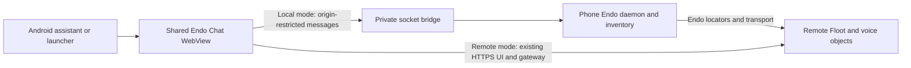

# Floot Android: local Endo and the shared web interface

Status: initial implementation, revised 2026-10-26.
This replaces the earlier proposal for a Kotlin conversation UI and a separate
mobile JSON gateway.

The app embeds the existing Endo Chat interface in Android WebView.
It can connect to its own Endo daemon or load the user's existing remote Endo
web URL, preserving the same Floot text, microphone, speech, session selection,
and recovery controls in both modes.
The local daemon will eventually expose Android endowments as shareable Endo
capabilities; this implementation does not grant remote agents phone APIs.

## Connection modes

**Local:** the APK includes the existing `endor` Rust/XS runtime as packaged
native executable code, rather than extracting executables into writable app
storage.
It runs with an app-private state directory, cache, and Unix socket.
The Android shell bridges bounded netstring frames between that socket and the
bundled web UI using an origin-restricted WebMessage listener.
The JavaScript side establishes ordinary CapTP and obtains this daemon's host
capability through its bootstrap.
No local TCP gateway or remotely reusable host token is needed.
Identity and imported references survive activity recreation and process restart.

**Remote:** the user pastes an HTTPS web UI URL through the Connection menu.
The app saves it in private, non-backed-up preferences and loads it directly.
The URL's fragment selects the remote gateway and agent exactly as in a browser.
The local daemon is not started for this mode; an already running local daemon
keeps its state when the user switches away.
Microphone permission is scoped to the selected origin and checked again after
Android's runtime permission result.
The local CapTP bridge accepts only the bundled app origin in the main frame,
while local mode is selected.
External navigations open outside the privileged WebView surface.

## Assistant and microphone lifecycle

A lightweight `VoiceInteractionService` registers Floot as an assistant on
Android 12 and later, with an explicitly empty platform recognition service:
speech recognition belongs to the shared Floot UI.
Android 10/11 use an `ACTION_ASSIST` activity instead, since selecting a voice
interaction service there requires a valid platform recognizer.
The setup button opens Android's voice-input/default-assistant settings directly:
Samsung rejects `createRequestRoleIntent(ROLE_ASSISTANT)` as not requestable even
when the role is available.
Returning from settings re-reads the actual role and shows success or
non-selection feedback.
Its protected session service issues a single-use invocation ID to the activity.
The selected connection's shared UI routes to a voice-enabled Floot space and
creates a new General Assistant session with `fae-codex` / `gpt-5.6-sol`.
Capture and transcription start concurrently with creation, without waiting for
model discovery or the usual initial noise calibration.
Finalized text waits for successful creation before submitting to the new session.
Failure stops capture and leaves manual microphone use available.
A bounded durable set of 32 invocation IDs prevents duplicate creation when
Android redelivers an invocation or recreates the activity.
Ambiguous creation is not retried automatically; another shortcut invocation is
an explicit new request.
Only the currently attached UI handles delivery after a gateway reconnect.
Android 10/11's exported activity intent is forgeable, so it opens the UI without
automatically recording; the user taps the microphone there.
The UI supplies its existing mic capture, transcription, and spoken reply path.
Only audio-capture WebView permission requests from the selected origin are
eligible, and Android's `RECORD_AUDIO` permission is required.
Backgrounding dispatches an audio-suspension event; recording and playback stop,
while the server-owned turn continues.
Pending microphone grants are fenced by capture generation and discarded after
suspension or unmount.
Delayed speech replies cannot restart audio while suspended; foregrounding
permits future audio without resuming the old capture or reply.
Hardware wake words, background listening, screen capture, and Android phone
endowments remain future work.
See Android's [voice service documentation](https://developer.android.com/reference/android/service/voice/VoiceInteractionService)
and [WebView permission guidance](https://developer.android.com/develop/ui/compose/migrate/interoperability-apis/wrap-webview-in-compose).

## Appearance and diagnostics

A single toolbar leaves the shared conversation UI most of the screen.
Connection, assistant selection, and diagnostics live in its overflow menu.
Android day/night resource themes follow system appearance; WebView receives
that theme through `isLightTheme` and exposes it as `prefers-color-scheme`.
The shared page declares `color-scheme: light dark` and uses its existing themes.
System appearance changes recreate the activity and reconnect to the same daemon.

Application and voice-process uncaught errors, WebView warnings/errors, load
failures, and daemon stdout/stderr are captured in private rotating logs.
A process-level reader drains daemon output while the activity is backgrounded.
Each stream retains two 256 KiB files; individual messages and unterminated lines
are bounded before buffering or writing.
Diagnostics remain accessible after relaunch and export via the Android document
picker, without broad storage permission.
The preview reads only the latest 8 KiB per file, keeping its accessibility
payload small; export reads all retained logs after the document picker returns.
Reports never enter saved activity state, avoiding Binder limits and allowing
export to survive process recreation while the picker is open.
Known credential forms are redacted; arbitrary application output can still
contain sensitive data, so export is an explicit user action.

## Import and export

The shared Floot settings expose an export containing a versioned
`endo-floot` record with controller, optional STT, and optional TTS locators.
Export uses `locateWithHints` to preserve Endo connection hints.
Import validates the entire record and every locator before writing anything.
It names the imported objects in a deterministic directory in the receiving
Endo, using `adoptFromLocator` to register peer hints.
Repeated imports reuse the directory and repair partial imports without
replacing an existing different capability.
Adding the resulting Floot space uses the same space creation path as selecting
objects already in the inventory.

This is capability transfer, not account login or a newly invented pairing
service.
The export dialog explains that the controller and speech references convey
access to those objects.
The controller retains its existing authority; there is no new per-session
attenuation, expiry, or independent device revocation layer.
Cross-daemon use requires mutually supported, reachable Endo transport hints.
Using the remote web URL avoids this additional transport requirement.

## Reconnect and duplicate submissions

Local socket connections carry a fresh generation ID.
Late close or message callbacks from an earlier connection cannot affect the
replacement CapTP connection.
A reconnect reacquires the local host and the UI's existing session watchers;
it does not delete daemon state, create another agent, or replay a turn.
The bridge bounds frames and aggregate queued data, closes failed connections,
and allows the UI's existing reconnect backoff to recover.

The shared UI stores an unacknowledged submission's text and request ID before
transmitting it.
Concurrent retries in one view share one promise.
Across views, short Web Locks transactions reserve the request before remote
method discovery and conditionally clear only that request after acknowledgement.
No lock spans a remote call.
Browsers without Web Locks fail closed with an update instruction.
Unsent drafts are persisted separately per session with revision identities.
An acknowledgement clears only its original draft revision, preserving edits
made during the send, including newly typed identical text.
Switching sessions or recreating the activity restores the matching draft;
a delayed failure cannot put one session's text into another session's composer.
After reconnect, retrying the restored draft uses the saved ID.
A different draft cannot silently replace an uncertain request.

Floot's new `enqueueOnce(text, requestId)` writes its receipt atomically with the
queue entry in the same durable record.
The receipt contains a text digest and the accepted pending ID and survives the
entry's dispatch, completion, or cancellation.
Duplicate calls return the same ID without releasing restart holds or starting
another turn; mismatched text is rejected.
Receipts are capped at 4,096 per session and expire after a 24-hour retry window.
Time-bearing expired IDs are rejected even after their receipts are removed.
Session deletion removes the queue and its receipts together.
No per-request names are added to the public Endo namespace.

Old Floot hosts use the existing `enqueue` API for a first submission.
If its acknowledgement is lost, the client preserves the uncertain draft and
refuses to retry it on that older API.
The user can inspect the conversation and explicitly clear the saved submission.
No exactly-once claim is made for downstream tools: interruption after a tool's
side effect still requires Floot's existing journal recovery.

## Verification and next work

Regression tests cover native UTF-8 framing and malformed input, remote origin
validation, local CapTP reconnect with stale callbacks, partial capability
imports, lost acknowledgements, concurrent duplicates, completed-entry retries,
expired IDs, mismatched text, and queue restart holds.
The Android build packages the shared web bundle and the native runtime;
emulator smoke testing must verify local daemon startup as well as WebView load.
Physical-device voice, audio focus and route changes, and end-to-end capability
transfer across the user's chosen Endo transport remain release acceptance work.

Next additions should preserve this architecture: Android endowments become
explicit local capabilities; scoped sharing and revocation belong in Endo;
voice enhancements belong in the shared Floot interface wherever possible.
