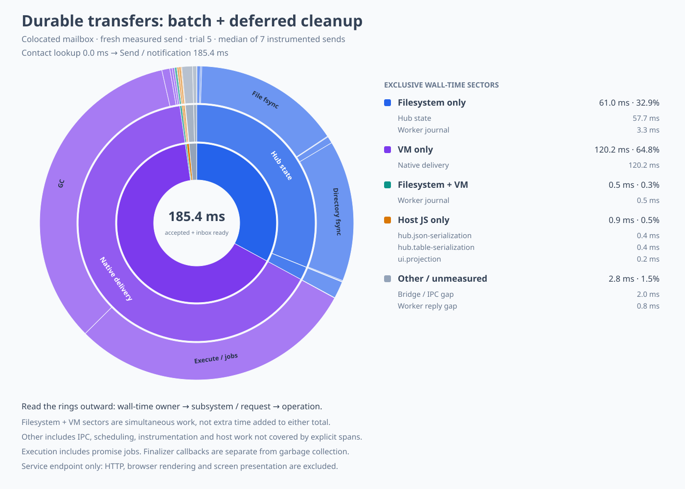
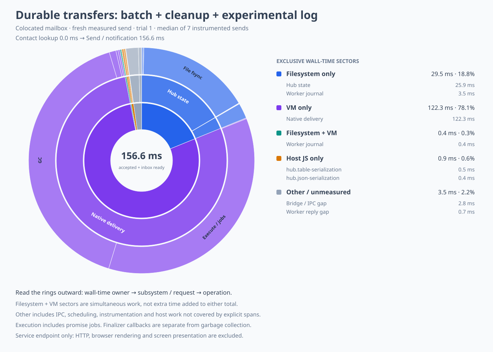

# Batching durable mail transfers

Measured on 18 October 2026 after ordered GC batching.
This experiment batches a completed native crank's outbound frames into one hub transaction and
piggybacks accepted worker-outbox cleanup on the next necessary hub commit.
It leaves guest execution, collection, finalizers, receiving-worker journal format, and snapshot
boundaries unchanged.

## Method and results

Each variant uses a separate disposable daemon, the same combined native worker and updated guest
bundle, three value-bearing seed messages, and seven measured text self-sends.
Recipients are captured references, the mailbox is colocated, and state arrives through subscriptions.
Idle sleeps and periodic snapshots are disabled for this bounded experiment.
There is no forced GC pressure, HTTP stage, or browser rendering in these measurements.
These runs are a fresh comparison; the previous forced-GC sunburst used a different workload.
All samples, including GC outliers, are retained in the traces.

| Variant | Median acceptance + pushed inbox | Median hub commits | Median hub persistence |
| --- | ---: | ---: | ---: |
| Both disabled | 216.919 ms | 10 | 90.631 ms |
| Deferred worker cleanup only | 210.234 ms | 9 | 80.868 ms |
| Completed-crank batching only | 199.247 ms | 7 | 63.418 ms |
| Both, atomic hub store | 185.444 ms | 6 | 55.951 ms |
| Both, experimental hub append log | 156.608 ms | 6 | 28.141 ms |
| Both disabled, repeated after candidates | 222.222 ms | 10 | 89.964 ms |

The combined atomic-store sample median is 31.476 ms lower, a 14.5% reduction.
The deterministic steady-send operation count falls from ten hub commits to six.
Every selected steady-send trace still contains one receiving-worker journal append and fsync.
The atomic path therefore has seven logical persistence operations and thirteen fsync calls:
six hub file fsyncs, six hub directory fsyncs, and one journal file fsync.
It has not reached the desired one-to-three-write budget.

The comparisons are sequential, small, and include variable filesystem latency and spontaneous GC.
The control has a 483 ms sample, batching alone has a 727 ms sample, and the combined atomic run has
a 670 ms sample.
This experiment supports the commit-count reduction and a lower sample median, not a tail-latency
claim or a guarantee that each saved commit costs the same number of milliseconds.

A repeat of the disabled control after all candidates returns to a 222.222 ms median and ten
steady hub commits, supporting the operation-count explanation despite timing variability.
Its first 959 ms sample has eighty hub commits from additional traffic; it is retained.

| Run order | Every sample, rounded to milliseconds |
| --- | --- |
| Control | 483, 217, 213, 213, 222, 228, 217 |
| Cleanup only | 217, 204, 208, 211, 208, 210, 211 |
| Batch only | 193, 727, 189, 196, 199, 211, 204 |
| Both, atomic | 187, 176, 670, 186, 181, 185, 184 |
| Both, experimental log | 156, 157, 155, 161, 156, 157, 168 |
| Repeated control | 959, 218, 217, 226, 216, 227, 222 |

Every sample reports zero worker wakes and zero snapshots.

## Updated sunbursts



The selected atomic-store interval is 185.447 ms: VM-only work occupies 120.201 ms,
filesystem-only work 61.023 ms, their overlap 0.500 ms, host JavaScript 0.905 ms, and other work 2.818 ms.
The native phase totals include 54.936 ms of execution and promise jobs and 62.805 ms in two collector
passes; finalizer callbacks account for another 1.521 ms.
These overlapping diagnostic phase totals must not be added to the exclusive wall-time sectors.
Hub file fsyncs consume 28.126 ms and directory fsyncs another 26.949 ms across six replacements.
The journal's one fsync consumes 3.749 ms, partly overlapping the VM.



The experimental log lowers the sample median by a further 28.836 ms to 156.608 ms.
Its selected interval contains six hub append fsyncs totaling 25.343 ms and one journal fsync of
3.837 ms, with no hub compaction in that interval.
The exclusive filesystem sector shrinks to 29.515 ms while VM-only time remains 122.254 ms.
The prototype remains confined to disposable benchmark state because its recovery and compaction
layout adds substantial production complexity.

The [control](mail-durable-transfers-control.svg), [cleanup-only](mail-durable-transfers-cleanup.svg),
[batch-only](mail-durable-transfers-batch.svg),
[repeated control](mail-durable-transfers-control-repeat.svg), and
[largest combined sample](mail-durable-transfers-combined-burst.svg) are also retained.
Each figure has a neighboring JSON breakdown and a JSONL trace containing every trial.
All native phases in the selected median intervals match host request envelopes within 0.6 ms;
there are no unmatched phases.

## Ownership and replay

The Ironhorse engine already obtains the whole outbound array after running one input to quiescence.
An optional batch callback carries that array through the worker transport to the hub.
Other engines and callers retain the existing single-frame callback.
The transport assigns the same session-lifetime identity to each individual frame that it would
have assigned without batching, including init output, journal replay, and post-snapshot output.
A batch changes transaction grouping, not the OCapN frame bytes or guest schedule.

The hub interprets frames in their original order while deferring persistence and outbox publication.
Its final transaction commits routing effects, outbound ownership, and the source watermark together.
Only then can an attached destination receive any resulting frame.
A failed commit leaves responsibility with the source's replayable crank.
After a restart, a previously committed prefix is skipped and the missing suffix is regenerated.
An ambiguous commit can safely replay the original frame identities.
Gift withdrawals retain the existing attempted-prefix ordering; unattempted tails are not numbered
in advance merely because their source arrived as a batch.

Deferred cleanup is enabled only for the daemon's durable worker receiver.
That receiver returns true after its journal owns the bytes and stable hub identity, before execution.
Its receipt watermark survives either in the journal or in snapshot metadata after truncation.
The hub can therefore remove an accepted entry in memory and persist that removal with its next
necessary transaction.
A crash in that interval repeats the original identity, which the receiver deduplicates.
The last accepted tail may remain on disk during an idle period; explicit sink flush also commits it.
Other adapters retain immediate final cleanup unless they explicitly promise durable deduplication.
The option requires both durable delivery and synchronous acceptance.

Tests cover failed batch commit and restart from a committed prefix, duplicate whole-batch replay,
accepted-tail replay after a crash, explicit cleanup flush, and original sequence numbering through
worker crash, snapshot, journal truncation, and host recreation.
Existing gift-ordering and before-wire failure tests remain applicable.

## Benefit versus complexity

| Change | Observed benefit | Added complexity | Decision |
| --- | --- | --- | --- |
| Completed-crank hub transaction | Three fewer steady hub commits; 17.673 ms lower sample median alone | Optional engine/transport callbacks and a batched hub sink; reuses existing transaction-depth and replay-watermark mechanisms | Keep |
| Piggyback worker cleanup | One fewer steady hub commit; 6.686 ms lower sample median alone | One adapter contract flag; an accepted tail can remain persisted until the next commit | Keep narrowly scoped to journaled workers |
| Receiving journal batching | No steady-send saving: only one journal append occurs | Would require new journal framing or carefully recovering partial multi-entry appends | Defer until a measured workload has multiple adjacent frames for one receiver |
| Existing append-log prototype | Measured separately below | Recovery, compaction, and an additional incompatible experimental storage layout | Keep experimental |

The retained changes add no persisted fields, journal format, timer, delayed execution queue, or new
native operation.
Their costs are additional optional host interfaces and a stronger receiver contract.
They do not attempt to combine independent guest cranks or change GC scheduling.
The receiver-side batch was deliberately not implemented because it adds failure cases without
saving a write in the measured path.

## Reproduction

Run from `packages/thixotrope`, using separately built native and guest artifacts:

```sh
THIXOTROPE_IRONHORSE_WORKER=/tmp/mail-combined-worker \
THIX_MAIL_BOOT_DIR=/tmp/mail-gc-batched-boot-final \
THIX_MAIL_TRANSFERS=both \
THIX_MAIL_TRIALS=7 \
THIX_MAIL_PROFILE=/tmp/mail-transfer-trace.json \
THIX_MAIL_PROFILE_WORKER=/tmp/mail-combined-profile-worker \
node --import ./scripts/profile-mail-loader.mjs scripts/measure-mail.mjs colocated
```

Use `THIX_MAIL_TRANSFERS=off`, `cleanup`, `batch`, or `both` for the four ablations.
Use `THIX_MAIL_HUB=log` only on disposable state for the additional append-log comparison.
Generate the selected median chart from its retained trace with:

```sh
python3 scripts/mail-profile-sunburst.py \
  designs/mail-durable-transfers-combined.trace.jsonl \
  /tmp/mail-durable-transfers-combined \
  --label 'Durable transfers: batch + deferred cleanup'
```

The loader applies ablations in the measurement process; normal daemon configuration is unchanged.
Native and guest hashes, source provenance, every trial, and fine-grained events are retained in the
adjacent trace files.
The live demo and its pinned artifacts were not modified or restarted.


## Validation

Package lint and typechecking pass with the existing warning set.
A clean workspace composite declaration build and all fourteen type-contract suites pass.
The twenty-seven nearby hub, outbox, transport, daemon recovery, and journal tests pass in all three
SES configurations.
Seven native tests pass, including actual process kills at journal, heap, output, and snapshot
boundaries, pending-call recovery before hub acceptance, collector-driven answer cleanup, and
completed-crank garbage reclamation across snapshots.
Both native fault harnesses now wrap the optional batch callback as well as the original single-frame
callback, keeping the durability boundaries observable.

Repository documentation generation still reports the prior baseline's 102 errors and 190 warnings;
its TypeScript diagnostic lines match the previous capture.
Every saved chart reproduces from its JSONL trace, its exclusive sectors sum to the measured interval,
and the atomic and append-log figures were rendered and inspected.
The normal worker and guest-bundle hashes remain unchanged.
