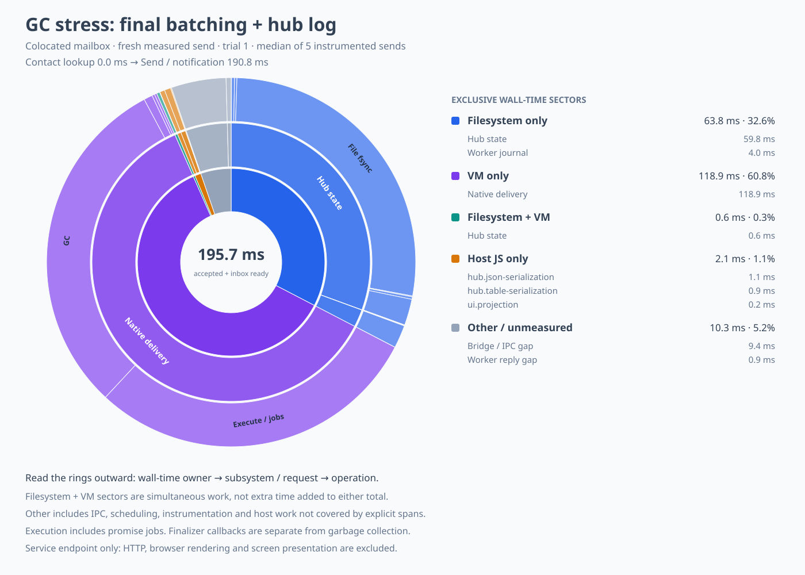

# GC batching: client, hub, and native guest experiments

This follows the [recipient-reference and hub-log experiments](mail-optimization-strategies.md).
The previous outliers contained many separately delivered GC hints.
This experiment coalesces those hints at their source and preserves lists while routing them.
The running user's daemon, native binary, guest bundle, workspace, and URL were left unchanged.

## Method and comparison

Each run uses disposable state, a colocated mailbox, the combined native operation, captured
recipient references, three seed messages, and five measured self-sends.
Before each measured send, 48 remote counter reads prepare additional short-lived answer references.
Those preparatory RPCs are outside the timing interval.
The interval includes explicit Node GC, two event-loop turns, send acceptance, and pushed inbox state.
It excludes HTTP and browser rendering.
This is a GC-stress workload, not the earlier unstressed 182–229 ms workload.
Host GC is included in elapsed time but is not separately instrumented; some of it falls in
unmeasured host time or overlaps native work already queued when the interval starts.

V8 determines which references are collectible on each pass.
Equal numbers of preparatory reads do not guarantee identical collected-reference sets or when
collection callbacks run.
These five-sample sequential runs cannot establish p99 latency.
All samples, including the initial combined run and the final repeat, are retained.

| Strategy | Median | Largest observed sample | Deliveries in that sample |
| --- | ---: | ---: | ---: |
| No batching, original guest, atomic hub | 276.733 ms | 3,392.679 ms | 122 |
| Host-client batching only, original guest, atomic hub | 262.174 ms | 3,364.150 ms | 122 |
| Host-client and hub batching, original guest, atomic hub | 261.517 ms | 712.399 ms | 20 |
| Initial combined guest batching and hub log | 196.585 ms | 378.908 ms | 5 |
| Final combined implementation and hub log, repeat | 195.697 ms | 626.633 ms | 18 |

The client-only change does not fix the large burst: the hub expands the list into singleton frames.
Keeping the list through the hub reduces the largest observed sample by 79.0% and native deliveries
by 83.6% in this small comparison.
The median change from batching alone is only 5.5%.
The final combined run includes both the new native guest bundle and the experimental append log,
so it is not an isolated measurement of either additional change.
Its larger repeat outlier is retained; the earlier 379 ms maximum is not a tail-latency claim.

Every sample, rounded to milliseconds:

| Run order | Samples | Delivery counts |
| --- | --- | --- |
| No batching | 1376, 275, 3393, 277, 273 | 48, 1, 122, 1, 1 |
| Host-client + hub | 629, 245, 712, 252, 262 | 16, 1, 20, 1, 1 |
| Host-client only | 253, 262, 3364, 235, 268 | 1, 1, 122, 1, 1 |
| Initial combined | 379, 191, 184, 197, 307 | 5, 1, 2, 1, 1 |
| Final combined repeat | 430, 196, 627, 193, 193 | 6, 1, 18, 1, 1 |

All trials report zero snapshots and zero worker wakes.
The delivery counter is read with a subsequent status call and can extend slightly past the visible
endpoint; protocol counts and native phases are clipped to the profiling window instead.

## Implementation and ordering

`makeGcBatcher` coalesces consecutive same-kind GC notices into lists of at most 64 positions.
The cap bounds buffering; no claim is made that 64 is the optimal batch size.
Export deltas and positions retain their original order and values, including repeated positions.
An ordinary message or a switch between GC kinds flushes the pending list first.
Empty lists and malformed notices retain their original immediate codec behavior.
A failed emit is propagated and is not retried under a fresh transport identity with ambiguous
acceptance.

The client flushes pending GC in a promise job, or synchronously before an ordinary outbound message.
A deferred write failure uses the normal session abort path, closing the connection and settling
pending obligations rather than silently losing decrements or leaving a half-open session.
The OCapN comms factory is also exported from its internal module for fault-injection tests;
it is not re-exported from the package entry point.

The hub groups GC hints by destination while processing an incoming GC list.
It finishes encoding the outgoing batches while still inside the existing delivery-depth scope.
The incoming watermark, reference effects, and queued frame bytes therefore commit before wire
visibility, as before.
The existing outbox supplies stable destination sequences and retains ownership until acceptance.
No hub-state version or disk-sync guarantee changes in this implementation.
The append-log format remains an opt-in disposable benchmark experiment.

The first three captures use the original guest bundle, isolating host-client and hub behavior.
The combined captures build a separate guest bundle with the updated client too.
The native operation still runs promise jobs and the complete finalizer cascade before extraction,
so the deferred GC flush runs before that delivery's outbound is returned.
Native reference-reclamation and replay tests pass with the new bundle.
The default guest bundle and pinned user runtime were not replaced.

## Where the burst time went

In the largest unbatched interval, the worker receives 110 `gc-answers`, ten `gc-exports`, and one
application `deliver` frame overlapping the interval.
The status counter reports 122 deliveries because its sampling interval is slightly wider.
Native collection occupies **2,731.288 ms across 122 collector rounds**.
The exclusive VM-only wall sector is 3,223.478 ms of the 3,392.682 ms profiling window.

With host-client and hub batching, the largest interval contains nine `gc-answers`, nine
`gc-exports`, and one application frame.
Native collection occupies **461.342 ms across 20 collector rounds**.
Its exclusive VM-only sector is 592.191 ms of the 712.402 ms window.
The remaining separate GC frames are not reordered across kind changes or ordinary-message barriers.

[Unbatched burst chart](mail-gc-batching-control-burst.svg) and
[data](mail-gc-batching-control-burst.json), compared with the
[client + hub burst chart](mail-gc-batching-both-burst.svg) and
[data](mail-gc-batching-both-burst.json).
All 25 saved windows partition exactly and every native phase matches a host request.
The largest request-envelope overrun is 1.135 ms; interpret sub-millisecond phase differences
cautiously when comparing the cross-process clocks.
Native phase totals include overlapping host work and must not be added to filesystem totals.
These are elapsed phase intervals, not CPU samples.

## The final combined median



The 195.700 ms profiling window partitions into 118.912 ms of VM-only work, 63.847 ms of
filesystem-only work, 0.588 ms of concurrent filesystem/VM work, 2.085 ms of explicit host JS,
and 10.269 ms of other host work and scheduling.
The small difference from the 195.697 ms visibility metric is profiling bookkeeping.
Native execution and promise jobs take 57.393 ms and two GC rounds take 59.228 ms.
The interval has 12 hub commits; the largest final sample still has 18 native deliveries and
427.489 ms of GC phase time.
The one-to-three-write expectation and the provisional 50–100 ms target remain unmet.

The next independent experiments should address grouped durable ownership commits, the cost of
full-heap collection, and instruction/call attribution inside the roughly 57 ms execution phase.
Batching unlike GC kinds or moving GC across application messages needs an explicit commutativity
and ordering argument; this change deliberately preserves those barriers.
A generational collector would need correct old-to-young tracking and weak-reference/finalizer
handling before it could replace either required collection round.

## Captures and reproduction

Every linked JSONL retains all five windows and results, native and guest-bundle hashes, protocol
tags, and the measurement method.
The initial candidate captures precede the final codec/error-path hardening; the final repeat uses
committed production code and the final separately built guest bundle.
Both successful-message batching behavior and all failure paths are covered by tests.

- [Control trace](mail-gc-batching-control.trace.jsonl), [median data](mail-gc-batching-control.json).
- [Client-only trace](mail-gc-batching-client.trace.jsonl), [median data](mail-gc-batching-client.json).
- [Client + hub trace](mail-gc-batching-both.trace.jsonl), [median data](mail-gc-batching-both.json).
- [Initial combined trace](mail-gc-batching-combined-first.trace.jsonl),
  [median data](mail-gc-batching-combined-first.json).
- [Final combined trace](mail-gc-batching-combined.trace.jsonl),
  [median data](mail-gc-batching-combined.json),
  [largest sample chart](mail-gc-batching-combined-burst.svg).

From the package directory, build the updated guest in a separate directory:

```sh
node scripts/bundle-ironhorse-worker.mjs /tmp/mail-gc-boot
THIXOTROPE_IRONHORSE_WORKER=/tmp/mail-combined-worker \
THIX_MAIL_BOOT_DIR=/tmp/mail-gc-boot THIX_MAIL_HUB=log THIX_MAIL_GC=both \
THIX_MAIL_GC_PRESSURE=48 THIX_MAIL_TRIALS=5 \
THIX_MAIL_PROFILE=/tmp/mail-gc.json THIX_MAIL_PROFILE_WORKER=/tmp/mail-phase-worker \
node --expose-gc --import ./scripts/profile-mail-loader.mjs scripts/measure-mail.mjs colocated
python3 scripts/mail-profile-sunburst.py /tmp/mail-gc.json /tmp/mail-gc-chart \
  --label 'GC stress: final batching + hub log'
```

Use the existing matching phase-timing worker build recipe for `/tmp/mail-phase-worker`.
For the host ablations, omit the boot override, use the original guest bundle and atomic hub, and
set `THIX_MAIL_GC=off`, `client`, or `both` with the profiling loader.
Those flags affect host modules, not code already bundled into a native guest.
Run captures sequentially and keep builds/tests outside measured windows.
Do not compare the forced-collection results directly with unstressed mail medians.

## Validation

The client/GC/pipeline suites pass 62 tests per SES configuration.
The hub/outbox/mail suites pass, including four dedicated answer/export batching replay cases per
configuration and failed-commit injection before publication.
A deterministic 130-position fixture becomes three frames of 64, 64, and two positions, retaining
all export deltas exactly once across replay and restart.
Deferred send failures abort the session; malformed messages preserve immediate codec errors.
Four native tests pass with the final new bundle: allocation reclamation, settled-answer release,
and SIGKILL recovery at output and snapshot boundaries.
The clean workspace declaration build and all 14 type-contract projects pass.
Thixotrope package lint and changed-file ESLint pass with no errors.

The OCapN full package typecheck still reports eight existing errors involving `FarRef` and debug
message types; restoring the original client source reproduces the same eight errors.
The documentation build retains the existing 102 errors and 190 warnings elsewhere.

Root lint remains blocked by unrelated project-service inclusion errors and the missing `@eslint/js`
dependency in the Moddable checkout.
