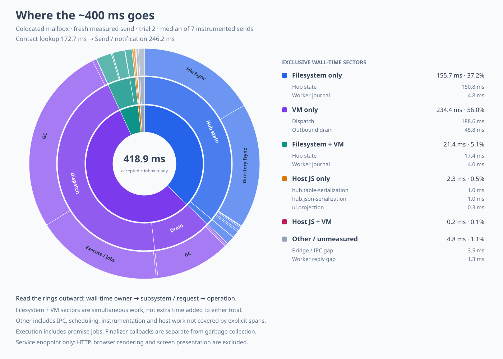

# Fine-grained colocated mail latency

Measured on 18 October 2026 using disposable state, the colocated mailbox experiment, incremental
entry subscriptions, and batched hub head sequences.
The running user's workspace and normal native worker were left unchanged.
The run used Node 22.21.1 on macOS arm64.



The figure uses the median elapsed-time trial of seven instrumented sends: **418.854 ms**.
It ends when both send acceptance and a pushed inbox state are available to the service.
It excludes HTTP, browser rendering, and physical screen presentation.
Every measured trial is retained in the [raw trace](mail-latency-colocated.trace.jsonl).
The [derived data](mail-latency-colocated.json) includes fine operations, counts, causal stages, and
the mutually exclusive wall-time partition used to draw the figure.

## Where the time went

| Exclusive wall-time category | Time |
| --- | ---: |
| VM phases with no simultaneous filesystem operation | 234.394 ms |
| Filesystem operations with no simultaneous VM phase | 155.704 ms |
| Filesystem operations and VM phases running concurrently | 21.439 ms |
| Explicit host JS spans with no simultaneous VM phase | 2.297 ms |
| Explicit host JS spans and VM phases running concurrently | 0.226 ms |
| Other host work, IPC, scheduling, and instrumentation gaps | 4.793 ms |
| Total | 418.854 ms |

These categories partition wall time and can be summed.
The following diagnostic totals include concurrent work and must not be added to that table:

- Hub state replacements: 168.220 ms across 18 replacements.
  File fsyncs occupied 78.494 ms, directory fsyncs 80.429 ms, and the remaining operations 9.297 ms.
- Worker journal appends: 8.813 ms across two appends, including 8.693 ms in file fsyncs.
- VM garbage collection: 175.941 ms across seven collector rounds.
- VM execution and promise jobs: 75.248 ms.
- VM compilation and relinking: 2.535 ms.
- Finalizer callbacks: 2.334 ms across two rounds.
- Hub table construction and JSON serialization: 2.198 ms.
- UI projection: 0.325 ms across two projections.

The interval contains two dispatch evaluations and three outbound-drain evaluations.
An interval can include already queued work; these counts describe the measured interval rather
than a claim that each application send intrinsically needs that number of evaluations.
Collector rounds and finalizer callback rounds are measured separately.
Their elapsed times are not CPU samples.

## An avoidable contact lookup

The causal stages are 172.656 ms resolving the contact, 246.169 ms sending and awaiting its response,
and 0.028 ms of bridge completion.
The web service still calls `E(contacts).get(name)` before `E(book).send(contact, content)`.
The pushed contact stream already supplies those references.
A subsequent change should capture a contact reference when the user selects a recipient and send
an opaque selection token, as the UI already does for included values.
That would remove this extra remote name lookup; the end-to-end saving must be measured afterward.
This investigation does not implement that change.

The dominant persistence cost in this small-mailbox workload is synchronization, not JSON encoding.
The selected send performed 18 hub file fsyncs, 18 directory fsyncs, and two journal file fsyncs.
The existing plan to batch durable delivery ownership remains relevant.

## Collection and checks

The opt-in loader measures hub table serialization, JSON serialization, UI projection, and the two
send stages without editing production modules on disk.
The benchmark's own filesystem powers record individual open, write, fsync, rename, close, and
scratch-removal calls, plus their parent operations.
The timing-only native worker records compilation, execution and jobs, each collector round, and
each finalizer callback round.
The collector and runtime behavior are unchanged.
The profiling patch and original worker hashes are recorded in the raw trace header.

Node and worker events use high-resolution epoch timestamps; worker phase durations use a monotonic
clock anchored to epoch time at each phase start.
Every selected worker phase matched a host request.
The largest overrun outside that request envelope was less than 0.054 ms.
Sub-millisecond differences should nevertheless be treated cautiously.
The analyzer splits the timeline at every event boundary, assigns overlapping work its own sector,
and asserts that the resulting leaves sum to the complete measured interval.
Only 4.793 ms remains outside explicit filesystem, VM, and host spans.

A five-send run with the unchanged worker and the same host instrumentation had a 426.419 ms median.
Its samples were 415, 423, 2,741, 426, and 432 ms.
The seven phase-instrumented sends were 412, 422, 419, 418, 417, 432, and 471 ms.
The median difference is within run-to-run variation; it does not prove zero instrumentation cost.
All trials reported zero worker wakes and zero snapshots.
The 2,741 ms calibration outlier recorded 73 worker deliveries, with no wakes or snapshots.
This capture does not classify that extra activity.
These small samples cannot establish tail latency, and the unchanged-worker outlier is retained.

## Reproducing the capture

From the package directory, with the normal native runtime and guest bundles built:

```sh
python3 scripts/build-mail-profile-worker.py /tmp/mail-phase-worker
THIX_MAIL_PROFILE=/tmp/mail-profile.json \
THIX_MAIL_PROFILE_WORKER=/tmp/mail-phase-worker \
THIX_MAIL_TRIALS=7 \
node --import ./scripts/profile-mail-loader.mjs scripts/measure-mail.mjs colocated
python3 scripts/mail-profile-sunburst.py /tmp/mail-profile.json /tmp/mail-profile-chart
```

The build helper temporarily applies the timing patch and rebuilds the release target, copies the
profiling binary to the requested separate path, and restores the original source and normal binary
in a `finally` block.
It refuses a changed worker source rather than applying its zero-context patch to different code.
Omit `THIX_MAIL_PROFILE_WORKER` for a separate unchanged-worker calibration run.
Run captures sequentially so they do not compete for storage.

The analyzer accepts JSON or the saved JSONL trace and selects the median trial by default.
Use `--trial N` to inspect a particular trial or `--segments` to retain every partition segment.
Regenerating the chart from the saved raw trace reproduces the summary and SVG exactly.
