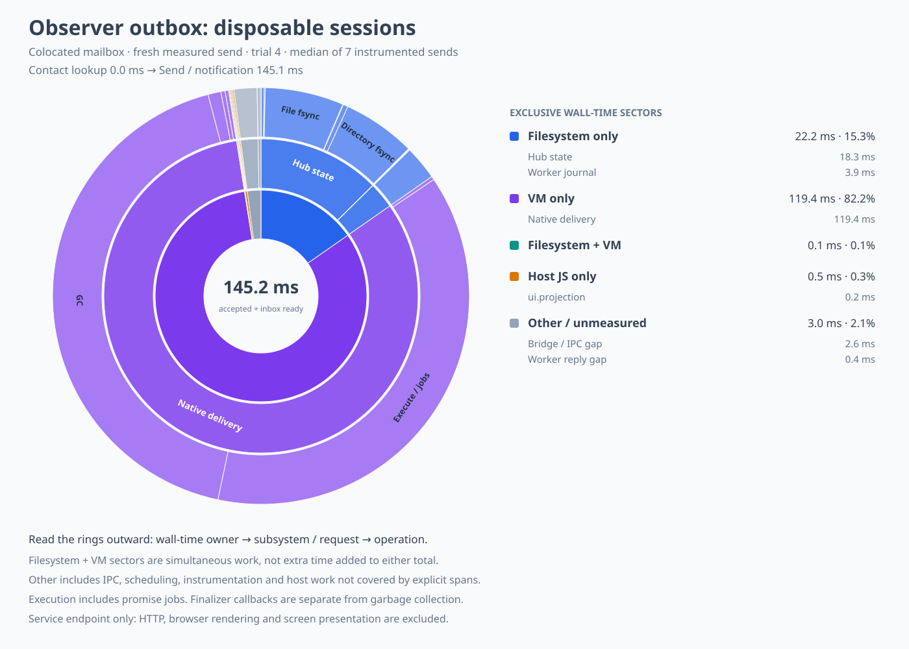
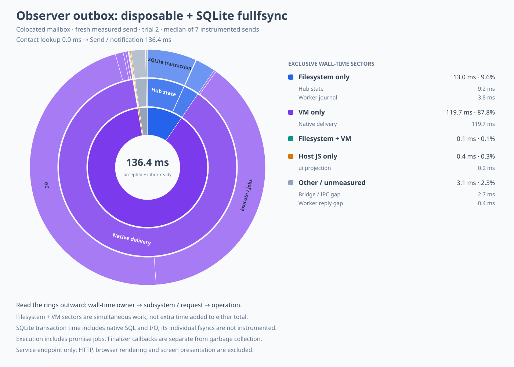

# Disposable observer outboxes and hub storage experiments

Measured on 19 October 2026 after the completed-crank batching changes.
The retained runtime change gives disposable host observers an explicit discard-on-restart outbox
policy, reducing the measured steady mail path to two hub commits and one worker-journal append.
The append-log and SQLite stores remain disposable benchmark backends.

## Results

Every run has three value-bearing seeds and seven measured text self-sends in its own disposable
daemon, with a captured recipient reference, colocated mailbox, pushed state, the same combined
native runtime, and the same updated guest bundle.
Runs are sequential and use no forced host GC, periodic snapshots, or idle sleeps.
Acceptance plus pushed inbox visibility excludes HTTP and browser rendering.
The live daemon, its pinned binary, guest bundle, and state were not modified or restarted.

| Variant | Median accepted + inbox ready | Median hub commits | Median hub persistence |
| --- | ---: | ---: | ---: |
| Previous observer policy, atomic hub | 190.458 ms | 6 | 58.726 ms |
| Disposable observers, atomic hub | 145.162 ms | 2 | 19.266 ms |
| Disposable observers, experimental append log | 132.561 ms | 2 | 9.587 ms |
| Disposable observers, SQLite WAL + FULL + fullfsync | 136.389 ms | 2 | 9.511 ms |
| Previous policy repeated after initial candidates | 186.965 ms | 6 | 55.821 ms |

The atomic-store candidate improves the first control median by 45.296 ms, or 23.8%.
The repeated control still has six steady hub commits and a similar median.
The two faster storage backends have almost identical hub persistence costs once sync strength is
matched; the difference in overall medians is mostly outside hub storage.
These small sequential samples do not establish p99 latency or a SQLite-versus-log winner.

All selected steady-send intervals also contain one worker-journal append and fsync.
The resulting budget is **three host durability commits**, rather than the previous seven.
Atomic hub replacement still has five sync calls: two hub file syncs, two hub directory syncs, and
one journal sync.
The selected append-log interval has three file syncs and no compaction.
SQLite's two transactions are timed as opaque native SQL/I/O intervals; its individual syscalls and
sync counts are not instrumented, and checkpoints can add work.
Native VM heap storage is separate from these host durability counts.
Status probes and GC traffic outside the acceptance/visibility windows are not charged to the
critical-path write counts.

## What the remaining commits do

A targeted trace of the old steady path identifies the six commits as:

| Commit | Durable effect |
| --- | --- |
| 1 | Incoming request routing and the worker's queued input |
| 2 | Completed-crank routing, source replay watermark, and four observer-bound frames |
| 3 | Remove observer frame 1 and assign frame 2's delivery identity |
| 4 | Remove frame 2 and assign frame 3's identity |
| 5 | Remove frame 3 and assign frame 4's identity |
| 6 | Remove the final accepted observer frame |

The four observer-bound frames are three `op:deliver` frames and one `op:gc-exports` frame.
They are not four additional vat invocations.
The observer's session is disposable and never resumes, so durable progress records for that outbox
were unnecessary.
The new path keeps commits 1 and 2 and the journal append between them.
It removes commits 3 through 6 without changing durable worker or resumable peer delivery.

## Runtime policy and replay

Only disposable sessions explicitly select `discardOnRestart`.
The hub requires a `transient:` key, nondurable attachment, no durable-acceptance claim, and an abort
handler.
The embedder must allocate a unique key, never resume or reuse it, and retire old transient sessions
before replaying worker journals at startup.
The daemon already satisfies that lifetime contract for transient clients and native adapters.
A generic `durable: false` session does not imply this policy; the daemon's endpoint is an example
that retains its original behavior.

Routing effects, reference allocations, and the source replay watermark commit before a prefix is
published to the observer.
The hub drains that committed prefix in memory.
Reentrant sends may append new work; that work must commit before the next prefix is published.
Progress is included in the next necessary commit or an explicit flush.
The last on-disk image may therefore contain observer frames that were already delivered.
A daemon restart retires that observer rather than replaying its output into a new incarnation.
The accepted mail still survives in the worker journal and committed hub routing state.

An ambiguous send or a closed receiver ends the observer's incarnation, rather than retrying a
possibly observed prefix.
In-process observers close immediately; native adapters start termination and are forgotten when
that process ends.
Storage refusal before publication still propagates without exposing output.
The policy adds no persisted fields, journal format, timer, or native guest operation.

## Storage comparison and the macOS sync mismatch

The SQLite prototype stores the existing serialized hub state as one row, rather than redesigning
hub tables or joining worker journals into the same transaction.
Its connection uses `journal_mode=WAL`, `synchronous=FULL`, and `fullfsync=ON`, checks that those
settings took effect, and retains default automatic checkpointing.
It uses Node's optional `node:sqlite` driver and is loaded only for that experiment.
Node 20 remains supported by the normal daemon; SQLite experiment tests skip when the driver is
unavailable.
The recorded environment is Node 22.21.1, libuv 1.51.0, and SQLite 3.50.4.

The initial SQLite run used FULL transactions but omitted the separate fullfsync setting.
It appeared to reach a 122.868 ms median with just 0.950 ms in two hub commits.
That is **not accepted as a durability-equivalent comparison on this macOS host**.
Node/libuv requests `F_FULLFSYNC` for its file-sync operation, while SQLite's separate fullfsync flag
is off by default.
Enabling it returned the measured hub commit cost to approximately the append log's cost.
See [libuv 1.51.0's sync implementation](https://github.com/libuv/libuv/blob/v1.51.0/src/unix/fs.c#L158)
and [SQLite's fullfsync setting](https://www.sqlite.org/pragma.html#pragma_fullfsync).
The initial run is retained under an explicitly rejected-comparison label.
Process-kill recovery tests do not themselves simulate power loss; the stronger sync request is
required independently of those tests.

Both experimental backends use an incompatible sidecar layout and leave the original hub JSON
absent or stale.
Neither may open the user's normal state directory.
The SQLite backend closes connections before removing benchmark state and has tests for reopen,
invalid input, corrupt database refusal, and recovery of an uncheckpointed WAL after SIGKILL.
Its whole transaction interval includes native SQL and I/O, not a fabricated per-fsync breakdown.

## Benefit versus complexity

| Change | Benefit shown here | Added complexity | Decision |
| --- | --- | --- | --- |
| Disposable observer outbox | Four fewer steady hub commits; 45.296 ms lower atomic-store median | Explicit lifetime policy and a committed-prefix drain path; reentrancy, abort, and restart tests | Keep |
| Append-log backend | Roughly 10 ms less hub persistence per steady send than atomic replacements | Custom record recovery, framing, compaction, migration, and versioning | Keep experimental |
| SQLite WAL + matched sync | Roughly the same hub persistence cost as the append log | Native driver availability, schema/migration, ownership and checkpoint policy, platform sync configuration | Keep experimental |
| Shared hub/inbox transaction | Would remove the remaining separate journal commit | Store transaction seam, delivery only after commit, rollback handling, snapshot/journal integration | Defer: remaining journal sync is about 4 ms |

The lowest-complexity retained improvement reaches the three-commit target without a new storage
format.
A production storage change could save another roughly 9–10 ms per steady send, but this experiment
does not establish that either backend is worth its migration and maintenance cost yet.
In the faster traces, VM-only work already occupies about 87–88% of the selected interval.
The next larger performance opportunity is the VM's execution and collector work; reducing the
three host commits to two would address a much smaller remaining cost.

## Sunbursts and complete samples



The selected atomic interval is 145.165 ms: VM-only work 119.350 ms, filesystem-only work 22.199 ms,
overlap 0.136 ms, host JavaScript 0.461 ms, and other work 3.019 ms.
Two hub replacements occupy 18.269 ms and the journal append occupies 4.023 ms.
Native phase totals include 54.816 ms in execution/jobs and 61.819 ms in two collector passes.
Those diagnostic totals overlap the wall-time partition and must not be added to it.



The selected SQLite interval is 136.391 ms: VM-only work 119.709 ms, filesystem/storage-only work
13.047 ms, overlap 0.087 ms, host JavaScript 0.447 ms, and other work 3.101 ms.
Its two opaque SQLite transactions occupy 9.173 ms; the journal append occupies 3.891 ms.
The [append-log figure](mail-observer-outbox-log.svg) has a 132.563 ms interval with 115.400 ms of
VM-only work and 13.399 ms of filesystem-only work.
The [control](mail-observer-outbox-control.svg),
[repeated control](mail-observer-outbox-control-repeat.svg), and
[largest atomic candidate sample](mail-observer-outbox-atomic-burst.svg) are retained too.

The first partial-path candidate enabled the policy only on in-process clients.
The mail control connection actually traverses a disposable native adapter process.
That candidate retained six commits and a 188.330 ms median; applying the policy to the actual native
adapter path produced the retained improvement.
Its [figure](mail-observer-outbox-host-only.svg) and every sample remain available.

| Run order | Every sample, rounded to milliseconds |
| --- | --- |
| Control | 193, 733, 190, 189, 189, 196, 190 |
| In-process clients only | 191, 845, 184, 186, 193, 187, 188 |
| Disposable policy, atomic | 144, 145, 477, 145, 145, 147, 147 |
| Disposable policy, append log | 139, 138, 129, 131, 132, 133, 133 |
| Initial SQLite, excluded durability comparison | 123, 121, 122, 122, 136, 124, 157 |
| Repeated control | 185, 938, 186, 187, 193, 189, 187 |
| SQLite with matched sync | 140, 137, 136, 135, 135, 135, 136 |

All samples report zero worker wakes and zero snapshots.
Spontaneous GC outliers remain, including 477 ms in the atomic candidate and 938 ms in the repeated
control; this is not evidence of improved tail latency.
Each figure has a neighboring JSON breakdown and a JSONL trace retaining all seven trials.

## Reproduction

Run sequentially from `packages/thixotrope`, with separate native and guest artifacts:

```sh
THIXOTROPE_IRONHORSE_WORKER=/tmp/mail-combined-worker \
THIX_MAIL_BOOT_DIR=/tmp/mail-gc-batched-boot-final \
THIX_MAIL_OBSERVER=disposable \
THIX_MAIL_HUB=atomic \
THIX_MAIL_TRIALS=7 \
THIX_MAIL_PROFILE=/tmp/mail-observer-trace.json \
THIX_MAIL_PROFILE_WORKER=/tmp/mail-combined-profile-worker \
node --import ./scripts/profile-mail-loader.mjs scripts/measure-mail.mjs colocated
```

Use `THIX_MAIL_OBSERVER=durable-progress` for the old-policy control.
Use `THIX_MAIL_HUB=log` or `sqlite` for the disposable storage comparisons.
The SQLite experiment now always requires the stronger fullfsync setting; the rejected setting is
not a runtime option.
The loader changes policy only in the measurement process for the control ablation.

Generate a median figure from its saved trace with:

```sh
python3 scripts/mail-profile-sunburst.py \
  designs/mail-observer-outbox-atomic.trace.jsonl \
  /tmp/mail-observer-outbox-atomic \
  --label 'Observer outbox: disposable sessions'
```


## Validation

Package lint/typechecking pass with the existing 229 warnings and no errors.
The clean workspace declaration build and fourteen type-contract suites pass.
Fifty-four affected JavaScript tests pass in each of the three SES configurations.
They cover ordinary durable replay and gift ordering, disposable failure before publication,
ambiguous prefix delivery, explicit flush, reentrant output, stale-observer startup cleanup, actual
native adapter lifecycle, and experimental SQLite recovery.

Eight native tests pass, including four SIGKILL boundaries, pending-call recovery before hub
acceptance, collector-driven answer cleanup, completed-crank reclamation, and a real daemon SIGKILL
with orphaned HTTP observers, accepted guest effects, and durable listeners.
The SQLite test also kills a separate process with an uncheckpointed committed WAL and recovers
its last snapshot through a new connection.
These process-crash tests do not replace the storage sync contract or constitute power-cut testing.

Repository documentation generation retains the prior 102 errors and 190 warnings; its TypeScript
diagnostic lines match the previous capture.
All eight new figures reproduce from their saved JSONL traces and their exclusive sectors sum to
the measured interval.
The atomic and SQLite figures were rendered and inspected, and an earlier figure still reproduces
byte-for-byte with the updated analyzer.
Normal native and guest-bundle hashes are unchanged.

## Adversarial review follow-up

The review reproduced a liveness failure when a disposable observer's abort hook throws.
The source watermark and remaining receiver queue were durable, but the exception interrupted
flushing unrelated receivers until another operation or restart.
Abort-hook failures are now logged and contained, matching the existing frame-error path.
Receiver publication still requires its own successful before-wire persistence.
Three regression cases cover a throwing hook, a one-shot cleanup persistence failure, and
persistent cleanup refusal followed by retry with the original delivery identity.
The new cases failed before the fix; the five focused suites pass afterward in all three SES
configurations (30 tests per configuration).

The review found no demonstrated native lifetime violation from buffered input before process
exit: the documented incarnation remains live until `onExit`.
Deferred or rejected termination remains a useful adapter coverage addition, especially for
pre-exit input acceptance, post-exit rejection, and isolation of the next incarnation.
