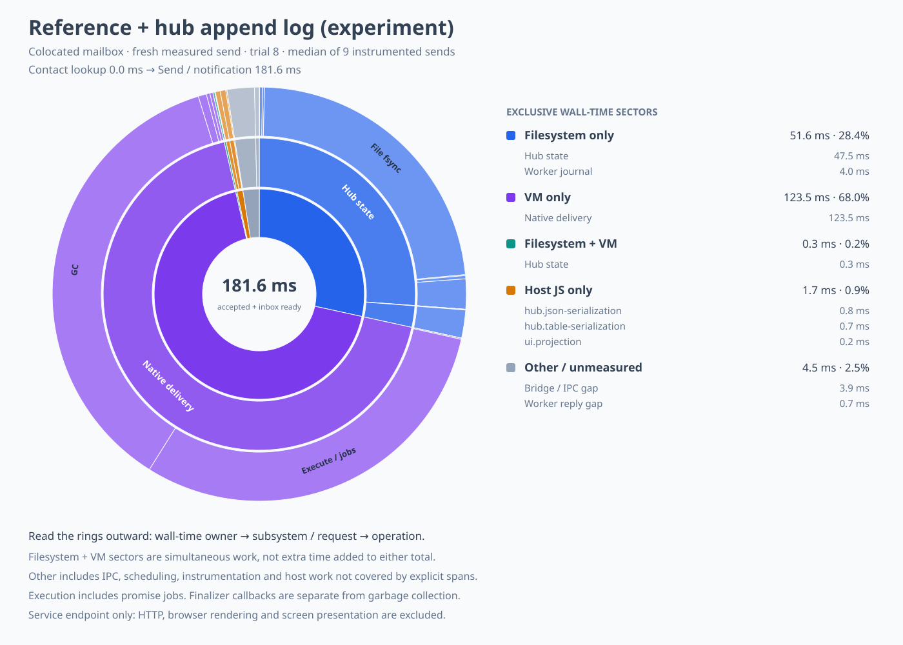

# Mail optimization strategies: references, hub logs, and GC traffic

Measured on 18 October 2026 after the [combined native delivery experiment](mail-latency-colocated.md).
All runs use the same combined native worker, three seed messages, nine measured text self-sends,
a colocated mailbox, pushed entry subscriptions, and disposable daemon state.
There are no periodic snapshots or idle sleeps in these trials.
The endpoint requires both send acceptance and pushed inbox state; HTTP and browser rendering are
excluded.
The running user's daemon, workspace, durable URL, and pinned native binary were left unchanged.

## Results

| Strategy | Median accepted + inbox ready | Median hub commits | Median time in hub persistence |
| --- | ---: | ---: | ---: |
| Name lookup, atomic hub replacements | 362.057 ms | 16 | 153.043 ms |
| Captured recipient reference, atomic hub | 228.682 ms | 10 | 96.570 ms |
| Captured reference, experimental hub append log | 181.643 ms | 10 | 49.482 ms |

The reference path is 36.8% faster than the fresh control median.
The log prototype improves on that median by another 20.6%, for 49.8% relative to the control.
These are small sequential comparisons, not randomized trials or tail-latency estimates.
The log result still makes ten synchronous hub commits and does not meet the one-to-three-write
expectation or the provisional 50–100 ms target.

An initial reference-only run had a 422.881 ms median and is retained rather than discarded.
Its selected interval spent 265.310 ms in ten hub replacements, versus 94.643 ms for ten
replacements in the repeated reference capture.
Filesystem latency varied substantially while the operation count stayed low.
The subsequent control and repeat make that confound visible; removing an RPC cannot be credited
with every difference between noncontemporaneous wall-time measurements.

| Run order | Every sample, rounded to milliseconds |
| --- | --- |
| Reference, first noisy run | 229, 1530, 368, 423, 419, 480, 424, 429, 252 |
| Name-lookup control | 3775, 362, 360, 362, 361, 359, 367, 354, 371 |
| Reference + hub log | 182, 168, 187, 174, 191, 173, 191, 173, 182 |
| Reference repeat | 229, 419, 421, 1300, 224, 227, 224, 228, 231 |

All samples report zero worker wakes and zero snapshots.
The absence of an outlier in nine log sends does not establish improved tail latency.

## Strategy 1: capture the recipient reference

The contact entry stream already grants the service the contact reference.
The service now gives the browser an opaque recipient token and retains that reference.
The composer sends `{ token }`; it no longer resolves a contact name before sending.
Labels remain presentation data, and rename or replacement cannot redirect a composed message.
Unknown recipient tokens are refused, and value-attachment tokens are authorized separately.
The older string-name bridge call remains available for compatibility and for the control run.
Old persisted objects without entry streams resolve references during their legacy snapshot.

The control's selected interval has a 138.608 ms remote lookup followed by 223.420 ms for sending.
The selected reference interval has no contact-lookup stage.
The browser host and HTTP bridge pass the recipient selection through without granting the contact
object to the confined UI.
Tests cover replacement, rename, unknown selections, no remote reread on the push path, and HTTP
transport of the selection.

[Reference sunburst](mail-strategy-reference.svg), [derived data](mail-strategy-reference.json),
and [all nine raw trials](mail-strategy-reference.trace.jsonl).
The [noisy first run](mail-strategy-reference-noisy.trace.jsonl) and its
[derived data](mail-strategy-reference-noisy.json) are also retained.

## Strategy 2: append full snapshots instead of replacing the file each time



The opt-in `scripts/mail-hub-log.mjs` wrapper appends complete JSON snapshots to a bounded log.
Every append still fsyncs before returning; disk-before-delivery ordering is retained.
Creation and compaction use a synced atomic replacement, including directory synchronization.
The default bounds are 64 records or four million JavaScript string code units, with one complete snapshot retained
when a single record exceeds that size threshold.
A torn final line is ignored and atomically repaired before the next append.
Malformed complete records fail closed.
A failed append invalidates the cache so retries cannot append behind an unrepaired tear.

In the selected log trial, nine commits append and one compacts.
The native phase total is about 124 ms, including 65.994 ms in two collector rounds and 55.222 ms
executing guest code and promise jobs.
Only about 52 ms of wall time is spent solely in filesystem operations.
The remaining VM cost is now dominant.

This is a disposable benchmark format, not an enabled production storage migration.
The normal `hub.json` reader does not understand the experimental sidecar log.
The harness confines it to a temporary daemon and removes that directory at completion.
Promotion needs an explicit storage-format/version gate and a complete power-loss and restart
matrix; a normal daemon must never silently read the stale legacy checkpoint instead.
The prototype repeats complete snapshots, so it has not solved history-dependent serialization or
byte amplification.
A transactional delivery ledger or grouped log records remain different experiments.

Recovery tests cover a partial append, a complete append followed by an error, failed compaction,
entry-count compaction, restart reading, legacy-checkpoint loading, and malformed complete records.
[Log derived data](mail-strategy-hub-log.json) and [all raw trials](mail-strategy-hub-log.trace.jsonl).

## The outliers are reference-reclamation traffic

The 3,774.688 ms control outlier contains 76 native requests:
67 incoming `op:gc-answers`, seven `op:gc-exports`, and two application `op:deliver` frames.
It performs 193 hub replacements and 76 worker-journal appends.
Native GC occupies 1,571.616 ms across 80 collector rounds; that is an overlapping phase total.
The mutually exclusive wall partition instead attributes 2,181.090 ms to filesystem work alone,
1,026.838 ms to VM work alone, 272.185 ms to parallel VMs, and the rest to overlap or host work.
The 1,300.393 ms reference-repeat outlier similarly contains 48 incoming `gc-answers` frames and
two application deliveries.

[Outlier sunburst](mail-strategy-gc-burst.svg) and [outlier data](mail-strategy-gc-burst.json) use
trial zero of the [control trace](mail-strategy-control.trace.jsonl).
The [control median chart](mail-strategy-control.svg) and [data](mail-strategy-control.json) provide
the steady-work comparison.
The first noisy capture predates operation-tag instrumentation; it has timing spans but no such tags.

This identifies the traffic amplifier, but not the initiating collector/event that determines when
the burst starts.
The client collection hook currently emits one-element plural GC messages, and the hub releases
answer rows by emitting another message for each released row.
Both GC operations already carry lists on the wire.
The next high-value experiment is batching these notifications at both boundaries, preserving
ordering relative to ordinary calls, per-reference deltas, and durable replay identities.
Batching only the client is insufficient if the hub expands the list back into singleton frames.
An inbound durable batch must be accepted before its sender releases ownership, and replay must
not decrement an export twice.
This experiment has not changed collector policy or implemented that batching yet.

## Reproduction and validation

From the package directory, with the combined worker and matching timing-only worker built:

```sh
THIX_MAIL_RECIPIENT=name THIX_MAIL_TRIALS=9 \
THIX_MAIL_PROFILE=/tmp/control.json THIX_MAIL_PROFILE_WORKER=/tmp/mail-phase-worker \
node --import ./scripts/profile-mail-loader.mjs scripts/measure-mail.mjs colocated

THIX_MAIL_TRIALS=9 THIX_MAIL_PROFILE=/tmp/reference.json \
THIX_MAIL_PROFILE_WORKER=/tmp/mail-phase-worker \
node --import ./scripts/profile-mail-loader.mjs scripts/measure-mail.mjs colocated

THIX_MAIL_HUB=log THIX_MAIL_TRIALS=9 THIX_MAIL_PROFILE=/tmp/log.json \
THIX_MAIL_PROFILE_WORKER=/tmp/mail-phase-worker \
node --import ./scripts/profile-mail-loader.mjs scripts/measure-mail.mjs colocated

python3 scripts/mail-profile-sunburst.py /tmp/log.json /tmp/log-chart \
  --label 'Reference + hub append log (experiment)'
```

Set `THIXOTROPE_IRONHORSE_WORKER` if the matching normal combined binary is in a separate path.
Run captures sequentially; do not run builds or tests during the measured sends.
Every capture's JSONL header retains its samples, native binary hashes, and source commits.
Profiler windows include a few microseconds of timing bookkeeping beyond the reported visibility
metric; the chart totals therefore differ slightly from the comparison table.
Worker phase times overlap host work and are not CPU samples.
All 36 captured trials partition exactly and match every native phase to a request.
The maximum observed request-envelope overrun is 0.680 ms.
Operation tags record only the outer wire operation, not message payloads.
Request-envelope matching permits one millisecond of cross-process clock skew and still reports
the actual maximum overrun; concurrent activity gets its own sunburst sector.

The 15 mail UI and log-recovery tests pass in all three SES configurations.
Package lint and typechecking pass.
Root lint fails on project-service inclusion errors in other packages, including `lal` and
`module-source`, and a missing `@eslint/js` dependency in the Moddable checkout.
Changed Thixotrope files report no lint errors.
The root documentation build retains the existing 102 errors and 190 warnings elsewhere.
