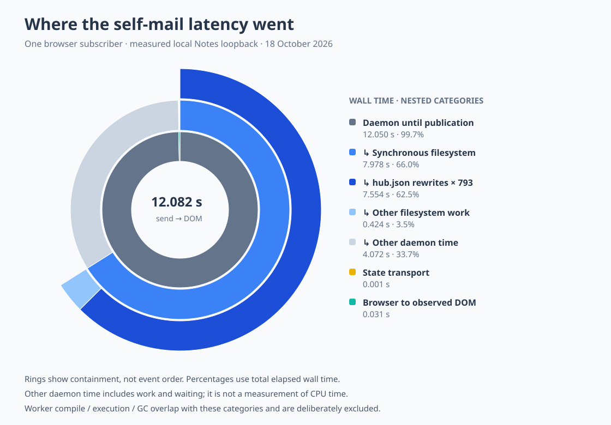

# Desired change: incremental mail UI subscriptions

Status: the first implementation consumes incremental entry streams on newly created objects.
Existing durable objects retain a shared legacy fallback until they can be migrated.
The browser still receives complete projected views; incremental browser payloads remain desired.

Consume daemon object subscription payloads incrementally and retain the resulting mail UI state.
Preact should render pushed state through its existing subscription effect and state hooks.
The server-side bridge currently treats notifications as invalidations, rereads both folders and
their contact and value references, and discards a completed projection if another event arrives.
Replace that full-rebuild loop with an initial state followed by incremental updates from mailbox,
inventory, contact-map, and contact-status subscriptions.
Add or extend subscription interfaces where their payloads cannot express the required updates.
Inventory renames should update displayed value names without rereading message contents.
Share the maintained projection across browser subscribers for the same workspace.
Preserve initial-state ordering, reconnect behavior, and subscription cleanup.

## Measured motivation

An instrumented local Notes self-send on 18 October 2026, with one browser subscriber and
9–11 messages per folder, took 12.082 seconds from send to observed DOM update.
Send acceptance took 750.45 ms and the inbox notification arrived after about 850 ms.
The first full projection finished after 6.477 seconds but was discarded.
Its replacement was published after 12.050 seconds.
State reached the browser after 12.051 seconds, and the message was observed in the DOM after
12.082 seconds using animation-frame callbacks; this does not measure physical screen presentation.

Within the 12.050-second daemon interval, synchronous filesystem operations occupied 7,977.80 ms.
Of that, 793 complete hub-state rewrites occupied 7,553.75 ms.
Other synchronous filesystem operations occupied 424.05 ms.
The remaining 4,072.20 ms of daemon wall time is unpartitioned work and waiting.
The chart groups durations by containment, not chronological order.
These filesystem durations exclude JSON serialization before entering the filesystem wrapper.

There were 95 worker deliveries, 187 sampled VM evaluations, zero worker wakes, and zero snapshots.
Aggregate worker phase times were 107.37 ms compiling, 2,148.04 ms executing, and 4,437.06 ms in GC.
Those worker totals overlap across processes and with host filesystem operations, so they must not
be added to the wall-time chart or interpreted as its remaining time.
Temporary instrumentation was removed after measurement.

Reducing UI reads addresses one source of amplification.
Batching durable hub bookkeeping is a separate desired optimization: preserve replay and
disk-before-wire guarantees while avoiding a full synchronous hub-state rewrite per submutation.
