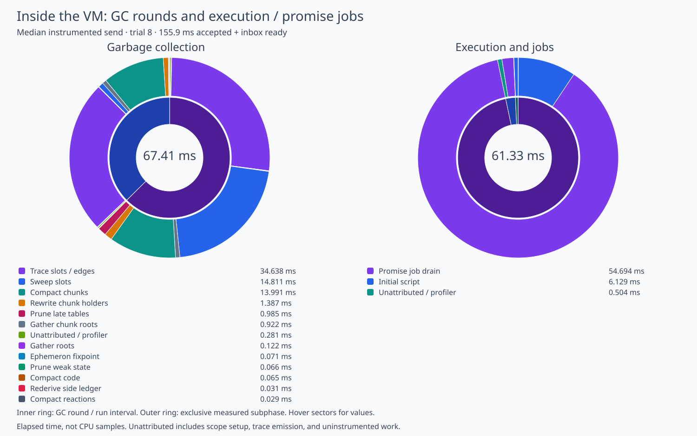

# Inside mail's native GC and promise jobs

Measured on 19 October 2026 in an isolated worktree based on `75afe09d3`.
This experiment adds opt-in timing only; it changes no collection, finalizer, job,
replay, metering, or persistence schedule.
The production VM source and live daemon remain unchanged.

## What the detailed median shows

The selected send takes **155.870 ms** from acceptance start to accepted and pushed
inbox state.
It has two hub commits and one worker-journal append, with no snapshot or wake.
The overall wall partition assigns 128.946 ms exclusively to the VM, 21.922 ms to
filesystem work, 0.828 ms to concurrent filesystem/VM work, 0.542 ms to host JS, and
3.632 ms to other work.
These sectors sum to the measured interval; diagnostic VM totals include overlap.

The initial `execution-and-jobs` interval is **59.299 ms**:

| Measured component | Time | Count |
| --- | ---: | ---: |
| Initial guest script dispatch | 5.718 ms | One script |
| Promise-job drains | 53.545 ms | 51 reaction jobs; zero thenable jobs |
| Unattributed interval remainder | 0.036 ms | Scope/trace overhead and other run work |

The queue is the main execution cost center: about 90% of this interval occurs
inside the promise-job drain.
That includes the handlers' interpreter and native builtin work and promise
settlement, not just queue manipulation.
There is no per-job or per-opcode clock.
The drain counter counts jobs removed from the queue, including jobs without a
JavaScript handler; it does not assert that all 51 jobs execute equal work.
The sum divided by job count is not a per-handler CPU measurement.
Native builtin time versus bytecode dispatch remains opaque.

After execution, collection takes **67.411 ms** in two distinct rounds:

| Measured component | First round | Second round | Total |
| --- | ---: | ---: | ---: |
| Mark worklist: slot and side-table edges | 18.025 ms | 16.613 ms | 34.638 ms |
| Slot sweep, including each reclaimed slot's table hook | 14.260 ms | 0.551 ms | 14.811 ms |
| Chunk compaction | 7.291 ms | 6.700 ms | 13.991 ms |
| Rewrite moved chunk holders | 0.830 ms | 0.557 ms | 1.387 ms |
| Late side-table pruning | 0.915 ms | 0.070 ms | 0.985 ms |
| Gather live chunk offsets | 0.469 ms | 0.452 ms | 0.922 ms |
| All other measured phases and explicit remainder | 0.380 ms | 0.298 ms | 0.678 ms |
| **Collector total** | **42.171 ms** | **25.240 ms** | **67.411 ms** |

Each round gathers 901 roots and visits about 49,500 marked slots and 80,400
outgoing slot/side-table edges.
Each takes three mark/ephemeron fixpoint passes.
The ephemeron scans propose 248 edges in each round and together cost 0.071 ms;
weak-state pruning costs another 0.066 ms.
The sweep scans an arena with capacity 345,550 slots in both rounds, reclaiming
36,577 slots first and 568 second.
The compactor receives roughly 16,690 live chunk offsets each time; those counts
can contain duplicate offsets.
The first round rewrites 192 moved chunk-offset mappings; the second rewrites two.
The mapping count is not a byte count.

Between those two collections, finalization takes **1.589 ms**, including three
additional reaction jobs costing 1.149 ms.
The remaining 0.440 ms includes registry cleanup plus uninstrumented run setup and
trace emission; the current spans do not isolate callback bodies from that work.
Outbound extraction then takes 0.440 ms, including 0.411 ms of script dispatch.
The companion figure includes those small execution intervals in its right-hand
ring, so its total is 61.327 ms rather than the initial run's 59.299 ms.



[Complete exclusive wall-time sunburst](mail-vm-detail-wall.svg) and the
[per-round counters and spans](mail-vm-detail.json) retain the remaining phases.

## Accounting boundaries and optimization implications

GC spans are siblings within a collector round.
Mark traversal includes slot edge enumeration, side-table `extra_edges`, vector
allocation, mark checks, and worklist operations; it does not separately identify
which of those operations dominates.
Slot sweep includes the `hooks.swept` work for each reclaimed slot.
Late pruning includes building the dead-slot set and dropping the borrowed hooks.
Chunk compaction remains opaque internally.
Those are useful next instrumentation boundaries before selecting an algorithm.

The small phases are not promising primary targets in this sample: root gathering,
ephemerons, weak pruning, reaction/code compaction, and the side-storage ledger
together account for well under a millisecond.
Both rounds retrace almost the same live graph and compact almost the same live
chunk set, but the second round is required by existing finalizer semantics.
This experiment does not justify skipping it or changing its schedule.

VM GC occurs after initial execution/jobs, and finalizer work lies between GC
rounds; those coarse sectors do not nest into the initial execution interval.
There is no shared-graph persistence, checkpoint, or SQLite heap commit in this
steady send: the worker commits its heap on close, and recovery uses the last
image plus the host journal.
The host's atomic hub/journal fsyncs remain separately measured.
No absence of checkpoint cost during a send implies that snapshots or shutdown
are free.

## Overhead and limitations

Both runs use the same newly built binary, with the detailed clock/trace switch
absent for the control and `THIX_MAIL_VM_DETAIL=1` for the detailed capture.
Each uses a fresh disposable daemon, three value-bearing seed messages, and nine
sequential text self-sends with a captured recipient reference and pushed state.
There is no forced host GC, periodic snapshot, idle sleep, HTTP, or browser stage.
All samples are retained in the raw traces.

| Same-source condition | Median accepted + inbox ready | Median initial execute/jobs | Median GC total |
| --- | ---: | ---: | ---: |
| Detail disabled | 156.188 ms | 56.772 ms | 68.567 ms |
| Detail enabled | 155.862 ms | 58.052 ms | 65.797 ms |

The observed overall median difference is -0.326 ms (-0.21%), within run noise.
The execution subgroup median is 1.280 ms higher with detail, while GC is lower;
these sequential samples do not establish a tight overhead bound or zero cost.
The control has two large GC outliers (including a 651 ms send), so aggregate means
are particularly unsuitable for attributing profiler overhead.
Counters and disabled scope checks remain in the instrumented control binary;
this comparison isolates enabling the fine timers and trace emission, not every
code-generation effect of adding instrumentation.
No production latency improvement is claimed.

Intervals are elapsed wall time, not CPU samples.
The analyzer partitions each coarse interval into sibling detail spans and an
explicit uncovered remainder, asserting that measured siblings do not overlap.
Cross-process clock alignment stays within the existing 1 ms tolerance (maximum
0.925 ms); very short subphase timings should be read as approximate.
Counts and scope definitions are more reliable than sub-millisecond rankings.
The live user's native binary, guest bundle, and daemon state were not modified.

## Reproduction and validation

The timing implementation is stored as an experimental source patch rather than
compiled into normal VM builds.
The builder applies the patch temporarily, builds into an explicitly separate
Cargo target directory, copies the resulting binary, and restores every source
in `finally`, including deleting the added instrumentation module.
It never rebuilds over the normal production worker.
Run from the repository root:

```sh
python3 packages/thixotrope/scripts/build-mail-vm-detail-worker.py \
  /tmp/mail-vm-detail-worker --target-dir /tmp/mail-vm-detail-build
THIX_MAIL_VM_DETAIL=1 \
THIXOTROPE_IRONHORSE_WORKER=/tmp/mail-vm-detail-worker \
THIX_MAIL_PROFILE_WORKER=/tmp/mail-vm-detail-worker \
THIX_MAIL_BOOT_DIR=/tmp/mail-gc-batched-boot-final \
THIX_MAIL_TRIALS=9 THIX_MAIL_PROFILE=/tmp/mail-vm-detail.json \
node --import ./packages/thixotrope/scripts/profile-mail-loader.mjs \
  packages/thixotrope/scripts/measure-mail.mjs colocated
python3 packages/thixotrope/scripts/mail-vm-detail.py \
  /tmp/mail-vm-detail.json /tmp/mail-vm-detail
```

Repeat without `THIX_MAIL_VM_DETAIL` for the same-source disabled control.
The guest override must point to the separately built trusted updated guest;
normal `dist-ironhorse` is deliberately untouched.
The saved traces contain the source base, binary/guest hashes, and method.
The measured profile worker SHA-256 is
`f79f5afc75e3a98ab755fd498a6970c9c57a095a3ce3cb646445531bb0f4c691`.
The peer bundle SHA-256 is
`7056a4f5c2372d696fed16c2ebb67de4a953664fb1b789ab44cbdcd5043aa252`.

All 17 existing native worker tests pass with detailed profiling enabled and again
with it disabled, including combined delivery, finalizer cascades, halt budgets,
restore, and close-only heap commits.
Exclusive-accounting assertions pass for all nine detailed trials.
The figures are reproduced from saved JSONL and inspected after SVG rasterization.

Raw data: [enabled](mail-vm-detail-enabled.trace.jsonl),
[disabled](mail-vm-detail-disabled.trace.jsonl).
